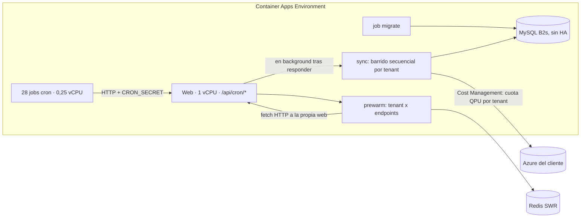

# Auditoría de arquitectura — 2026-10-10

Ingeniería inversa de toda la plataforma: arquitectura y flujo de datos, malas decisiones, lógica
duplicada, cuellos de botella, riesgos de escala y de mantenimiento. **No cambia funcionalidad.** Las
mejoras de código de esta entrega son refactors verificados (sección 8); el resto queda como estrategia
priorizada (sección 7), con las decisiones de producto separadas de las técnicas.

## 0. Cómo leer este documento

- **Estados.** **MEDIDO**: lo medí yo contra producción, un build o un navegador (el comando está en el
  apéndice). **LEÍDO**: lo comprobé leyendo el código. **DEL AGENTE**: lo reportó un análisis de solo
  lectura y no lo reproduje. **HIPÓTESIS**: razonable pero sin medir.
- **Método.** Cinco análisis de solo lectura en paralelo (arquitectura y flujo, capa de datos, duplicación,
  integración con Azure, frontend) más mediciones propias en Azure Monitor, Log Analytics, `az`, el build y
  un navegador real. En este repo ya pasó que 4 de 6 hallazgos de infraestructura se cayeron al medirlos:
  por eso lo que importa está medido, y **donde un agente o yo nos equivocamos se dice** (sección 6: cinco
  correcciones a los análisis y dos a mis propias hipótesis).
- **Alcance.** No se ejecutó `EXPLAIN` ni se escribió en ninguna base. De producción solo se leyó (Azure
  Monitor, Log Analytics, `az`, `curl` a páginas públicas).

## 1. Resumen ejecutivo

1. **Hoy la plataforma está casi ociosa en promedio** (1 réplica web al 1% de CPU, MySQL con 0,84 GB y 4% de
   CPU, 0,13 req/s), **pero hay tres defectos vivos que ninguna métrica de infraestructura muestra** (Z0): el pool
   de MySQL se desborda en ráfagas (≈9.900 errores en 30 días; **corregido**), los 5 tenants Enterprise se
   re-escanean cada 20 min para devolver una lista vacía, y seis de las ocho capacidades del resumen de IA fallaban
   siempre por columnas que no existen (**corregido**). El resto de los problemas de escala son **techos de diseño**; los de
   mantenimiento ya se pagan todos los días.
2. **El primer muro de la ingesta es Cost Management, no la capacidad de la infraestructura.** El barrido diario tarda 30 a 47
   min con solo **5 tenants** (el job se corta a los 60) y en 7 de 8 días entre 1 y 3 tenants terminan
   «colgados» por 429. `prewarm-dashboard` termina **parcial en el 20%** de sus ejecuciones. El diseño
   alcanza para unos **7-8 tenants**, no para los ~50 que estimaban los análisis ni los ~23 del comentario del código.
3. **Cada usuario descargaba 194 KB gzip de datos de demo** (el 96% de las páginas). **Corregido**: ahora
   0 de 252 páginas lo cargan y la home baja de 458 a 288 KB gzip (−37%), medido en build y en navegador.
4. **Cada carga completa de página manda ~300 KB gzip de traducciones** (el JSON entero de i18n incrustado
   en el HTML, incluso en el login). Medido; la solución es por sección y queda como estrategia.
5. **El plan comercial no se hace cumplir en el servidor** en 59 de 99 APIs de pantallas Business/Enterprise:
   solo lo valida la UI. Registrado con un test; qué rutas deben exigir plan es decisión de producto.
6. **15 rutas de cron existen y ningún job de producción las invoca** (`addon-expiry`,
   `storage-retention-cleanup`, `idle-resources-alerts`…).
7. **Redis se rendía para siempre tras 3 reintentos** (1,2 s). **Corregido** para producción; hubo 2 resets
   en 14 días y 1 corte de MySQL de ≥30 s el 2026-10-04 (sin HA).
8. **El código se repite en moldes enteros**: 312 formas de responder un error, 35 `buildFetcher`, 29 rutas que
   leen el tier a mano con 4 semánticas. Dos copias **ya divergieron** y se nota.
9. **Lo bien hecho** (no tocar): el guard central de auth, los tests que derivan sus listas del árbol de
   fuentes, el cron como código, el SWR con TTL blando/duro, y el núcleo del limitador de Azure.

## 2. Arquitectura

### 2.1 Qué es

SaaS multi-tenant que lee Azure **en nombre de cada cliente** (Cost Management, Resource Graph, ARM, Graph),
lo normaliza y lo muestra con gobernanza y recomendaciones. Next.js 16 (App Router) + TypeScript; MySQL
Flexible Server; Redis (SWR); Azure Container Apps (web + 28 jobs cron + 1 job de migración); Terraform por
*stamp* regional; Key Vault para secretos de plataforma y credenciales de tenants.

| Capa | Tamaño | Responsabilidad real |
|---|---|---|
| `src/app/[locale]` + `src/components` | 250 páginas, 292 componentes | UI. 62 archivos ≥1000 líneas (56 son paneles de `components/`) |
| `src/app/api` | 488 `route.ts` (634 handlers) | Debería ser borde HTTP; **237 hacen SQL directo** y 250 ramifican por demo |
| `src/services` | 170 archivos | Lógica de negocio, cuando la ruta no la absorbe |
| `src/lib` | 163 archivos | Auth (`requestAuth`), caché, Azure, helpers |
| `src/modules` | 36 archivos | Colectores de Azure y almacenamiento (`db.ts`) |
| `infra/terraform` | ~7k líneas | Stamp, Container Apps, jobs, MySQL, Redis, Key Vault |

Dependencias reales: `app/api → services → lib → modules`, **pero las rutas se saltean los servicios y van
al pool** (1.032 `pool.query`: 553 en `app`, 371 en servicios, 67 en `lib`, 41 en `modules`). Inversiones: `lib→services` 5 archivos,
`modules→services` 1, `services→app` 1, `modules→app` 1, `lib→app` 1. No hay ciclos de importación.

### 2.2 Flujo de una request

```mermaid
sequenceDiagram
    autonumber
    actor U as Usuario
    participant E as Cloudflare / Front Door
    participant P as proxy.ts (next-intl + CSP)
    participant T as TenantProvider (cliente)
    participant R as route.ts
    participant A as requestAuth.ts
    participant C as Redis (SWR)
    participant S as services y colectores
    participant D as MySQL
    participant Z as Azure del cliente

    U->>E: HTTPS
    E->>P: request (el matcher excluye /api: sin auth en el borde)
    P-->>U: HTML + ~300 KB gzip de traducciones + JS
    U->>T: elige tenant; token MSAL (getFreshIdToken, 'demo' sin cuenta)
    T->>R: fetch /api/... con Bearer
    R->>A: requireTenantAccess / Role / Tier
    A->>D: membresía, rol y tier (un SELECT por llamada)
    R->>C: getWithStaleWhileRevalidate(clave)
    alt hit fresco
        C-->>R: payload
    else miss (ahora con un solo fetch por clave y proceso)
        R->>S: fetcher()
        S->>Z: credencial por tenant + consulta
        S->>D: lectura o escritura (pool 10, cola 20)
        R->>C: guarda envelope
    end
    R-->>T: JSON
```

- **No hay auth en el borde**: cada `route.ts` se defiende sola y `guardRutasApi.test.ts` lo vigila.
  `requireTenantAccess` es un único *choke point* con *deny-by-default* (membresía en `Users`, alcance por
  usuario, superadmin, cron con hash SHA-256).
- **Demo en tres capas**: `window.fetch` parcheado en `TenantProvider`, rama `isMockTenant` en 250 rutas y en
  162 componentes. Por eso `isMockTenant` era el nodo más conectado del grafo (1.078 aristas).
- **Credenciales de Azure por tenant**: `getAzureCredential` → modelo de acceso (Lighthouse o App
  Registration) → Key Vault con caché 30 min fresco / 24 h respaldo → `new ClientSecretCredential` por llamada.

### 2.3 Ingesta y jobs



El job hace un `fetch` a `/api/cron/<job>` **de la misma web que atiende a los usuarios**. Como el ingress
de Container Apps corta a ~240 s, el sync «dispara y consulta»: responde de inmediato y **sigue trabajando en
segundo plano dentro de la réplica web**; el job consulta el estado por polling. Es una decisión documentada
en `cron/sync/route.ts` (reusar pool, servicios y guards) y razonable hoy; es también el origen de varios
riesgos de la sección 4.

## 3. Producción, medida (7 días, Azure Monitor y Log Analytics)

| Recurso | Medido | Lectura |
|---|---|---|
| Web | 1 réplica toda la semana (1 vCPU / 2 GiB, autoscale 1-5 a 40 req concurrentes). CPU prom 1,1% (pico 0,33 vCPU), memoria pico 0,49 GiB, 0 reinicios, 77.500 req/7 d (0,13 req/s) | Ociosa |
| MySQL | `Standard_B2s` burstable, 64 GB, 492 IOPS, **sin HA**. 0,84 GB de datos. CPU prom 4%, créditos al máximo, 15 conexiones (máx 19), memoria 22% | Ocioso. Un pico de IO al 90% el 2026-10-04 07:18 UTC |
| Disponibilidad de MySQL | `ECONNREFUSED` el 2026-10-04 ~08:05 UTC (≥30 s): el cron no pudo registrar su corrida. Sin evento en el Activity Log; ventana de mantenimiento gestionada por el sistema | Sin HA, un mantenimiento es un corte |
| Redis | 2 `read ECONNRESET` en 14 días (2026-10-03 y 10-04) | Ver Z5 |
| Barrido diario (`cron-sync`) | 5 tenants: **30-47 min** (promedio 38,5; tope del job 60). `tenants ok` de 5: 5,4,4,3,2,3,3,3 en 8 días | Cerca de su techo |
| `cron-prewarm-daily` | promedio 18 min, máximo 25 (tope 30) | Cerca de su techo |
| `prewarm-dashboard` | 336 ejecuciones en 7 d: **67 parciales (19,9%)**, a todas las horas | Throttling constante |
| Pool de MySQL (10 + cola de 20) | ≈9.900 errores `Queue limit reached` en 30 d (desde 2026-09-17; el log más viejo es del 09-10), **todos** en los minutos :13/:33/:53; aparecen en 52 de las ~144 corridas de `sync-azure-ai` de las últimas 48 h | Se desborda con la base al 4%: Z0.1 |
| Caché de capacidades de IA | Los 5 tenants Enterprise, 144 corridas en 48 h: 0 aciertos y siempre `Cached 0 capabilities` | Re-escaneo vacío cada 20 min: Z0.2 |
| Documentación vs realidad | HLD: MySQL B1ms y 15 cron jobs → real B2s y 28 + migrate. Réplicas: runbook y `checks.tf` apuntan a 3, **desplegado 5** | Actualizar |

## 4. Zonas críticas

Ordenadas por impacto real, no por tamaño del código.

### Z0 — Defectos que ya ocurren en producción (medidos)

Salieron de leer en los logs de producción el error que más se repite, no del análisis del código, y no se ven en
CPU, memoria ni disponibilidad (todas en verde).

**Z0.1 — El pool de MySQL se desborda cada vez que corre `sync-azure-ai`.** MEDIDO (Log Analytics, 30 días):
≈9.900 errores `Queue limit reached`, el 100% en los minutos :13, :33 y :53 de cada hora, que son los del cron
`sync-azure-ai` (`13,33,53 * * * *`), en 1.168 ráfagas de 30 días (52 de las ~144 corridas de las últimas 48 h). La
mediana es de **10 errores por ráfaga** (máximo 21), justo lo que da la cuenta de abajo. Pasaron de
~690 por día (hasta el 09-28) a ~100 (desde el 09-30); no investigué por qué. Mecanismo (LEÍDO): el cron hace un
`fetch` por tenant Enterprise a `/api/intelligence/azure-ai`, que lanza 8 colectores con `Promise.all` y cada uno
abre con una consulta a MySQL: con los 5 tenants de hoy son **40 consultas simultáneas contra un pool de 10
conexiones y una cola de 20** (`db.ts`), y las 10 que sobran se rechazan. Lo grave es lo que sigue: el colector atrapa
el error y devuelve `null`, o sea que **la capacidad desaparece de la respuesta sin ruido** (9.504 de los errores);
`getAccessModel` lo traduce a `app_registration` «ante cualquier duda» (102); y, si el tenant tiene alguna otra
capacidad, la ruta cachea 2 h la lista incompleta. Un tenant tarda 1,9 s (p50; p95 3-4 s; máx 21 s), así que 5 son ~10 s de los 300 del job.
**Corregido** en `667529f`: el cron va de a un tenant (8 consultas simultáneas, bajo el pool). Mi primer arreglo
había puesto un tope de 5, que con exactamente 5 tenants no cambiaba nada: lo mostró el log, no el código.
**Para confirmarlo tras el deploy**: la consulta del apéndice debe dar ~0 en esos tres minutos. La causa de fondo
(pool de 10 frente a 40 requests concurrentes por réplica, `DB_POOL_LIMIT` sin definir en el tfvars) sigue: Fase 0b.

**Z0.2 — Los 5 tenants Enterprise se re-escanean completos cada 20 minutos y el resultado casi seguro es vacío.**
MEDIDO: en 48 h, `[aiServiceCache] Cached 0 capabilities` 143 veces por cada tenant y 0 aciertos de caché. La ruta
solo sirve del caché si `capabilities.length > 0` (`azure-ai/route.ts:1396`), así que un resultado vacío, que sí se
cachea, cuenta siempre como miss. Son 5 × 8 colectores × 72 corridas = **2.880 corridas de colectores por día** (Resource
Graph, Monitor, MySQL) para devolver una lista vacía. No hay otros errores de colector en 48 h, así que lo más
probable es que esos tenants no tengan recursos de IA (no lo distinguí de un vacío silencioso). **No se cambió**:
cachear el vacío alarga a ≤TTL la detección de un recurso nuevo, y esa frescura es una decisión de producto.

**Z0.3 — El resumen de IA pedía columnas que no existen y seis de ocho capacidades nunca aparecían. Corregido.** MEDIDO y
LEÍDO: `azureAiSummary.service.ts` hacía `SELECT resourceName, region, resourceGroup, …, lastAccessedDaysAgo, … FROM <tabla>`
sobre cinco tablas cuyas migraciones (`20260812-004` a `-008`) **no tienen `resourceGroup` ni `lastAccessedDaysAgo`** (las de
Search y Foundry sí: se copió el patrón), y la de Databricks nombra `workspaceId` / `workspaceName`, no `resourceId` /
`resourceName`. Document Intelligence también fallaba: su tabla tiene `resourceGroup` pero no `lastAccessedDaysAgo`.
Producción lo confirma en las 4 aperturas del resumen que hubo en 30 días, cada una con 6 errores: `Unknown column
'resourceGroup'` en Speech/Language, Vision/Video, Content Safety y AML; `'resourceName'` en Databricks;
`'lastAccessedDaysAgo'` en DocIntel. (Mi primera cuenta decía «cinco» porque sólo veía `resourceGroup`; la corrigió el test.)
El `catch` logueaba y devolvía `null`: esas capacidades no aparecían, sin ningún error visible, el patrón del que advierte el
CLAUDE.md. El servicio no tenía tests.

**Corregido** en `fix(ia)`, con `azureAiSummaryColumnas.test.ts` (6 tests): una base falsa que lee el DDL **real** de
`migrations/` y rechaza, como MySQL, toda columna inexistente (los mocks de `pool.query` de otros tests aceptan cualquier
SELECT, por eso nadie lo vio). Sin el arreglo el test reproduce los 6 errores de producción. El arreglo: los SELECT piden
sólo columnas que existen, Databricks usa sus columnas propias, y `mapCapabilityKey` conoce `doc_intelligence` (caía en
`foundry` por defecto: con recursos de Document Intelligence, la fila de Foundry mostraba su costo; lo encontró el test).
Además el resumen sigue cacheando sólo las capacidades con recursos, como antes: ahora las cinco genéricas existen como
objetos vacíos y el caché es el de `/api/intelligence/azure-ai`, que lo sirve sólo si la lista no está vacía. **Lo que cambia
para el usuario:** un tenant con recursos de esos seis servicios ve sus costos en el resumen; uno sin ellos no ve diferencia
(los 5 tenants de hoy).

**La misma clase de defecto en otro lado, sin tocar** (leído en los logs de producción al buscar este): el reporte ejecutivo
(`executiveReportGenerator.service.ts`) tiene tres colectores que fallan, y su sección sale vacía: `hardWaste` consulta
`ZombieResources`, una tabla que no existe (45 veces en 9 días); `anomalies` pide `detected_date` (11 veces); `budgets`
pide `name` (11 veces). Hay además dos casos sueltos (`resolved_at` en las anomalías en vivo y `resource_id` en el fallback
de `realConsumptionService`, una vez cada uno).

### Z1 — Ingesta de Cost Management (el primer muro)

**MEDIDO** (tabla 3): el barrido diario usa 38 de 60 minutos con 5 tenants y falla parcialmente casi todos los
días; el prewarm queda parcial en 1 de cada 5 corridas. Los logs lo dicen: `Too many requests. Please retry`
(429 de Cost Management) y esperas hasta el techo de 10 min por tenant (`COLGADO tras 600001ms`).

Causa (análisis de Azure, con el contrato verificado en Learn; la parte estructural está LEÍDA, el peso por
consulta es PLAUSIBLE): Azure regula la **cuota en QPU por tenant y por rango de fechas** (12 cada 10 s, 60 por
minuto, 600 por hora; ≈1 QPU por mes de datos consultado) y la plataforma regula **llamadas**:
- El limitador (`crearLimitadorGlobal`, `apiThrottle.ts`) es bueno, pero cubre solo parte de las llamadas:
  28 sitios de Cost Management lo usan y ~38 llaman directo (`chargeback`, `networkCostService`,
  `aksCostService`, `commitments`…). Las rutas que usan los prewarm de cómputo y bases pegan sin cola
  mientras la cola espera un 429: eso **renueva la penalidad**.
- No lee el header de espera propio de la API de costos (`x-ms-ratelimit-microsoft.costmanagement-qpu-retry-after`).
- El sync corre como prioridad **interactiva** (la de fondo existe pero nadie la usa) y compite con los
  prewarm y los usuarios; sync, prewarm-daily, focus-export y backfill caen en el minuto `:00`.
- No hay presupuesto de llamadas ni corte por tenant: tras agotar los reintentos siguen las demás consultas
  y solo corta el reloj de 10 min, que es el «colgado». La pausa por 429 es global: el de un tenant frena a los demás.
- Las tags son todo-o-nada: un 429 en la 4.ª suscripción descarta las 3 anteriores (el `tag cost fetch failed`).
- Todo corre **dentro de la web**: si la réplica muere a mitad del sync (deploy, escala hacia abajo) el
  estado queda `done: false` y los tenants restantes pierden el día. Se observó: durante el deploy del
  2026-10-10 02:32 los prewarm recibieron `ECONNREFUSED`.

Techo: con ~7 min por tenant + 45 s de pausa, la ventana de 55 min alcanza para **7-8 tenants**.

**Hecho:** single-flight del miss de caché y hoist de la consulta por tag (menos llamadas duplicadas) y
`sync-azure-ai` de a un tenant. **No hecho** (decisiones de diseño con riesgo medio; ver Fase 1).

### Z2 — Peso del cliente

- **Corregido: dataset de demo.** `isMockTenant` vivía en `mockData.ts` (4.452 líneas, 292 KB). Medido en
  build: antes 241 de 250 páginas cargaban el chunk del dataset (676 KB / 194 KB gzip); ahora 0 de 252.
  JS referenciado por página (gzip): home 458 → 288 KB (−171), billing 592 → 421 (−172), maturity 460 → 289 (−171).
  En un navegador real el dataset **no se pide** en páginas públicas ni en el login, y se pide bajo demanda
  (a los ~700 ms) al entrar a la demo. 177 de los 185 archivos de cliente solo necesitaban el predicado.
- **MEDIDO, pendiente: traducciones.** Cada carga completa de página incrusta casi todo `messages/<locale>.json`
  en el HTML: **~1.000 KB (300 KB gzip) en `es`, 942 KB (281 KB) en `en`, incluso en `login`, `terms` y `status`**.
  Solo 44 de 241 namespaces (8% del peso) no los usa ningún componente de cliente, así que no hay atajo global: hay que
  partir por sección (layout por área con la lista de namespaces que usa). Riesgo medio: un namespace faltante
  muestra la clave en vez de fallar.
- **DEL AGENTE, pendiente.** `TenantProvider` tiene el interceptor de demo (62% de sus 1.241 líneas) dentro del
  componente; el shell importa estáticos `GlobalCopilot` (44 KB + markdown), `PricingPage` (30 KB) y
  `addonCatalog` (36 KB) que casi nadie usa en cada página.

### Z3 — El plan comercial no se hace cumplir en el servidor

- **LEÍDO** (`/api/intelligence/aks`, que `routeTiers.ts` marca Enterprise: solo `requireTenantAccess`) y
  **MEDIDO** por conteo con el mismo criterio en dos implementaciones: de 99 rutas de API bajo pantallas
  Business/Enterprise, **59 no tienen ningún gate de tier** (43 Enterprise, 16 Business); el análisis dio 48
  con otro mapeo. El servidor nunca consulta `ROUTE_TIERS` (solo la UI): un tenant de un plan menor las pide
  directo para su propio tenant. No es fuga entre clientes: es plata no cobrada.
- El tier se lee a mano en 29 rutas (conteo mío) con 4 semánticas distintas, algunas sin el add-on ni el superadmin
  (DEL AGENTE); `normalizePlanTier` existe 3 veces con 3 cuerpos (LEÍDO: `starter` es Professional en el Funnel y en
  `tenantAccountStatus.types.ts`, pero Enterprise en Partner Center; un plan vacío es Enterprise en los dos
  servicios y Community en el tipo); 4 literales discrepan de `ROUTE_TIERS` (`aks-chargeback`, `cost-centers`,
  `mcp-keys`, `focus-export/schedule`; DEL AGENTE).
- **Hecho:** `apiSinGateDeTier.test.ts` registra las 59 y falla si aparece una nueva. **Decisión de producto:**
  qué rutas exigen plan (una API puede alimentar a propósito una pantalla de un plan menor).

### Z4 — Cron y jobs

- **MEDIDO contra los 29 jobs desplegados:** 43 rutas `api/cron/*`, 28 invocadas; **15 sin job**. 14 son
  funciones que nunca corren solas (la 15.ª, `external-spend-poll`, está condicionada a propósito).
  Ninguna estuvo nunca en `infra/`, `.github/` ni `scripts/`. `addon-expiry` figura en el README como «Diaria
  07:15 UTC» y no existe; `storage-retention-cleanup` es una purga. La clase de error ya ocurrió (cron de reservas).
- La tabla de crons del README tiene horarios que ya no son los desplegados (`prewarm-dashboard` «cada 10
  min» vs real `0,30`) y omite 3 jobs.
- `sync-azure-ai` lanzaba una request HTTP por tenant Enterprise (hasta 100) **todas a la vez** contra la
  propia web. **Corregido**: de a uno (ver Z0.1; el tope de 5 que puse primero no cambiaba nada). Es además la única de 43 con `CRON_SECRET || "unsafe-default"`: con la
  variable sin definir acepta `Bearer unsafe-default`. Falla cerrado = cambia el comportamiento ante mala
  configuración: **recomendado, no hecho**.
- **Hecho:** `cronRutasConJob.test.ts` concilia rutas y jobs y registra las 14.

### Z5 — Redis y caché

- **Corregido:** `retryStrategy` devolvía `null` tras 3 intentos y ioredis no reconecta nunca más: un
  failover dejaba a la réplica sin caché hasta reiniciarla. En producción ahora no se rinde.
- **Corregido:** el miss de caché no deduplicaba (solo la revalidación en background). El HLD prometía «locks
  distribuidos»; no los hay. Ahora es un solo fetch por clave **y por proceso**; con varias réplicas un miss
  simultáneo sigue haciendo uno por réplica.
- **Pendiente (DEL AGENTE):** `KEYS` con comodín inicial en 3 archivos (O(keyspace), bloquea Redis);
  `invalidateCostCaches` borra al terminar cada tenant lo que el prewarm acaba de calentar.

### Z6 — Capa de datos (techo de diseño; el pool ya se toca: Z0.1)

MySQL tiene 0,84 GB y 2,4× de margen en el buffer pool; salvo el pool (Z0.1), nada de esto duele hoy.
- **Filtro de fecha no sargable** `DATE(COALESCE(ChargePeriodStart, date))`: 88 usos en 26 archivos (LEÍDO;
  el costo real es PLAUSIBLE, sin `EXPLAIN`). Ningún índice aplica: cada consulta lee todas las filas del tenant.
  Incluye mi propio `iacGate.service.ts`, copiado del patrón. Fix listo (sección 9), sin aplicar.
- `ActionLogs` solo indexa `tenant_id`; las consultas ordenan por `timestamp` con `LIMIT/OFFSET`.
- **Sin retención** para 14 tablas de crecimiento continuo (`ActionLogs`, `AuditTrailLogs`, `NotificationLog`,
  `Cost*Snapshots`, `FocusLineItems`…); el HLD promete 12/36 meses.
- Inserts fila por fila con `innodb_flush_log_at_trx_commit=1` (un fsync por fila): techo ~400-490 filas/s con
  492 IOPS. Hoy lo frena la pausa de 45 s. Ya existe el patrón `VALUES ?` (`azureApiMetrics.ts`).
- **Pool 10 + cola 20 frente a 40 requests concurrentes por réplica** (la regla de autoscale): la solicitud
  nº 31 que espera base recibe `Queue limit reached` con MySQL al 4%: **ocurre hoy** (Z0.1). `DB_POOL_LIMIT` no está
  en el tfvars de producción. 5 réplicas (el máximo desplegado) × 20 = 100 de 341 `max_connections`.
- `initializeDatabase()` corre `runMigrations()` en **cada proceso web** sin `GET_LOCK`; el pipeline aplica antes
  las migraciones con el job `migrate`, así que es latente (2+ réplicas y una migración pendiente).
- Filtros `JSON_EXTRACT` sobre tablas grandes (`iacGate`, `anomalyOwnerResolver`) cuando existe `CostTagSnapshots` indexada.
- **Corregido:** el fallback de costos por tag ejecutaba el mismo `GROUP BY Tags` de toda la historia una vez
  por clave.

### Z7 — Duplicación y mantenimiento

| Qué | Medida |
|---|---|
| Formas de responder un error (`catch`) | 594 handlers con catch, 312 redacciones distintas; la más repetida cubre el 14%; 187 cuerpos distintos para el 500 |
| Texto interno devuelto al cliente | 147 handlers devuelven el mensaje de la excepción (DEL AGENTE; decisión de seguridad aparte) |
| Fetch de cliente con Bearer a mano | 202 archivos / 260 sitios; `fetchWithAuthRetry` solo 17; 35 `buildFetcher` en 16 cuerpos |
| Moneda y fechas | `formatCurrency` ×11 idéntica, `fmtUsd` ×6 y `fmtUSD` ×6 (5 cuerpos), `money` ×14 (7 cuerpos); la canónica (`lib/fx.ts`) no se usa |
| Tier | 29 rutas lo leen a mano; `normalizePlanTier` ×3 divergentes (ver Z3) |
| Catálogos | MEJ-32 se cumplió, pero reaparece: tabla de precios ASP en una ruta, forecast de fin de mes ×6, categorías de servicio con 6 vs 10 valores |
| Demo | `isDemo` ×5 idénticos; `recommendationExemptions.ts:38` usa `=== "demo_tenant"` y manda `demo-tenant` y `mock*` a la base real (ya divergió) |
| Componentes gemelos | 13 pares con ≥55% de líneas compartidas (3 tableros de red, 3 de BD, 4 modales de remediación) |
| Código muerto | 26 componentes sin ningún import (8.055 líneas), registrados en `TABLEROS_MUERTOS` a la espera de una decisión de producto |
| Tipos | 2.316 líneas con `any` explícito (`: any`, `as any`, `<any>`); 416 son `const [rows]: any = await pool.query` |
| Tests | 80 de 453 leen el fuente; son guardas valiosas pero atan los tests a la ubicación del código |

Lo que NO se consolida de forma mecánica (ya divergió y hay que decidir el comportamiento correcto):
`buildFetcher`, `normalizePlanTier`, CSV, categorías de servicio.

### Z8 — Documentación desfasada

**Corregido en esta entrega:** el HLD decía MySQL B1ms (real B2s), 15 cron jobs (real 28 + migrate), 238 endpoints
(real 488) y «locks distribuidos» en el SWR (no los hay); la tabla de crons del README se regeneró desde el tfvars y
ahora la vigila un test. **Pendiente:** el runbook y `checks.tf` dicen 3 réplicas máximas y el recurso tiene 5 (es
infraestructura como código: lo decide quien aplica el Terraform).

## 5. Lo que está bien hecho (no tocar)

1. **`requestAuth.ts`**: un solo *choke point* con *deny-by-default*, cuentas MSA rechazadas, cron con SHA-256 y
   comparación en tiempo constante.
2. **Los tests de invariantes que derivan sus listas del árbol de fuentes** (`guardRutasApi`, `fetchConSesion`,
   `demoFetchLeak`, `corteMockAntesDeIO`) y la regla ESLint `no-unauth-tenant-id`; sus excepciones se auto-invalidan.
3. **El cron como código** (`modules/cronjobs`, conversión a UTC con precondición) y el contrato `?status=1` del sync.
4. **El SWR** con TTL blando/duro, `dynamicTtl` y la lección de no borrar el respaldo ante un 429.
5. **El núcleo del limitador de Azure** (`apiThrottle.ts`): pausa al detectar el 429, reloj monotónico, Redis
   best-effort y prioridad por `AsyncLocalStorage`.
6. **Lighthouse vs App Registration** con default seguro y caché de Key Vault con respaldo de 24 h.
7. **`CostTagSnapshots` separada**, claves `UNIQUE` con `tenant_id` al frente más `ON DUPLICATE KEY UPDATE`
   (ingesta idempotente) y migraciones con checksum.
8. **El parche de `window.fetch` instalado durante el render** con `__finopsDemoActive` (no pasarlo a `useEffect`).
9. **La frontera RSC del layout** (`children` por props) y la paridad i18n (15.676 claves idénticas en 3 idiomas).
10. **La cola finita del pool** (`db.ts`: «un error claro a los 200 ms es mejor que un cuelgue de cuatro minutos»): es lo que dejó a la vista Z0.1.

## 6. Correcciones a los análisis (dónde se equivocaron)

| Dijo el análisis | Lo medido |
|---|---|
| El sync alcanza para ~50 tenants (2.400 s / 45 s de pausa) | Cada tenant tarda 3,5-10 min, no 45 s: techo **7-8 tenants** |
| Producción escala a 3 réplicas web | El recurso desplegado tiene máximo **5** (el runbook y `checks.tf` apuntan a 3) |
| `azureDocumentIntelligence` lee las tablas `Subscriptions` y `TenantSubscriptions` enteras (cruce entre tenants) | `TenantSubscriptions` es la tabla del **plan de facturación** (sin `subscription_id` ni `display_name`) y `Subscriptions` no tiene definición: las dos consultas **fallan en silencio** dentro de un `catch` vacío y los nombres de suscripción nunca se resuelven. Es un bug latente, no una fuga |
| 14 rutas de cron sin job | **15** (la que sobra, `external-spend-poll`, es condicional por diseño) |
| El pool de 10 + cola de 20 es un techo teórico («el request nº 31») | Se supera hoy: ≈9.900 errores en 30 días, de un solo cron (Z0.1) |
| (mi cuenta) el resumen de IA falla en 5 capacidades, por `resourceGroup` | Son **6**: Document Intelligence pedía `lastAccessedDaysAgo` y Databricks, `resourceName` (lo mostró el test con el DDL real) |
| (mi primer arreglo) un tope de 5 tenants en paralelo en `sync-azure-ai` | No cambiaba nada con exactamente 5 tenants; la medición pidió 1 |
| (mi hipótesis inicial) ~40 copias del auth de cron con `unsafe-default` | **1** (`sync-azure-ai`); el resto lee `CRON_SECRET` sin ese respaldo |

## 7. Estrategia de refactorización

Cada fase es independiente y reversible. «¿Cambia funcionalidad?» responde por el refactor, no por la decisión de producto que lo precede.

**Fase 0 — Hecha en esta entrega** (sección 8).

**Fase 0b — Defectos vivos que esperan una decisión** (antes que cualquier otra fase):
1. Tras el deploy, confirmar con la consulta del apéndice que `Queue limit reached` cae a ~0 en :13/:33/:53.
2. **Hecho (Z0.3):** el resumen de IA. Falta lo mismo en el reporte ejecutivo (`hardWaste`, `anomalies`, `budgets`):
   SQL contra lo que no existe y un `catch` que lo traga, igual que el bug latente de `azureDocumentIntelligence`
   (sección 6). Para no depender de que alguien lo mire en los logs: contrastar los `SELECT` con el DDL de las migraciones,
   como hace la base falsa de `azureAiSummaryColumnas.test.ts`.
3. Cachear el resultado vacío de `azure-ai` con un TTL propio (p. ej. 1 h): evita ~2.900 corridas de colectores por
   día. Cambia la frescura de un recurso de IA nuevo (Z0.2).
4. `DB_POOL_LIMIT=20` en el tfvars (5 réplicas × 20 = 100 de 341 conexiones; MySQL está al 4%). Solo por CI.
5. Que un colector que falla no devuelva `null`, indistinguible de «sin recursos» (un resultado `ok: false`), que la
   ruta no cachee la lista si algún colector falló y que `getAccessModel` no convierta un error de pool en
   `app_registration`.

**Fase 1 — Cost Management** (el techo real; empezar por medir):
1. Capturar `qpu-consumed` por etiqueta en `azureApiMetrics` antes de fijar ningún peso. Sin riesgo.
2. Que los prewarm cedan mientras exista `cron:sync:lock:v1`. Riesgo bajo; deja de competir con el sync.
3. Marcar el sync y los jobs como prioridad **de fondo** (`conPrioridadDeFondo`, hoy sin llamadores). Riesgo bajo-medio: el sync pasa a la fila de fondo; vigilar su duración.
4. Cobertura total del limitador: una subclase de `CostManagementClient` que enrute `query.usage`/`forecast.usage` por `withRetry`, y un test que falle ante llamadas crudas. Riesgo medio (la doble envoltura puede trabarse).
5. Presupuesto por tenant con peso igual a los meses del rango, y leer el header QPU. Riesgo medio.
6. Corte tras N reintentos agotados por tenant y tags por suscripción×clave (no todo-o-nada). Riesgo bajo-medio.
7. Cuando se pase de ~5 tenants: sacar el barrido de la web a un job propio. La decisión actual (reusar pool, servicios y guards) es razonable hoy; los números de la sección 3 dicen cuándo deja de serlo.

**Fase 2 — Contratos y gobierno** (requiere decisión de producto):
1. Decidir las 59 rutas sin gate; luego `getTenantTier()` en `requestAuth.ts` para las ~16 copias de semántica idéntica y un único `normalizePlanTier`.
2. Decidir las 14 rutas de cron: programarlas, dispararlas a mano a propósito o borrarlas.
3. La tabla de crons del README ya coincide con `cron-jobs.tfvars` y un test lo vigila; falta generarla en vez de mantenerla a mano.
4. Fallar cerrado en `sync-azure-ai` (quitar `unsafe-default`).

**Fase 3 — Frontend:**
1. i18n por sección (layout por área con sus namespaces) con un test que exija el namespace literal de cada archivo cliente. −~250 KB gzip por carga completa.
2. Sacar el interceptor de demo de `TenantProvider` a `lib/demoFetchInterceptor.ts`; `dynamic()` para Copilot y Pricing.
3. Un `apiClient` mínimo sobre `fetchWithAuthRetry` y migración gradual de los 202 sitios.
4. Extraer lo puro de los giants a `*.logic.ts` con tests por tabla; modales compartidos entre `ActionGroups` y `AlertsManagement`.
5. Borrar los 26 componentes muertos tras la decisión de producto.
6. `useMemo`/`useCallback` en `Currency`, `Metric` y `Subscription` (pasan funciones definidas en el render).

**Fase 4 — Datos:**
1. Índices (SQL en la sección 9) y unificar la expresión de fecha en una constante.
2. `DB_POOL_LIMIT=20` (5 réplicas × 20 = 100 de 341; ya listado en la Fase 0b) o bajar la concurrencia por réplica.
3. Retención por lotes con `LIMIT` (patrón de `snapshotService`) para las tablas sin purga.
4. `INSERT` multi-fila por lotes en la ingesta; `queryRows<T>()` tipado.
5. HA de MySQL antes de que un mantenimiento coincida con el barrido.

**Fase 5 — Capas:** repositorios para las tablas calientes y migración gradual de los 237 handlers con SQL inline; `respuestaDeError` aplicado por *codemod* a los ~293 handlers de molde idéntico (sin tocar los 147 que devuelven texto interno ni los que tienen forma propia).

## 8. Qué cambió en esta entrega

Rama `refactor/auditoria-2026-10-10`, 11 commits, **sin push**. Suite: 4.784 tests en verde (+44 nuevos), `tsc` limpio, `eslint --quiet` exit 0, `next build` exitoso.

| Commit | Cambio | Evidencia |
|---|---|---|
| `perf(bundle)` | `isMockTenant` y las constantes de identidad a `demoTenant.ts` (sin imports); 185 archivos lo importan de ahí; 7 cargan el dataset con `import()`; guarda `mockDataFueraDelBundle.test.ts` | 241/250 → 0/252 páginas; −171 KB gzip por página; comprobado en Chromium; e2e de demo idénticos al commit base (0 diferencias) |
| `fix(redis)` | El cliente no se rinde en producción (`estrategiaDeReintento`) | 2 resets en 14 días; 5 tests; mutación comprobada |
| `perf(cache)` | Un solo fetch por clave en misses concurrentes | 6 tests; contra el código anterior fallan 3 |
| `perf(inventario)` | El fallback por tag corre una vez por request (`asyncOnce`) | 3 consultas → 1; el resultado por clave no cambia |
| `perf(cron)` | `sync-azure-ai` limita a 5 tenants en paralelo | 12 tenants: máximo 5 en vuelo (antes 12); forma de respuesta intacta. **Insuficiente**: hay 5 tenants, así que no cambiaba nada hoy |
| `fix(cron)` | `sync-azure-ai` corre de a un tenant | Z0.1: ≈9.900 errores de pool en 30 días, todos de este cron. Un tenant tarda ~2 s. Con el tope viejo el test falla (`expected 5 to be 1`); a confirmar en producción tras el deploy |
| `test(arquitectura)` | Rutas de cron sin job y APIs sin gate quedan registradas | 14 y 59 excepciones; mutación en ambas direcciones |
| `perf(ui)` | `value` de `TenantProvider` memoizado | 223 consumidores; impacto en renders sin medir |
| `fix(ia)` | El resumen de IA pide sólo columnas que existen, Databricks usa las suyas, `doc_intelligence` ya no cae en `foundry`, no se cachean capacidades vacías | `azureAiSummaryColumnas.test.ts` (6): base falsa con el DDL real de `migrations/`; reproduce los 6 errores de producción sin el arreglo; mutación comprobada en cada una de las 5 partes |
| `docs` | Este informe, HLD 21 y sus cifras corregidas, README (tabla de crons regenerada desde el tfvars y vigilada por `cronRutasConJob.test.ts`) y LLD 48 | +1 test; mutación comprobada |

**Cómo se comprobó que el refactor del bundle no rompió la demo.** (1) Build exitoso. (2) La guarda falla, nombrando
el camino, si alguien reintroduce un `import` estático alcanzable desde el cliente. (3) En Chromium real el
dataset no se pide en páginas públicas ni en el login, y se pide bajo demanda al entrar a la demo, donde la
pantalla de Tag Governance muestra sus datos. (4) Experimento de control: los e2e de demo dan **5 pasan / 96
fallan** tanto en el commit base como en la rama, con **0 tests de resultado distinto**; los 96 fallan en ambos
por el entorno de prueba (HTTP plano y sin base: `ERR_SSL_PROTOCOL_ERROR`, 401, 500) y los 5 que pasan incluyen
el login de demo y 4 pruebas funcionales que ejercitan el interceptor.

## 9. Lo que no se hizo, y SQL listo para aplicar

**No se hizo, a propósito:** todo lo que cambia comportamiento (fallar cerrado el secreto de cron; gates de tier;
prioridad del sync; programar los crons; cachear el vacío, Z0.2; arreglar el reporte ejecutivo, Z0.3), lo que necesita medir primero (pesos de QPU), y lo que es un diseño
mayor (i18n por sección, `apiClient`, repositorios). **No se aplicó ninguna migración**: el pipeline ejecuta
cada `.sql` nuevo en el próximo deploy y hoy no hay presión de escala.

**Sin verificar:** que `667529f` elimine los errores de pool en producción (solo se verifica después del deploy);
si los 5 tenants Enterprise no tienen recursos de IA o los colectores devuelven vacío sin error; por qué los errores
de pool bajaron un 85% el 09-30; `EXPLAIN` de las consultas de la sección Z6; el efecto del `useMemo` en renders (haría falta el
Profiler); el peso real de cada consulta en QPU; cuántos de los 5 tenants usan Lighthouse; el comportamiento
de los e2e con una base y HTTPS reales.

Índices recomendados, listos para validar en el MySQL local y recién después convertir en migración idempotente
(`INFORMATION_SCHEMA` + `PREPARE`, como las demás); requieren MySQL ≥ 8.0.13 (producción: 8.0.21):

```sql
-- La expresión tiene que ser IDÉNTICA a la de las consultas para que el optimizador la use.
CREATE INDEX idx_cs_tenant_chargedate ON CostSnapshots (tenant_id, ((DATE(COALESCE(ChargePeriodStart, `date`)))));
CREATE INDEX idx_actionlogs_tenant_ts ON ActionLogs (tenant_id, `timestamp`);
```

## Apéndice — cómo se midió

| Medición | Cómo |
|---|---|
| Web y MySQL (sección 3) | `az monitor metrics list` sobre el recurso, `--interval PT1H`, 7 días; `az mysql flexible-server show`; `az containerapp show/list` |
| Jobs: duración y fallos | `az containerapp job execution list` por job (las últimas 100 ejecuciones) |
| Barrido y prewarm parcial | Log Analytics, `ContainerAppConsoleLogs_CL`: `barrido terminado`, `"status":207` agrupado por hora |
| Resets de Redis y corte de MySQL | Log Analytics: `ECONNRESET`, `ECONNREFUSED` (14 días) |
| Pool de MySQL (Z0.1) | `ContainerAppConsoleLogs_CL \| where TimeGenerated > ago(30d) and Log_s has 'Queue limit reached' \| summarize n=count() by minuto=datetime_part('minute', TimeGenerated)` (debe dar solo 13, 33 y 53) y `by dia=bin(TimeGenerated,1d)`; el mensaje distingue colector, `getAccessModel` y live sync. **Tras el deploy** repetir la primera: debe dar ~0 |
| Caché de IA y duración por tenant (Z0.2) | Mismos logs: `[azure-ai] Cache miss for <id>` y `[aiServiceCache] Cached N capabilities for <id>` agrupados por tenant y N; duración = último `Cached` menos primer `Cache miss` por tenant y ventana de 20 min |
| Columnas inexistentes (Z0.3) | `Log_s has 'Unknown column' and Log_s has 'azureAiSummary'`, con `extract` de la capacidad (`\[azureAiSummary\] (.+?) capability error`, ojo: `DocIntel` lleva mayúsculas) y de la columna; sin el filtro de `azureAiSummary` aparecen los del reporte ejecutivo. El DDL, de `migrations/` |
| Rutas de cron sin job | Rutas `src/app/api/cron/*` contra los `command/args` de los 29 jobs (`az containerapp job list`) y `git log -S` en `infra/`, `.github/`, `scripts/` |
| Bundle | `npm run build`; por página: chunks listados en `server/app/<ruta>/page_client-reference-manifest.js` (tamaño gzip); marca `cscsfinopsprodwestus2sa` para ubicar el chunk del dataset; grafo de imports desde los `'use client'` |
| Navegador | Playwright (Chromium): eventos `request` sobre `/_next/static/chunks/`, con el flujo de login de `demo.setup.ts` |
| Control de los e2e | Mismo build y servidor (`next start`, sin `.env` ni base) en `d42dba3` y en la rama; `npx playwright test --project=demo-setup --project=demo` |
| Payload de i18n | `next start` local y `curl -H 'Accept-Encoding: identity' … \| wc -c` y `\| gzip -c \| wc -c` sobre `/es/login`, `/es/legal/terms`, `/es/status` |
| Conteos de código | `git grep` y scripts sobre `git ls-files` (los análisis publicaron sus scripts en el scratchpad de la sesión) |
