# High-Level Design (HLD) — CSCloudSolutions FinOps Platform

**Versión:** 1.1  
**Fecha:** 2026-08-03  
**Autor:** Equipo de Arquitectura Cloud & FinOps — CSCloudSolutions  
**Estado:** Aprobado para Producción

---

## 1. Resumen Ejecutivo y Visión Estratégica

### 1.1 Propósito del Producto

**CSCloudSolutions FinOps Platform** es un SaaS empresarial multi-tenant, **Azure-only**, diseñado para proporcionar observabilidad financiera, optimización continua de costos, gobernanza automatizada y simulación de escenarios sobre la infraestructura cloud en Microsoft Azure.

La plataforma aborda la complejidad creciente del modelo de facturación cloud mediante la ingesta, normalización y análisis de telemetría de costos e inventario, permitiendo a los equipos de FinOps, Ingeniería y Finanzas tomar decisiones informadas basadas en datos unitarios y en tiempo real.

### 1.2 Alineación con el FinOps Framework

La arquitectura de CSCloudSolutions FinOps implementa de manera nativa las tres fases del ciclo de vida definido por el **FinOps Foundation Framework**:

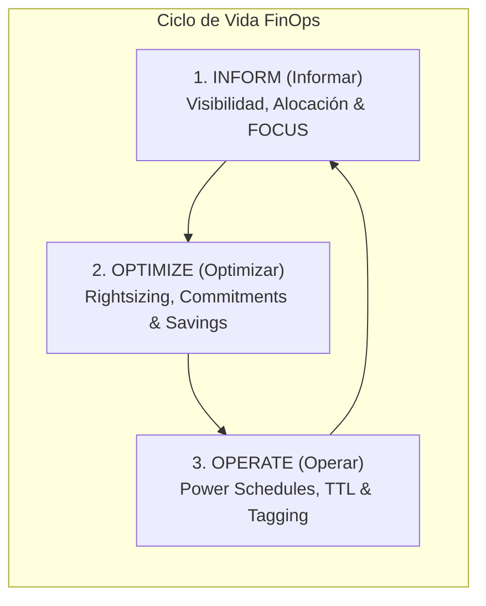

* **INFORM (Informar):** Asignación precisa de costos por Tenant, Centro de Costos, Suscripción y Tags. Telemetría de uso MTD (Month-To-Date), proyección a fin de mes, dashboards interactivos configurables y exportación estandarizada bajo el formato **FOCUS 1.0** (FinOps Open Cost and Usage Specification).
* **OPTIMIZE (Optimizar):** Identificación automatizada de recursos no utilizados o sobredimensionados (*Zombie Resources*), motor de rightsizing de Virtual Machines y App Services, recomendaciones de Azure Advisor, y gestión del ciclo de vida de Reservas e Savings Plans (RI/SP).
* **OPERATE (Operar):** Automatización de acciones de gobierno mediante apagado/encendido programado de VMs (*Power Schedules*), políticas de tiempo de vida de recursos (*TTL Policies*), cumplimiento de políticas de etiquetado (*Tag Inheritance & Enforcement*) y remediación guiada con RBAC.

### 1.3 Matriz de Tiers y Modelo de Negocio

El SaaS opera bajo un modelo de suscripción freemium/tiered con pago integrado vía **Paddle**:

| Capacidad / Dimensión | Tier Professional | Tier Business | Tier Enterprise |
|---|---|---|---|
| **Suscripciones Azure** | Hasta 2 suscripciones | Hasta 3 suscripciones | Ilimitadas / Custom |
| **Usuarios por Tenant** | Hasta 3 usuarios | Hasta 5 usuarios | Ilimitados |
| **Frecuencia de Sync** | 6 horas | 1 hora | 10 minutos (Real-time) |
| **Retención de Reportes PDF/JSON** | 90 días | 180 días | 365 días |
| **Retención Histórica FOCUS** | 12 meses | 36 meses | Personalizada |
| **Módulos Incluidos** | Core Dashboard, Cost MTD, Export Básico, +Alertas de anomalías (Z-score), +Copilot IA básico | +Simulador What-If, +Cost Groups, +Remediación | Todo + Pantalla de anomalías (causa raíz y explicación con IA) + SSO Enterprise + SLA 99.9% + Data Residency |
| **Autenticación** | Entra ID MSAL | Entra ID MSAL | Entra ID MSAL + WorkOS SAML/OIDC SSO |

---

## 2. Arquitectura Global de Sistema y Dominio

### 2.1 Diagrama de Arquitectura de Alto Nivel (C4 - System Context & Containers)

La plataforma se despliega en una arquitectura de **Stamp Regional** dentro de Microsoft Azure (región primaria `westus2`), protegida perimetralmente por **Cloudflare** para WAF, CDN y gestión de DNS.

```mermaid
graph TB
    subgraph "Perímetro Externo & CDN"
        U["Usuarios / Navegadores Web"]
        CF["Cloudflare (WAF + CDN + Dynamic Routing)"]
    end

    subgraph "Azure Regional Stamp (westus2)"
        subgraph "VNet (10.0.0.0/16)"
            subgraph "Apps Subnet (10.0.1.0/24)"
                CAE["Azure Container Apps Environment"]
                WEB["Web App Service Container (Next.js 16 Standalone)"]
                CRON["Container App Jobs (15 Cron Tasks Scheduled)"]
                MIG["Container App Job (DB Auto-Migration Runner)"]
            end

            subgraph "Private Endpoint Subnet (10.0.2.0/24)"
                PE_REDIS["Private Endpoint: Managed Redis"]
                PE_KV["Private Endpoint: Key Vault"]
                PE_STORAGE["Private Endpoint: Storage Account"]
                PE_AI["Private Endpoint: Azure AI Services (opcional)"]
            end

            subgraph "Database Subnet (10.0.3.0/24)"
                MYSQL[("Azure MySQL Flexible Server (B1ms, TLS 1.2)")]
            end
        end

        KV["Azure Key Vault (Secretos Infra & Tenant SPs)"]
        REDIS[("Azure Managed Redis (Balanced B3, HA)")]
        STORAGE["Azure Storage Account (Blobs, Reports, Exports)"]
        OBS["Azure Monitor / Log Analytics / App Insights"]
        AOAI["Azure AI Services en westus3 (opcional: gpt-5.4-mini, Data Zone US)"]
    end

    subgraph "APIs Nativas Azure (Tenants de Clientes)"
        ACM["Azure Cost Management API"]
        ARG["Azure Resource Graph API"]
        AAD["Azure Advisor API"]
        MSGRAPH["Microsoft Graph API (Users/Licenses/Entra)"]
        ARM["Azure Resource Manager (ARM REST API)"]
    end

    subgraph "Servicios Externos / Integraciones SaaS"
        PADDLE["Paddle Billing (Subscriptions & Webhooks)"]
        WORKOS["WorkOS (Enterprise SSO / SAML)"]
        GEMINI["Google Gemini API (Vercel AI SDK)"]
        ENTRA["Microsoft Entra ID (OIDC / OAuth 2.0)"]
    end

    U -->|"HTTPS / WSS"| CF
    CF -->|"Origin Shield / TLS"| WEB
    WEB -->|"MySQL Pool (TLS)"| MYSQL
    WEB -->|"Redis TLS (Port 6380)"| REDIS
    WEB -->|"Key Vault REST API"| KV
    WEB -->|"Blob SDK"| STORAGE
    CRON -->|"Internal Triggers"| WEB
    MIG -->|"SQL Migration Execution"| MYSQL

    WEB -->|"Cost Telemetry"| ACM
    WEB -->|"Inventory KQL"| ARG
    WEB -->|"Optimization Recs"| AAD
    WEB -->|"Identity & Licenses"| MSGRAPH
    WEB -->|"Resource Control & Actions"| ARM

    WEB -->|"Checkout & Billing"| PADDLE
    WEB -->|"SAML Auth"| WORKOS
    WEB -->|"AI Telemetry & Copilot"| GEMINI
    WEB -->|"IA de plataforma (Entra ID, Private Endpoint)"| AOAI
    WEB -->|"User Auth & Tokens"| ENTRA

    WEB -.->|"Metrics & Traces"| OBS
    CRON -.->|"Job Execution Logs"| OBS
```

### 2.2 Desglose de Capas del Sistema

#### A. Capa de Presentación (Client Layer)
* **Framework UI:** React 19 / Next.js 16 (App Router) con Renderizado Servidor-Primero (RSC).
* **Internacionalización (i18n):** `next-intl` con soporte nativo y sincronizado para 3 idiomas (`es`, `en`, `pt-BR`), alcanzando 4,114 keys traducidas por idioma.
* **Componentes Interactivos:** Recharts para gráficos de tendencias/forecast, React Grid Layout para widgets editables, cmdk para Command Palette (`Cmd+K`), y Tailwind CSS 4 para diseño responsivo y accesible.

#### B. Capa de Aplicación y Backend (API & Business Logic)
* **Next.js App Router API Routes:** 238 endpoints REST integrados con validación de tipos TypeScript.
* **Services & Collectors Layer:** 26 servicios de negocio especializados (`anomalyDetectionService`, `reservationService`, `powerScheduleService`, `budgetService`, `governanceReportingService`, `remediationService`) y 29 módulos colectores agnósticos (`collectors/azure/billingService`, `resourceGraphService`, `advisorService`).
* **Protección Middleware:** Control estricto de acceso basado en roles (RBAC) y Tenants vía `requestAuth.ts` (`requireTenantAccess`, `requireTenantRole`, `requireTenantTier`, `requireSuperAdmin`).

#### C. Capa de Cómputo y Procesamiento Asíncrono (Workers & Cron Jobs)
* **Azure Container Apps:** Despliegue de la aplicación principal como un contenedor inmutable (Node.js 22 Alpine, Next.js standalone).
* **Container App Jobs:** 15 tareas programadas independientes (*cron jobs*) aisladas para ingesta de datos, precalentamiento de caché, evaluación de anomalías, backfill histórico, alertas de expiración y exportaciones estandarizadas.

#### D. Capa de Persistencia y Caché (Data & Security State)
* **Azure MySQL Flexible Server:** Persistencia relacional primaria en MySQL Flexible Server con TLSv1.2, motor InnoDB, collation `utf8mb4_unicode_ci` y pool de conexiones optimizado (`mysql2`).
* **Azure Managed Redis:** Caché de alto rendimiento (Balanced B3, HA) utilizando `ioredis` con patrón **Stale-While-Revalidate (SWR)** y locks distribuidos para deduplicación de consultas hacia Azure.
* **Azure Key Vault:** Custodia y aislamiento de secretos de infraestructura (credenciales DB/Redis/Cron) y Service Principals de los tenants de clientes (`tenant-{tenantId}-client-id` / `secret`).

---

## 3. Desglose de Capacidades FinOps

La plataforma estructura sus funciones en 4 módulos operativos principales:

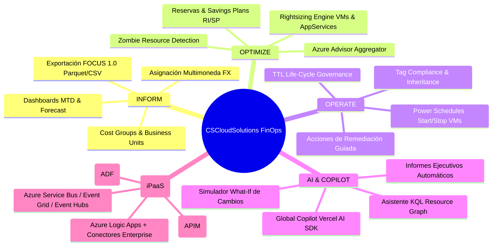

### 3.1 Módulo INFORM (Visibilidad y Asignación)
* **MTD & Daily Cost Tracking:** Cálculo exacto del gasto acumulado del mes (*Month-To-Date*), costo del día anterior (*Yesterday Cost*) y proyección matemática a cierre de mes basada en promedios ponderados y variaciones estacionales.
* **Multi-Currency & FX Engine:** Conversión dinámica entre monedas de origen de Azure (USD, EUR, BRL, ARS) con persistencia de tipos de cambio históricos en la tabla `FxRates`.
* **Cost Groups Customizables:** Agrupación lógica de recursos por unidades de negocio, aplicaciones o ambientes (Dev/Staging/Prod) sin modificar la infraestructura subyacente.
* **Estándar FOCUS 1.0:** Mapeador y exportador nativo compatible con la norma abierta FOCUS 1.0, permitiendo interoperabilidad y reporting estandarizado.

### 3.2 Módulo OPTIMIZE (Eficiencia y Ahorro)
* **Zombie Resources Scanner:** Detección automática de discos no adjuntados (*unattached Managed Disks*), IPs públicas sin asociar, Network Interfaces huérfanas, Snapshots obsoletos y Load Balancers vacíos.
* **Rightsizing Engine:** Motor analítico que cruza métricas de CPU/RAM/IOPS de ARM Monitor con costos de SKU para recomendar desescalados óptimos (*downgrades*) o cambios de familia de instancias.
* **Commitment Manager (RI / SP):** Cobertura y recomendaciones de compra/modificación de Reservas de Instancias (*Reserved Instances*) y Savings Plans con análisis de ROI y período de amortización.

### 3.3 Módulo OPERATE (Gobernanza y Automatización)
* **Power Scheduling:** Programación de apagado y encendido automático de máquinas virtuales no productivas fuera del horario laboral, calculando el ahorro estimado en USD.
* **Tag Governance & Inheritance:** Motor de verificación y heredado de etiquetas desde Resource Groups hacia Recursos hijo, con alertas de incumplimiento de política.
* **TTL Policy Enforcement:** Asignación de tiempo de vida máximo (*Time-To-Live*) a recursos temporales o de prueba, con flujo de notificación previa y eliminación automática o solicitada.
* **Remediation Actions Framework:** Sistema de acciones con aprobación (Delete, Deallocate, Downgrade, Retag) respaldado por `RemediationRequests` y registro auditables en `ActionLogs`.

### 3.4 Módulo AI & Copilot Assistant
* **Global Copilot Integrado:** Asistente conversacional basado en **Vercel AI SDK** y **Google Gemini**, capaz de interpretar consultas en lenguaje natural sobre costos y recursos ("¿Por qué subió el costo en la suscripción X este fin de semana?").
* **What-If Simulator:** Simulador de escenarios que proyecta el impacto económico de migraciones, apagados de cargas o compras de reservas antes de ejecutarlos en Azure.
* **AI Cost Analytics (Enterprise):** Vista de costo por modelo y tendencia de tokens para **Microsoft Foundry / Azure OpenAI**, priorizando tokens desde Azure Monitor (`ProcessedPromptTokens`, `GeneratedTokens`, `ProcessedInferenceTokens`) y fallback a costo agregado desde Cost Management cuando no hay desglose de tokens.
* **RBAC mínimo para AI Cost Analytics:** no introduce roles nuevos; reutiliza `Reader`, `Cost Management Reader`, `Monitoring Reader` y `Billing Reader` bajo principio de menor privilegio.
* **Explicación de anomalías:** el código calcula qué cambió dentro del servicio que empujó el desvío (medidor nuevo, más consumo, más precio), sin IA. La IA lo redacta a pedido, citando sólo esos hechos, y la salida se valida antes de mostrarse. Se ve en Detección de Anomalías, que hoy es Enterprise (§19).
* **Mapeo de CSV con IA (Business+):** la IA infiere qué columna corresponde a cada campo FOCUS y el código convierte todas las filas. El reporte de la carga pasa por el mismo gate y, sin IA, muestra el resumen por servicio (§19).
* **Gate único de IA:** kill switch global, interruptor por feature, `Tenants.ai_enabled`, tier, rate limit y cuota mensual por feature para las funciones de IA nuevas, con telemetría por feature en Log Analytics. El Copilot conserva el suyo (§19).

### 3.5 Módulo Integration Services (iPaaS)

* **Hub dedicado en Inteligencia:** `/intelligence/integration-services` con tabs para Logic Apps, APIM, Service Bus, Event Grid, Event Hubs y ADF.
* **Modelo operativo común:** cada tab expone metadatos transversales (suscripción, resource group, región, tags), costo acumulado/proyectado y estado de salud.
* **Logic Apps Enterprise Connectors:** separación explícita de conectores Standard vs Enterprise para priorizar impacto económico y operativo.
* **Consistencia UX FinOps/CMP:** filtros base, columnas base, orden A-Z/Z-A/costo, paginado 15/30/45/60 y columnas redimensionables.

---

## 4. Modelo Multi-Tenancy, Tiering y Gobernanza de Datos

### 4.1 Arquitectura Multi-Tenant

CSCloudSolutions FinOps utiliza un modelo de **Base de Datos Compartida con Discriminador por Tenant (`tenantId`)** y **Aislamiento Lógico Estricto**:

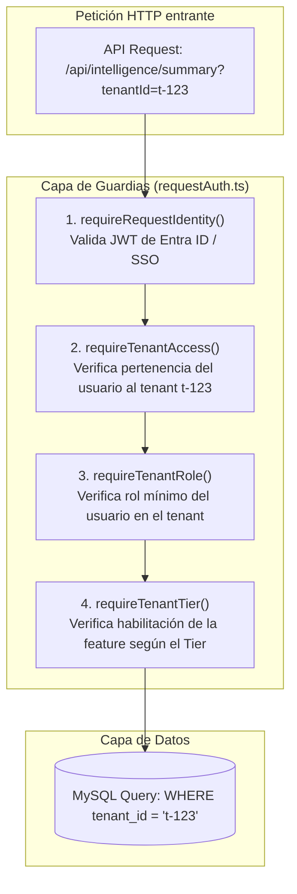

* **IDOR Prevention:** La regla de ESLint `local/no-unauth-tenant-id` evalúa en CI/CD que **toda ruta de API** que consuma `tenantId` contenga obligatoriamente un guard de `requestAuth.ts`.
* **Aislamiento de Secretos:** Cada tenant almacena sus credenciales de Service Principal de forma aislada en Azure Key Vault bajo la nomenclatura `tenant-{tenantId}-client-id` y `tenant-{tenantId}-client-secret`.

### 4.2 Patrón de Despliegue Stamp-Based y Data Residency

Para cumplir con regulaciones internacionales de residencia de datos (GDPR, LGPD, normativas bancarias), la plataforma implementa una infraestructura basada en **Stamps Regionales**:

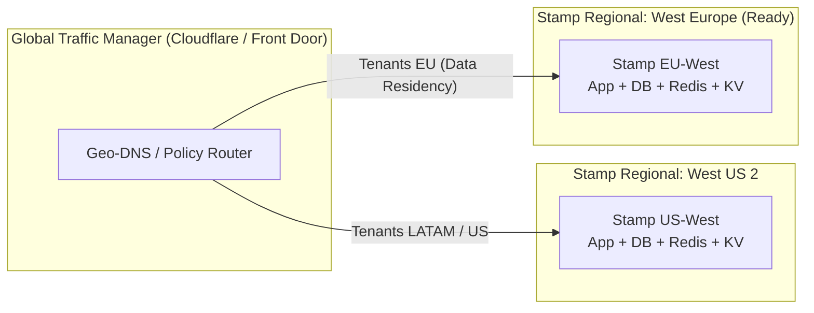

* **Multi-Stamp Ready:** La variable `var.stamps` en Terraform permite aprovisionar réplicas completas de la infraestructura en diferentes regiones de Azure.
* **Residencia Configurable:** El campo `Tenants.data_residency` rige la ubicación física de las tablas de datos del tenant y su almacenamiento de blobs asociado.

---

## 5. Modelo de Seguridad, Identidad y Cumplimiento

### 5.1 Autenticación y Autorización (RBAC)

La plataforma soporta autenticación dual transparente:
1. **Microsoft Entra ID (MSAL Browser/React):** Autenticación nativa OIDC/OAuth 2.0. El token JWT emitido por Entra ID es validado en backend contra las claves públicas de Microsoft, verificando issuer, audience y tenant ID.
2. **WorkOS Enterprise SSO:** Autenticación SAML 2.0 / OIDC dedicada para clientes Enterprise con proveedores de identidad corporativos (Okta, Ping Identity, Azure AD Enterprise).

#### Matriz de Roles dentro del Tenant

| Rol Tenant | Permisos de Lectura | Configurar Budgets/Tags | Ejecutar Remediación | Administrar Usuarios / Credentials |
|---|---|---|---|---|
| **Reader** | ✅ Sí | ❌ No | ❌ No | ❌ No |
| **Analyst** | ✅ Sí | ✅ Sí | ❌ No | ❌ No |
| **Operator** | ✅ Sí | ✅ Sí | ✅ Sí (Aprobadas) | ❌ No |
| **Admin / Owner** | ✅ Sí | ✅ Sí | ✅ Sí (Directas) | ✅ Sí |

### 5.2 Hidratación y Aislamiento de Secretos (Key Vault Architecture)

Ningún secreto sensible (passwords de DB, claves de Redis, API keys de terceros, credenciales de Service Principals) existe en código ni en variables estáticas en disco.

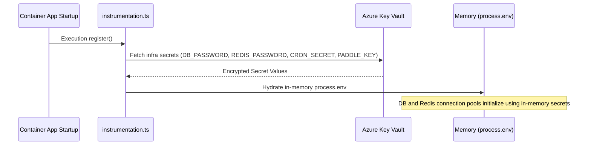

### 5.3 Headers de Seguridad y Protección Web

Configuración activa en `next.config.ts` y verificada en auditorías Checkov:
* `X-Frame-Options: DENY` (Anti-Clickjacking)
* `X-Content-Type-Options: nosniff` (Anti-MIME Sniffing)
* `Referrer-Policy: strict-origin-when-cross-origin`
* `Permissions-Policy: camera=(), microphone=(), geolocation=(), payment=(), usb=()`
* `Strict-Transport-Security: max-age=31536000; includeSubDomains; preload` (HSTS)
* **Content Security Policy (CSP):** Restricción de scripts, estilos, objetos y conexiones hacia orígenes explícitamente autorizados (Cloudflare, Paddle, Microsoft, Google Fonts).

---

## 6. Arquitectura de Integraciones Cloud (Azure Platform)

La plataforma interactúa de manera no invasiva con los tenants de los clientes mediante un **Azure Service Principal (App Registration)** configurado con los permisos mínimos necesarios (Principio de Menor Privilegio):

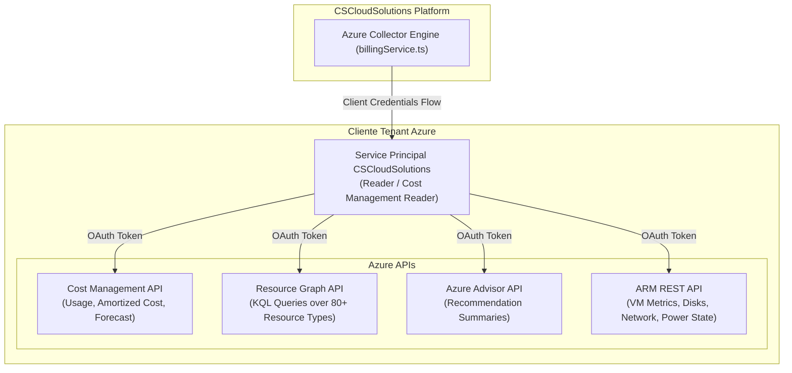

### 6.1 Roles Azure Mínimos Requeridos en Tenant de Cliente

| Alcance / Scope | Rol Azure Mínimo | Propósito |
|---|---|---|
| **Subscription / Management Group** | `Cost Management Reader` | Ingesta de datos de costos MTD, históricos y presupuestos |
| **Subscription** | `Reader` | Lectura de inventario vía Resource Graph y métricas ARM |
| **Resource Group (Opcional)** | `Desktop Virtualization Power On Off` / Custom Role | Apagado/Encendido de VMs en Power Schedules |

### 6.2 Resiliencia y Manejo de Rate Limits (429 Throttling)

El servicio `billingService.ts` implementa patrones avanzados de resiliencia frente a los límites de frecuencia de Azure Cost Management API:
* **Backoff Exponencial con Jitter:** Reintentos automáticos configurados hasta 5 niveles con retraso aleatorio.
* **Single-Flight Lock via Redis:** Deduplicación de peticiones concurrentes para el mismo tenant y ventana temporal.
* **Cache SWR:** Entrega de datos desde caché Redis mientras se revalida en segundo plano para evitar "cache stampede".

---

## 7. Modelo de Datos y Estrategia de Persistencia

### 7.1 Resumen del Esquema (84 Tablas Relacionales)

El esquema MySQL comprende 84 tablas agrupadas por dominios funcionales:

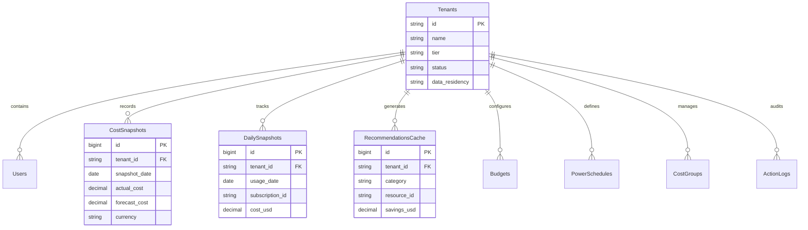

### 7.2 Estrategia de Caché de 3 Nivel con Redis

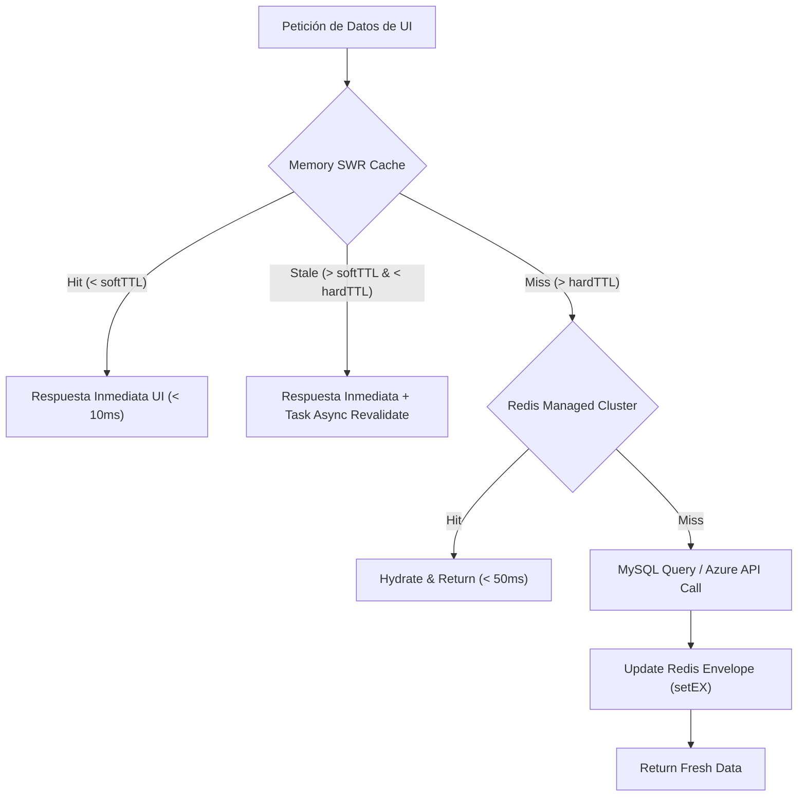

---

## 8. Flujos Operativos y Diagramas de Secuencia HLD

### 8.1 Flujo de Onboarding de Tenant Azure

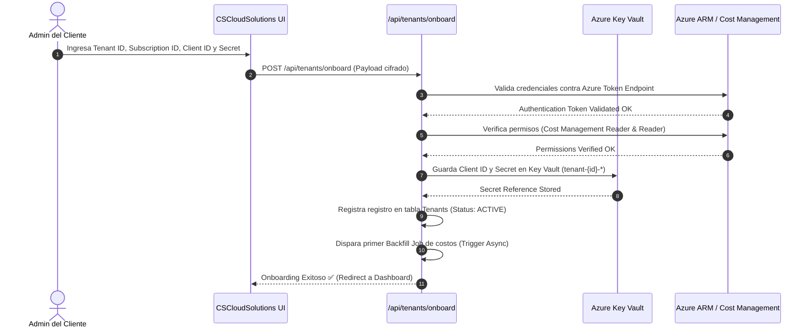

### 8.2 Flujo de Recolección y Procesamiento de Costos MTD

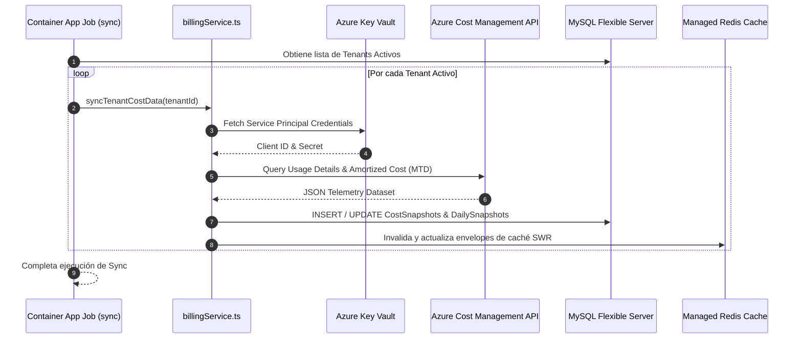

---

## 9. Operación, Alta Disponibilidad, Resiliencia y CI/CD

### 9.1 Canalización de CI/CD (GitHub Actions)

El ciclo de integración y despliegue continuo se encuentra completamente automatizado mediante GitHub Actions:

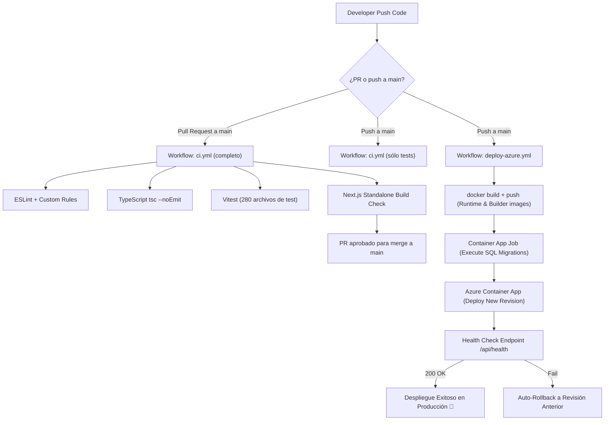

### 9.2 Resiliencia y Estrategia de Disaster Recovery (DR)

* **MySQL Flexible Server:** Automated Backups con retención configurable de 30 días, Point-In-Time Restore (PITR) y arquitectura regional con réplica de lectura opcional.
* **Stateless Application Layer:** La capa Web Container Apps es completamente desprovista de estado (*stateless*). La pérdida de una instancia de contenedor provoca el auto-healing de Azure en < 15 segundos.
* **Caché Transient:** La pérdida del cluster Redis no interrumpe el servicio; la plataforma degrada suavemente a consultas directas contra MySQL y reintenta la conexión de Redis.

---

## 10. Hoja de Ruta de Arquitectura (Roadmap HLD)

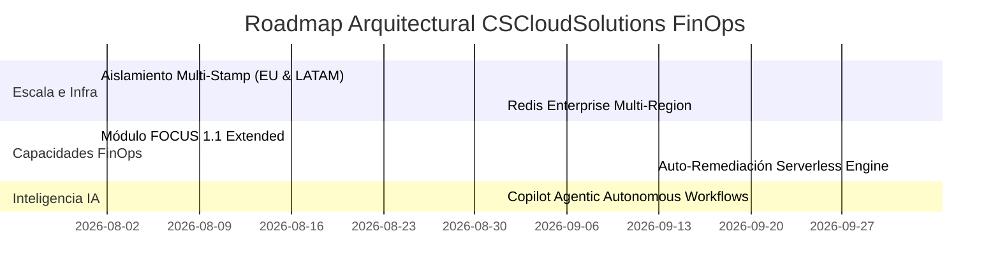

1. **Expansión Multi-Stamp (Q3 2026):** Despliegue del Stamp `westeurope` para atención regional europea con cumplimiento LGPD/GDPR estricto.
2. **Auto-Remediación Autónomamente Guiada (Q4 2026):** Evolución del motor de remediación a un modelo basado en agentes autónomos controlados por políticas de riesgo configurables por el usuario.
3. **Soporte Amortizado FOCUS 1.1 (Q3 2026):** Incorporación completa de especificaciones FOCUS 1.1 para facturación unificada de compromisos multinivel.

---

*CSCloudSolutions FinOps Platform — High-Level Design Architecture Document*  

---

## 11. Addendum 2026-08-03 — SuperAdmin Operations & Commercial Governance

### 11.1 SaaS Operations Control Plane (SuperAdmin)

Se incorpora un nuevo módulo de operaciones globales (`/superadmin/ops`) con
visión consolidada de estado de plataforma:

- Salud de componentes SaaS (API, DB, Sync, colas y alertas).
- Estado de crons críticos por frescura de ejecución y severidad.
- Cobertura de canales de notificación para tenants administrados.
- Dispatch de notificaciones operativas desde un único punto de control.

Este módulo opera bajo principio de menor privilegio con acceso exclusivo
`SUPERADMIN` y no expone datos de tenant a usuarios no autorizados.

### 11.2 Cron Reliability Layer

Se agrega una capa de observabilidad persistente para jobs programados:

- Registro de ejecución por cron (estado, duración, resumen y detalle).
- Evaluación de frescura contra expectativa de cadencia (on-time vs late).
- Señal temprana para detección de degradación operacional sin depender de logs
  efímeros del contenedor.

### 11.3 Commercial Metadata Governance

El dominio de gestión de tenants amplía metadatos comerciales por cliente:

- **Vendedor/Referido** (`sales_referrer`)
- **Comisión (%)** (`sales_commission_pct`)

Ambos campos quedan restringidos a operación de SuperAdmin y auditados
(`updated_by`, `updated_at`) para trazabilidad financiera interna.

## 12. Addendum 2026-08-22 — Dominio de Gobernanza Operativa y Ciclo de Vida del Gasto

### 12.1 Dos dominios nuevos en el mapa de capacidades

La plataforma incorpora dos dominios funcionales que cierran el ciclo entre *detectar* un desperdicio y
*eliminarlo* con control:

- **Limpieza de Nube (Cloud Waste Lifecycle).** Detección continua de recursos huérfanos, gobernanza de
  ciclo de vida por TTL y auditoría de backups sin origen. Cubre el desperdicio duro —lo que factura sin
  entregar valor— y el blando —lo que factura sin dueño identificable.
- **Gobernanza Operativa.** Automatización de energía de cómputo, prevención de costos desde el
  aprovisionamiento con Azure Policy, reporting ejecutivo de postura, resiliencia arquitectónica, ciclo de
  vida de credenciales de identidad y flujo de aprobación de cambios.

### 12.2 Principio arquitectónico: prevención antes que remediación

El dominio de Gobernanza se ordena sobre tres momentos del gasto, en orden de valor decreciente:

1. **Prevenir** (Azure Policy con efecto `Deny`): el costo indeseado nunca se aprovisiona. Es el único
   mecanismo con ahorro del 100% y esfuerzo operativo cero por recurso.
2. **Corregir automáticamente** (`Modify` / `DeployIfNotExists`, herencia de etiquetas, apagado programado):
   el costo existe pero se ajusta sin intervención humana por caso.
3. **Remediar con aprobación** (borrado, redimensionamiento, cambio de tier): exige juicio humano y por lo
   tanto pasa por el flujo de cuatro ojos.

Una política `Deny` **no revierte lo ya desplegado**: los recursos anteriores a la asignación aparecen como no
conformes hasta corregirse. Esa asimetría es la razón de que los tres momentos convivan y no se sustituyan.

### 12.3 Control de cambios de infraestructura (four-eyes)

Todo cambio irreversible sobre Azure originado en la plataforma atraviesa `RemediationApprovals`:

```
Motor de optimización ──> Petición PENDING ──> Revisión de un segundo operador
                                                      │
                                    ┌─────────────────┴─────────────────┐
                                  APPROVE                            REJECT
                                    │                                  │
                        (opcional) Snapshot previo            Motivo obligatorio
                                    │                          + notificación
                             Llamada a ARM
                                    │
                    ┌───────────────┴───────────────┐
              Succeeded                          Failed
              → APPROVED                      → FAILED
        (suma al ahorro liberado)      (no suma; traza del error)
```

La separación entre `APPROVED` y `FAILED` es deliberada a nivel de arquitectura: **el ahorro reportado al
negocio sólo incluye lo que Azure confirmó**. Una aprobación que ARM rechazó no liberó un peso, y contarla
inflaría la métrica que sostiene el caso de negocio de la plataforma.

### 12.4 Postura de seguridad e identidad

- **Ciclo de vida de credenciales de Entra ID.** Auditoría de secretos y certificados de App Registrations con
  alertas multi-umbral previas al vencimiento. La rotación es aditiva por diseño —crea sin revocar— porque
  revocar y migrar en un solo paso es la causa habitual del incidente que el módulo previene.
- **Auditoría de SIDs huérfanos.** Asignaciones RBAC cuyo principal ya no existe en el directorio. No otorgan
  acceso a nadie hoy, pero si el `objectId` se reutiliza el permiso revive sobre otro principal.
- **Score de Seguridad Financiera.** Índice ponderado de cuatro pilares (Azure Policy 40%, etiquetas 30%, RBAC
  20%, zombis 10%) con **redistribución de peso de los pilares no medibles**: la plataforma nunca afirma una
  postura que no pudo verificar.

### 12.5 Resiliencia como decisión económica

El módulo de Alta Disponibilidad presenta cada brecha con su **SLA vigente, el alcanzable y el costo del
salto**, traducidos a minutos de caída mensual. La decisión de redundancia deja de ser técnica y pasa a ser
una comparación explícita entre minutos de indisponibilidad y dólares por mes, que es la conversación que el
negocio puede sostener.

Se distingue entre lo aplicable por API (SKU de IP pública, asociación de backup) y lo que exige rediseño
—zonas, Availability Sets, geo-redundancia—: prometer un botón donde hace falta recrear un recurso erosiona la
confianza en toda la herramienta.

### 12.6 Restricción de arquitectura reafirmada

Un componente cliente **no puede importar de un servicio que toque la base de datos**, ni siquiera una función
pura alojada allí: el grafo de imports arrastra el driver de MySQL al bundle del navegador. Las funciones
compartidas entre servidor y cliente viven en los archivos de tipos o en `src/lib/`.

### 12.7 Gobernanza de Etiquetas y Hardening de Secretos de Infraestructura

- **Gobernanza de Etiquetas (Azure Tag Governance Engine).** Auditoría automatizada de políticas obligatorias (`Environment`, `Role`, `CostCenter`, `Department`), propagación de etiquetas desde Grupos de Recursos con Merge Seguro y sugerencia de etiquetas faltantes por convención de nombres (una heurística, sin IA: §19.4).
- **Key Vault Network Isolation.** Aislamiento perimetral completo del almacén de secretos (`cscs-finops-prod-wus2-kv`) mediante Private Endpoint (`privatelink.vaultcore.azure.net`) y directiva `default_action = Deny`, eliminando vectores de acceso público y protegiendo credenciales de tenants en tránsito y reposo.

*© 2026 CSCloudSolutions. Todos los derechos reservados. — CONFIDENCIAL*

---

## 13. Addendum 2026-09-01 — Comunicación con el cliente, ciclo de vida contractual y capacidad como producto

Tres capacidades nuevas a nivel de arquitectura, más la consolidación del cobro
de capacidad. Todas comparten un mismo principio de diseño que conviene explicitar
porque se aplicó cuatro veces en la sesión: **cuando un dato es un hecho con su
momento, se persiste; cuando es una consecuencia recalculable, se deriva.**

### 13.1 Canal de comunicación plataforma → tenant

Hasta ahora la plataforma sólo podía hablarle al cliente a través de
notificaciones generadas por reglas automáticas (gasto, auditoría). No existía un
canal para que un operador humano emitiera un aviso —un mantenimiento, una
incidencia— con ventana de vigencia y alcance elegible.

Se incorpora un dominio `SystemAnnouncements` con dos canales de entrega (banner
persistente y popup con descarte) y segmentación por tenant. Es transversal:
vive en `ClientShell`, por encima de cualquier módulo, y no depende del estado de
ningún cockpit.

Decisión de arquitectura relevante: el **estado de un anuncio se deriva de sus
fechas**, no se materializa. "Programado", "Activo" y "Finalizado" son la misma
comparación contra el reloj; persistirlos habría creado una obligación de
sincronización (un cron) para un valor que se recalcula en microsegundos. El
contraste con §13.2 es deliberado.

El contenido admite traducciones opcionales por idioma, con caída al idioma base.
La opcionalidad es una decisión de producto, no una limitación: exigir tres
traducciones convertiría la urgencia de un aviso de incidencia en fricción
operativa.

### 13.2 Ciclo de vida contractual del tenant

La plataforma conocía el estado actual de una suscripción, pero no su historia:
no había forma de calcular churn, LTV ni retención por cohortes porque las fechas
de alta, suspensión y baja no se registraban en ningún lado.

Se incorpora un modelo de dos capas —**estado actual denormalizado** en `Tenants`
para el filtrado del panel, e **historial append-only** en
`TenantLifecycleEvents` para el análisis— y, más importante, **un único punto de
transición** por el que pasan webhooks, crons y acciones administrativas. Antes
había 17 escrituras directas del estado, cada una libre de olvidarse del
registro; ahora el registro es consecuencia de la transición.

Acá el dato **sí se persiste** aunque parezca derivable: un tenant que se da de
baja y vuelve tiene varios períodos, y el estado actual sólo conserva el último.
La historia no se puede reconstruir después a partir del presente.

### 13.3 Capacidad como producto cobrable

La capacidad (suscripciones de Azure, tenants vinculados) pasa de ser un límite
fijo por plan a ser **capacidad base + capacidad comprada**, con el add-on
gestionado como ítem de la suscripción existente en el proveedor de pagos.

El principio de integridad que gobierna el diseño: **la capacidad la acredita el
webhook, nunca la ruta de compra**. La API solicita el cambio al proveedor; sólo
cuando éste confirma, la plataforma escribe. Y se *fija* desde la cantidad
vigente en la suscripción en vez de incrementar, lo que hace el mecanismo
naturalmente idempotente y hace que la baja del add-on devuelva la capacidad sin
código adicional.

Ningún price ID configurado equivale a "add-ons deshabilitados": el sistema no
toca la capacidad de nadie, para no pisar con ceros lo asignado comercialmente a
mano.

### 13.4 Exactitud del dato de costo por etiqueta

El costo llega por dos caminos con propiedades distintas: el export FOCUS
(exacto, con etiquetas y `ResourceId`) y la Query API de Cost Management
(agregada, sin etiquetas). La plataforma ahora **distingue explícitamente** cuál
de los dos alimentó un período y degrada de forma consciente: con dato exacto
usa el predicado por etiqueta y evita una llamada a Resource Graph; sin él, cae a
la aproximación por Resource Group y **lo informa** (`tagMatchIsApproximate`).

Se suma un tercer origen para tenants sin export: un desglose por etiqueta
obtenido de Cost Management en su propia tabla. Vive separado del agregado
principal porque es *el mismo dinero visto por otra dimensión*: mezclarlo haría
que cualquier consumidor que sume sin filtrar cuente doble. Es la misma
convención que ya seguían los desgloses por medidor y por categoría.

### 13.5 Plataforma de ejecución

Se retiran los últimos artefactos del despliegue anterior sobre VPS. La
plataforma corre exclusivamente sobre **Azure Container Apps** (build en ACR,
migraciones como Container App Job, OIDC federado sin llaves SSH) desde el
2026-07-27. Los documentos que registran la migración y el aviso legal de cambio
de subencargado se conservan: son el porqué de la arquitectura actual y una
obligación contractual, respectivamente.

---

## 14. Addendum 2026-09-03 — Rendición de cuentas del desvío, integridad del modo demo y canal Marketplace

### 14.1 El desvío como unidad de trabajo, no como dato

Hasta ahora la plataforma detectaba anomalías de gasto y las mostraba. Detectar
es la mitad barata del problema: **un desvío que nadie toma es equivalente a un
desvío no detectado**, y cuesta más, porque consume atención sin producir acción.

Se completa el ciclo con tres piezas que convierten el hallazgo en trabajo
asignado: un estado de triaje que persiste con autoría, un responsable derivado
del modelo de gobernanza del cliente, y una notificación dirigida a esa persona.

El principio de diseño que gobierna la asignación: **la plataforma no inventa
dueños**. La responsabilidad se deriva de lo que el cliente ya declaró — sus Cost
Groups con dueño, o la etiqueta `Owner` que audita el módulo de Gobernanza de
Etiquetas — y cuando ese modelo no alcanza, el desvío se muestra explícitamente
como "sin asignar".

Eso no es una limitación disimulada: asignarle un desvío a quien no corresponde
entrena a esa persona a ignorar las alertas, y ahí se pierde el canal completo.
El contador de "sin asignar" es, además, el argumento más concreto para que el
cliente complete su modelo de etiquetas — convierte una carencia de gobernanza en
una lista accionable.

### 14.2 Integridad del modo demo como propiedad de seguridad

Los datos de demostración son sólo para demostración. Esa regla, que parece
obvia, es en realidad una **propiedad de seguridad de datos** en un producto de
gestión de costos: si un tenant real ve una cifra inventada, toma una decisión de
dinero sobre información falsa, y el error no deja rastro porque los números se
ven normales.

La auditoría del mecanismo de demo encontró que podía violarse durante el cambio
de tenant, por una asimetría entre cómo se instalaba y cómo se desinstalaba la
intercepción. Se corrigió revalidando el contexto en cada llamada en vez de
confiar en que la desinstalación llegue a tiempo.

De ahí se desprende un principio más general que conviene explicitar: **todo
mecanismo que sustituye datos reales debe revalidar su condición en el momento de
servir, no sólo en el momento de instalarse.** El estado de la aplicación cambia
entre ambos instantes.

La segunda mitad es de contrato: los generadores de datos de demostración se atan
al mismo tipo que devuelve el camino vivo, de modo que un cambio de contrato
rompa la compilación en lugar de degradar la demostración en silencio. Una demo
divergente no sólo se ve mal ante un prospecto: se usa para validar cambios sin
tocar un tenant real, y cuando diverge convierte esa validación en falsos
negativos.

### 14.3 Canal de distribución: Azure Marketplace

Se incorpora el Marketplace de Azure como segundo canal comercial, junto al
cobro directo. Arquitectónicamente supone que **el estado de una suscripción
puede provenir de dos autoridades distintas**: el proveedor de pagos propio y
Microsoft.

Por eso el estado reportado por Microsoft se persiste **separado** del estado
comercial de la plataforma. Unificarlos sería más simple y estaría mal: una
suspensión originada en Azure pisaría el motivo real de una baja gestionada por
otro canal, y ante una conciliación con Partner Center no se podría explicar el
origen de cada transición.

Se registran además los datos de conciliación —oferta, comprador y directorio
comprador—, porque quien compra no siempre es quien después usa la plataforma, y
esa distinción es la que Microsoft pide para resolver un reclamo de facturación.

La verificación criptográfica del webhook no es opcional: sin ella, el endpoint
de ciclo de vida es una vía pública para alterar el plan de cualquier tenant.

---

## 15. Addendum 2026-09-04 — Dos modelos de acceso, y la contención como problema de arquitectura

### 15.1 La autoridad del token es una decisión de arquitectura, no un detalle de implementación

Hasta esta fecha la plataforma tenía **un solo** modelo de acceso a las
suscripciones del cliente, y estaba implícito en el código: un App Registration
en el directorio **del cliente**, cuyas credenciales guardamos por tenant. Todo
`getAzureCredential(tenantId)` construía la credencial contra el tenant del
cliente, porque no había otra posibilidad.

Azure Lighthouse no es "otra forma de onboarding": **invierte la autoridad del
token**. El Service Principal vive en nuestro directorio, el token se emite
contra el nuestro, y ARM lo resuelve hacia las suscripciones que el cliente
delegó. Es la diferencia entre "el cliente nos da una identidad en su casa" y
"el cliente le da permiso a nuestra identidad".

Esa distinción tiene consecuencias que no se ven en un diagrama de cajas:

- **No hay plano de datos.** Lighthouse delega plano de control. Nada de leer
  secretos del Key Vault del cliente, ni blobs de su storage, ni su directorio
  (Microsoft Graph). Cualquier capacidad que dependa de eso simplemente no
  existe para un tenant delegado — y la credencial lo hace cumplir (18.1).
- **Los management groups no se delegan.** La delegación es por suscripción, así
  que el scope agregado de Cost Management —el más barato— no está disponible.
  Todo consumo tiene que consultarse suscripción por suscripción.
- **La revocación es del cliente y es silenciosa.** No expira un secreto que
  podamos monitorear: el cliente quita la delegación desde su portal y lo que
  vemos es un 403, o directamente cero suscripciones.

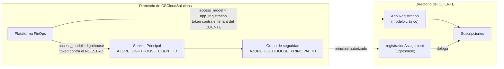

**El principio que gobierna el interruptor:** `Tenants.access_model` sólo se
enciende cuando Resource Graph **confirma** la delegación desde nuestro
directorio. Encenderlo al emitir la plantilla dejaría al tenant sin datos hasta
que el cliente la desplegara, y la plataforma no tiene forma de saber cuándo eso
pasa salvo preguntándole a Azure. Simétricamente, **no se apaga solo**: un fallo
puntual de ARG devolvería al tenant al modelo anterior, cuyas credenciales
probablemente ya no existan. El único apagado automático es la baja explícita de
la última delegación, que es una acción humana.

### 15.2 Lighthouse es una capacidad de Enterprise, y el gate vive en el servidor

Restringir Lighthouse a Enterprise no es una decisión comercial arbitraria: el
modelo delegado concentra en **una sola credencial** el acceso a las
suscripciones de todos los clientes que lo usan. Eso cambia el perfil de riesgo
respecto del modelo clásico, donde cada tenant tiene su propio secreto y el
compromiso de uno no toca a los demás.

La lección de implementación vale para todo el sistema: **un gate declarado no
es un gate aplicado**. `routeTiers` declaraba Lighthouse como Enterprise, pero el
panel dejó de ser una página propia y pasó a ser pestaña de un hub; el gate
resuelve el tier por `pathname` y el hub filtra por permisos y rol, no por tier.
La declaración decía Enterprise y la realidad era "cualquiera".

Por eso el gate efectivo está en las **rutas de API**, no en la UI. Un bloqueo
visual se saltea con un `fetch`. Y la ruta de verificación importa tanto como la
que emite la plantilla, porque es la que enciende el modelo de acceso.

### 15.3 La contención sobre APIs de terceros es un problema de arquitectura

El barrido nocturno de costos venía venciendo su techo por tenant y, durante
cuatro días, tres de cada cuatro tenants no ingirieron un dato. La causa no era
volumen: era **contención**. En la media hora del barrido, Resource Graph
registró 5 respuestas 429 y Cost Management 314.

La diferencia entre los dos no era la cuota: era que ARG tenía una **cola global
con pausa compartida** y Cost Management no. El backoff por llamada es
insuficiente por construcción — mientras un llamador espera su turno, los demás
siguen golpeando y renuevan la penalidad. Con los jobs de precalentamiento
corriendo cada 10, 15 y 20 minutos, el throttle nunca bajaba.

El patrón queda extraído a un limitador genérico con **estado por instancia**:
ARG y Cost Management tienen cuotas independientes, y compartir el `pausedUntil`
haría que un 429 de uno frenara al otro sin motivo. La lección arquitectónica es
que **el rate limiting de un servicio externo es una propiedad del sistema, no
de cada llamada**: cualquier consumidor nuevo de una API de terceros con cuota
compartida tiene que entrar por la cola, no traer su propio reintento.

### 15.4 El límite de suscripciones tiene que ser visible donde se decide

El tope por plan (Professional 2, Business 3, Enterprise sin límite) se aplicaba
por truncado silencioso: se ordenaba por GUID y se tomaban los primeros N. Es
determinístico —no cambia entre corridas— pero arbitrario desde el punto de vista
del cliente: su suscripción de producción podía quedar afuera y su sandbox
adentro, sin ninguna señal.

La tabla de Cuentas Cloud mostraba las cuatro suscripciones con la misma
apariencia, y el banner decía "2 de 2 permitidas" sin aclarar **cuáles** dos. La
salida ya existía en el diseño —desvincular una libera cupo, porque la exclusión
se aplica *antes* del truncado— pero era indescubrible.

El principio: **cuando el sistema toma una decisión que el usuario podría tomar
mejor, la decisión tiene que ser visible y reversible en el mismo lugar donde se
ve su efecto.**

---

## 16. Addendum 2026-09-05 — El límite del barrido secuencial, y la señal que se pierde

### 16.1 Secuencial por tenant es una decisión correcta con una fecha de vencimiento

Los barridos por tenant —costos, precalentamiento, backfill, detección de
anomalías— se procesan **en serie**. La razón está bien fundada: correrlos en
paralelo amplifica el 429 de Cost Management en vez de evitarlo, y un tenant que
agota sus reintentos pierde el día entero de datos.

Pero secuencial significa **tiempo lineal en la cantidad de tenants**, y eso
choca contra un límite fijo:

```
techo por tenant × N tenants ≤ timeout del job
      10 min     ×     N     ≤      60 min       →  N ≤ 6
```

A partir del séptimo tenant el barrido no termina. **No degrada: se corta.** Y
los dos límites se comen mutuamente — subir el techo por tenant reduce cuántos
entran, bajarlo hace que los lentos no completen.

El principio a registrar: **una decisión de diseño correcta puede tener un techo
aritmético que no se ve hasta que se alcanza**, y el momento de identificarlo es
cuando se elige, no cuando se choca. Acá el techo ya se estaba alcanzando —
`historical-gap-backfill` llevaba días sin completar una sola corrida— y se leía
como "un job que falla", no como "el diseño llegó a su límite".

Las salidas reales son dos, y ninguna es un ajuste de parámetros: un job por
tenant, con paralelismo acotado y techo propio; o una cola de trabajo con
workers. Mientras tanto, un **presupuesto de tiempo con orden rotado** convierte
un barrido que nunca termina en uno que avanza parcialmente y de forma pareja.

> La rotación es lo que hace aceptable al presupuesto. Sin ella, acotar el
> tiempo es peor que no acotarlo: los mismos tenants se procesan siempre primero
> y los últimos no se procesan nunca. El presupuesto sin rotación no reparte el
> trabajo, elige perdedores fijos.

### 16.2 El estado de un job es una señal, y tiene que distinguir grados

Sobre ~300 ejecuciones de cron en rojo, **ninguna era un problema del trabajo**.
Tres modos de falla, y los tres comparten una forma: el sistema tenía la
información correcta y la perdía al cruzar un borde.

- Un barrido con 4 de 5 tenants OK se reportaba igual que uno con 0 de 5. La
  aplicación sí lo clasificaba como `warning`; el exit code, que es lo único que
  la plataforma mira, sólo admite éxito o fracaso.
- Un barrido que superaba el techo de la plataforma HTTP se reportaba como
  fallido aunque completara del lado del servidor.
- Un job que terminaba en 107 ms se reportaba como fallido porque el proceso
  salía antes de que la plataforma registrara su código.

El costo de esto no es el ruido: **es la señal**. Con cien alertas falsas por
día, una alerta legítima es indistinguible del fondo. Un sistema de alertas con
50% de falsos positivos no está degradado — está apagado, y encima da la
impresión contraria.

El criterio que queda: **el estado que se publica hacia afuera tiene que
preservar los grados que el sistema ya conoce internamente.** Colapsar
"parcialmente bien" a "mal" es tirar información que costó producir, en el único
punto donde alguien la iba a leer.

---

## 17. Addendum 2026-09-07 — El payload no conoce el idioma del lector, y el TTL duro no es frescura

### 17.1 La prosa generada en el servidor es una decisión de arquitectura, no de redacción

Un barrido sobre `intelligence/` encontró el mismo defecto en cuatro módulos
independientes: el servidor **armaba el texto** que iba a leer el usuario y lo
metía en el payload.

```
Servidor (sin locale)                        Cliente (con locale)
─────────────────────                        ────────────────────
recommendation: "Réplicas mínimas       →    <p>{svc.recommendation}</p>
  fijadas en > 1 sin tráfico 24/7."          (UI en inglés, texto en español)
```

El servidor no tiene locale, y no puede tenerlo de forma confiable: el mismo
payload se cachea en Redis y se sirve a lectores distintos. Una vez que la
prosa entra al envelope, **el idioma queda congelado en el momento de la
recolección**, no en el de la lectura.

Lo llamativo es que en los cuatro casos el payload **ya llevaba el
discriminador** — `remediationActionKey`, `actionKey`, `type`, `serviceKey` — y
la prosa era información redundante que además era incorrecta. El catálogo de
traducciones existía y estaba completo; en nueve claves nadie lo leía nunca.

> **El criterio que queda:** un payload cacheado y compartido entre lectores
> transporta *hechos y claves*, nunca texto para humanos. Si el servidor eligió
> una rama de negocio, lo que viaja es cuál rama eligió — el nombre de esa rama
> en el idioma del lector lo resuelve el borde que sí conoce el locale.

El corolario operativo: **las claves que se arman en runtime son invisibles para
el verificador de integridad de i18n.** `t(\`rc_rec_${key}\`)` no aparece en
ningún grep de literales, así que un catálogo puede quedar incompleto y la UI
renderiza el nombre crudo de la clave sin que nada falle. Cada familia de claves
dinámicas necesita su propio test que recorra el dominio del discriminador.

### 17.2 El TTL duro de un caché es una propiedad de disponibilidad

Una ruta pesada devolvía `524` desde el CDN (timeout de origen, 100 s) y "después
de un rato cargaba bien, y al rato otra vez no". Estaba cacheada con
stale-while-revalidate, que es exactamente el patrón correcto. El TTL era 30 min.

La confusión de fondo es tratar el TTL duro como si midiera frescura. No la mide:

| | qué controla | si es corto |
|---|---|---|
| **TTL blando** | cuánto se sirve antes de revalidar en background | se revalida seguido; nadie espera |
| **TTL duro** | cuánto tiempo **existe** una entrada | la entrada desaparece y el lector siguiente paga el cálculo sincrónico |

Vencido el TTL duro, el patrón deja de protegerte: no hay nada stale que
devolver, y el request se convierte en el cálculo completo. Si ese cálculo supera
el techo del CDN, el resultado es un error que **no se manifiesta como lentitud
sino como caída**, y de forma intermitente — una vez por vencimiento.

> **El criterio:** en una ruta cuyo cálculo en frío se acerca al techo de la
> capa HTTP, el TTL duro se dimensiona para que **siempre haya una entrada**, y
> la frescura se delega enteramente al TTL blando. Y tiene que ser coherente con
> la cadencia del precalentamiento: un prewarm diario contra un TTL de 30 min
> deja 23 horas y media de exposición al camino lento.

El caso degradado necesita su propio TTL. Cachear por un día un payload que
salió incompleto por un 429 transitorio congela un número equivocado; el TTL
dinámico lo baja a minutos para que el refresh siguiente reintente.

### 17.3 Programa de afiliados: la pasarela de pago queda fuera del camino de confianza

Se incorpora un canal de referidos: un tercero promociona la plataforma con un
link propio y devenga un porcentaje recurrente de lo que pagan los tenants que
trajo.

El diseño obvio es hacer viajar el código del afiliado por los metadatos de la
pasarela (`custom_data`), para que vuelva intacto en el webhook de cobro. Se
descartó, y el motivo es de arquitectura:

```
Descartado:  link → localStorage → checkout → Paddle → webhook → comisión
                                   └─ el cliente edita el valor acá ─┘

Adoptado:    link → cookie → alta del tenant → AffiliateReferrals (servidor)
                                                        ↓
                             webhook → tenant_id → referido → comisión
```

La atribución es un **hecho del servidor indexado por tenant**, y el webhook ya
resuelve el tenant. Hacerla ida y vuelta por un tercero agrega una superficie
donde el cliente puede intervenir justo antes de pagar, y obliga a modificar los
siete lugares que construyen sesiones de checkout. El límite de confianza queda
en el alta, que ocurre una vez y detrás de una identidad verificada.

> **El principio:** cuando un dato ya vive del lado del servidor y hay una clave
> para recuperarlo, hacerlo circular por un sistema externo no agrega
> disponibilidad — agrega una superficie de manipulación y N puntos de
> integración.

Tres propiedades quedan garantizadas por el **esquema**, no por el código:
atribución de primer toque (`uq_referral_tenant`), una comisión por cobro
(`uq_commission_transaction`) y unicidad de código de referido. La segunda es la
que importa: la pasarela reintrega webhooks ante cualquier respuesta que no sea
2xx, y una comisión duplicada es dinero pagado dos veces. Un chequeo previo en
la aplicación es una condición de carrera; un índice único no lo es.

---

## 18. Addendum 2026-10-06 — Lo que Lighthouse delega es una lista cerrada, y la hace cumplir la credencial

### 18.1 Una identidad que actúa por muchos clientes se acota en la identidad misma

Con Lighthouse, `getAzureCredential(tenantId)` devuelve la credencial de
**nuestro** Service Principal (15.1). Contra ARM es exactamente lo que hace andar
la delegación: ARM resuelve el token hacia las suscripciones que el cliente
delegó. Contra cualquier otra audiencia el resultado no es "sin acceso": un
token de Microsoft Graph emitido por nuestro directorio lee **nuestro**
directorio. Con permisos de Graph en esa identidad, las pantallas de identidad
—usuarios, licencias, actividad de Microsoft 365, Entra ID— le mostrarían al
cliente nuestros usuarios como si fueran suyos, y la búsqueda de usuarios de
Entra ID permitiría enumerarlos.

La decisión: la credencial de Lighthouse **sólo emite tokens para las audiencias
que Lighthouse delega**, y rechaza las demás **antes** de pedirle el token a
Entra ID. No es una convención que cada servicio tenga que recordar: es una
propiedad de la credencial, por la que pasa toda consulta de un tenant delegado.

| Audiencia | Con Lighthouse | Por qué |
|---|---|---|
| `https://management.azure.com` (ARM) | Sí | Es lo que Lighthouse delega |
| `https://api.loganalytics.io` (Log Analytics) | Sí | Learn lista como soportada la consulta a workspaces del cliente |
| `https://graph.microsoft.com` (directorio) | **No** | Microsoft Graph no pasa por ARM |
| Plano de datos (Key Vault, storage, Cognitive Services...) | **No** | Son requests a la instancia, no a ARM |

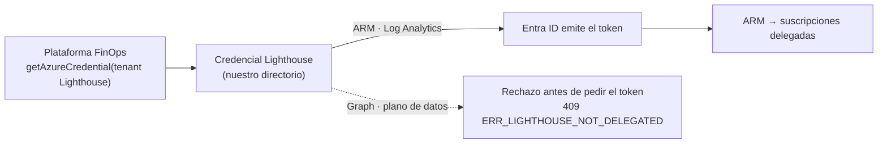

> **El principio:** cuando una identidad actúa en nombre de muchos clientes, lo
> que puede hacer tiene que estar acotado en la identidad, no en cada llamador.
> Un servicio nuevo que pida Graph con `getAzureCredential` falla cerrado y con
> un motivo legible, en vez de abrir una fuga.

### 18.2 Lo que el modelo de acceso no permite no es un error ni un cero

Antes del corte, un tenant Lighthouse veía en Microsoft 365, Licencias, la
búsqueda de usuarios y Copilot M365 un pedido de consentimiento de Graph —que no
arregla nada, porque el directorio no se delega— y en Entra ID un tablero en
cero con el sello "Live Microsoft Graph", indistinguible de un directorio vacío.
Las rutas de identidad responden ahora **409** con un código, y la pantalla dice
*No disponible con Azure Lighthouse* en el idioma del usuario en vez de mostrar
datos. El texto no viaja en el payload, por el mismo motivo que en 17.1.

La verificación del 2026-10-06 contra Entra ID confirmó que **no era
explotable**: el Service Principal de Lighthouse no tiene permisos de aplicación
de Graph, ni roles de directorio, ni pertenece a grupos asignables a roles. El
corte no depende de eso: si mañana esa identidad recibe un permiso de Graph por
otro motivo, la plataforma igual no lo usa para un tenant delegado.

## 19. Addendum 2026-10-07 — La IA redacta, el código decide

Primera parte de la propuesta de capacidades de IA
([`docs/propuesta-capacidades-ia-2026-10-07.md`](../propuesta-capacidades-ia-2026-10-07.md),
sección 10). La regla de fondo: cifras, causas y acciones salen de lógica
determinista; el modelo sólo pone en palabras lo que el código ya verificó, o
elige entre opciones cerradas. El detalle técnico está en el LLD §40; para la
IA de plataforma sin keys (19.6), en el §41, y para la IA de soporte (19.7), en
el §42.

### 19.1 Un solo lugar decide si se gasta IA

Hasta ahora cada función de IA traía sus propios controles, o ninguno. El
Copilot tiene su gate en `copilotConfig.ts`, pero la normalización de CSV llamaba
al modelo sin mirar el kill switch, `Tenants.ai_enabled` ni una cuota.

Las funciones nuevas pasan por `checkAiFeature` (`src/lib/aiFeatureGate.ts`), que
aplica seis controles en orden: kill switch global, interruptor de la feature,
`Tenants.ai_enabled`, tier, rate limit por usuario y por minuto, y cuota mensual
**por feature**. La cuota cuenta en `PlatformAiUsage` sólo lo que paga la
plataforma, así que BYOK no la consume. Un denegado no es un error: la pantalla
sigue con la versión determinista y dice por qué no hay IA.

El interruptor por feature lo maneja el superadmin en la Configuración de IA
Global y se guarda en `GlobalSettings`. Sin valor guardado manda el
`defaultEnabled` de la feature, para que una función con precondiciones de
negocio pueda arrancar apagada.

Cada decisión del gate, cada llamada al modelo (con su latencia) y cada salida
descartada por los validadores dejan una línea JSON `evt: "ai_feature"` en
stdout, que ya llega a Log Analytics. No hay exporter de OpenTelemetry; si se
suma, cambia un solo archivo.

El gate no autentica. La ruta ya validó el acceso con `requireTenantAccess`, y el
gate sólo decide si se puede gastar. El Copilot conserva el suyo: atiende la demo
pública, cuyos tenants no tienen fila en `Tenants` y el gate los negaría, y su
cuota cuenta intentos antes de llamar al modelo, mientras que la del gate cuenta
respuestas terminadas. Migrarlo además pondría en cero los contadores del mes.
El kill switch global ya lo apaga.

### 19.2 Anomalías: primero los hechos, después el texto

La anomalía ya decía cuánto se desvió (z-score) y qué resource group y servicio
lo empujaron. Faltaba **qué cambió dentro del servicio**.

Al guardar la anomalía, el código compara el día contra los 30 anteriores, medidor
por medidor, y clasifica: medidor nuevo, más consumo, más precio unitario (con la
descomposición precio-volumen) o más costo sin cantidades para separar uno de
otro. Esos hechos y las acciones que se derivan de ellos se muestran sin IA, en
el panel de causa raíz de Detección de Anomalías. Esa pantalla y la explicación
con IA son **Enterprise**, aunque el cron calcula los hechos desde Professional.

La propuesta suponía que `CostSnapshots` traía recurso y medidor, y no es así: el
sync lo escribe por servicio y resource group. El detalle por medidor está en
`CostMeterSnapshots`, que no tiene resource group. Lo escriben el sync por API y
la ingesta de exports, cuando el archivo trae la columna del medidor. Si no hay
detalle, la pantalla dice "sin detalle" en lugar de inventar una causa.

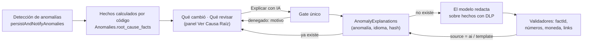

La explicación con IA se pide desde la pantalla, nunca en el cron, y sigue tres
reglas:

- **Cita hechos por id.** No puede nombrar una causa que no esté en la lista.
- **No ve montos.** Recibe porcentajes, z-score y nombres, porque la pantalla
  convierte la moneda y una cifra en USD dentro del texto la contradiría. Todo
  número del texto tiene que existir en los hechos.
- **Si no valida, no se muestra.** Quedan los hechos, y el rechazo se guarda
  para no pagar dos veces por los mismos datos.

La caché es por anomalía, idioma y hash del contexto ya redactado, es decir, por
lo que de verdad vio el modelo. La tabla cuelga de `Anomalies` y se borra con el
tenant en cascada. En modo demo no se simula: un texto fijo con la etiqueta
"Generado con IA" mostraría como IA algo que no lo es.

> **El principio:** la IA no decide nada que el código pueda calcular. Si el
> modelo no puede decirlo sin inventar, la pantalla muestra los datos y nada
> más.

### 19.3 CSV: la IA mapea columnas, el código convierte filas

La normalización anterior le mandaba al modelo las primeras 50 filas y devolvía
las que el modelo reescribía. Un archivo de 10.000 filas se procesaba sobre 50,
sin aviso, y los montos salían del modelo.

Ahora el modelo recibe los encabezados y 20 filas redactadas, y devuelve qué
columna corresponde a cada campo FOCUS y en qué orden vienen las fechas. El
código valida ese mapeo (las columnas existen, no hay campos repetidos, y están
el costo y el servicio) y lo aplica a **todas** las filas. Los montos y las
fechas los interpreta el código: una fecha ambigua queda vacía, no adivinada.

El mapeo se guarda por tenant y conjunto de encabezados, y se consulta **antes**
del gate: el mismo formato no vuelve a enviar datos ni a consumir cuota. Si no
hay IA disponible, el upload falla con el motivo en lugar de cargar datos a
medias. Los archivos FOCUS siguen sin pasar por la IA.

El reporte que se redacta después de la carga (`getAssessment`) también pasa por
el gate, como la feature `billing-upload-assessment`. Si se niega, la carga
devuelve el resumen por servicio que ya calculó el código, con el motivo. El
reporte sale en el idioma de la pantalla y rotula la moneda del archivo, sin
inventarla si el archivo no la trae. La API de carga exige Business en el
servidor, no sólo en la navegación.

### 19.4 Lo que no es IA no se llama IA

El botón "Autocompletar con IA" de Gobernanza de Etiquetas era una heurística sobre la
convención de nombres, con una confianza fija de 0,94. Ahora se llama **Sugerir
por convención de nombres**, la respuesta declara `method: "heuristic"` y la
confianza inventada desapareció. De paso, el endpoint exige `tenantId` y acceso
al tenant: se quitaron el bypass `?mock=true` y la caída al tenant `"default"`.

### 19.5 Lo que se corrigió de paso (MEJ-42)

- **El triaje de anomalías no se guardaba.** El panel mandaba un vocabulario que
  la columna `ENUM` de la base rechazaba, y el error se tragaba. Ahora hay un solo
  endpoint de triaje con el vocabulario de la base, que exige Admin, Owner o
  Colaborador y fija la fecha de cierre de la que sale el tiempo medio de acción.
- **La carga de CSV** valida el plan en el servidor y su reporte pasa por el gate
  (19.3).
- **Los exports** escriben el detalle por medidor (19.2).
- **Los subencargados** declaran que la inferencia de IA corre en Azure (Azure
  OpenAI y Azure AI services), y Cloudflare figura en la lista.

### 19.6 La IA de plataforma sin keys

La IA que paga la plataforma puede correr en una cuenta de Azure AI Services
propia del stamp, con la identidad administrada de la app como credencial: no
hay keys que rotar ni guardar. Queda apagado detrás de `ai_services_enabled`
hasta el rollout.

- **Red.** La cuenta no tiene acceso público. La app la alcanza por un private
  endpoint en la VNet del stamp, con tres zonas DNS privadas (`cognitiveservices`,
  `openai` y `services.ai`). Si falta una, ese nombre resuelve a la IP pública y
  la llamada falla con 403, la misma falla silenciosa que tuvo Redis.
- **Región.** La cuenta va en West US 3 porque West US 2 no ofrece modelos de
  Azure OpenAI; el private endpoint queda en West US 2. Con Data Zone Standard la
  inferencia no sale de Estados Unidos. El centro de confianza dice hoy
  «despliegue único en West US 2»: hay que actualizarlo al prender la cuenta.
- **Identidad.** La misma identidad user-assigned que lee Key Vault, con el rol
  *Cognitive Services OpenAI User* sobre la cuenta. Puede pedir inferencias, pero
  no administrar la cuenta ni leer sus keys.
- **Alcance.** Sólo la IA de plataforma con Azure OpenAI. BYOK y los otros
  proveedores siguen con su key. Sin identidad, en desarrollo local, la app usa
  la key como antes.
- **Transición en dos pasos.** Primero la cuenta convive con la key: la app pasa
  a Entra ID sólo con `ai_services_entra_auth`, y volver atrás es apagar ese flag
  sin borrar la cuenta. Después se apagan las keys de la cuenta.
- **Costo.** Unos US$9 por mes fijos (private endpoint y zonas DNS) más el
  consumo del modelo. Tiene un presupuesto propio de US$50 por mes con avisos al
  50, 75, 90 y 100 %.

### 19.7 Soporte: la IA sugiere, el operador decide

Dos ayudas para el equipo de CSCloudSolutions en `/superadmin/support`. Las paga
la plataforma con su propia IA, nunca con la BYOK del tenant, y no consumen la
cuota del cliente. Arrancan apagadas: primero hay que medir si el volumen de
tickets las justifica.

- **Triaje.** Al crear un ticket, después de responderle al usuario, el modelo
  sugiere prioridad, categoría, módulo e impacto productivo, eligiendo entre
  valores cerrados. La sugerencia queda en su propia tabla y **nunca** cambia la
  prioridad ni el SLA. Aceptarla pasa por el mismo PATCH que un cambio manual:
  la IA no tiene un camino propio para escribir en el ticket.
- **Borradores.** A pedido del operador, el código busca en los manuales las
  secciones que mejor responden el ticket, en su idioma, y el modelo redacta
  citándolas. Si cita una sección que no se le dio, el borrador no se guarda. El
  que pasa la validación queda como **nota interna**: nunca se envía solo.

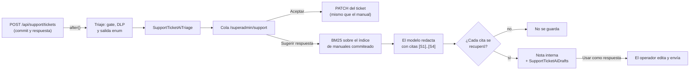

- **Por qué un índice commiteado.** La imagen de Docker no lleva `docs/` ni los
  `.md`, así que el índice no se puede armar en el build ni en runtime. Se genera
  con `npm run support:index` y un test falla si no corresponde a los manuales.
  Son unos cientos de secciones: BM25 en memoria alcanza y no hace falta una
  base vectorial.
- **Qué ve el modelo.** El ticket va dentro de `<context_data>`, como dato. Del
  hilo sólo viajan los mensajes públicos, sin emails ni nombres. Si el tenant no
  comparte nombres de recursos o tags con la IA, el texto libre del ticket no
  sale. Los manuales de superadmin, seguridad, HLD y LLD quedan fuera del índice.
- **Cómo se mide.** La cola muestra la primera respuesta, los SLA incumplidos y
  el porcentaje de borradores que se enviaron, en una ventana de 30 días.

### 19.8 Lo que queda

- El rollout de 19.6: confirmar la cuota del modelo en West US 3, actualizar el
  centro de confianza, aplicar con la app todavía en la key, verificar el DNS
  privado desde el contenedor y recién después pasar la app a Entra ID y apagar
  las keys. Con Entra ID todos los planes usan el mismo modelo mini; si
  Enterprise necesita uno mayor, hace falta un segundo deployment.
- Legal decide si la aclaración de subencargados exige el aviso de 30 días; si lo
  exige, va antes de habilitar las funciones a clientes. El borrador actual
  (`docs/aviso-cambio-subencargado-2026.md`) cubre sólo el cambio de ubicación.
- Los otros que llaman a `getAssessment` (reporte con IA, assessment y reporte
  ejecutivo) siguen sin tier ni cuota, en español y USD.
- En la ingesta FOCUS, la columna de servicio puede tomar `ServiceCategory` y la
  de suscripción no reconoce `SubAccountId`. Corregirlo exige limpiar datos.
- La IA de soporte (19.7): aplicar las migraciones, medir el volumen, confirmar
  qué tickets usan el manual del partner y recién después prender los
  interruptores.
- Las fases 2 y 4 de la propuesta: tags y Document Intelligence.
