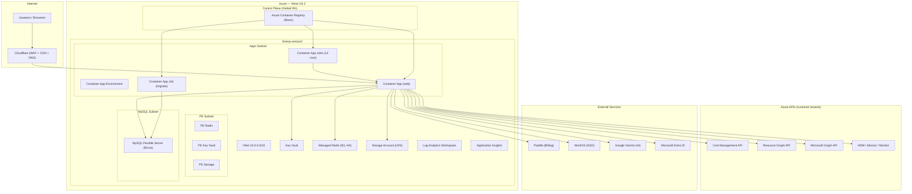
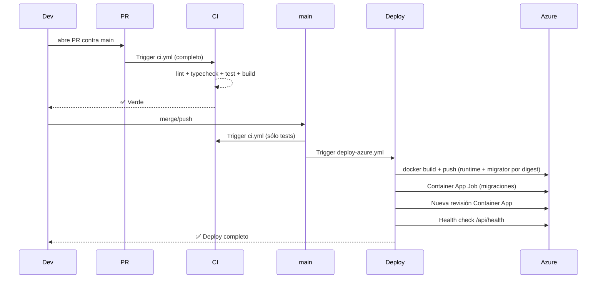
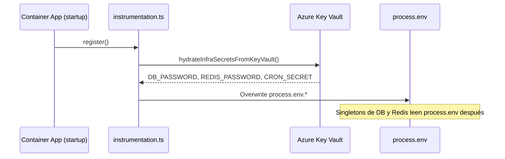
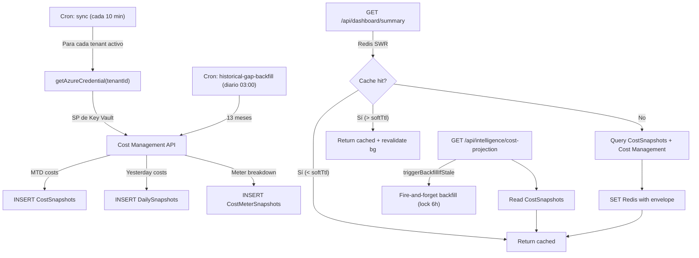

# Low-Level Design (LLD) — CSCloudSolutions FinOps Platform

**Versión:** 1.3\
**Fecha:** 2026-10-16\
**Autor:** Equipo de Arquitectura Cloud & FinOps — CSCloudSolutions

---

## 1. Resumen Ejecutivo

CSCloudSolutions FinOps es una plataforma SaaS **Azure-only**, multi-tenant, diseñada para dar visibilidad, optimización y gobernanza del gasto en la nube de Microsoft Azure. Corre sobre **Next.js 16** (App Router, TypeScript) con backend integrado (API routes), persistencia en **MySQL Flexible Server** y caché/locks en **Azure Managed Redis (Balanced B3, HA)**.

### Métricas del codebase

| Dimensión | Valor |
|---|---|
| Líneas de código fuente (src/) | **~99,500** |
| Archivos TypeScript/TSX | **676** |
| Rutas API (route.ts) | **238** |
| Páginas de UI (page.tsx) | **127** (120 únicas bajo `[locale]/`) |
| Tablas de BD | **84** |
| Migraciones SQL | **57** |
| Tests (Vitest) | **65 archivos**, ~592 tests |
| Módulos Terraform | **18** |
| Líneas de IaC (.tf) | **~5,500** |
| Recursos de infra gestionados | **83+** |
| Variables de entorno (.env) | **72** |
| Idiomas (i18n) | **3** (es, en, pt-BR) — 4,114 strings c/u |

### Actualización relevante 2026-08-13

- Se agregó el módulo **Azure Integration Services (iPaaS)** en `intelligence/integration-services` con tabs:
  `logic-apps`, `apim`, `service-bus`, `event-grid`, `event-hubs`, `adf`.
- Backend nuevo: `GET /api/intelligence/integration-services/[service]` (tenant-scoped, mock por tier, KPIs + tabla FinOps/CMP).
- Sección específica en Logic Apps para **Conectores Enterprise**.
- Hardening de despliegue staging en migraciones:
  - `20260813-001-azure-foundry-snapshots.sql`: ajuste de prefijos de índice por límite MySQL (`ER_TOO_LONG_KEY`).
  - `20260813-001-tagging-policies-table.sql`: seed compatible con variantes de esquema legacy (`tenant_id|tenantId`, `policy_name|policyName|tag_key`, `is_required|isRequired|required`).
  - `.github/workflows/deploy-staging.yml`: diagnóstico automático de execution + replica logs ante fallo del job de migración.

---

## 2. Arquitectura de Alto Nivel



### Patrón de despliegue: Stamp-based

La infra usa un patrón de **stamps** (sellos regionales). Hoy existe un único stamp (`westus2`). La key del mapa es el valor de `Tenants.data_residency`. Agregar un segundo stamp requiere:
1. Declarar la entrada en `var.stamps`
2. Declarar el dominio regional del stamp (`custom_domain_name`, por ejemplo `eu.<dominio>`) y cargar su registro en Cloudflare. No hay router global: Front Door se eliminó del Terraform el 2026-10-10 (último estado en el commit `979582f`)

---

## 3. Stack Tecnológico

### 3.1 Frontend

| Tecnología | Versión | Propósito |
|---|---|---|
| Next.js | 16.2.7 | Framework full-stack (App Router, standalone output) |
| React | 19.2.4 | UI library |
| TypeScript | ^5 | Type safety |
| Tailwind CSS | ^4 | Styling |
| next-intl | ^4.13.0 | i18n (3 idiomas) |
| Recharts | ^3.8.1 | Gráficos y visualizaciones |
| Lucide React | ^1.17.0 | Iconos |
| SWR | ^2.4.2 | Data fetching client-side |
| Zustand | ^5.0.14 | State management |
| React Grid Layout | ^2.2.3 | Dashboard widgets configurables |
| cmdk | ^1.1.1 | Command Palette |
| MSAL Browser/React | ^5 | Auth con Microsoft Entra ID |

### 3.2 Backend

| Tecnología | Versión | Propósito |
|---|---|---|
| Next.js API Routes | 16.x | 238 endpoints REST |
| mysql2 | ^3.22.4 | Pool de conexiones a MySQL |
| ioredis | ^5.11.1 | Cliente Redis (TLS-aware) |
| jose / jsonwebtoken | ^6 / ^9 | JWT validation |
| @azure/* SDKs | Varios | Cost Management, Resource Graph, ARM, Graph, Key Vault, Identity, Storage |
| AI SDK (Vercel) | ^6.0 | Abstracción multi-proveedor IA |
| decimal.js | ^10.6.0 | Aritmética de precisión para costos |
| Paddle SDK | ^1.6.4 | Billing SaaS |
| WorkOS Node | ^10.7.0 | Enterprise SSO |

### 3.3 Infraestructura

| Componente | Recurso Azure | SKU/Tier |
|---|---|---|
| Compute | Container Apps | Consumption plan |
| Base de datos | MySQL Flexible Server | B1ms |
| Cache/Locks | Managed Redis | Balanced B3, HA |
| Secretos | Key Vault | Standard |
| Blobs | Storage Account | Standard LRS |
| Observabilidad | Log Analytics + App Insights | — |
| Registry | Container Registry | Basic |
| CDN/WAF | Cloudflare (externo) | — |
| IaC | Terraform | >= 1.8, azurerm ~> 4.0 |

---

## 4. Modelo de Datos

### 4.1 Esquema: 84 tablas

El esquema se gestiona vía **migraciones SQL incrementales** en `migrations/`. El runner ([migrations.ts](file:///Users/manuelchavez/Documents/FinOpsProyect/src/modules/storage/migrations.ts)) las aplica automáticamente en `initializeDatabase()`.

**Tablas core por dominio:**

| Dominio | Tablas principales |
|---|---|
| **Tenancy** | `Tenants`, `TenantSubscriptions`, `TenantCommercialDeals`, `TenantGlobalSettings`, `Users`, `TenantSSO`, `TenantDelegations`, `TenantProviderTransitions` |
| **Cost Data** | `CostSnapshots`, `cost_snapshots`, `CostMeterSnapshots`, `CostCategorySnapshots`, `DailySnapshots`, `AICostSnapshots` |
| **Optimization** | `RecommendationsCache`, `SavingsHistory`, `Anomalies`, `HARecommendations`, `AppServiceRecommendations`, `SqlDbRecommendations`, `StorageRecommendations`, `VmssRecommendations` |
| **Budgets** | `Budgets`, `TenantMonthlyBudgets`, `CostCenterBudgets`, `AlertRules` |
| **Governance** | `TaggingPolicies`, `ExpiringCredentials`, `PowerSchedules`, `TtlPolicies`, `TtlDeletions`, `AllocationRules` |
| **Cost Groups** | `CostGroups`, `CostGroupResourceGroups` |
| **Billing & Reports** | `ExecutiveReportJobs`, `ExecutiveReportHistory`, `TenantMarkupSettings`, `MarkupOverrideRules`, `TenantFocusSchedule`, `BillingTransactions`, `MarketplaceEvents`, `MACCCommitments` |
| **Auth/Security** | `AuthTokens`, `SSOSessions`, `MfaChallenges`, `LegalAcceptances`, `PublicApiKeys`, `MCPApiKeys`, `TenantPublicApiKeys`, `TenantMcpApiKeys` |
| **Support** | `SupportTickets`, `SupportTicketMessages`, `SupportTicketAttachments` |
| **Notifications** | `Notifications`, `TenantNotifications`, `NotificationChannels`, `NotificationLog` |
| **Platform & Operations** | `GlobalSettings`, `PlatformGlobalAiConfig`, `SaaSCronJobs`, `SaaSComponentHealth`, `TenantPartnerCenterAssociations`, `TenantM365CopilotSettings`, `PlatformIncidents`, `PlatformStatusSnapshots`, `PlatformAiUsage`, `SystemAlerts`, `LoadTestRuns`, `SaaSLoadTestHistory` |
| **Open Data** | `OpenDataServices`, `OpenDataRegions`, `OpenDataResourceTypes`, `OpenDataPricingUnits`, `OpenDataCommitmentEligibility`, `OpenDataSyncState`, `BillingPricingUnitsCatalog` |
| **Onboarding** | `OnboardingProgress`, `SignupEvents`, `AcademyProgress` |
| **Data Residency** | `DataResidencyChanges` |
| **FX** | `FxRates`, `UserCurrencyPreference`, `PricingUnits` |
| **FOCUS** | `FocusLineItems`, `FocusExportSchedules` |
| **Analytics** | `BusinessMetrics`, `BusinessMetricsConfig`, `CopilotUsage`, `TenantAiSettings`, `TenantIntegrations` |
| **Audit** | `AuditTrailLogs`, `ActionLogs`, `AiCache`, `DataPipelineEvents`, `RemediationRequests`, `RecommendationActions` |

### 4.2 Pool de Conexiones

- **Driver:** `mysql2/promise` con pool singleton vía `globalThis` (evita múltiples pools en hot-reload de dev).
- **Connection limit:** configurable vía `DB_POOL_LIMIT` (default 10).
- **TLS:** habilitado en prod vía `DB_SSL=true` (TLSv1.2, `rejectUnauthorized: true`).
- **Collation:** `utf8mb4_unicode_ci` (Terraform; **no** `utf8mb4_0900_ai_ci` — divergencia causa `ER_FK_INCOMPATIBLE_COLUMNS`).

### 4.3 Redis

- **Driver:** `ioredis` con TLS condicional (`REDIS_TLS=true` en prod).
- **Singleton** vía `globalThis`.
- **Puerto:** 6380 (TLS) / 6379 (plain).
- **Patrones de cache:**
  - **Simple TTL:** `getWithCache(key, fetcher, ttl)` — lookup → fetch → set EX.
  - **Stale-While-Revalidate:** `getWithStaleWhileRevalidate(key, fetcher, ttl, softTtl, dynamicTtl)` — envelope `{__sw, t, data}` con soft/hard TTL y deduplicación in-flight.
  - **Invalidación:** `invalidateCache(...keys)`, `invalidateCachePattern(glob)`.

---

## 5. Seguridad y RBAC

### 5.1 Autenticación

La plataforma soporta **dos mecanismos** de autenticación:

1. **Microsoft Entra ID (MSAL):** Flujo principal. El frontend obtiene un token MSAL y lo envía como `Authorization: Bearer <token>`. El backend valida el JWT contra OpenID Connect metadata de Microsoft, verifica `tid`, `aud`, `iss`, `exp`, y extrae claims.

2. **Enterprise SSO (WorkOS):** Para tenants Enterprise con SSO configurado. Flujo OAuth/SAML vía WorkOS.

**Guard chain** (en [requestAuth.ts](file:///Users/manuelchavez/Documents/FinOpsProyect/src/lib/requestAuth.ts)):

| Guard | Qué verifica |
|---|---|
| `requireRequestIdentity` | Token válido, claims básicos, rechaza MSA consumers (`9188040d-…`) |
| `requireTenantAccess` | Identity + usuario pertenece al tenant solicitado |
| `requireTenantRole` | TenantAccess + rol mínimo (Admin/Owner) |
| `requireTenantTier` | TenantAccess + tier del tenant ≥ tier requerido |
| `requireSuperAdmin` | Identity + `system_role = SUPERADMIN` |

**Protección IDOR:** La regla ESLint `local/no-unauth-tenant-id` en CI bloquea cualquier ruta que lea `tenantId` sin pasar por uno de los cinco guards (los cinco están en la allow-list de la regla).

**Gating de tier server-side:** `RouteTierGate`, `FeatureGuard` y el Sidebar filtran la UI, no la API. Toda ruta que sirva una feature registrada en `src/lib/routeTiers.ts` debe usar `requireTenantTier`, o un tenant de tier inferior puede pedirle los datos directo con un token válido de su propio tenant. Al 2026-08-21 lo usan 40 archivos de ruta; fue el finding **SEC-02** de `docs/security/audit-2026-08-21.md`.

**Orden de los branches demo respecto del guard — regla condicional.** El check `isMockTenant` puede ir **antes** del guard si y sólo si la rama mock devuelve exclusivamente literales sintéticos. Si esa rama consulta MySQL, Redis, Azure o cualquier estado compartido, **el guard va primero**: de lo contrario un llamador anónimo con `?tenantId=demo-x` alcanza ese estado sin autenticarse (finding **SEC-01** de `docs/security/audit-2026-08-09.md`). Al 2026-08-21 el código está repartido 76 rutas con mock primero y 70 con guard primero, y ambos órdenes son correctos donde están aplicados según ese criterio. Los mocks no son una frontera de autorización: un payload mock nunca puede contener datos de un tenant real, porque `isMockTenant` matchea las subcadenas `demo`/`mock` y ninguna de sus letras es un dígito hexadecimal válido en un GUID de Entra ID.

### 5.2 Modelo de Tiers y Control de Cuotas

```
Professional (1) < Business (2) < Enterprise (3)
```

Cada tier tiene **límites de uso contractuales** y **features gated**:

| Límite / Dimensión | Professional | Business | Enterprise |
|---|---|---|---|
| **Suscripciones Azure Vinculadas** | Hasta 2 suscripciones | Hasta 3 suscripciones | Ilimitadas / Personalizado |
| **Usuarios por Tenant** | Hasta 3 usuarios | Hasta 5 usuarios | Ilimitados |
| **Retención de Reportes Ejecutivos** | 90 días | 180 días | 365 días |
| **Frecuencia de Sync** | 6 horas | 1 hora | 10 minutos (Real-time) |
| **Features Exclusivas** | Básicas, +Anomalías, +Copilot IA | +Simulador What-If, +Cost Groups, +Remediación | Todo + SSO Enterprise + SLA 99.9% + Data Residency |

**Motor de Enforzamiento de Cuotas (`tierLimitsGuard.ts` & `useTenantPlanLimits.ts`):**
- Control reactivo antes del aprovisionamiento de nuevas suscripciones cloud (`canAddSubscription`).
- Despliegue de modal dinámico (`UpgradeModal.tsx`) con pasarela Paddle para tenants B2B.

### 5.3 Cron Jobs — Autenticación por `CRON_SECRET` y Arquitectura `async_poll`

Procesos periódicos autenticados con `Authorization: Bearer $CRON_SECRET`:

| Job | Frecuencia (GMT-3) | Propósito | Contrato |
|---|---|---|---|
| `sync` | diario 03:00 (06:00 UTC) | Sincroniza costos de Azure Cost Management con deadline cooperativo por tenant | `async_poll = true` |
| `prewarm-daily` | diario 04:00 (07:00 UTC) | Pre-cálculo y calentamiento exhaustivo de caché Redis (TTL 26h): KQL 30+ reglas, Zombies, Whiteboard, MTD/Históricos, Inventario, Tags, Madurez, Scorecard | `async_poll = true` |
| `historical-gap-backfill` | diario 00:00 (03:00 UTC) | Backfill y reconciliación de datos históricos faltantes (upsert-only) | `async_poll = true` |
| `prewarm-dashboard` | cada 10 min | Pre-cachea datos del dashboard general | Sincrónico (300s) |
| `prewarm-databases` | cada 15 min | Pre-cachea diagnósticos y métricas de los 12 motores de bases de datos (SQL, Cosmos, Postgres, MySQL, Mongo, Redis) | `async_poll = true` |
| `prewarm-compute` | cada 15 min | Pre-cachea workloads de cómputo (VMs, WebApps, Functions, VMSS, ARO) | `async_poll = true` |
| `prewarm-mysql-finops` | cada 20 min | Pre-cachea cockpit dedicado de Azure MySQL | Sincrónico (300s) |
| `prewarm-cosmos-finops` | cada 20 min | Pre-cachea cockpit dedicado de Cosmos DB | Sincrónico (300s) |
| `prewarm-mongo-finops` | cada 20 min | Pre-cachea cockpit dedicado de MongoDB | Sincrónico (300s) |
| `prewarm-sql-finops` | cada 20 min | Pre-cachea cockpit dedicado de Azure SQL / Managed Instance | Sincrónico (300s) |
| `prewarm-postgres-finops` | cada 20 min | Pre-cachea cockpit dedicado de PostgreSQL | Sincrónico (300s) |
| `prewarm-storage-finops` | cada 20 min | Pre-cachea cockpits dedicados de Almacenamiento | Sincrónico (300s) |
| `prewarm-security-finops` | cada 20 min | Pre-cachea módulo de Seguridad (Defender + service-cost) | Sincrónico (300s) |
| `anomaly-detection` | cada 5 min | Detección de anomalías de costo (Z-Score) | Sincrónico (300s) |
| `power-schedules` | cada 2 min | Ejecuta encendido/apagado programado de VMs | Sincrónico (120s) |
| `cost-sync-staleness-check` | diario 05:00 (08:00 UTC) | Alerta si el sync diario no dejó datos frescos | Sincrónico (default) |
| `credential-expiry-alerts` | diario 04:00 (07:00 UTC) | Alerta App Registrations por vencer | Sincrónico (default) |
| `focus-export-daily` | diario 04:00 (07:00 UTC) | Genera exports FOCUS 1.1 diarios automáticos | Sincrónico (1800s) |
| `open-data` | semanal (lunes 01:00) | Sincroniza datos abiertos de Azure FinOps Toolkit | Sincrónico (1800s) |
| `status-snapshot` | cada 5 min | Status page snapshot (uptime 30d) | Sincrónico (`auth_mode = query`) |
| `subscription-expiry` | diario 03:30 (06:30 UTC) | Alertas y corte de suscripciones canceladas vencidas | Sincrónico (default) |
| `support-attachments-cleanup` | diario 02:00 (05:00 UTC) | Limpieza de adjuntos de soporte > 60 días | Sincrónico (default) |
| `storage-retention-cleanup` | diario 04:00 (07:00 UTC) | Purga blobs de reportes ejecutivos según tier | Sincrónico (default) |
| `trial-expiry` | diario 22:00 (01:00 UTC +1) | Expira trials vencidos | Sincrónico (default) |
| `ttl-expiry-alerts` | diario 06:00 (09:00 UTC) | Alertas preventivas TTL antes de borrado | Sincrónico (default) |

> **Nota:** Los crons corren en **GMT-3** (`cron_timezone_offset_hours = -3`), no UTC. Los jobs pesados utilizan el protocolo `async_poll` con polling cada 15s (`?status=1`) y locks en Redis para evitar el timeout de 240s del Ingress de Azure Container Apps.

### 5.4 SuperAdmin Session Impersonation Engine

Motor de delegación de sesiones para auditoría y soporte SuperAdmin:
- **Intercambio Seguro:** Cookie HTTP-only cifrada `saas_impersonation_session` con validez máxima de 4 horas (`maxAge: 14400`).
- **Banner Flotante Global:** Componente renderizado en `z-[90]` que informa de manera nítida la identidad del tenant impersonado y el email del SuperAdmin ejecutor, con botón de retorno seguro a `/superadmin/tenants`.
- **Trazabilidad Inmutable:** Registro automático en `AuditTrailLogs` con `isImpersonated: true` y `executedBySuperAdmin`.

### 5.5 Headers de Seguridad

Configurados en [next.config.ts](file:///Users/manuelchavez/Documents/FinOpsProyect/next.config.ts):

- `X-Frame-Options: DENY`
- `X-Content-Type-Options: nosniff`
- `Referrer-Policy: strict-origin-when-cross-origin`
- `Permissions-Policy: camera=(), microphone=(), geolocation=(), payment=(), usb=()`
- `Strict-Transport-Security: max-age=31536000; includeSubDomains; preload` (solo prod)
- **CSP** completa con `default-src 'self'`, dominios permitidos para Paddle, Microsoft, Google Fonts, Cloudflare Insights.

---

## 6. Capa de Servicios (Negocio)

### 6.1 Services (26 archivos)

Los servicios viven en `src/services/` y encapsulan lógica de dominio. Los route handlers los invocan; nunca la UI directamente.

**Top 10 por complejidad:**

| Servicio | Líneas | Dominio |
|---|---|---|
| [anomalyDetectionService](file:///Users/manuelchavez/Documents/FinOpsProyect/src/services/anomalyDetectionService.ts) | 374 | Z-score anomaly detection |
| [reservationService](file:///Users/manuelchavez/Documents/FinOpsProyect/src/services/reservationService.ts) | 348 | RI/SP management |
| [powerScheduleService](file:///Users/manuelchavez/Documents/FinOpsProyect/src/services/powerScheduleService.ts) | 321 | VM start/stop scheduling |
| [haService](file:///Users/manuelchavez/Documents/FinOpsProyect/src/services/haService.ts) | 259 | High Availability assessment |
| [budgetService](file:///Users/manuelchavez/Documents/FinOpsProyect/src/services/budgetService.ts) | 241 | Azure budgets CRUD |
| [tagInheritanceService](file:///Users/manuelchavez/Documents/FinOpsProyect/src/services/tagInheritanceService.ts) | 186 | Tag compliance + remediation |
| [governanceReportingService](file:///Users/manuelchavez/Documents/FinOpsProyect/src/services/governanceReportingService.ts) | 184 | Governance score + report |
| [remediationService](file:///Users/manuelchavez/Documents/FinOpsProyect/src/services/remediationService.ts) | 179 | Delete/deallocate/downgrade VMs |
| [costGroupDetailMetricsService](file:///Users/manuelchavez/Documents/FinOpsProyect/src/services/costGroupDetailMetricsService.ts) | 168 | Cost group analytics |
| [snapshotService](file:///Users/manuelchavez/Documents/FinOpsProyect/src/services/snapshotService.ts) | 167 | Daily cost snapshots |

### 6.2 Modules (29 archivos)

Los módulos viven en `src/modules/` organizados en tres capas:

- **`collectors/azure/`** — Integraciones con SDKs de Azure (Cost Management, Resource Graph, Advisor, Graph, Log Analytics, Container Apps, Cosmos DB, etc.)
- **`core/`** — Motores agnósticos (AI Provider, FOCUS mapper, rightsizing engine, KQL catalog)
- **`storage/`** — Persistencia (pool MySQL, migrations, region pool)

**El archivo más complejo:** [billingService.ts](file:///Users/manuelchavez/Documents/FinOpsProyect/src/modules/collectors/azure/billingService.ts) — **1,302 líneas**. Es el corazón del sistema: consulta Cost Management por Management Group y por suscripción, con fallback, reintentos con backoff exponencial, y diagnóstico de 429s.

---

## 7. Pipeline CI/CD

### 7.1 Workflows

Workflows relevantes para CI, despliegue e infraestructura. El circuito de
Terraform autenticado es independiente del build/despliegue de la aplicación;
ver §51 para la configuración desplegada de runners y backend.

| Workflow | Trigger | Qué hace |
|---|---|---|
| [ci.yml](file:///Users/manuelchavez/Documents/FinOpsProyect/.github/workflows/ci.yml) | Push a `main` y PRs a `main` | En PR: lint → typecheck → test → build. En push a `main`: **sólo** el job de tests, porque el `next build` de la imagen ya hace los otros tres |
| [deploy-azure.yml](file:///Users/manuelchavez/Documents/FinOpsProyect/.github/workflows/deploy-azure.yml) | Push a `main` | Build y despliegue a **staging** → migraciones → nueva revisión → cron jobs → health check |
| `promote-prod.yml` / `_deploy.yml` | Promoción manual / workflow reutilizable | Promueve el SHA elegido a producción; no usa los runners privados de Terraform |
| [terraform.yml](file:///Users/manuelchavez/Documents/FinOpsProyect/.github/workflows/terraform.yml) | PR de infraestructura/workflows/Dockerfile; dispatch; lunes 07:00 UTC | PR: solo scan sin OIDC. Dispatch desde `main`: scan bloqueante + plan del ambiente; apply solo con `APPLY-PROD` o `APPLY-STAGING`. Schedule: drift de ambos ambientes |
| `kv-firewall-reconcile.yml` | Cada 15 minutos, finalización de Terraform y dispatch | Retira leases/reglas vencidas por ambiente, desde su runner Azure; limpieza de backend por ARM antes de Blob |

Los dos que faltan respecto de versiones anteriores de este documento se
borraron, no se congelaron: `deploy.yml` y `restore-test.yml` se fueron en
`0fe7f17` con el resto del VPS retirado, y `deploy-staging.yml` en `78a6d1f`.
El despliegue de staging se dispara desde `main`, no por publicar una rama
llamada `staging`.

### 7.2 Flujo de deploy



### 7.3 Docker

- **Multi-stage build** ([Dockerfile](file:///Users/manuelchavez/Documents/FinOpsProyect/Dockerfile)): `deps` → `builder` → `runner`; rama `deps` → `migrator` sin compilar Next
- **Base:** `node:22-alpine` fijada a digest verificado
- **Output:** `standalone` (Next.js)
- **BuildKit:** SBOM/procedencia OCI y deploy por digest (§52.4, pendiente de rollout)
- **Configuracion publica:** seis valores de identidad/Paddle en runtime, no build args; prod importa los digests de staging (§52.4)
- **User:** runtime `nextjs` (uid 1001), migrador `migrate` (uid 1002), sin root

---

## 8. Integraciones Externas

### 8.1 Azure (tenant del cliente)

| API | Propósito | Autenticación |
|---|---|---|
| Cost Management | Costos MTD, forecast, histórico | SP del cliente (credentials en Key Vault) |
| Resource Graph | Inventario de recursos | SP del cliente |
| Advisor | Recomendaciones de optimización | SP del cliente |
| Microsoft Graph | Usuarios, licencias, MFA, M365 | SP del cliente |
| ARM (Compute, Network, Monitor) | Rightsizing, métricas | SP del cliente |
| Entra ID | Autenticación de usuarios | MSAL (browser) |

### 8.2 Servicios Terceros

| Servicio | Propósito | Configuración |
|---|---|---|
| **Paddle** | Billing SaaS (checkout, subscriptions, webhooks) | `PADDLE_API_KEY`, `PADDLE_WEBHOOK_SECRET` en Key Vault |
| **WorkOS** | Enterprise SSO (SAML/OIDC) | `WORKOS_API_KEY`, `WORKOS_CLIENT_ID` |
| **Google Gemini** | AI reports, copilot, assessments | `GEMINI_API_KEY` |
| **Cloudflare** | CDN, WAF, DNS | Full strict SSL, dominio `finops.cscloudsolutions.com.ar` |

---

## 9. Secretos y Key Vault

### 9.1 Flujo de hidratación



### 9.2 Credenciales de tenant

Los Service Principals de cada tenant se almacenan en Key Vault como secrets con naming convention:
- `tenant-{tenantId}-client-id`
- `tenant-{tenantId}-client-secret`

El módulo [keyvault.ts](file:///Users/manuelchavez/Documents/FinOpsProyect/src/lib/keyvault.ts) implementa cache con soft/hard TTL para evitar llamadas excesivas.

---

## 10. Superficie de UI

### 10.1 Navegación principal (120 páginas)

| Sección | Páginas | Tier mínimo |
|---|---|---|
| Dashboard (raíz) | 1 | Professional |
| Intelligence | 42 | Professional → Enterprise |
| Admin | 32 | Professional → Enterprise |
| Overview | 9 | Professional |
| Governance | 7 | Professional → Enterprise |
| Legal | 5 | — (público) |
| Superadmin | 5 | SUPERADMIN |
| Cleanup | 4 | Professional → Business |
| Mobile | 4 | Professional |
| Academy | 1 | Professional |
| Demo | 1 | — |

### 10.2 Componentes destacados

| Componente | Líneas | Rol |
|---|---|---|
| [TenantProvider](file:///Users/manuelchavez/Documents/FinOpsProyect/src/components/TenantProvider.tsx) | 76,158 bytes | Context global de tenant, suscripciones, scope |
| [ZombieResourcesTable](file:///Users/manuelchavez/Documents/FinOpsProyect/src/components/ZombieResourcesTable.tsx) | 51,516 bytes | Tabla interactiva de recursos zombie |
| [AdvisorPanel](file:///Users/manuelchavez/Documents/FinOpsProyect/src/components/AdvisorPanel.tsx) | 42,830 bytes | Panel de Azure Advisor |
| [TagManager](file:///Users/manuelchavez/Documents/FinOpsProyect/src/components/TagManager.tsx) | 35,685 bytes | Gestión de tags Azure |
| [GlobalCopilot](file:///Users/manuelchavez/Documents/FinOpsProyect/src/components/GlobalCopilot.tsx) | 30,916 bytes | Copilot IA flotante |
| [Sidebar](file:///Users/manuelchavez/Documents/FinOpsProyect/src/components/Sidebar.tsx) | 30,172 bytes | Navegación lateral |
| [ClientShell](file:///Users/manuelchavez/Documents/FinOpsProyect/src/components/ClientShell.tsx) | 25,384 bytes | Shell principal client-side |
| [PricingPage](file:///Users/manuelchavez/Documents/FinOpsProyect/src/components/PricingPage.tsx) | 24,077 bytes | Pricing + checkout Paddle |
| [mockData](file:///Users/manuelchavez/Documents/FinOpsProyect/src/lib/mockData.ts) | 160,657 bytes | Datos mock por tier (demo) |
| [apiErrors](file:///Users/manuelchavez/Documents/FinOpsProyect/src/lib/apiErrors.ts) | — | `serverError` (respuesta 500 sin filtrar internals) + narrowing tipado de errores capturados: `errorMessage`, `errorStatus` (acotado al rango HTTP 100-599 para no propagar errnos de driver), `errorCode`. Usado en 489 bloques `catch`, en reemplazo de `catch (e: any)` |

---

## 11. Infraestructura Terraform

### 11.1 Módulos (18)

```
infra/terraform/modules/
├── acr/               # Container Registry
├── budget/            # Azure Budget + Action Groups
├── containerapp/      # Container App + Environment
├── cronjobs/          # 13 Container App Jobs (cron)
├── custom_domain/     # Custom domain + Managed Certificate
├── defender/          # Microsoft Defender for Cloud
├── diagnostics/       # Diagnostic settings
├── keyvault/          # Key Vault + access policies
├── monitoring/        # Action groups + metric alerts
├── mysql/             # MySQL Flexible Server
├── mysql_backup/      # Backup automation (VM + blob)
├── network/           # VNet + subnets + NSGs + DNS zones
├── private_dns/       # Private DNS zones
├── redis/             # Managed Redis (Enterprise)
├── security_policy/   # Security policies
├── stamp/             # Orquestador de un stamp completo
└── storage/           # Storage Account
```

### 11.2 Trampas conocidas de Terraform

> [!WARNING]
> Estas trampas están documentadas extensamente en [HANDOFF-FINAL-2026-07-28.md](file:///Users/manuelchavez/Documents/FinOpsProyect/HANDOFF-FINAL-2026-07-28.md).

1. **Redis HA:** `CREATE` con `high_availability=true` falla en West US 2. Crear con false, luego `UPDATE` a true.
2. **Managed Certificate bugs:** IDs desalineados entre `managedCertificates` y `certificates`. Se resuelve con `replace()`.
3. **State key:** Es `prod/terraform.tfstate` (con barra), no `prod.tfstate`.
4. **Collation MySQL:** El server usa `utf8mb4_unicode_ci`; local sin flag usa otra → FKs rompen.
5. **`AZURE_CLIENT_ID`** tiene 3 significados distintos según el contexto. Ver sección de trampas del handoff.

---

## 12. Estado Actual y Pendientes

### 12.1 ✅ Funcionando

- Deploy automático end-to-end (push a `main` → Container Apps)
- Dominio propio `finops.cscloudsolutions.com.ar` con certificado
- Autenticación MSAL + SSO
- 238 API routes con RBAC
- 4 tiers con feature gating
- Billing vía Paddle (checkout, subscriptions, webhooks)
- i18n en 3 idiomas
- 592 tests en verde
- Checkov 122/122 checks
- Key Vault para secretos de infra y tenant

### 12.2 ⚠️ Pendientes abiertos

| # | Pendiente | Severidad | Detalle |
|---|---|---|---|
| 1 | **KPIs de costo discrepantes** | Resuelto | Whiteboard usa una única colección MTD para KPI, Top Servicios y Centros de Costos; el refresh invalida ambas capas Redis y un `$0.00` real no se sustituye por mocks. |
| 2 | **Container Apps / Log Analytics tarjetas vacías** | Media | Puede ser víctima del 429 throttling. Necesita verificación en devtools post-deploy. |
| 3 | **Ahorro potencial: `Number("1,234.56") = NaN`** | Media | `extractSavings` parsea strings con separador de miles. Fix: limpiar la coma antes de `Number()`. |
| 4 | **429 del cron sync** | Media | Operaciones `yesterday(MG)` y `detailed()` concentradas a las 06:00 UTC. Solución: espaciar barrido de tenants o usar ventanas. |
| 5 | **`allowed_ip_ranges` vacío** | Baja | El FQDN de Azure es accesible directo sin Cloudflare WAF. El mecanismo existe en Terraform, solo falta cargar rangos de Cloudflare. |
| 6 | **Resource locks deshabilitados** | Baja | `resource_lock_enabled = false`. Habilitar cuando la infra estabilice. |
| 7 | **Drift de tags/workload_profile** | Cosmético | ~17 cambios permanentes en `plan`. Declarar valores explícitamente. |

### 12.3 Deuda técnica identificada

| Área | Descripción | Estado |
|---|---|---|
| `billingService.ts` (1,302 LoC) | Archivo monolítico refactorizado en submódulos por dominio (`billingTypes`, `mtdBillingService`, `forecastBillingService`, `yesterdayBillingService`, `historicalBillingService`) con patrón facade retrocompatible. | ✅ Completado (2026-07-31) |
| `TenantProvider.tsx` (76KB) | Componente god-object. Debería descomponerse. | Pendiente |
| `mockData.ts` (160KB) | Archivo masivo de mocks. Considerar archivos por dominio. | Pendiente |
| Tests | 66 archivos de test (638 pasados) con aislamiento por archivo en Vitest. | En progreso |
| SMTP | 6 variables SMTP declaradas con 0 usos — están configuradas pero no implementadas. | Pendiente |
| `PROVIDER_ARCHIVE_RETENTION_DAYS` | Variable obsoleta de proveedor eliminado removida de `.env.example`. | ✅ Completado (2026-07-31) |

---

## 13. Diagrama de Flujo de Datos — Ciclo de Costos

### 12.9 Azure Advisor (`/governance/advisor`)

- **UI:** `AdvisorPanel` (5 pestañas de pilar + tabla CMP + modal resolutivo). **API:** `GET /api/advisor`
  (SWR Redis `advisor:v4:*`, 30 min, `bust=1` invalida), `POST|DELETE /api/advisor/suppress`.
- **Servicio:** `getAdvisorExecutiveData` → `collectAdvisorData` (REST `2023-01-01`, paginada) +
  `deduplicateAndProcessRecommendations`.
- **Identidad del tenant:** `tenantName` es el nombre comercial resuelto desde
  `TenantGlobalSettings.organization_display_name` con fallback a `Tenants.company_name`; el GUID de Entra
  ID viaja aparte en `tenantGuid` y sólo se muestra como micro-badge con copiado. Nunca se publica el GUID
  como nombre.
- **Normalización i18n:** `advisorI18n.ts` es la única fuente. `category` e `impact` llegan de Azure siempre
  en inglés (el `Accept-Language` no los localiza), así que se traducen con `translateAdvisorCategory` /
  `translateAdvisorImpact` en el servidor y viajan como `categoryDisplayName` / `impactDisplayName`.
- **Deduplicación:** clave `categoría + recommendationTypeId + recurso` (`dedupKey`). El id crudo de Advisor
  cambia por suscripción y consulta, por lo que no sirve como identidad. En duplicados exactos gana el
  `lastUpdated` más reciente; las reservas agrupan además por suscripción.
- **Recurso afectado:** se parsea el ARM Resource ID de `resourceMetadata.resourceId` (precedencia sobre
  `impactedValue`, que trae el nombre corto) con `extractResourceDisplayName` → `resource: ParsedArmResource`
  (`rawId`, `subscriptionId`, `resourceGroup`, `resourceType`, `resourceName`). Sin valores inventados: si
  Advisor no expone grupo, el campo va vacío.
- **Acción sugerida:** `generateAdvisorRemediationAction` sintetiza la remediación concreta por tipo de
  recurso y `extendedProperties` (RIGHTSIZE / DELETE_ZOMBIE / ENABLE_HA / PURGE_STORAGE /
  PURCHASE_RESERVATION / APPLY_AHUB / UPDATE_TAGS / REVIEW). Es determinista a propósito —corre sobre cientos
  de recomendaciones por carga y el payload de Advisor ya trae SKU destino, CPU y ahorro—; sólo emite
  `UPDATE_TAGS` cuando la regla es de etiquetado.
- **Posposición (snooze) y Descarte Permanente:** persiste en `RecommendationActions` (`status='suppressed'`,
  `expires_at` con fecha para 30/90 días o `NULL` para descarte permanente, `user_email`, unique `tenant_id + recommendation_id`);
  se guarda la `dedupKey` como `recommendation_id` para que sobreviva al cambio de id crudo de Azure.
  `getAdvisorExecutiveData` reactiva las expiradas (`expires_at <= NOW()`) y excluye las vigentes de todas las vistas activas
  de Optimización y del cálculo del **Índice de Optimización (COIN)** (clasificándolas como *snoozed* o *dismissed* sin sumar al ahorro potencial pendiente).
  Requiere rol **Admin/Owner** del tenant. La UI aplica actualización optimista (quita la fila y descuenta los KPIs del pilar)
  revirtiendo si el POST falla.
- **Alcance Azure vs. Plataforma:** Las supresiones efectuadas en el Portal de Azure son detectadas y sincronizadas hacia la
  plataforma vía la REST API de suppressions de Azure. Las supresiones/descartes ejecutados desde la plataforma se gobiernan
  localmente en el tenant (principio de menor privilegio para no exigir permisos de escritura en Azure), por lo que en el Portal
  de Azure la recomendación podría continuar visible mientras que en la plataforma FinOps queda formalmente suprimida, auditada y fuera de los cálculos.

### 13.0 Whiteboard / Resumen Ejecutivo

- **Ruta UI:** `/[locale]/overview/whiteboard`, renderizada por `ExecutiveSummaryBoard` sobre `react-grid-layout`.
- **API facade:** `/api/overview/whiteboard` aplica mock-first, RBAC para tenants reales y caché aislada por tenant, locale y modo `mock|live`.
- **Agregador financiero:** `/api/intelligence/whiteboard` obtiene una colección mensual única desde Azure Cost Management (`ActualCost`) y deriva de ella `summary.costMtdUSD`, Top 4 servicios y gasto por CostCenter. Si Azure no entrega filas, usa `CostSnapshots` del mes actual sin datos sintéticos.
- **Fuentes complementarias:** `CostCenterBudgets`, Resource Graph para cobertura de tags, `getAdvisorExecutiveData` para pilares, Advisor Score y quick wins, `/api/dashboard/summary` para zombies y carbono.
- **Advisor (pilares, score y quick wins):** se consume `getAdvisorExecutiveData` —la misma fuente que `/governance/advisor`— y no `collectAdvisorData` crudo: viene deduplicada por recurso+regla (las variantes de término 1y/3y de una reserva colapsan en una) y se filtran las recomendaciones no activas (`postponed`/`dismissed`), de modo que los conteos coincidan con Azure Advisor. El `summary.advisorScore` es la media ponderada por consumo de la Advisor Score API. Cada quick win trae su comando CLI/PowerShell resuelto en servidor por `buildAdvisorRemediationCommand` sobre el `resourceId` real (el widget sólo tiene un generador de fallback).
- **Enriquecimiento server-to-server:** el self-fetch a `/api/dashboard/summary` (zombies, ahorro potencial, carbono) forwardea el `Authorization` o `X-Cron-Auth` de la request entrante; ese endpoint no acepta `x-forwarded-request` como credencial y sin forward devolvía 401 con KPIs en 0.
- **UX y personalización:** cinco KPI superiores y 16 tarjetas reubicables/redimensionables. Layout, visibilidad y panel lateral “Personalizar Tarjetas” se persisten por navegador; Top Servicios no incluye la categoría artificial Total y los ejes usan formatter adaptativo. El Copilot global permanece en `z-40`.
- **Pines:** widgets `whiteboard.*` registrados en `widgetRegistry`; demo persiste en `localStorage` y tenants reales en `UserDashboardPins` con RBAC.



### 13.1 Flujo de AI Cost Analytics (Microsoft Foundry / Azure OpenAI)

- **Ruta:** `GET /api/intelligence/ai-analytics`.
- **Fuente primaria:** `AICostSnapshots` (tokens por modelo desde Azure Monitor sobre `Microsoft.CognitiveServices/accounts`).
- **Métricas soportadas:** `ProcessedPromptTokens`, `GeneratedTokens` y `ProcessedInferenceTokens`.
- **Ingesta resiliente por métrica (fix 2026-08-05):** las métricas se piden **una por una** a Azure Monitor (no en un solo batch) porque el servicio rechaza todo el batch con 400 si un `metricname` no existe para ese recurso (p.ej. `ProcessedInferenceTokens` en cuentas Azure OpenAI clásicas). Cada métrica reintenta sin el filtro `ModelDeploymentName eq '*'` para cubrir recursos Foundry que no exponen esa dimensión. Ventana = ayer completo + hoy parcial; persistencia por fecha de datapoint (UTC).
- **Fallback de costos (SQL GROUP BY fix 2026-08-05):** cuando no hay desglose de tokens, consulta `CostSnapshots` por huellas de Microsoft Foundry / Azure AI Services / OpenAI (service + meter). Query incluye todas las columnas no agregadas en el GROUP BY para cumplir con `sql_mode=only_full_group_by` de Azure MySQL — antes fallaba silenciosamente, impidiendo que **ningún dato** se retornara incluso con filas válidas en BD.
- **Precisión de costos:** los totales, agrupaciones, tendencias y costo por 1K tokens conservan `Decimal` durante la agregación; la conversión a número ocurre solo en el límite de serialización con redondeo explícito.
- **Endpoint de diagnóstico:** `GET /api/intelligence/ai-analytics/diagnostics?tenantId=…` (guard `requireTenantAccess`). Reporta estado de `AICostSnapshots`, suscripciones visibles (con truncado por tier), cuentas `Microsoft.CognitiveServices/accounts` + `kind`, definiciones de métricas disponibles, prueba real de cada métrica de token (series + suma) y filas que produciría el colector, con conclusión heurística de por qué el panel está en cero. No requiere acceso a DB de prod ni a logs del cron. Incluye paginación 15/30/45/60 items por página.
- **RBAC mínimo:** no requiere rol nuevo; usa `Reader`, `Cost Management Reader`, `Monitoring Reader`, `Billing Reader`.

### 13.2 Costo actual MTD en productos Azure AI

- **Contrato canónico:** las ocho capacidades (`Foundry`, `AI Search`, `Document Intelligence`, `Speech & Language`, `Vision & Video`, `Content Safety`, `Azure ML` y `Databricks`) exponen `currentCostMtdUSD` como costo facturado acumulado del mes actual. `monthlyCostUSD` se conserva temporalmente como alias compatible para cachés y clientes anteriores.
- **Fuente:** Azure Cost Management con `timeframe: MonthToDate` y filtro exacto por `ResourceId`; si la API no está disponible se usa el snapshot MTD más reciente del mismo recurso. Un `$0.00` válido se conserva y nunca se reemplaza por precio teórico de SKU, páginas o capacidad.
- **Snapshots acumulativos:** `selectLatestAzureAiSnapshots` conserva el registro más reciente por recurso/deployment antes de agregar, evitando sumar snapshots diarios que ya contienen acumulados MTD.
- **Actualización manual:** `refresh=true` omite el caché consolidado y vuelve a consultar los collectors. Demo/mock se resuelve antes de RBAC y tenants reales nunca reciben datos sintéticos como fallback.

### 13.3 Azure AI Document Intelligence

- **Ruta UI/API:** `/[locale]/intelligence/azure-ai/document-intelligence` consume `GET /api/intelligence/azure-ai/document-intelligence?tenantId=…&days=mtd|30|90`.
- **Inventario:** `azureDocumentIntelligence.service.ts` consulta Resource Graph por `Microsoft.CognitiveServices/accounts` con kind `FormRecognizer`, `DocumentIntelligence` o `AIServices`; conserva `resourceId`, RG, región, suscripción, SKU, red pública y Private Endpoints.
- **Modelos custom:** intenta primero `/documentintelligence/models?api-version=2024-02-29-preview` y luego el endpoint estable `formrecognizer/documentModels`; la ausencia de permiso o endpoint no fabrica modelos.
- **Telemetría:** Azure Monitor consulta `ProcessedPages`, `TotalCalls`, `SuccessfulCalls`, `TrainingHours`, `ClientErrors` y `ServerErrors` por día. Si ARG devuelve vacío, el estado real permanece vacío; snapshots SQL solo se usan cuando ARG falla técnicamente.
- **Economía unitaria:** el costo canónico es Cost Management MTD por `ResourceId`. El reparto Read/Layout/Specialized/Custom/Training usa tarifas relativas únicamente para atribuir el total real, sin reemplazar `$0.00` ni modificar el total facturado.
- **Reglas:** Custom→Prebuilt, Commitment Tier sobre 50K páginas, dev S0→F0 bajo 500 páginas y cuentas huérfanas. `calculateDocIntelligencePotentialSavings` evita sumar ahorros superpuestos.
- **Seguridad:** `isMockTenant`/`mock=true` antes de `requireTenantAccess`; tenants reales nunca reciben fallback mock. Roles mínimos: Reader, Monitoring Reader y Cost Management Reader.

---

## 14. Convenciones del Proyecto

- **Commits:** granulares, con prefijo convencional (`feat:`, `fix:`, `chore:`…) y `Co-authored-by: Copilot`.
- **Migraciones:** `YYYYMMDD-NNN-descripcion.sql`, idempotentes (`IF NOT EXISTS`).
- **i18n:** toda string visible usa `useTranslations()`, 3 idiomas siempre en paridad.
- **Mocks por tier:** cada feature incluye mocks representativos en `mockData.ts`.
- **Precision:** costos en `DECIMAL` en DB, `decimal.js` en JS.
- **Auth:** toda ruta API que lea `tenantId` del cliente DEBE pasar por un guard de `requestAuth.ts`.

---

## 15. Variables de Entorno — Resumen

De las 72 variables declaradas:
- **35** con uso activo en `src/`
- **14** son healthcheck URLs de crons (usadas externamente, 0 en código)
- **6** son SMTP (declaradas pero sin implementación)
- **17** son de infraestructura/build (Terraform, Docker, Next.js build)

Las variables críticas están en Key Vault:
- `infra-db-password`, `infra-redis-password`, `infra-cron-secret`
- `tenant-{id}-client-id`, `tenant-{id}-client-secret`
- `infra-paddle-api-key`, `infra-paddle-webhook-secret`

---

## 16. Addendum 2026-08-03 — Operaciones SuperAdmin, PAL/CPOR y comisiones

### 16.1 Centro de Operaciones SaaS (SuperAdmin)

- **Nueva UI:** `/superadmin/ops` (solo `SUPERADMIN`).
- **Nueva API:** `GET/POST /api/superadmin/ops`.
  - `GET`: resumen de salud de componentes, cron status y cobertura de canales.
  - `POST`: dispatch de notificación operativa a tenants administrados.
- **RBAC:** guard estricto `requireSuperAdmin`.

### 16.2 Observabilidad persistente de crons

- **Nueva tabla:** `SystemCronRuns` (migración `20260803-001-system-cron-runs.sql`).
- **Helper reusable:** `src/lib/cronRunTracker.ts`.
- **Instrumentación aplicada** en crons críticos (`sync`, `power-schedules`,
  `status-snapshot`, `anomaly-detection`, `credential-expiry-alerts`,
  `ttl-expiry-alerts`, `cost-sync-staleness-check`, `focus-export-daily`,
  `historical-gap-backfill`).
- Cada ejecución registra `cron_name`, `status`, `duration_ms`, `summary`,
  `details`, timestamp y contexto de error.

### 16.3 Gestión comercial por tenant (vendedor + comisión)

- **UI SuperAdmin:** `/admin/tenants` incorpora edición por fila de:
  - `sales_referrer` (vendedor/referido)
  - `sales_commission_pct` (DECIMAL, 0–100, 2 decimales)
- **API:** `PATCH /api/admin/tenants` extendido para `salesCommissionPct`.
- **DB:** migración `20260803-002-tenants-sales-commission.sql` agrega:
  - `sales_commission_pct DECIMAL(5,2)`
  - `sales_commission_updated_by VARCHAR(320)`
  - `sales_commission_updated_at DATETIME`

### 16.4 PAL/CPOR (UX de recuperación)

- El bloque de asociación PAL/CPOR en onboarding vuelve a mostrarse mientras el
  estado no sea `LINKED` (incluye `FAILED`/`DECLINED`), permitiendo reintento
  sin depender de resets manuales de estado.

## 17. Dashboard & UI Fixes (Agosto 2026 - Sprint Whiteboard)

### 17.1 AI Cost Analytics Fixes (Commits 5035ad0, 6a79b52, 1be9ba6)

- **SQL `only_full_group_by` fix:** Corregidas queries en `/api/intelligence/ai-analytics/route.ts`
  - Las columnas en SELECT ahora coinciden con las expresiones COALESCE en GROUP BY
  - Previene silent failures (0 rows returned) en MySQL 8+
- **Date format fix:** Azure SDK devuelve Date objects, no ISO strings
  - Agregada detección en `aiUsageCollector.ts`: `dateObject.toISOString().substring(0, 10)`
  - Valida formato YYYY-MM-DD antes de INSERT en AICostSnapshots

### 17.2 Dashboard Feature Fixes

#### Whiteboard - Tendencia Recomendaciones (Commit a43da23)
- Cambio de filtro: `updated_at BETWEEN` → `created_at` con `status='open'`
- Ahora muestra recomendaciones activas incluso si son viejas (no fueron tocadas)

#### Ahorro Capturado (Commit aacf5b5)
- Nueva función `getTopSavingsResources()` en `/api/intelligence/captured-savings/route.ts`
- UI muestra tabla de top 10 recursos por ahorro estimado
- Permite visibility de qué assets generan más savings

#### Fugas Financieras (Commit a02e65d)
- ZombieResourcesTable ahora siempre visible (antes solo en click)
- Simplificado UI flow

#### Grupos de Costos - Error Untagged/unknown (Commit 37e07f1)
- Problema: Forward slash en `"Untagged/Unknown"` causaba error de pattern matching en rutas dinámicas
- Solución: Renombrado a `"Untagged"` en 6 archivos
- Archivos afectados: `cost-groups/[name]/route.ts`, `cost-groups/route.ts`, whiteboard, top-expenses, scorecard, mockData

#### Centros de Costos - Editables (Commit c66f976)
- Removida condición `data?.isCustom` para mostrar botones edit/delete
- Ahora todos los cost groups pueden ser editados, no solo los custom

#### Unit Economics - Formato Moneda (Commit f1795d8)
- Cambio: `costPerUserCents` → `costPerUserDollars` (sin *100)
- Tooltip formatter usa `format()` en lugar de mostrar `¢`
- Gráfico ahora muestra $1.23 en lugar de 123¢

## 18. Addendum 2026-08-07 — Pestaña acfr y métricas de Azure Cache for Redis

### 18.1 Endpoint de Métricas API (Commit de la sesión)
- **API Route:** `GET /api/intelligence/databases/redis-metrics`
- **Métricas Consultadas:** Consultas en paralelo de las 12 métricas críticas de Azure Monitor utilizando agregación `Average`, intervalo `PT1H` (por hora) y ventana de tiempo `PT24H` (últimas 24 horas):
  - CPU Usage (`PercentProcessorTime`), Server Load (`ServerLoad`), Used Memory (`UsedMemory`), Cache Hits (`CacheHits`), Cache Misses (`CacheMisses`), Connected Clients (`ConnectedClients`), Operations Per Second (`OperationsPerSecond`), Evicted Keys (`EvictedKeys`), Expired Keys (`ExpiredKeys`), Errors (`Errors`), Total Commands Processed (`TotalCommandsProcessed`), Cache Read (`CacheRead`) y Cache Write (`CacheWrite`).
- **Mocks Enriquecidos:** Si `isMockTenant` es `true` o no hay suscripciones activas, genera series temporales de simulación realistas con patrones diarios de uso comercial (más alto entre las 9am y 6pm) e incorpora un 10% de ruido aleatorio controlado y variaciones en forma de ondas sinusoidales para cada una de las 12 métricas.

### 18.2 UI de Supervisión (Pestaña acfr)
- **Ruta de UI:** `/intelligence/bases-de-datos/acfr` (montando el componente `RedisCacheFinopsBoard`)
- **Visualización:**
  - Panel superior con selectores de instancias de Redis, tarjetas ejecutivas para promedios de CPU, Memoria, Tasa de aciertos (Cache Hit Rate) y Carga de Servidor.
  - Grilla de visualización responsiva con 12 paneles de gráficas de área (`AreaChart` con gradientes de relleno lineales y bordes glassmorphic) donde se detalla la evolución de cada métrica con agregación promedio de forma explícita.
  - El gráfico 12 combina `CacheRead` (Network Read) y `CacheWrite` (Network Write) superpuestos en la misma vista de área interactiva con doble leyenda.

## 19. Addendum 2026-08-08 — Pestaña mysql y métricas de Azure Database for MySQL

### 19.1 Endpoint de Métricas API (MySQL)
- **API Route:** `GET /api/intelligence/databases/mysql-metrics`
- **Métricas Consultadas:** Consultas en paralelo de las 8 métricas críticas de Azure Monitor utilizando agregación `Average`, intervalo `PT1H` (por hora) y ventana de tiempo `PT24H` (últimas 24 horas) para servidores flex/single:
  - CPU Usage (`cpu_percent`), Memory Usage (`memory_percent`), Active Connections (`active_connections`), Failed Connections (`connections_failed`), Storage Usage (`storage_percent`), I/O Utilization (`io_consumption_percent`), Network Ingress (`network_bytes_ingress`) y Network Egress (`network_bytes_egress`).
- **Mocks Enriquecidos:** Si `isMockTenant` es `true`, genera series temporales con variaciones de carga comercial en horas pico de negocio, incluyendo ruido dinámico aleatorio y fluctuaciones en conexiones y bytes de red.

### 19.2 UI de Supervisión (Pestaña mysql)
- **Ruta de UI:** `/intelligence/bases-de-datos/mysql` (montando el componente `AzureMySqlFinopsBoard`)
- **Visualización:**
  - Panel superior con selectores de instancias de MySQL, tarjetas ejecutivas para promedios de CPU, RAM, Conexiones, Almacenamiento y el costo mensual acumulado real obtenido mediante `getMonthlyCostByType` y `distributeCostPerResource`.
  - Grilla de gráficos responsiva de 7 paneles interactivos con gradientes visuales y tooltips formateados de forma nativa para bytes, porcentajes y totales numéricos.

## 20. Addendum 2026-08-09 — Integridad de diagnósticos y sincronización

- **Autorización antes de mocks:** los endpoints de diagnósticos de MySQL, Redis, Cosmos DB, MongoDB, PostgreSQL, SQL y sus métricas exigen `requireTenantAccess` antes de evaluar el tenant demo.
- **Costos exactos:** la distribución de costos por recurso y las agregaciones de AI Analytics usan `decimal.js`; cada asignación se redondea explícitamente a centavos solo al formar la respuesta API.
- **Telemetría operacional:** los diagnósticos MySQL y Redis expresan campos o muestras sin medición como `null` y exponen `telemetry.available=false` con el origen `not_collected` cuando no existe telemetría. La UI muestra `No disponible`, no valores cero fabricados. Si Azure Monitor no entrega historial Redis, la API devuelve un historial vacío y el mismo estado explícito.
- **Sincronización cancelable:** el cron `sync` propaga un `AbortSignal` desde el deadline por tenant a Cost Management, Azure Monitor, Resource Graph, reintentos y concurrencia. Los guards locales impiden persistencias e invalidaciones de caché posteriores a una cancelación.

## 21. Addendum 2026-08-18 — Módulo de Redes Básicas (VNets, Private Endpoints, DNS, NSG & UDR)

### 21.1 Arquitectura y Capa de Datos
- **Service Backend:** `src/services/azureBasicNetworking.service.ts`
- **Tipado TypeScript:** `src/types/basicNetworking.types.ts` (`BasicNetworkResource`, `BasicNetworkSummary`, `BasicNetworkRemediationAction`, `BasicNetworkingResponse`).
- **Endpoint API:** `GET /api/intelligence/network/basic` (con guard `requireTenantAccess`, mock check previo e invalidación SWR / stale-while-revalidate).
- **Inventario Azure Resource Graph:**
  - Virtual Networks (`Microsoft.Network/virtualNetworks`): `addressPrefixes`, `subnets`, `virtualNetworkPeerings`.
  - Private Endpoints (`Microsoft.Network/privateEndpoints`): `customDnsConfigs`, `networkInterfaces`, `privateLinkServiceConnections`.
  - Private DNS Zones (`Microsoft.Network/privateDnsZones`): conteo de `virtualNetworkLinks`.
  - Network Security Groups (`Microsoft.Network/networkSecurityGroups`): verificación de subredes y NICs asociadas (detección de huérfanos).
  - Route Tables / UDR (`Microsoft.Network/routeTables`): verificación de subredes asociadas (detección de huérfanos).
- **Motor de Higiene y Remediación:**
  - Detección de NSGs y UDRs huérfanos con scripts de remediación en Azure CLI (`az network nsg delete`, `az network route-table delete`) y PowerShell (`Remove-AzNetworkSecurityGroup`, `Remove-AzRouteTable`).
  - Detección de VNets vacías sin subredes/dispositivos (`az network vnet delete`).
  - Optimización de Private Endpoints en entornos Dev/QA/Sandbox con baja transferencia mensual.

### 21.2 UI y Experiencia de Usuario (Frontend)
- **Componente:** `src/components/dashboard/BasicNetworkingFinopsDashboard.tsx`
- **Rutas de UI:** `/intelligence/redes/netwokbasic`, `/intelligence/redes/redes-basicas`.
- **4 Tarjetas KPI:**
  - Costo Mensual Total (MTD + Proyección a fin de mes).
  - Recursos Detectados (Desglose VNets, PEs, DNS, NSG/UDR).
  - Higiene de Red (Contador y alertas de huérfanos).
  - Private Endpoints & Zonas DNS (Total de enlaces gestionados).
- **Gráfica Donut:** Paleta estricta en tonos de azul (`#0078D4`, `#2563EB`, `#38BDF8`, `#93C5FD`, `#60A5FA`) con tooltips institucionales `#1B2A41` y Share of Wallet.
- **Tabla Estándar CMP:** Filtros superiores limpios sin selectores anómalos (`SERVICIO`, `GRUPO DE RECURSOS`, `SUSCRIPCIÓN`), ordenamiento multicriterio, paginación 15/30/45/60, columnas redimensionables (`ResizableTh`) y cajón modal de topología.
- **Iconografía:** Tabler Icons exclusivos en azul corporativo sin fondo (`bg-transparent`).
- **Internacionalización:** 100% de paridad en `messages/es.json`, `messages/en.json` y `messages/pt-BR.json`.

## 22. Addendum 2026-08-18 — Módulo de Conectividad Híbrida (ExpressRoute, Virtual WAN, VPN Gateway, Conexiones & Local Gateways)

### 22.1 Arquitectura y Capa de Datos
- **Service Backend:** `src/services/azureHybridConnectivity.service.ts`
- **Tipado TypeScript:** `src/types/hybridConnectivity.types.ts` (`HybridNetworkResource`, `HybridConnectivitySummary`, `HybridRemediationAction`, `HybridConnectivityResponse`).
- **Endpoint API:** `GET /api/intelligence/network/hybrid` (con guard `requireTenantAccess`, mock check previo e invalidación SWR).
- **Inventario Azure Resource Graph:**
  - ExpressRoute Circuits (`Microsoft.Network/expressRouteCircuits`): `sku.tier`, `sku.family` (MeteredData / UnlimitedData), `bandwidthInMbps`, `peeringLocation`.
  - Virtual WAN & Virtual Hubs (`Microsoft.Network/virtualWans`, `Microsoft.Network/virtualHubs`): escala, rutas y gateways conectados.
  - Virtual Network Gateways (`Microsoft.Network/virtualNetworkGateways`): `gatewayType` (Vpn vs ExpressRoute), SKUs (`VpnGw1-5`, `ErGw1AZ-3AZ`), activeActive, vpnType.
  - Conexiones IPSec (`Microsoft.Network/connections`): estado de conexión (`Connected`, `Connecting`, `NotConnected`), gateways vinculados.
  - Local Network Gateways (`Microsoft.Network/localNetworkGateways`): metadatos de configuración on-premises (**Costo base asignado: $0.00 USD**).
- **Motor de Higiene y Fugas FinOps:**
  - Detección de Virtual Network Gateways huérfanos sin conexiones activas ($140 - $1,750 USD/mes de costo fijo).
  - Detección de túneles caídos / desconectados (`NotConnected`).
  - Arbitraje de tarifas de ExpressRoute (conversión de circuitos `UnlimitedData` con <20 TB/mes a `MeteredData`, generando ~$1,200 USD/mes de ahorro por circuito).
  - Rightsizing de VPN Gateways sobredimensionados (`VpnGw3/4/5` con <100 Mbps throughput hacia `VpnGw2`).

### 22.2 UI y Experiencia de Usuario (Frontend)
- **Componente:** `src/components/dashboard/HybridConnectivityFinopsDashboard.tsx`
- **Rutas de UI:** `/intelligence/redes/hibridcon`, `/intelligence/redes/conectividad-hibrida`.
- **4 Tarjetas KPI Superiores:**
  - Costo Mensual Total (MTD ~$12,874.99 USD + Forecast a fin de mes).
  - Gateways & Circuitos (Recuento de VPN Gateways, Circuitos ER y Virtual Hubs).
  - Túneles Caídos / Huérfanos (Contador con badge ámbar de atención requerida).
## 23. Addendum 2026-08-18 — Módulo de Balanceo y Publicación (Application Gateway / WAF, Azure Front Door, Load Balancers & Traffic Manager)

### 23.1 Arquitectura y Capa de Datos
- **Service Backend:** `src/services/azureLoadBalancing.service.ts`
- **Tipado TypeScript:** `src/types/loadBalancing.types.ts` (`LoadBalancingResource`, `LoadBalancingSummary`, `LoadBalancingRemediationAction`, `LoadBalancingResponse`).
- **Endpoint API:** `GET /api/intelligence/network/load-balancing` y alias `GET /api/intelligence/network/loadbalancer` (con guard `requireTenantAccess`, mock check previo e invalidación SWR).
- **Inventario Azure Resource Graph:**
  - Application Gateways (`Microsoft.Network/applicationGateways`): SKUs (`Standard_v2`, `WAF_v2`), `autoscaleConfiguration` (minCapacity, maxCapacity), backendAddressPools, httpListeners, requestRoutingRules y políticas WAF.
  - Azure Front Door (`Microsoft.Cdn/profiles`, `Microsoft.Network/frontdoors`): SKUs (`Standard_AzureFrontDoor`, `Premium_AzureFrontDoor`), customDomains, securityPolicies y reglas de enrutamiento CDN global.
  - Load Balancers (`Microsoft.Network/loadBalancers`): SKUs (`Basic`, `Standard`, `Gateway`), frontendIPConfigurations, backendAddressPools, loadBalancingRules.
  - Traffic Manager (`Microsoft.Network/trafficManagerProfiles`): métodos de enrutamiento (`Priority`, `Weighted`, `Performance`), endpoints monitoreados y **calibración FinOps realista** ($0.54/millón de consultas DNS + health probes).
- **Motor de Higiene y Fugas FinOps:**
  - Detección de Load Balancers huérfanos sin máquinas virtuales ni pods asignados en su backend pool (Ahorro del 100% de la tarifa fija de reglas e IP pública).
  - Optimización de Autoscale en Application Gateways: Detección de `minCapacity > 2` en ambientes Dev/QA con bajo tráfico.
  - Arbitraje Front Door: Migración de perfiles `Premium_AzureFrontDoor` ($330/mes) a `Standard_AzureFrontDoor` ($35/mes) en entornos no productivos (Ahorro de $295 USD/mes por perfil).
  - Detección de Ingress inactivo y auditoría de listeners sin reglas de ruteo activas.

### 23.2 UI y Experiencia de Usuario (Frontend)
- **Componente:** `src/components/dashboard/LoadBalancingFinopsDashboard.tsx`
- **Rutas de UI:** `/intelligence/redes/loadbalancer`, `/intelligence/redes/balanceo-y-publicacion`.
- **4 Tarjetas KPI Superiores:**
  - Costo Mensual Total (MTD ~$12,874.99 USD + Forecast a fin de mes).
  - Balanceadores & Ingress (Conteo de Application Gateways, Front Doors, Load Balancers y Traffic Managers).
## 24. Addendum 2026-08-18 — Módulo de Acceso a Internet & Seguridad Perimetral (Public IPs, NAT Gateways, Azure Firewall & DDoS Protection)

### 24.1 Arquitectura y Capa de Datos
- **Service Backend:** `src/services/azureInternetAccess.service.ts`
- **Tipado TypeScript:** `src/types/internetAccess.types.ts` (`InternetAccessResource`, `InternetAccessSummary`, `InternetAccessRemediationAction`, `InternetAccessResponse`).
- **Endpoint API:** `GET /api/intelligence/network/internet-access` y alias `GET /api/intelligence/network/internet` (con guard `requireTenantAccess`, mock check previo e invalidación SWR).
- **Inventario Azure Resource Graph:**
  - Public IP Addresses (`Microsoft.Network/publicIPAddresses`): `properties.ipAddress`, `sku.name`, `sku.tier`, método de asignación e `ipConfiguration.id` (detección de desasociadas = huérfanas).
  - NAT Gateways (`Microsoft.Network/natGateways`): `sku.name`, subredes asociadas, IPs públicas y tiempo de inactividad (idle timeout).
  - Azure Firewalls (`Microsoft.Network/azureFirewalls`): SKUs (`Basic`, `Standard`, `Premium`), threatIntelMode, firewallPolicy y configuraciones IP.
  - DDoS Protection Plans (`Microsoft.Network/ddosProtectionPlans`): redes virtuales protegidas y análisis de cobertura de IPs públicas.
- **Motor de Higiene y Fugas FinOps:**
  - Detección de direcciones IP públicas estándar huérfanas/desasociadas (100% de desperdicio fijo acumulado).
  - Arbitraje de planes DDoS: Detección de DDoS Network Protection ($2,944/mes) en tenants con menos de 10 IPs públicas para sugerir migración a *DDoS IP Protection* ($199/IP/mes, ahorrando hasta ~$2,500 USD/mes).
  - Racionalización y eliminación de NAT Gateways sin subredes o con consumo despreciable en ambientes Dev/Sandbox ($32.85 USD/mes de tarifa fija por gateway).
  - Rightsizing de Azure Firewall: Degradar de Standard/Premium a Basic en suscripciones de pruebas ($624 - $989 USD/mes de ahorro).

### 24.2 UI y Experiencia de Usuario (Frontend)
- **Componente:** `src/components/dashboard/InternetAccessFinopsDashboard.tsx`
- **Rutas de UI:** `/intelligence/redes/internet`, `/intelligence/redes/acceso-a-internet`.
- **4 Tarjetas KPI Superiores:**
  - Costo Mensual Total (MTD ~$4,285.50 USD + Forecast a fin de mes).
  - Recursos Perimetrales (Recuento de IPs Públicas, NAT Gateways, Firewalls y Planes DDoS).
  - IPs Huérfanas / Fugas (Contador con badge de advertencia para IPs desasociadas).
  - Gasto en Seguridad Perimetral (Costo consolidado en Azure Firewall y DDoS Protection).
- **Gráfica Donut:** Paleta estricta en tonos de azul (`#0078D4`, `#2563EB`, `#0284C7`, `#38BDF8`), tooltip institucional `#1B2A41` y Share of Wallet.
- **Tabla Estándar CMP:** Filtros limpios (`SERVICIO`, `GRUPO DE RECURSOS`, `SUSCRIPCIÓN`), ordenamiento multicriterio, paginación 15/30/45/60, columnas redimensionables con `ResizableTh` y botones corporativos en fondo blanco con borde `#0054A6` e icono Tabler `IconEye`.
- **Modales con Capas Estrictas (z-50):** Drawer de Contexto Perimetral y Modal de Remediación con scripts ejecutables en Azure CLI y PowerShell.
- **Internacionalización:** 100% de paridad en `messages/es.json`, `messages/en.json` y `messages/pt-BR.json`.

---

## 25. Addendum 2026-08-21 — Workbooks, Network Watcher y refactor de Defender for Cloud

Cierra las dos sub-pestañas de Monitoreo que seguían apuntando al board genérico de costos por familia
(`workbooks`, `network-watcher`) y reescribe la de Seguridad → Defender for Cloud. El hilo común de los tres
es el mismo problema FinOps: **el recurso que Azure factura no es el que genera el gasto**, así que la vista
nativa muestra $0.00 o un conteo sin contexto.

### 25.1 Azure Monitor Workbooks (`intelligence/monitoreo/workbooks`)

- **Capa de datos:** `src/services/azureWorkbooks.service.ts` inventaría `microsoft.insights/workbooks` y
  `microsoft.insights/myworkbooks` vía Resource Graph, y **parsea `properties.serializedData`** —el JSON de la
  definición del dashboard— para extraer consultas KQL, tablas referenciadas, intervalo de auto-refresh y
  recursos objetivo. El parser recorre los `items` de forma recursiva y se queda con el intervalo más
  agresivo, que es el que domina el costo. Una definición corrupta devuelve vacío en lugar de lanzar, para no
  tumbar el inventario entero por un workbook roto.
- **Reglas de fuga:** (1) huérfanos — `sourceId` o workspaces referenciados que ya no existen; (2) auto-refresh
  ≤ 5 min sobre tablas de alto volumen; (3) dashboards zombie — sin modificar hace > 180 días **y** con
  consultas pesadas (uno viejo pero liviano no es una fuga y no debe ensuciar el tablero).
- **Corrección al modelo de costo.** La especificación original asumía escaneo de consultas a $2.30/GB. **No
  es así como factura Azure:** en Log Analytics tier *Analytics* las consultas son gratuitas e ilimitadas y los
  $2.30/GB corresponden a la **ingesta**. El escaneo por consulta solo se cobra sobre *Basic Logs*, datos
  archivados y *search jobs*, a ~$0.005/GB. El módulo usa esa tarifa (`LOG_ANALYTICS_QUERY_SCAN_USD_PER_GB`) y
  conserva la de ingesta documentada aparte. Con la tarifa incorrecta el dataset demo arrojaba $259.197/mes
  para 8 dashboards; con la real da ~$150/mes. Corolario documentado en el código: el auto-refresh de un
  Workbook **no es un job programado**, solo dispara mientras alguien tiene el dashboard abierto, así que las
  horas de visualización pesan más que el intervalo.
- **API:** `GET /api/intelligence/monitoring/workbooks`.
- **UI:** `src/components/monitoring/WorkbooksManagementPanel.tsx` — 4 KPI, donut por fuente de datos, área de
  volumen escaneado, tabla CMP con paginado 15/30/45/60 y drawer `z-50` con las consultas KQL y su volumen
  estimado por ejecución.

### 25.2 Azure Network Watcher (`intelligence/monitoreo/network-watcher`)

- **Por qué existe:** el recurso Network Watcher es gratuito, por eso Azure lo lista en $0.00 y el gasto queda
  invisible. `src/services/azureNetworkWatcher.service.ts` consolida las cuatro capacidades que sí facturan y
  las atribuye al watcher regional que las origina: Traffic Analytics ($2.30/GB procesado, ~96% del total en la
  práctica), Connection Monitor ($0.30 por prueba/mes), almacenamiento de Flow Logs y packet captures.
- **Indexación:** los recursos hijos (`flowlogs`, `connectionmonitors`, `packetcaptures`) se agrupan por watcher
  padre derivando el ID con `parentWatcherId`.
- **Reglas de fuga:** (1) Traffic Analytics a 10 min en scope no productivo — en producción puede estar
  justificado por detección temprana, así que la regla solo dispara en Dev/Test; (2) flow logs con
  `retentionPolicy.days == 0`, que es retención **infinita**, no ausencia de retención; (3) Connection Monitors
  huérfanos o con sondeo ≤ 30 s en desarrollo.
- **Ahorro honesto:** `MONITOR_FREQUENCY` se reporta con ahorro **$0.00**, no con una cifra inflada: Connection
  Monitor se factura por prueba/mes, no por sondeo. La remediación de ciclo de vida incluye las dos patas
  necesarias (retención del flow log + regla de lifecycle en el contenedor), porque el flow log solo purga lo
  que él mismo escribió. En tenants vivos el volumen procesado queda en 0 hasta cruzar con Cost Management:
  se muestra $0.00 real en vez de estimarlo (Directiva 24.1).
- **API:** `GET /api/intelligence/monitoring/network-watcher`.
- **UI:** `src/components/monitoring/NetworkWatcherPanel.tsx` — drawer `z-50` con dos pestañas (Flow Logs /
  Connection Monitors).

### 25.3 Microsoft Defender for Cloud (`intelligence/seguridad/defender-for-cloud`)

- **Qué faltaba:** Azure expone qué planes están en Standard, pero no sobre **qué recursos** se aplican. El
  board anterior mostraba un conteo suelto y etiquetaba como `Other` todo plan fuera de una lista corta.
- **Capa de datos:** `src/services/azureDefender.service.ts` cruza `Microsoft.Security/pricings` contra el
  inventario de Resource Graph. `DEFENDER_PLAN_CATALOG` mapea los 14 nombres técnicos a su denominación
  comercial y a los tipos de recurso que cubren; un plan desconocido deriva un nombre legible
  (`SomeNewPlan` → *Defender for Some New Plan*) en vez de caer a `Other`.
- **Clasificación de entorno:** prioriza el tag `Environment` sobre el nombre del grupo de recursos. **Sin
  señal explícita asume Producción**: equivocarse hacia Dev llevaría a recomendar *bajar* la seguridad de algo
  productivo.
- **Reglas:** (1) Servers Plan 2 sobre VMs no productivas; (2) Defender for Storage sobre cuentas frías de
  respaldo/logs; (3) bases de datos productivas en tier Free; más gobernanza de auto-provisioning (plan
  Standard sin recursos que proteger). CSPM y Resource Manager quedan excluidos de esa última regla porque
  cobran a nivel suscripción por diseño.
- **Riesgo ≠ ahorro:** los hallazgos de bases productivas desprotegidas se reportan con ahorro **$0.00** y
  etiqueta RIESGO, y el KPI de ahorro potencial los excluye: activar esa protección aumenta el gasto. La
  recomendación de downgrade advierte que el tier de Defender for Servers se fija **por suscripción**, y el
  comando ofrece las dos salidas reales (mover la suscripción o excluir VMs por etiqueta). Las exclusiones por
  recurso no se infieren, porque la API de pricings no las expone.
- **API:** `GET /api/intelligence/defender/details`, reescrita para delegar en el servicio (conserva la URL).
- **UI:** `src/components/security/DefenderForCloudPanel.tsx`, que reemplaza a `DefenderDetailsBoard` (borrado).
  Incluye el **fix de scrollbar horizontal visible en macOS**: los scrollbars overlay del sistema desaparecen
  al no scrollear y ocultan que la tabla continúa a la derecha.

### 25.4 Transversal a los tres módulos

- **RBAC:** las tres rutas usan `requireTenantTier(…, "Business")`, con `isMockTenant` evaluado antes del guard
  — admisible porque las tres ramas mock son literales sintéticos puros, sin I/O (ver la regla condicional en
  §5.1 y DOC-01 de `docs/security/audit-2026-08-21.md`).
- **`shellQuote`** (nuevo en `src/lib/aiRemediations.ts`) escapa los nombres de recurso interpolados en los
  comandos de remediación, cerrando el riesgo residual que dejó registrado la auditoría del 2026-08-21: un
  recurso llamado `x"; rm -rf ~; #` armaba un comando destructivo al copiarse a la terminal del operador.
- **Mocks por tier** deterministas (sin `Math.random`), para que la demo y los snapshots sean estables.
- **Tests:** 66 casos nuevos (18 Workbooks + 22 Network Watcher + 26 Defender). Los tres módulos quedan con
  **0 warnings de lint**.
- **Deuda conocida:** los paneles usan cadenas en español embebidas, igual que los seis paneles hermanos de
  Monitoreo. Es una desviación de AGENTS.md #12 que afecta al módulo completo y conviene resolver en una
  pasada única de i18n sobre los nueve paneles, no dejando tres distintos de sus hermanos.

---

## 26. Addendum 2026-08-21 — Azure Key Vault (Seguridad)

Cierra la sub-pestaña Key Vault, que apuntaba al board genérico de costos por familia.

### 26.1 Las dos caras del servicio

El módulo está construido alrededor de una distinción que la vista nativa no hace:

- **El dinero** está concentrado en **Managed HSM** (~$2.336/mes por pool dedicado — se factura por existir, con
  tráfico o sin él) y en las claves HSM de Premium ($1/clave/mes). Las transacciones son calderilla: $0.03 cada
  10.000 operaciones. En el dataset demo, de $2.354 totales, **$2.336 son un único pool HSM en una suscripción
  de desarrollo**.
- **El riesgo** está en el **throttling**. Un bucle de lectura no produce una factura alarmante, produce 429
  contra los límites duros del servicio y tumba la aplicación. Por eso el módulo reporta ambas dimensiones y
  no presenta la mitigación de polling como si fuera un gran ahorro: en el mismo dataset ahorra $6,19.

### 26.2 Capa de datos

`src/services/azureKeyVault.service.ts`:

- Inventario de `microsoft.keyvault/vaults` y `microsoft.keyvault/managedhsms` vía Resource Graph. El SKU se
  deriva del **tipo de recurso**, no del campo `sku.name`: un Managed HSM declara una familia (`Custom_B32`),
  no `premium`.
- Telemetría de Azure Monitor: `ServiceApiHit`, `ServiceApiLatency` y `ServiceApiResult`, este último leído por
  su dimensión `StatusCode` para separar 429 de 5xx.
- Cruce de consumidores por las referencias que Resource Graph **sí** expone (URIs `*.vault.azure.net`,
  resource IDs de vault en CMK, DES, linked services). Los app settings no están en Resource Graph, así que la
  cobertura es parcial y la UI lo declara.
- Private Endpoints indexados por el recurso al que apuntan.
- Reglas: (1) polling — más de 1M operaciones MTD; (2) Managed HSM en scope no productivo; (3) higiene —
  objetos vencidos o bóveda sin tráfico hace más de 45 días (`daysSinceLastTransaction === null` es el caso más
  huérfano: nunca registró una transacción).

### 26.3 RBAC mínimo real

El servicio pide **solo `Reader`**. Nunca lee el *valor* de un secreto: únicamente metadata del plano de
control y métricas. Consecuencia asumida a propósito: en tenants vivos el conteo de objetos alojados
(secretos/claves/certificados) queda en 0, porque vive en el plano de datos, y la UI lo declara como *requiere
plano de datos* en lugar de estimarlo o de solicitar permisos de más sobre una bóveda.

### 26.4 Honestidad en las recomendaciones

- `POLLING_CACHE_OPTIMIZATION` reporta el ahorro real, y el texto explica que el beneficio principal es de
  disponibilidad y latencia. Si ya hay 429 lo dice; si no, advierte sin afirmar un throttling que no ocurrió.
- `ENABLE_RBAC` va con ahorro **$0.00**: es postura, no dinero.
- El comando de baja de Managed HSM exige el **security domain ANTES** del delete, con aviso de
  irreversibilidad — sin él las claves son irrecuperables y no hay soporte de Microsoft que las restaure. Un
  test verifica el orden de los pasos.
- El comando de migración a RBAC **asigna los roles antes** de activar `enableRbacAuthorization`, porque
  activarla invalida las access policies de golpe. También verificado por orden en el test.
- El reparto de operaciones por tipo de objeto queda declarado como aproximación: `ServiceApiHit` no se
  dimensiona por tipo en Azure Monitor; la fuente exacta sería el log `AuditEvent` en Log Analytics.

### 26.5 UI

`src/components/security/KeyVaultPanel.tsx` — full-width, 4 KPI con iconos Tabler azules sin fondo, donut de
operaciones por tipo de objeto, área de llamadas API con **eje dual** para la latencia (una latencia que sube
con el volumen es el síntoma temprano del throttling, antes de los 429), filtros, tabla CMP con paginado
15/30/45/60 y scrollbar horizontal visible en macOS, y drawer `z-50` con el **desglose auditable del costo**,
la postura de seguridad de la bóveda y los consumidores ordenados por volumen.

**API:** `GET /api/intelligence/security/key-vault`. RBAC: `requireTenantTier(Business)` con `isMockTenant`
antes del guard. 34 tests; 0 warnings de lint.

---

## 27. Addendum 2026-08-21 — Entra ID y WAF (Seguridad)

Cierra las dos sub-pestañas restantes del módulo Seguridad. Con esto las seis quedan sobre paneles propios.

### 27.1 Microsoft Entra ID (`intelligence/seguridad/entra-id`)

**El problema:** Entra ID mezcla dos modelos de facturación que Azure nunca muestra juntos. Los recursos ARM
medidos (Domain Services, External ID) aparecen en Cost Management; las licencias por usuario
(P1/P2/Governance/Workload ID) **no**, porque se facturan por el acuerdo de licenciamiento. El desperdicio de
licencias suele ser el número más grande y el más invisible: en el dataset demo, $175 de fuga sobre $215
facturados, frente a $638 de costo ARM.

- **Capa de datos:** `src/services/azureEntraId.service.ts` cruza `/subscribedSkus`, `/users` y
  `/servicePrincipals` de Microsoft Graph con `Microsoft.AAD/domainServices` de Resource Graph.
- **Reutilización:** se exportan `graphToken` y `graphGetAll` de `m365UsersService` (el fetcher paginado que ya
  seguía `@odata.nextLink`) y se agregan `ENTRA_ID_GOVERNANCE` y `WORKLOAD_IDENTITIES` a `m365SkuCatalog`, que
  ya tenía P1 y P2. Nada de esto se duplicó.
- **Ruta nueva** `/api/intelligence/security/entra-id`, deliberadamente separada de la legacy
  `/api/intelligence/entra-id`: aquella sirve otra forma de respuesta y está interceptada por el monkey-patch
  de modo demo en `TenantProvider`, así que cambiarla habría roto ambas cosas.
- **Salvaguarda central:** sin `signInActivity` el estado de una identidad es **Unknown**, no Active ni
  Inactive, y la auditoría de licencias huérfanas queda deshabilitada con un aviso visible. Graph solo lo
  expone con `AuditLog.Read.All` y licencia P1; asumir "activo" ocultaría la fuga y asumir "inactivo" haría
  revocar licencias a gente que trabaja.
- **Corrección de modelo** detectada por un test: el gasto de licencias se calculaba sobre las unidades
  *asignadas*, pero Microsoft factura las *compradas*. Eso permitía que el desperdicio superara al gasto, que
  es imposible. `totalLicenseSpendUSD` ahora usa `prepaidUnits`.

### 27.2 Azure WAF (`intelligence/seguridad/waf`)

**El problema visual:** el board anterior pintaba Top Países y Top Amenazas en rojo y naranja. En un panel de
seguridad eso se lee como alarma activa, cuando lo que muestran esas barras es tráfico **ya mitigado**. Todo
pasa a la escala azul institucional.

**El problema de fondo:** las dos plataformas tienen economías distintas, y eso cambia las recomendaciones.

| Plataforma | Modelo | ¿Filtrar antes ahorra? |
|---|---|---|
| Application Gateway WAF_v2 | Instancia fija ($0.36/h) + Capacity Units | **Sí** — las CU escalan con la inspección |
| Front Door Premium | Base plana ($330/mes) + cargo por millón de solicitudes | **No** — la solicitud se paga igual se bloquee o se permita |

Por eso `calcGeoFilterSaving` devuelve 0 en Front Door y la recomendación lo declara en su propio texto, en
lugar de prometer un ahorro inexistente. Verificado por test.

- **Reglas:** (1) Detection en producción — hallazgo de **riesgo** con ahorro $0.00, no una oportunidad de
  recorte; Detection en Dev no dispara la alerta, porque ahí es donde se calibran las exclusiones. (2)
  Geo-filtro temprano. (3) Políticas huérfanas, también con ahorro $0.00: sin plano de datos no hay cómputo
  que facturar.
- **Sin telemetría no se inventan amenazas.** Cuando los logs de diagnóstico no están en un workspace
  accesible, el payload marca `telemetryUnavailable` y los contadores quedan en cero con aviso visible.
- **Higiene de datos:** el top de IPs excluye RFC1918, loopback, link-local y CGNAT — son tráfico interno o del
  propio balanceador. Los payloads de ataque se renderizan como texto plano en `<code>`, nunca interpretados.
- **Dos correcciones detectadas por los tests:** `looksProduction` no encontraba `\bprod\b` en nombres
  camelCase como `wafPolicyWebProd`, que es la convención habitual en Azure; y el disparador del geo-filtro
  exigía bloqueos > 0, lo que dejaba fuera justo a las políticas en Detection, donde la matriz CRS se ejecuta
  igual y consume las mismas Capacity Units.

### 27.3 Estado del módulo Seguridad

Las seis sub-pestañas quedan sobre paneles propios con servicio, contratos de tipos, mocks por tier y tests:
Defender for Cloud, Microsoft Sentinel, Key Vault, Entra ID, WAF y DDoS Protection. Se eliminaron los tres
boards genéricos que quedaron sin uso (`DefenderDetailsBoard`, `EntraIdLicensingBoard`, `WafDashboard`).
La deuda de i18n señalada en §25.4 ahora abarca **once** paneles (los nueve de Monitoreo más estos dos) y sigue
conviniendo resolverla en una pasada única.

---

## 28. Addendum 2026-08-21 — Unit Economics multidimensional (Analítica Avanzada)

### 28.1 El bug corregido

El eje derecho del gráfico formateaba sus ticks con `¢` mientras graficaba `costPerUserDollars`, un valor en
dólares. Un costo unitario de $0.23 se dibujaba como **"0.23¢"** cuando en realidad son 23¢: un error de
factor 100 en la métrica principal del panel. La serie además se llamaba `series_cost_per_user_cents`. Ambos
ejes van ahora en USD y el rótulo dice *"Costo por [métrica] (USD)"*.

### 28.2 Modelo de datos

`BusinessMetrics` (20260701-002) soportaba una sola métrica —DAU— en una columna fija. La migración
**20260821-001** pasa la métrica de columna a fila:

- **`TenantUnitMetrics`** — una fila por tenant/fecha/métrica, con los seis tipos (DAU, MAU, TRANSACTIONS,
  API_CALLS, AI_TOKENS, STORAGE_TB). `unit_count` es `DECIMAL(20,4)` y no `INT`: STORAGE_TB y AI_TOKENS son
  fraccionarios y alimentan un cálculo de costo (Regla Cero).
- **`TenantUnitEconomicsConfig`** — métrica primaria, meta y umbral de alerta. La meta es `DECIMAL(18,8)`
  porque el costo por token o por llamada API ronda los 0.00001 USD y con menos escala se redondearía a cero.
- **No borra `BusinessMetrics`.** El paso 3 copia su historial de DAU con `INSERT IGNORE`, de modo que
  re-ejecutar la migración no duplica ni pisa correcciones posteriores. Validada contra MySQL 8 en una base
  descartable: el backfill saltó correctamente el `NULL` y el `0`.

### 28.3 La asimetría que define el módulo

El costo unitario es **la única métrica FinOps que no se puede calcular con datos de Azure solos**: hace falta
el denominador de negocio, que vive en los sistemas del cliente. De ahí las decisiones centrales:

- `calcUnitCost` devuelve **`null`** sin denominador, nunca cero, y el gráfico deja un hueco en la línea
  (`connectNulls={false}`). Un cero se leería como eficiencia perfecta justo donde falta el dato. El resumen
  los cuenta en `daysMissingBusinessData`.
- El promedio se calcula sobre el total del período, **no** promediando promedios diarios: un día de bajo
  volumen distorsionaría el resultado.
- Sin denominador cargado, la única recomendación es cargarlo. No se simulan hallazgos sobre datos que no
  existen.

### 28.4 Corrección conceptual: elasticidad ≠ correlación

La clasificación de elasticidad usaba **correlación de Pearson**, que es invariante a la escala. Un servicio
cuyo gasto varía un 1% pero perfectamente sincronizado con el volumen da correlación 1.0 y quedaba etiquetado
como *elástico*, cuando es un costo fijo con ruido. Un test lo detectó.

Ahora se clasifica por la **razón de coeficientes de variación** —cuánto varía el gasto en términos relativos
por cada punto de variación relativa del volumen—, que es la definición económica de elasticidad. La
correlación se conserva únicamente como dato informativo en la UI, porque sigue diciendo algo útil: si el gasto
acompaña al negocio o va a contramano.

Complemento: con el volumen **cayendo**, que el costo unitario suba no se marca como crítico — es lo esperable
cuando los costos fijos se reparten entre menos unidades.

### 28.5 Ingesta automatizada

`POST /api/unit-metrics/ingest` se autentica **por API key, no por JWT de usuario**: un script de CI/CD no
puede completar un flujo OAuth interactivo. Reutiliza `verifyApiKey`/`requireScope` de `publicApiAuth` y agrega
el scope **`write:metrics`**, el único de escritura del sistema, siguiendo la convención `verbo:recurso` de
`/api/v1`.

**El tenant sale de la clave y nunca del body.** Tomarlo del body sería un IDOR directo sobre las métricas de
otro tenant. El endpoint devuelve `207` en lotes parciales, para que el cliente distinga "todo bien" de
"algunas filas quedaron afuera" sin parsear el cuerpo.

### 28.6 UI e i18n

`src/components/analytics/UnitEconomicsPanel.tsx` reemplaza a `UnitEconomics.tsx` (borrado). Full-width, 4 KPI,
gráfico de doble eje con `ReferenceLine` de meta, tabla de atribución por servicio con paginado 15/30/45/60 y
scrollbar visible en macOS, drawer `z-50` de configuración con ejemplo cURL, y modal en `z-[100]`.

**i18n preservado.** A diferencia de los 12 paneles con cadenas embebidas (§25.4, §27.3), este módulo ya usaba
`useTranslations` y no se regresó: se agregaron **77 claves nuevas a los tres diccionarios**, que quedan en
paridad con 7768 cada uno.

---

## 29. Addendum 2026-08-22 — Limpieza de Nube, Analítica Avanzada y refactor del módulo de Gobernanza

Cierra el ciclo de trabajo del 21–22 de agosto: nueve módulos entre implementaciones nuevas y refactorizaciones
profundas, más una auditoría de cumplimiento que encontró defectos de fondo en lo ya entregado.

### 29.1 Tabla de módulos

| Módulo | Ruta UI | Endpoint | Servicio | Tier |
|---|---|---|---|---|
| Auditoría de Zombis | `/cleanup/zombies` | `/api/cleanup/zombies` | `azureZombieAudit.service.ts` | — |
| Networking Zombies | `/cleanup/zombies/networking` | `/api/cleanup/zombies/networking` | `azureNetworkingZombies.service.ts` | Professional |
| TTL Enforcement | `/cleanup/ttl` | `/api/cleanup/ttl` (+ `policies`, `unlabeled`, `history`) | `azureTtlEnforcement.service.ts` | Business |
| Backups Huérfanos | `/cleanup/backup-orphans` | `/api/cleanup/backup-orphans` | `azureOrphanBackups.service.ts` | Professional |
| Gobernanza de Etiquetas | `/governance/tags` | `/api/governance/tags` (+ `inherit-rg`, `suggest`) | `azureTagGovernance.service.ts` | Professional |
| Prorrateo de Costos | `/intelligence/analitica-avanzada/prorrateo` | `/api/analytics/allocation` | `azureCostAllocation.service.ts` | — |
| Scorecard de Eficiencia | `/intelligence/scorecard` | `/api/analytics/scorecard` | `azureScorecard.service.ts` | — |
| Control de VMs | `/governance/power` | `/api/governance/power-management` | `azureVmPowerManagement.service.ts` | Business |
| Políticas (Auto-Block) | `/governance/policies` | `/api/governance/auto-block` (+ `deploy`, `remediate`) | `azureAutoBlockPolicies.service.ts` | Enterprise |
| Reporting de Gobernanza | `/governance/reporting` | `/api/governance/reporting` | `azureGovernanceReporting.service.ts` | Enterprise |
| Alta Disponibilidad | `/governance/ha` | `/api/governance/ha` | `azureHighAvailability.service.ts` | Business |
| Credenciales Entra ID | `/governance/credentials` | `/api/governance/expiring-credentials` (+ `credentials/rotate`) | `azureCredentialsExpiry.service.ts` | Business |
| Aprobaciones de Remediación | `/governance/approvals` | `/api/governance/approvals` | `azureRemediationApprovals.service.ts` | Business |

Alias de ruta creados para los paths que nombran las especificaciones, todos re-export del canónico:
`/governance/power-schedules` → `/governance/power`, `/governance/auto-block` → `/governance/policies`,
`/governance/high-availability` → `/governance/ha`, `/remediation/approvals` → `/governance/approvals`.

### 29.2 Auditoría de cumplimiento del módulo de Limpieza (commit `9c88bed`)

La revisión contra las Directivas Maestras encontró seis desvíos; **tres dejaban la feature inoperante en
tenants reales**. Detalle completo en `docs/HANDOFF-2026-08-22.md` §3.

| # | Severidad | Hallazgo |
|---|---|---|
| CLN-01 | **Crítico** | Tres paneles no integraban MSAL: ni el GET del fetcher SWR ni ninguna de sus 12 mutaciones enviaban `Authorization: Bearer`. `requestAuth` sólo lee ese header —no hay cookie de sesión de respaldo—, así que devolvían **401 en todo tenant real** y funcionaban únicamente en demo. |
| CLN-02 | Alto | La acción `REMEDIATE` devolvía `success: true` sin borrar nada ni registrar el pedido: el usuario veía "remediado" y el recurso seguía facturando. |
| CLN-03 | Alto | Payload de remediación incompleto: faltaba `domain` (obligatorio y fail-closed → 400 seguro) y los campos que `deleteResource` necesita para las ramas con SDK tipado. |
| CLN-04 | Medio | Cuatro mutaciones ignoraban `res.ok` tras un `mutate(..., false)` optimista: un 401/403/500 dejaba la tabla mostrando un estado que el servidor nunca guardó (reaparición de OPS-01). |
| CLN-05 | Medio | Dos rutas registradas en `routeTiers.ts` usaban sólo `requireTenantAccess`; `RouteTierGate` es client-side (clase SEC-02). |
| CLN-06 | Bajo | Faltaban los órdenes Z-A y ascendente por ahorro (Directiva 19). El `onChange={(e: any) => ...}` de los selects ocultaba el desajuste de tipos. |

El mismo defecto de auth apareció en las tres mutaciones del panel de Gobernanza de Etiquetas (`2bbc501`).

### 29.3 Datos fabricados eliminados

Tres módulos presentaban cifras inventadas como si fueran reales. Se reemplazaron por consultas vivas y, ante
la ausencia de datos, por un estado vacío legítimo:

- **`/api/governance/policies/compliance-overview`** (eliminada) estimaba los recursos no conformes con
  `Math.floor(total * 0.25)` sobre el inventario de ARG. Un tenant **sin una sola política asignada** veía
  "75% de cumplimiento". Además caía al dataset demo en tres puntos del camino live y las iniciativas eran
  siempre mock. Reemplazada por `/api/governance/auto-block`, que lee `policyresources` (policystates de
  Policy Insights) y con cero evaluaciones muestra 0/0.
- **Aprobaciones de Remediación**: aprobar sólo cambiaba el estado en MySQL. El historial decía "Aprobado" y
  el recurso seguía facturando. Ahora la aprobación llama a ARM y, si Azure la rechaza, la fila queda en
  `Failed` con la respuesta literal — no en `Approved`.
- **Acción `REMEDIATE` de Limpieza** (CLN-02, arriba).

### 29.4 Decisiones de modelado con justificación

Se documentan porque en cada caso la alternativa evidente era incorrecta:

- **Ahorro off-hours (Control de VMs).** El enunciado fijaba la ventana "L-V 19:00→07:00 + fin de semana
  completo" en **118 h/semana**. Son **108**: cuatro noches L-J × 12 h = 48, más viernes 19:00 → lunes 07:00 =
  60. Las 118 duplican el viernes por la noche y la madrugada del lunes. El complemento cierra:
  168 − 108 = 60 h encendida = 5 días × 12 h. Además el cálculo **no usa constante**: recorre la semana
  derivando la ventana real de cada VM, porque depende de qué días tienen apagado y cuáles encendido.
- **Cumplimiento de política.** `Exempt` y `Unknown` no cuentan ni como conformes ni como infracciones:
  sumarlos al lado no conforme inventaría infracciones que Azure no reporta. Un efecto desconocido se muestra
  como `Audit`, no como `Deny` — mostrar Deny haría creer que está bloqueando algo.
- **Score de Seguridad Financiera.** Un pilar sin datos no puntúa 0 ni 100: se marca no medible y su peso se
  redistribuye entre los medibles. En 0 castigaría al tenant por una falta de permisos del Service Principal;
  en 100 subiría el score justamente por no tener información. Sin ningún pilar medible el score es **0**.
- **SLA de alta disponibilidad.** La SKU Basic se modela con SLA **0**, no 99,9: Microsoft no publica SLA para
  esa SKU. Un backup deja el SLA igual —mejora el RPO, no la disponibilidad— en vez de inflar la mejora
  prometida. Todo SLA se muestra traducido a minutos de caída mensual.
- **Rotación de secretos.** Crea un secreto nuevo **sin revocar el anterior**: revocar en el mismo paso
  cortaría el servicio a todo lo que aún usa el viejo, que es el incidente que el módulo previene. El
  `secretText` viaja una sola vez y no se persiste ni se loguea; en `ActionLogs` queda el `keyId`.
- **Scorecard.** Promedio **ponderado por gasto**: un equipo de $5 con score perfecto no debe compensar a uno
  de $5.000 con score malo. Un equipo sin gasto ni recursos no compite en el ranking — sin esa regla, un centro
  de costo vacío se llevaba los 20 puntos del pilar presupuestario y quedaba por encima de equipos reales.
- **Exenciones (HA y Zombis).** No cuentan en los KPIs: si contaran, el tablero nunca podría bajar a cero.
  Siguen visibles bajo su filtro y la justificación queda registrada con el usuario que la firmó.

### 29.5 Flujo de aprobación de cuatro ojos

`/api/governance/approvals` implementa el control que faltaba sobre los cambios de infraestructura:

1. **Separación de roles.** El solicitante no puede aprobar su propio pedido (403). Los motores automáticos
   (`advisor-bot`, `rightsizing-engine`) nunca coinciden con un email de operador, así que la regla sólo
   bloquea el auto-aprobado real.
2. **Snapshot previo.** Opcional antes de borrar un disco. Si el snapshot falla, **el borrado no se ejecuta**:
   el operador pidió explícitamente la red de contención.
3. **Doble resolución imposible.** El `UPDATE` lleva `AND status = 'Pending'`; dos aprobadores simultáneos
   ejecutan la acción una sola vez.
4. **Aprobación masiva acotada.** "Aprobar todo lo seguro" excluye acciones destructivas y las que reinician
   servicio: borrar un disco o redimensionar una VM productiva exige una decisión consciente.
5. **Rechazo con motivo obligatorio**, notificado al solicitante.
6. **Traza real de ARM** persistida en `arm_execution_result_json`, con el estado `Failed` que faltaba en el
   enum.

### 29.6 Cambios de esquema

| Migración | Contenido |
|---|---|
| `20260821-003-zombie-exemptions-tag-cache.sql` | `ZombieExemptions`, `LocalResourceTagsCache` |
| `20260821-001-tenant-unit-metrics.sql` | `TenantUnitMetrics`, `TenantUnitEconomicsConfig` |
| `20260821-002-allocation-rules-strategy.sql` | Extiende `AllocationRules` |
| `20260822-001-governance-ha-credentials-approvals.sql` | `HaExemptions`, `CredentialAlertRules`; extiende `RemediationRequests` con `resource_type`, `resource_group`, `subscription_id`, `action_payload_json`, `rejection_reason`, `arm_execution_result_json`, `backup_snapshot_id` y el estado `Failed` en el enum |

Las cuatro se validaron aplicándolas **dos veces** contra un MySQL 8 real en bases scratch.

### 29.7 Deuda registrada

- **Regla Cero parcial.** Los servicios de limpieza agregan costos con `number` + `.toFixed(2)` en vez de
  `decimal.js`. Es el patrón de 45 de los 57 servicios `azure*.service.ts`; sobre sumas de valores ya
  redondeados a dos decimales el error queda varios órdenes de magnitud por debajo del centavo. Deuda
  transversal, no bloqueo de estos módulos. Los servicios nuevos de gobernanza y analítica **sí** usan Decimal.
- **i18n.** Los paneles de limpieza y gobernanza nuevos tienen las cadenas visibles embebidas en español, sin
  `useTranslations` (desvío de AGENTS.md #12). Es la misma deuda ya medida sobre los demás paneles y sigue
  pendiente de una pasada dedicada. La paridad de claves de los tres diccionarios se mantiene.
- **Bug de bundling detectado por el build.** `HighAvailabilityPanel` importaba `downtimeMinutesPerMonth` del
  servicio, y ese servicio importa el pool de MySQL: arrastraba `mysql2` al bundle del cliente. La función es
  matemática pura y se movió al archivo de tipos. Vale como recordatorio: **un componente cliente no puede
  importar de un servicio que toque la base de datos**, ni siquiera una función pura que viva ahí.

---

## 30. Addendum 2026-08-22 — Inventario de infraestructura y postura de red del Key Vault

Pasada de documentación contra el estado real de Azure al 2026-08-22.
Inventario, planes y pendientes de este apartado son históricos; para la
conectividad de runners y applies vigentes consultar §51. No toca código de aplicación.

### 30.1 Inventario verificado (suscripción `CSCS-LandingZone`, `ec03e8ce`)

| Tipo | Nombre | Resource Group | Región | Nota |
|---|---|---|---|---|
| Key Vault | `cscs-finops-prod-wus2-kv` | `cscs-finops-prod-westus2-rg` | westus2 | RBAC + purge protection; acceso público habilitado |
| Key Vault | `cscs-finops-stg-wus2-kv` | `cscs-finops-stg-westus2-rg` | westus2 | ídem |
| Key Vault | `cscs-finops-prod-us-kv` | — | eastus2 | Soft-deleted 2026-07-28, purga automática 2026-08-27. Sin referencias en el repo |
| Storage | `cscsfinopsprodwestus2sa` | `cscs-finops-prod-westus2-rg` | westus2 | ZRS, 755 MiB — db-backups, adjuntos, logos, avatares |
| Storage | `cscsfinopsmgmtqak5xmsa` | `cscs-finops-mgmt-eastus2-rg` | eastus2 | LRS, 65 MiB — `tfstate` |
| Storage | `cscsfinopsstgwestus2sa` | `cscs-finops-stg-westus2-rg` | westus2 | ZRS, **0,02 MiB y 0 transacciones** — contenedores creados pero sin uso |

La suscripción `CSCloudSolution-Production` (`0beb7800`, tenant `8b41364f`) quedó dada de baja: su service
principal no autentica y no aloja recursos del SaaS. Se eliminaron sus referencias del repo. El tenant
`8b41364f` **sigue vigente** como master tenant de la aplicación y es un objeto distinto de la suscripción.

### 30.2 Key Vault — por qué cerrar el acceso público no es un cambio de una variable

`modules/keyvault/main.tf` ya deriva `public_network_access_enabled` de `private_endpoint_enabled`, y el stamp
de prod tiene `keyvault_create = true`, así que el atributo está bajo control de Terraform. Del lado de la app
no falta nada: el Container App Environment está inyectado en la VNet, la subnet de private endpoints existe y
la zona `privatelink.vaultcore.azure.net` está enlazada.

**Contexto histórico (2026-08-22; reemplazado por §51 el 2026-10-15).**
El bloqueo estaba en el pipeline. Terraform gestiona `azurerm_key_vault_secret.cron` y `.mysql_password`, y cada
`plan` los refresca contra el **plano de datos** del vault. El apply y el drift de los lunes corren en
`runs-on: ubuntu-latest`, sin ruta a `10.50.0.0/16`: al cerrar el acceso público ambos empiezan a fallar.

Se descartó entonces ejecutar PRs en una máquina dentro de la VNet productiva:
un fork podría ejecutar código con acceso a servicios internos. **Esa decisión
no describe la solución actual:** los PR ya no obtienen OIDC ni ejecutan plan;
las dos VMs actuales están en VNets separadas de los stamps, sin peering, y
aceptan solo workflows confiables de `main`. No constituyen aislamiento fuerte
frente a un workflow malicioso ya integrado en esa rama.

### 30.3 Solución inicial — firewall con apertura efímera

Registro de la solución de agosto. Desde el 2026-10-15 los jobs de Terraform
usan además subredes autorizadas por service endpoints; la apertura/cierre
temporal y el reconciliador se conservan como transición. Estado aplicado en §51.

El vault queda en `network_acls.default_action = "Deny"` con `bypass = "AzureServices"`, la app entra por
private endpoint, y el workflow de Terraform se agrega a la allowlist sólo por lo que dura el plan/apply:

| Pieza | Ubicación |
|---|---|
| Bloque `network_acls` dinámico y `public_network_access_enabled` desacoplado del PE | `modules/keyvault/main.tf` |
| `lifecycle.ignore_changes = [network_acls[0].ip_rules]` | `modules/keyvault/main.tf` |
| Output `key_vault_names` que el workflow consume | `environments/*/outputs.tf` |
| Pasos "Abrir/Cerrar el Key Vault" en `plan-apply` y `drift` | `.github/workflows/terraform.yml` |

El `ignore_changes` es la pieza crítica: sin él, el propio `terraform apply` vería la IP que el workflow acaba
de agregar como drift y la quitaría **mientras la está usando**. El cierre corre con `if: always()` para que
un plan fallido no deje IPs muertas en la allowlist.

El apply manual que entonces faltaba ya no está pendiente: los applies y el
estado vigente de ambos ambientes están registrados en §51.

### 30.4 Dos bloqueos pre-existentes destapados al validar

- **`terraform validate` estaba roto.** azurerm 4.x volvió obligatorio `worker_id` en
  `azurerm_automation_hybrid_runbook_worker`, y la configuración no lo declaraba: el workflow de Terraform
  viene fallando desde el **2026-08-17**. Como el id es ForceNew y el worker de prod está vivo
  (`ec15b7be-…`, registrado el 2026-08-01), se resolvió con `random_uuid` + `ignore_changes`: satisface al
  proveedor sin recrear el worker, y un stamp nuevo sí genera el suyo.
- **`environments/staging/` no validaba — RESUELTO, pero con una advertencia grande.** Ver §30.5.

### 30.5 `environments/staging/` — reparación y bloqueo histórico de agosto

La configuración de staging no pasaba `terraform validate` desde que se creó. Ahora sí. Lo que se corrigió:

| Problema | Corrección |
|---|---|
| `module "stamp"` pasaba `stamp_identifier`, `acr_login_server`, `acr_admin_enabled` | Renombrados a `data_region` y `registry_server`; agregados `acr_id`, `tenant_id`, `alert_email` |
| `module "cron_jobs"` suelto, con 19 argumentos inexistentes | **Eliminado.** El módulo `stamp` ya instancia `cronjobs` internamente, y el state lo confirma: tiene `module.stamp["us"].module.cronjobs` con 14 jobs y ningún `module.cron_jobs` |
| `cron_jobs` no llegaba al stamp | Se pasa. Sin esto el módulo recibía el default vacío y querría destruir los 14 jobs |
| `outputs.tf` usaba outputs inexistentes (`keyvault_id`, `mysql_hostname`, `web_app_id`, `container_app_env_id`, `redis_hostname`) | Reescrito contra los outputs reales del módulo, reproduciendo el conjunto y la forma que el state ya guarda |
| Siete outputs duplicados entre `main.tf` y `outputs.tf` | Eliminados los de `main.tf` |
| `staging.tfvars.example`: `environment = "staging"` | → `"stg"`. Con "staging" el nombre del vault da 27 caracteres y el módulo lo rechaza; los recursos reales son `cscs-finops-stg-*` |
| `acr_resource_group_name` apuntaba al RG del stamp | → `cscs-finops-prod-global-rg`, que es donde vive el ACR |
| `keyvault_create = false` contra `cscs-finops-prod-kv` (no existe) | → `true`. Staging tiene vault propio, `cscs-finops-stg-wus2-kv` |
| `log_retention_days = 7` | → `30`. Log Analytics sólo acepta 30-730; con 7 el apply falla |
| `key_vault_secret_ids` con placeholders `YOUR_SUB` | Comentados, como en el ejemplo de prod |

Nota de contexto: **la configuración que produjo `staging/terraform.tfstate` no está en git**. El state
(serial 24, 2026-08-06) tiene la estructura de `environments/staging/` —incluido su `data.azurerm_container_registry`,
que prod nunca tuvo— pero el archivo commiteado en `9043fed` ya era inválido contra el módulo de ese mismo día.
O sea que el apply se hizo desde una copia local que nunca se commiteó.

El primer plan tras reparar la configuración daba **31 destrucciones**. Ver §30.7: la causa era compartida con
prod y ya está resuelta. El plan de staging de aquella revisión era de 8 altas,
52 cambios y 1 baja; no es el plan aplicado el 2026-10-15 (§51).

### 30.7 El apply reemplazaba el Container App Environment — en prod y en staging

Un `terraform plan -refresh=false` contra el state **de producción** daba **33 altas, 17 cambios y 22 bajas**,
entre ellas el Container App Environment, la app web, el job de migraciones, los 14 cron jobs y el certificado
del dominio propio. Aplicar Terraform se llevaba puesta la producción entera.

Causa raíz única, con efecto cascada:

```
- infrastructure_resource_group_name = "ME_cscs-finops-prod-westus2-cae_..." -> null # forces replacement
```

Azure genera solo ese resource group y lo devuelve en el state; la configuración no lo declara, y desde
azurerm 4.x el proveedor lee la ausencia como un cambio `ForceNew`. Al reemplazarse el CAE cambia su id, y
todo lo que lo referencia se reemplaza detrás. Se resolvió con `ignore_changes` sobre ese atributo en
`modules/stamp/main.tf`.

**No lo introdujo el trabajo de esta sesión**: un plan sobre el código pre-sesión (`e6287ee`) con sólo el fix
de `worker_id` aplicado da exactamente los mismos 22 destroys. El trabajo de Key Vault suma una alta (el
private endpoint) y un cambio (`network_acls: Allow → Deny`), cero bajas.

También se eliminó `azurerm_automation_hybrid_runbook_worker` del módulo `mysql_backup`. Nunca llegó al state,
y el worker real (`ec15b7be-…`, vivo desde el 2026-08-01) lo registró la extensión `HybridWorkerExtension`.
Reponerlo con un uuid nuevo habría creado un **segundo** worker sobre la misma VM, porque `ignore_changes` no
aplica en la creación.

Plan resultante y qué significa cada baja que queda:

Plan **autoritativo**, medido en CI (run 32578968157, `workflow_dispatch` sin confirmar) — que es el que vale,
porque usa el secret `TF_VARS_PROD` y no el `terraform.tfvars` local, y los dos difieren:

```
Plan: 9 to add, 26 to change, 2 to destroy
```

| Baja | Por qué es esperable |
|---|---|
| `mysql_backup[0].azurerm_automation_runbook.worker` | Se reemplaza por un cambio deliberado de `runbook_type` a `PowerShell72` que estaba en código sin aplicar. Es un script |
| `keyvault.azurerm_role_assignment.deployer_secrets_officer[0]` | El `principal_id` pasa de `1926fcd6-…`, que **ya no resuelve en el directorio**, a `27b3df0a-…` = `cscs-finops-terraform`, el SP de OIDC. Es limpiar una concesión colgada |

**El Container App Environment figura como `will be updated in-place`, no como reemplazo.** Ésa es la
confirmación de que el `ignore_changes` funciona en CI, no sólo localmente.

Lección de método: el plan local dio `12 / 18 / 3` y el de CI `9 / 26 / 2`. El `terraform.tfvars` de la
máquina **no es** lo que usa el pipeline. Cualquier número que no salga de un run de CI es orientativo.

Las altas de prod son el private endpoint del vault, tres cron jobs que están en el tfvars y no desplegados
(`prewarm-compute`, `prewarm-databases`, `prewarm-mysql-finops`) con sus alertas, el contenedor
`finops-cost-exports` y dos recursos del módulo de backup.

### 30.6 Documentación corregida

- `infra/docs/deployment-guide.md` — nombres de rollback inexistentes (`rg-cscs-finops-prod-us-core`).
- `infra/docs/migracion-desde-vps.md` — nombres de jobs, y banner de runbook ya ejecutado (corte 2026-07-28).
- `infra/docs/pendientes-de-app.md` — región East US 2 → West US 2; nuevo pendiente #8 (red del vault).
- `infra/pipelines/` — eliminado: plantillas superadas por los workflows vivos.
- Marca (AGENTS.md #18) — "CS Cloud FinOps" / "CS Cloud Solutions" en cuatro archivos, incluido el aviso a
  clientes de `docs/aviso-cambio-subencargado-2026.md`.

### 30.8 Azure Bastion: alta no pedida de ~USD 140/mes, evitada

El primer plan de CI creaba cinco recursos de Azure Bastion (`bastion_host`, subnet, NSG, asociación y public
IP). El módulo `mysql_backup` los declaraba **sin condición**, comentados como "para RDP puntual de
mantenimiento". En SKU Basic son ~USD 140/mes contra un `monthly_budget_amount` de 250 para el stamp.

Verificado que era alta neta y no reconciliación: `az resource show` devuelve 404 y una consulta de Resource
Graph sobre `microsoft.network/bastionHosts` da 0 registros en toda la suscripción. El state sí tiene entradas
huérfanas en `bastion[0]` —de un apply que las registró sin que llegaran a existir— que el refresh resuelve en
404 y descarta solas.

Los cinco recursos pasan a `count = var.bastion_enabled ? 1 : 0` con default `false`, y el output tolera la
ausencia. Para una ventana de mantenimiento: poner en `true`, aplicar, usar, y volver a `false`. Alternativa
sin costo fijo: JIT VM access de Defender for Cloud.

Efecto en el plan: de **14 altas a 9**.

### 30.9 Convergencia y Hardening de Key Vault Aplicado en Producción (2026-08-22)

En los runs de CI `32581916076` y `32583410832` (`terraform.yml` sobre `staging`) se ejecutó el apply definitivo en Azure:

1. **Aislamiento de Red del Key Vault:**
   - Creado el Private Endpoint `cscs-finops-prod-wus2-kv-pe` en la subnet `snet-pe` con registro en la zona DNS privada `privatelink.vaultcore.azure.net`.
   - Modificado el firewall del Key Vault a `default_action = "Deny"`.
   - El pipeline de GitHub Actions abre y cierra temporalmente la IP efímera del runner con step seguro `if: always()`.
2. **Prewarm CronJobs y Alertas de Monitoreo:**
   - Desplegados los 3 jobs (`prewarm-compute`, `prewarm-databases`, `prewarm-mysql-finops`) y sus correspondientes alertas de métricas en Azure Monitor.
3. **Resolución de Bloqueos de Estado:**
   - `mysql_backup_vault_enabled = false` establecido en el secret `TF_VARS_PROD`, destruyendo el Data Protection Vault vacío sin impacto operativo.
   - Importado declarativamente el runbook `Orchestrator-Start-Backup-Stop` al state de Terraform en `environments/prod/main.tf`.
4. **Despliegue y Validación:**
   - Rama `staging` mergeada a `main` y desplegada exitosamente mediante workflow `deploy-azure.yml` (run `32584346409`).
   - Producción 100% saludable: `https://finops.cscloudsolutions.com.ar/api/health` → `200 OK`.

### 30.10 Cierre de la Decisión B — los runbooks de backup sí corren sobre PowerShell 7.2 (2026-08-22)

El plan de prod arrastraba `runbook_type: "PowerShell" -> "PowerShell72"` sobre los dos runbooks de
`aa-mysql-backups`, con `# forces replacement`. Como el atributo es ForceNew, los runbooks se destruían y se
recreaban en **cada apply**, y la duda de fondo era funcional: el módulo declara
`azurerm_automation_powershell72_module` para `Az.Accounts`, `Az.Compute` y `Az.Automation`, así que si Azure
guardaba el runbook como PowerShell 5.1 esos módulos no le servirían y el sistema de backups estaría
silenciosamente roto.

**Verificación contra ARM** (`api-version=2023-11-01`, resource group
`cscs-finops-prod-westus2-backup-rg`):

| Runbook | Origen | `runbookType` en Azure | `runbook_type` en el state |
|---|---|---|---|
| `Backup-MySQL-Smart` | Creado por Terraform | `PowerShell72` (Published) | `PowerShell` |
| `Orchestrator-Start-Backup-Stop` | Importado (`import` block) | `PowerShell72` (Published) | `PowerShell` |

El desfase es idéntico en los dos, o sea que **no lo causa el `import` ni Azure: es la lectura del provider
azurerm 4.81**. El runtime real es 7.2, los módulos PS 7.2 son los correctos y los backups nunca corrieron
sobre 5.1. La hipótesis funcional queda descartada y el loop era ruido de plan.

Resuelto con `ignore_changes = [runbook_type]` en los dos recursos de `modules/mysql_backup/main.tf`, la
misma clase de deriva perpetua que `infrastructure_resource_group_name` (§30.7) y `workload_profile_name`:
atributos que Azure o el provider rellenan y la configuración no puede reproducir. `content` **no** diverge
— en el plan dirigido `runbook_type` es el único atributo que cambia, así que no hace falta ignorarlo y un
cambio real de script sigue aplicándose.

Contrapartida documentada en el código: mientras el ignore esté puesto, cambiar `runbook_type` en la
configuración no tiene efecto. Migrar el tipo de verdad exige quitar el ignore o recrear el runbook aparte.

**Deriva adicional encontrada en el camino.** `azurerm_resource_group_template_deployment.logic_app_alerts`
figuraba como `will be updated in-place` en todos los planes y volvía a ejecutar el template ARM en cada
apply. El diff era sólo de mayúsculas: ARM normaliza el tipo del parámetro y del output y devuelve
`"String"`, mientras la configuración escribía `"string"`. Corregido en `parameters.connectionId` y
`outputs.triggerUrl`; los `"string"` restantes pertenecen al schema del trigger HTTP del workflow, que ARM no
normaliza. Los tipos de ARM son case-insensitive: no hay cambio de comportamiento.

**Hardening del Key Vault — verificado, no pendiente.** El handoff tenía dos secciones en contradicción (una
lo daba por aplicado, otra por pendiente). Manda la primera:

```
az keyvault show --name cscs-finops-prod-wus2-kv
  → networkAcls.defaultAction = Deny · ipRules = [] · bypass = AzureServices · RBAC habilitado
az network private-endpoint list
  → cscs-finops-prod-wus2-kv-pe (Approved) → cscs-finops-prod-wus2-kv
```

**Estado del plan de prod tras las dos correcciones.** Plan local: `1 to add, 0 to change, 1 to destroy`, y
el único ítem es `keyvault.azurerm_role_assignment.deployer_secrets_officer`, que usa
`data.azurerm_client_config.current.object_id`: local resuelve al usuario interactivo y en CI al SP
`cscs-finops-terraform` (`27b3df0a-…`), que es justo lo que hay en el state. Es artefacto del plan local — la
lección de método del §30.5 aplicada al revés. Falta confirmar con un dispatch de `terraform.yml`
(`environment: prod`, `confirm` vacío) que en CI el plan queda sin cambios.

## 31. Addendum 2026-08-22 — Mesa de ayuda y control de acceso

### 31.1 Soporte: SLA, asignación y notas internas

El módulo tenía tickets, mensajes y adjuntos desde la migración
`20260706-001`, pero le faltaba todo lo que hace operable una mesa de ayuda: SLA de
primera respuesta, dueño del ticket y un canal interno para el equipo.

**Decisión de esquema: no se renombraron los ENUM.** La base guarda `question` /
`urgent` / `waiting_customer`; el contrato del dominio
(`src/types/supportTickets.types.ts`) usa `CONSULTA` / `CRITICAL` /
`WAITING_USER`. La traducción vive en `src/services/supportTickets.service.ts`,
igual que `mapCredential` en el módulo de Credenciales. Renombrar los ENUM habría
implicado reescribir datos de producción y romper el cron de notificaciones y las
rutas existentes, sin ganancia funcional. `CONEXION_TENANT` no tiene valor propio
en MySQL: se guarda como `technical` y se distingue por `related_module`.

Migración `20260822-001-support-sla-assignment.sql`:

| Tabla | Columnas nuevas |
|---|---|
| `SupportTickets` | `sla_deadline`, `first_responded_at`, `resolved_at`, `assigned_admin_email`, `related_module` + índices `idx_support_assigned` y `idx_support_sla` |
| `SupportTicketMessages` | `is_internal_note`, y `'system'` agregado al ENUM de `author_role` |
| `SupportTicketAttachments` | `message_id` (+ índice), para colgar el adjunto de su mensaje |

Con backfill: deadline a 4 h de la creación, `first_responded_at` derivado del
primer mensaje de soporte de cada ticket y `resolved_at` para los ya cerrados. Sin
ese backfill el KPI "en riesgo de SLA" arrancaría contando todo el histórico como
sin responder.

**Reglas del SLA** (`supportTickets.service.ts`, 22 tests):

- `calcSlaRemainingMinutes` tiene piso en 0: un SLA vencido no devuelve negativos,
  la UI muestra "Vencido".
- `isSlaBreachRisk` sólo aplica a tickets **sin primera respuesta** y en estado
  OPEN o IN_PROGRESS. Un ticket esperando al cliente no está en riesgo aunque el
  reloj corra: el pendiente no es del equipo.
- El deadline se deriva de `created_at` + horas del tier cuando la columna está en
  NULL, así que un cambio de tier se refleja sin reescribir filas.
- `avgResolutionTimeHours` promedia **sólo** tickets resueltos. Incluir los
  abiertos daría una métrica que baja cuando entra trabajo nuevo.

**Notas internas — dónde está la garantía.** `stripInternalNotes` se aplica en la
ruta, no en el componente: si el llamador no es del equipo, la nota no sale del
proceso. Un usuario de tenant que manda `isInternalNote: true` crea un mensaje
público. Una nota interna tampoco mueve el estado del ticket ni sella
`first_responded_at`, porque el cliente no vio nada.

`PATCH /api/admin/support/tickets` asigna o libera y/o cambia `priority`.
`assignedAdminEmail: "me"` asigna a quien hace el pedido: el cliente no puede
asignar por email arbitrario. Los dos campos son independientes (body puede
traer uno, otro o ambos); `priority` se normaliza contra
`SUPPORT_TICKET_PRIORITIES` (`"critical"` se mapea a `"urgent"`) y rechaza
valores fuera del set con 400. Editable desde la cola global y desde
`TicketConversationDrawer` en modo agente.

### 31.2 Soporte: las dos vistas

`/support` (usuario) y `/superadmin/support` (cola global) reescritas: full-width,
Tabler exclusivamente (se eliminó `lucide-react` de ambas), scrollbar horizontal
forzado para macOS, columnas redimensionables con visibilidad persistida
(`table_columns_config_user_tickets_${tenantId}` y
`table_columns_config_global_tickets`) y paginado 15/30/45/60.

**Un solo drawer de conversación** (`TicketConversationDrawer`, `mode="user" |
"agent"`) sirve a las dos vistas en vez de duplicar el hilo. El modo agente agrega
selector de estado, asignación y toggle de nota interna; el modo es UX, la
seguridad está en el backend.

Los contadores de las pills de estado se calculan globales, no sobre el resultado
filtrado: contándolos sobre el filtro, al elegir "Abierto" todas las demás pills
mostrarían 0.

La vista previa de imágenes baja el blob con el Bearer y arma una object URL. Un
`` daría 401: la etiqueta no manda
headers.

### 31.3 Usuarios y Permisos: se extendió `Users`, no se creó `TenantUsers`

`Users` es la tabla que consultan `requireTenantAccess`, `requireTenantRole` y
`hasSystemRole`. Un padrón paralelo de identidades habría que mantenerlo
sincronizado a mano, y cualquier deriva entre los dos sería un agujero de RBAC.
Migración `20260822-002-tenant-users-access-control.sql`: `account_status`,
`entra_mfa_registered` + `entra_mfa_checked_at`, `last_login_at`, `invited_by`,
`allowed_modules` e índice `(tenant_id, account_status)`.

**La columna de 2FA se llama `entra_mfa_registered` y no reutiliza `mfa_enabled`.** Esa ya existía
desde `20260728-003` y mide otra cosa: que el usuario enroló TOTP **en esta plataforma**
(`src/lib/mfa.ts`, `/api/mfa/status`). Son dos hechos independientes — alguien puede tener 2FA en
Entra ID y no en la plataforma, o al revés. Colapsarlos habría mostrado el estado equivocado en el
panel, y como `mfa_enabled` tiene `DEFAULT 0`, cada usuario habría aparecido como "Pendiente" en vez
de "Sin dato".

**El puente módulos ↔ RoleTag es el núcleo del módulo.** El drawer muestra seis
módulos del SaaS (`SaaSModuleKey`), pero lo que filtra el Sidebar y
`RouteTierGate` son los `RoleTag` de `src/lib/pageRoleTags.ts`. Guardar sólo
`allowed_modules` habría dejado cada casilla como una promesa de acceso que ningún
gate cumple, así que **toda escritura de módulos escribe también `permissions`**:

| Módulo | RoleTag que otorga |
|---|---|
| `VISIBILITY` | `FinOps` |
| `FINOPS_ANALYTICS` | `FinOps`, `ProductOwner` |
| `CLOUD_CLEANUP` | `CloudAdmin` |
| `GOVERNANCE` | `CloudAdmin`, `Security` |
| `SECURITY` | `Security` |
| `ADMINISTRATION` | **ninguno** |

`ADMINISTRATION` no otorga tag a propósito: `Platform` no es asignable (ver
`ASSIGNABLE_PERMISSIONS`) y es implícito para Admin/Owner. Si lo otorgara, un
Reader se autoconcedería la administración del SaaS marcando una casilla.

La lectura hace el camino inverso: si `allowed_modules` está en NULL (usuario
anterior a la migración), los módulos se derivan de `permissions`, que es lo que
está gateando de verdad. Mostrar todo apagado mentiría sobre lo que ese usuario ve.

**Corrección de un desajuste real:** el rol en base es `Colaborador`, no
`Contributor`. `roleToDb("CONTRIBUTOR")` devuelve `"Colaborador"` porque es lo que
ofrece el `<select>` desde el día uno; escribir la otra ortografía habría creado
filas que el dropdown no puede mostrar.

### 31.4 Entra ID: autocompletado, grupos y 2FA

- `GET /api/admin/users/search-entra` — `$search` de Graph con
  `ConsistencyLevel: eventual` (sin ese header `$search` sobre `/users` no
  funciona) y comillas escapadas antes de interpolar, porque un `"` sin escapar
  rompe la sintaxis del filtro. Debounce de 350 ms en el cliente. El OID se
  completa solo y queda read-only con tilde de validación: se eliminó la entrada
  manual de GUIDs. RBAC `Owner|Admin` — leer el directorio del cliente no es algo
  que habilite la simple pertenencia al tenant.
- `GET/POST /api/admin/users/sync-group` — busca grupos de seguridad
  (`securityEnabled`, para no traer los grupos de Teams) y aprovisiona sus
  miembros. El rol **Owner está prohibido por esta vía**: la transferencia de
  propiedad es individual. El límite de usuarios del tier se respeta igual que en
  el alta manual, para que la sincronización no sea una puerta para saltearlo, y
  el `system_role` nunca se toca: nadie se promueve a SUPERADMIN por pertenecer a
  un grupo. Los miembros sin OID o sin email (grupos anidados, service principals)
  se omiten y se reportan como `skipped`.
- **2FA** desde `reports/authenticationMethods/userRegistrationDetails`, cacheado
  en `Users.entra_mfa_registered` y refrescado bajo pedido (`?refreshMfa=true`) porque el
  reporte pagina sobre todo el directorio y no vale pagarlo en cada carga de la
  tabla. `entra_mfa_registered = NULL` significa **"Entra ID no contestó"**, no "sin 2FA":
  el KPI se calcula sólo sobre los usuarios con dato conocido y declara cuántos
  quedaron sin dato. Meterlos en el denominador convertiría una falta de permisos
  de Graph en un supuesto incumplimiento de 2FA.

### 31.5 Componente compartido de columnas

`useColumnConfig` y `ColumnMenu` estaban duplicados literalmente en 11 paneles
(`src/components/governance/*`, `src/components/cleanup/*`). Se extrajeron a
`src/components/TableColumns.tsx` junto con `SCROLL_X` (las clases que fuerzan la
visibilidad del scrollbar en macOS) y `CELL`, y las tres tablas nuevas los usan de
ahí. Los 11 paneles existentes siguen con su copia local: migrarlos es un cambio
de blast radius grande que no pedía este trabajo y se puede hacer de a uno.

## 32. Addendum 2026-08-22 — Las cuatro pestañas restantes de Usuarios y Accesos

### 32.1 El permiso que faltaba para rotar secretos

La rotación de secretos de App Registrations es la **única capacidad de la
plataforma que escribe en Entra ID**, y el script de onboarding no pedía ningún
permiso de escritura. El resultado era una feature que no podía funcionar en
ningún tenant: Graph devolvía `403` y el módulo de Credenciales se veía completo
porque **listar alcanza con `Directory.Read.All`**.

`generateOnboardingScript` ahora asigna `Application.ReadWrite.OwnedBy` cuando el
tier tiene la feature (`hasAccess(tier, 'Business')`), con el mismo patrón que
`AuditLog.Read.All`: lookup del app role por `Value` contra el SP de Graph, nunca
un GUID hardcodeado.

**Se pide `OwnedBy` y no `Application.ReadWrite.All` a propósito.** `All`
habilitaría reescribir cualquier app del directorio del cliente, incluidas las
que no son de la plataforma. La contrapartida es que `OwnedBy` **sólo alcanza a
las apps de las que el SP es owner**, y eso el script no lo puede hacer solo: los
tiers Business+ imprimen una nota final con la ruta exacta del portal. Sin ese
paso el permiso queda otorgado y la rotación sigue dando 403, que es justo el caso
confuso que se quiere evitar.

### 32.2 Seguridad (2FA): bitácora, FIDO2 y regeneración

El TOTP y los códigos de recuperación ya existían (`Users.mfa_*`, `src/lib/mfa.ts`,
`mfaCrypto.ts` con AES-GCM y bcrypt). Faltaba la trazabilidad y el segundo factor
por llave física. Migración `20260822-003`: `AuthAuditLogs`,
`UserWebAuthnCredentials` y el challenge WebAuthn en la fila del usuario.

**`recordAuthEvent` nunca lanza.** Perder una línea de bitácora es malo; dejar a
alguien afuera de su cuenta porque falló el INSERT de auditoría es peor.

FIDO2 con `@simplewebauthn/server`, agregado como dependencia en vez de
implementarlo a mano: parsear attestation, CBOR y claves COSE es exactamente donde
viven los bugs de seguridad, y una implementación a medias es peor que ninguna.
Decisiones del flujo:

- `rpID` y `origin` salen de env, **no de los headers del request**. `Host` y
  `Origin` los controla el cliente, y derivarlos de ahí anularía la protección
  anti-phishing que es la razón de existir de FIDO2.
- El challenge vive en la fila del usuario con TTL de 5 min y se **consume
  siempre**, haya verificado o no: dejarlo vivo tras un fallo permitiría
  reintentar con otra respuesta.
- `excludeCredentials` evita registrar dos veces la misma llave en el navegador,
  en vez de que el UNIQUE de la tabla lo rechace recién al guardar.
- El DELETE filtra por tenant y email: nadie borra la llave de otro con un id ajeno.
- Deshabilitar 2FA también borra las llaves: dejarlas registradas mostraría la
  cuenta como protegida por un factor que ya no se exige.

Regenerar códigos exige un TOTP válido y tiene rate limit de 5/hora: emitir un
paquete nuevo equivale a crear llaves maestras de la cuenta, así que una sesión
secuestrada no debería poder hacerlo sin el segundo factor.

**Colisión de columna encontrada y corregida.** La migración de Usuarios
(`20260822-002`) declaraba `mfa_enabled`, que **ya existía** desde `20260728-003`
para el TOTP de la plataforma. El runner tolera `ER_DUP_FIELDNAME`, así que el
ALTER se habría salteado en silencio y la columna habría quedado con su semántica
original — y como tiene `DEFAULT 0`, el panel de Usuarios habría mostrado
**"Pendiente" para todos** en vez de "Sin dato", midiendo el TOTP de la plataforma
creyendo medir el directorio. La columna del directorio pasa a
`entra_mfa_registered`, con el porqué escrito en la migración.

### 32.3 SSO SAML: la prueba consulta la realidad, no la simula

Migración `20260822-004` sobre el `TenantSSO` existente: `idp_provider`,
`is_domain_verified`, `jit_provisioning_enabled`, `default_role_for_new_users` y
el resultado de la última prueba.

Dos defaults elegidos: **JIT apagado** (aprovisionar automáticamente a cualquiera
que autentique contra el IdP del cliente es una decisión explícita, no un
default heredado) y **rol JIT = Reader** con `toJitRole` fallando cerrado a Reader.
Si el default fuera Admin, habilitar JIT le daría administración del tenant a todo
el directorio del cliente.

`POST /api/admin/sso/test` **no simula un login**: consulta el estado real de la
conexión en WorkOS (`active` / `draft`), su tipo de IdP y los dominios asociados.
Un test que devolviera atributos SAML inventados sería un mock disfrazado de
diagnóstico. La UI dice explícitamente que la verificación de extremo a extremo
sólo ocurre en un inicio de sesión real, porque WorkOS no expone un perfil de
muestra sin login.

El PUT gana validación server-side que antes no existía: dominio normalizado
(pegar la URL completa es el error típico), prefijos `org_` y `conn_` para atrapar
el copiado cruzado de IDs, y el rechazo de habilitar SSO sin las tres piezas — eso
dejaría a los usuarios del dominio sin poder entrar por ningún camino.

### 32.4 Onboarding de Clientes: refactor en el lugar

Refactor, no reescritura: el panel tiene features de superadmin (referente de
venta, comisión, partner link, tier por tenant) que una reescritura habría perdido.

Los tres endpoints necesarios ya existían y se reusan: `/api/admin/tenants`,
`/api/admin/onboarding` y `/api/admin/check-sp-roles`. **No se creó
`ClientEnvironments`**: el directorio de entornos ES la lista de `Tenants`
proyectada al contrato del módulo, y un padrón paralelo del mismo hecho mostraría
un inventario falso en cuanto los dos derivaran.

Lo que define el comportamiento es el orden de precedencia del estado: **un secreto
vencido gana sobre "faltan permisos"**. Con la credencial muerta no se pueden ni
consultar los roles, así que reportar permisos faltantes mandaría a revisar RBAC
cuando el problema es la credencial.

`normalizeVerification` separa las suscripciones inalcanzables (`status: 'ERROR'`)
de las que tienen roles faltantes: no saber es distinto de saber que falta, y
mezclarlos haría que un problema de red se lea como un problema de RBAC. Una
suscripción inalcanzable además impide afirmar que todo está bien.

### 32.5 Onboarding Lighthouse: dos fuentes, y la diferencia importa

El panel era un stub de 26 líneas. El backend ya tenía el generador de plantilla
ARM con los GUID reales de los roles integrados y la tabla `TenantDelegations`.

Faltaba la lectura de la realidad. La ruta consulta `ManagedServicesResources` en
Resource Graph y **combina** el resultado con el registro propio, marcando el
origen de cada fila:

| `origin` | Qué significa |
|---|---|
| `arg` | La delegación existe en Azure. |
| `db` | La plataforma emitió una plantilla y el cliente no la desplegó. |

Mantener la distinción es el punto: mezclarlas haría que un template descargado y
nunca aplicado se lea como acceso vigente. Cuando ambas fuentes coinciden en
(tenant, suscripción), gana ARG — Azure dice lo que hay, la base dice lo que se
pidió.

Si Resource Graph no responde, `fetchArgDelegations` devuelve el error y **no un
array vacío**: la vista cae al registro propio con un aviso explícito. "Cero
delegaciones" y "no pude preguntar" llevan a decisiones distintas.

Otras reglas: sólo `Succeeded` cuenta como delegación activa (dar por activa una
fallida mostraría acceso inexistente); un `roleDefinitionId` con GUID desconocido
se muestra abreviado en vez de descartarse (ocultarlo daría una lista de permisos
incompleta); el porcentaje de sincronización con cero delegaciones es 0% y no 100%;
y la plantilla no se sube a ningún host, porque lleva los `principalId` del MSP.

### 32.6 Endurecimiento de `/api/admin/config/users`: mock antes que RBAC, y fallback de esquema

Los cuatro handlers de esta ruta (`GET`/`POST`/`PUT`/`DELETE`) reordenaron el
check `isMockTenant`: ahora corre antes de `requireTenantAccess`/
`requireSuperAdmin` e `initializeDatabase()`, no después. Es seguro hacerlo así
porque la rama mock (`getMockDataForRoute('users', …)`) devuelve un array
literal — ningún `pool.query`, fetch a Azure ni Redis de por medio —, que es
exactamente la condición de la Directiva 24: *mock primero sólo si el mock no
toca nada real*. Antes del reorder, un tenant demo pagaba el roundtrip de RBAC
y DB para recibir de todos modos datos sintéticos.

La segunda mitad del fix es un fallback de esquema alrededor de la consulta a
`Users`. `20260822-002` (§31.3) agregó `allowed_modules`, `account_status`,
`entra_mfa_registered`, `last_login_at` e `invited_by`; esa migración corre en
un Container App Job separado antes de que la nueva revisión reciba tráfico,
pero si un tenant le pega a una réplica que todavía no la vio — o a una base de
staging desactualizada —, el `SELECT` con las columnas nuevas rompe con
`ER_BAD_FIELD_ERROR` para **todos** los usuarios de ese tenant, no sólo para
uno. El catch reintenta con la forma vieja de la consulta (sin esas cinco
columnas, sin el `ORDER BY FIELD(role, …)`, sólo `ORDER BY display_name`) en
vez de devolver 500.

**El catch no filtra por código de error.** No verifica
`err.code === 'ER_BAD_FIELD_ERROR'`: cualquier fallo de la consulta ancha — un
timeout, una conexión caída — cae también en la consulta reducida en vez de
propagarse. Es degradación silenciosa a propósito (un panel de Usuarios con
menos columnas es mejor que un 500), pero un error real de conectividad se ve
idéntico a un esquema desactualizado. El mismo patrón de catch-sin-código se
repite en el lookup de tier (`SELECT tier FROM Tenants`, ~línea 109), con
default `'Professional'`.

### 32.7 Tabla de Usuarios: el `table-fixed` que desbordaba columnas

`UsersPanel` usaba `table-fixed`, que reparte el ancho de las columnas según la
primera fila y no vuelve a medir contra el contenido real. Con `ResizableTh`
guardando anchos por columna en `localStorage` (Directiva 19) pero sin
`truncate` ni `whitespace-nowrap` en las celdas, un email largo o un OID de
Entra ID desbordaba su celda y se dibujaba encima de la columna siguiente en
vez de recortarse.

El fix cambia a layout natural con `border-collapse` y reemplaza el
`minWidth={100}` genérico de `ResizableTh` por un mínimo específico por
columna (`COLUMN_MIN_WIDTHS`: nombre 220, email 250, OID 140, rol 160, scope
160, 2FA 130, último login 140, acciones 200), y agrega `max-w-[…] truncate`
en nombre/email y `whitespace-nowrap` en el resto. Cada celda recorta ahora su
propio desborde en vez de invadir la de al lado — el resize manual y la
persistencia en `localStorage` de la Directiva 19 siguen intactos, sólo
cambió el piso de cada columna.

## 33. Configuración Global — pestaña General

`ConfigGeneralPanel` (`?tab=general` de `/admin/config`) pasa de una pantalla
mayormente decorativa a una operable. Los cuatro bloques ya existían; lo que
faltaba era que dos de ellos hicieran algo.

### 33.1 Por qué no se crearon `TenantGlobalSettings` ni `TenantIntegrations`

La especificación pedía dos tablas nuevas. Se extendió `Tenants` en su lugar
(migración `20260822-005`) porque **`webhook_url` y `logo_stored_name` ya viven
ahí**: mover el webhook a `TenantIntegrations.proactiveAlertsWebhookUrl` habría
obligado a reescribir `/api/admin/config/webhook` y `/api/admin/tenants/logo` y
a migrar datos, y en el intervalo habría dos filas afirmando cuál es el webhook
del tenant — el padrón paralelo que §32.4 rechaza.

El precedente que decide es la configuración de IA: `ai_provider`,
`ai_endpoint` y `ai_api_key` (cifrada) ya son columnas de `Tenants`, y ITSM es
estructuralmente lo mismo — proveedor + URL + credencial cifrada. Además la
relación es 1:1, así que una tabla aparte sólo agrega un JOIN.

Columnas nuevas: `theme_preference`, `itsm_system`, `itsm_base_url`,
`itsm_user_email`, `itsm_api_key_encrypted`, `itsm_project_key`.

### 33.2 ITSM: de maqueta a integración real

El bloque era teatro: los `<input>` eran no controlados y "Guardar Credenciales"
sólo disparaba un `toast.success`. Nada se persistía y no había endpoint que
recibiera nada.

Ahora `PUT /api/admin/config/general` guarda la configuración y
`POST /api/admin/config/integrations/test-itsm` la prueba. Decisiones:

- **El secreto se cifra con `secretCrypto` (AES-256-GCM), el mismo mecanismo que
  `ai_api_key`** — no se agregó criptografía nueva.
- **El secreto nunca vuelve al cliente.** La API expone `isItsmConfigured`, un
  booleano, y nada más. Correlato: un `apiKey` vacío en el PUT **conserva** el
  guardado en vez de borrarlo, porque el usuario que edita sólo la URL manda ese
  campo vacío necesariamente.
- **La prueba consulta el endpoint de identidad** (Jira `/rest/api/3/myself`,
  ADO `_apis/connectionData`, ServiceNow `sys_user`) y devuelve *quién* quedó
  autenticado, siguiendo el criterio de §32.3: un test que sólo dijera "OK" no
  distingue una credencial válida de un login HTML que responde 200. Se prueba
  lo **guardado**, no lo que viene en el body: validar un secreto suelto
  certificaría credenciales distintas de las que después usa el Action Center.
- **401/403 y 404 se reportan distinto** — credencial rechazada vs. URL base
  equivocada. Mezclarlos manda a rotar un token que estaba bien.

### 33.3 SSRF: el guard que faltaba para hosts del cliente

`assertSafeWebhookUrl` no sirve para ITSM: su allow-list es Slack/Teams/Logic
Apps, y la URL de Jira es un dominio del cliente. Pero la URL la elige un admin
del tenant y **el request lo hace nuestro servidor con credenciales**, así que
sin guard apuntarla a `169.254.169.254` convertía "probar conexión" en una
lectura del metadata endpoint de Azure.

Se extrajo `assertPublicHttpsUrl(url, label)` de `webhookSecurity.ts` con lo que
ya estaba ahí — HTTPS, prohibición de IP literal, resolución DNS con rechazo de
rangos privados — y `assertSafeWebhookUrl` ahora lo usa y le suma su allow-list.
Una sola definición de "URL segura para llamar desde el servidor", en vez de
dos que derivan.

### 33.4 Power BI: el token era `btoa(tenantId)`

El panel mostraba
`/api/intelligence/export/powerbi?tenantId=…&token=btoa(tenantId)`. Ese token es
falso: el endpoint valida `?token=` contra el **client_secret del Service
Principal**, así que la URL que el admin copiaba devolvía 403 — y hacerla
funcionar habría significado mostrar el client_secret de Azure en un campo
copiable.

La pestaña ahora emite un API key dedicado vía `/api/admin/mcp-keys`
(`MCPApiKeys`: sha256, prefijo `mcp_`, revocable) y apunta a
`/api/exports/powerbi-feed`, que ya autentica contra esa tabla. El key se
muestra **una sola vez** y viaja en el header `Authorization`, no en la URL:
un token en la query string queda en logs de proxy e historial.

### 33.5 La purga de tenant borraba su propia auditoría

`teardownTenant` hacía `DELETE FROM ActionLogs WHERE tenant_id = ?`, y peor:
`ActionLogs` y `AuthAuditLogs` tenían FK a `Tenants` con **`ON DELETE CASCADE`**,
así que quitar el `DELETE` no alcanzaba — borrar la fila del tenant se llevaba
igual toda la bitácora. La baja del entorno era justo el evento que quedaba sin
rastro.

`20260822-006` dropea las dos FK (verificadas contra `information_schema`: ambas
`*_ibfk_1`) y repone el índice por `tenant_id` que la FK mantenía implícito. Las
filas quedan huérfanas a propósito: el hecho auditado ocurrió cuando el tenant
existía. El resto de las tablas conserva `CASCADE` — los datos operativos sí
deben irse. `teardownTenant` además sella un `TENANT_PURGE` con el email del
superadmin antes de borrar.

### 33.6 UI

Un solo fetch a `/api/admin/config/general` en el componente padre baja por
props; antes cada sub-bloque llamaba a `useTenant()` y hacía su propio request,
y un cambio de tenant disparaba tres cargas desacopladas. Además: `max-w-4xl
mx-auto` → `w-full max-w-full` (Directiva 24.2), iconos lucide → Tabler
(Directiva 24.3), `InfoTooltip` en título, secciones y campos sensibles
(Directiva 22), botonera corporativa de fondo blanco con borde igual al texto
(Directiva 21) y el gate `inProgress === 'none' && (accounts.length > 0 ||
isDemo)` que faltaba, contra el 401 a los 11 ms.

El cambio de tema es optimista y **revierte si el PUT falla**: dejar el tema
aplicado tras un guardado fallido mostraría una preferencia que la próxima carga
contradice.

---

## 34. Addendum 2026-09-01 — Comunicaciones globales, ciclo de vida de tenants, etiquetas de costo y capacidad cobrable

Sesión larga. Se agrupan acá seis mejoras del backlog y tres bugs encontrados en
el camino, dos de ellos con impacto en facturación.

### 34.1 Bug: las cancelaciones fallaban en silencio (prerrequisito de MEJ-12)

`Tenants.subscription_status` quedó como `ENUM('TRIAL','ACTIVE','EXPIRED')` en
toda base cuya tabla sea anterior al bootstrap del 2026-06-28. Ese bootstrap
declara el enum completo, pero es `CREATE TABLE IF NOT EXISTS`: sobre una tabla
preexistente **corrió, se registró como aplicado en `SchemaMigrations`, y no
modificó nada**. `src/modules/storage/schema.sql` —baseline de referencia, que
no se ejecuta— arrastraba el mismo error.

Con `STRICT_TRANS_TABLES`, `UPDATE ... SET subscription_status='CANCELED'` aborta
con error 1265 y **el tenant queda ACTIVE**: quien cancelaba conservaba el
acceso y ninguna baja quedaba registrada. Afectaba 5 rutas. `EXPIRED` sí era
válido, así que el cron de vencimiento funcionaba y el hueco pasó desapercibido.

`20260901-004` lo arregla con `MODIFY COLUMN`, que sí actúa sobre tablas
existentes. Es el patrón a usar siempre que haya que corregir una columna ya
creada: `CREATE TABLE IF NOT EXISTS` nunca repara un esquema divergente.

### 34.2 MEJ-12 — Ciclo de vida de tenants

Había **17 `UPDATE Tenants SET subscription_status = ...`** repartidos entre
webhooks, crons, rutas de admin y servicios; ninguno registraba cuándo ni por
qué. Estampar fechas en los 17 serían 17 oportunidades de olvidarse una, así que
se creó el punto único `recordTenantLifecycleTransition`
(`src/services/tenantLifecycle.service.ts`): el registro es *consecuencia* de
cambiar el estado, no un paso aparte.

- Estado + fecha + evento **en una transacción**: si el UPDATE entrara y el
  INSERT no, quedaría un cambio sin registro, justo lo que el historial impide.
- **Idempotente ante reentregas**: descarta sólo si el tenant ya está en el
  estado destino Y el último evento es del mismo tipo, para no suprimir un ciclo
  real (baja → alta → baja).
- **Un tenant inexistente se ignora sin lanzar**: un webhook puede traer una
  suscripción de otro entorno que comparte cuenta de facturación; con 500 el
  proveedor reintentaría para siempre. Un fallo real de base sí propaga.
- `EXPIRED` también estampa `canceled_at` (motivo `contract_expired`): para el
  churn, un contrato vencido es una baja y sin fecha no entra en ninguna cohorte.

**Columnas Y tabla de eventos** (`20260901-005`) no es redundancia: las columnas
son el estado actual que el panel filtra; `TenantLifecycleEvents` es la historia.
Un tenant que se va y vuelve tiene una sola `activated_at` pero varios períodos,
y las cohortes necesitan los períodos. Es la decisión **opuesta** a la de MEJ-11
(`displayStatus` derivado) y por el motivo opuesto: allá el valor se recalcula
con una comparación de fechas y materializarlo exigiría un cron; acá el dato es
un hecho con su momento, irrecuperable después.

El backfill estampa `activated_at = created_at` sólo a los vigentes. Es una
aproximación —fecha del registro, no del onboarding efectivo— y queda
documentada en la migración para que nadie lea esas fechas como exactas.

### 34.3 MEJ-11 — Comunicaciones globales

`SystemAnnouncements` + `UserAnnouncementDismissals` (`20260901-001`), banner y
popup montados en `ClientShell`, panel SuperAdmin en `/superadmin/announcements`.

`status` guarda 3 valores (`draft`/`published`/`cancelled`); "Programado",
"Activo" y "Finalizado" se **derivan** de las fechas contra `NOW()` en cada
lectura. Materializarlos habría exigido un cron que los mantenga sincronizados
sin ganar nada: la consulta "¿está activo?" es la misma cuenta.

**Bug de zona horaria (encontrado en pruebas).** El filtro de vigencia usaba
`starts_at <= NOW() AND ends_at >= NOW()` en SQL. `starts_at`/`ends_at` guardan
el `datetime-local` **naive** que tipeó el SuperAdmin (hora local, sin offset),
pero `NOW()` de MySQL corre en el reloj del **contenedor** (UTC por default en
Docker): comparar un valor naive-local contra un NOW() en UTC daba 3 horas de
diferencia y un anuncio recién creado aparecía "ya vencido". Se movió el filtro a
JS con `new Date()`, que es el mismo criterio que ya usaba `computeDisplayStatus`
—estaban comparando con dos relojes distintos para la misma pregunta.

**i18n del contenido** (`20260901-002`): `title`/`message` son el idioma base y
`translations` es una columna JSON con las traducciones. Son **opcionales a
propósito**: un aviso de caída a las 3am tiene que poder publicarse en un solo
idioma. `resolveAnnouncementContent` cae al base cuando falta la traducción, y
también cuando existe pero quedó a medias —un cuerpo en blanco es peor que el
texto entero en otro idioma. `pt-BR` acepta una traducción guardada como `pt`.

El alcance específico usa `GET /api/superadmin/tenants` (ya existía). Se excluyen
sólo los `CANCELED`: un `TRIAL` o `PAST_DUE` sigue entrando, y a un `PAST_DUE` es
justamente a quien se le quiere avisar.

### 34.4 MEJ-30 pasos 2 y 3 — Etiquetas en el pipeline de costos

El documento de la mejora atribuía el bloqueo al límite de 2 agrupaciones de la
Query API. El límite existe, pero el obstáculo real era de **grano**:
`CostSnapshots.allocation_tag_hash` está en la clave única desde julio para
admitir filas particionadas por etiqueta, pero **ningún consumidor lo filtra**
(verificado: la columna no aparece en un solo `WHERE` de `src/`). Poblarlo habría
hecho que toda consulta que suma `CostSnapshots` contara doble, en silencio.

**Paso 2** — `CostTagSnapshots` (`20260901-003`): el desglose por etiqueta es un
cuarto corte del mismo dinero, así que va a su propia tabla, igual que
`CostMeterSnapshots` y `CostCategorySnapshots` (el sync ya lo dice: *"Mismo
costo, dos desgloses … a su propia tabla para no duplicar sumas"*). La consulta
agrupa por `[TagKey, ResourceGroupName]` — 2 dimensiones, dentro del límite;
`ServiceName` se sacrifica porque ese corte ya lo cubre `CostSnapshots`. Las
claves se acotan a las que alguna regla usa (tope `MAX_TAG_KEYS_PER_RUN = 5`) y
el fetch se saltea entero para tenants con export.

**Paso 3** — `src/lib/costTagCoverage.ts`: una fila con `Tags` en NULL es
ambigua (¿recurso sin etiquetar, o fila que nunca las trajo?). La señal que los
separa ya existía sin columna nueva: **sólo el ingestor de exports escribe
`ResourceId`/`Tags`**, el sync deja ambos en NULL. El umbral es "no queda nada
sin procedencia" y no un porcentaje: cualquier costo sin procedencia es costo
invisible al predicado exacto, o sea una sub-cuenta silenciosa.

Con dato exacto, `/api/cost-groups` **se saltea la llamada a Resource Graph** y
`tagMatchIsApproximate` queda en `false`. Las tres fuentes quedan ordenadas de
exacta a aproximada: `Tags` del export → `CostTagSnapshots` → resolución por RG.

### 34.5 MEJ-15 fase 2 — Capacidad cobrable

El plan original proponía `additional_tenant_slots = additional_tenant_slots + 1`
sobre `transaction.completed`. **Eso acumula para siempre**: los add-ons son
mensuales y ese evento dispara en cada renovación. Se implementó al revés — se
**fija** la capacidad desde la cantidad vigente en los ítems de la suscripción,
sobre `subscription.created` / `subscription.updated`. Resuelve de una sola vez
la reentrega (fijar dos veces el mismo número da lo mismo), la baja parcial y la
cancelación (el ítem desaparece, la cantidad queda en 0). No hace falta manejar
refunds aparte.

`purchased_subscription_slots` (`20260901-006`) es columna nueva y no se reusó
`max_allowed_subscriptions` porque ésa guarda un tope **absoluto**: comprar 2
slots en Professional (2+2=4) y luego subir a Business dejaría ese 4 por debajo
de lo que ya corresponde. Guardando lo comprado aparte, el tope es
`incluidas + compradas` y sobrevive a cualquier cambio de tier.

`POST /api/billing/addons/capacity` hace `PATCH /subscriptions/{id}`, **no un
checkout**: el overlay abre una compra nueva y el add-on tiene que ser ítem de la
suscripción existente o el webhook nunca lo vería. Ese PATCH **reemplaza la lista
entera de ítems**, así que se leen y conservan los del plan — mandar sólo el
add-on borraría la suscripción del cliente. El precio se resuelve desde el tier
del tenant en la base (cobrar el de Business a un Professional sería facturar
mal) y el filtrado de ítems es por add-on, no por price ID puntual: un tenant que
cambió de plan arrastra el precio del tier anterior y quedarían dos ítems del
mismo add-on cobrándose los dos.

### 34.6 Bug: el medidor de suscripciones informaba 0 a todos

`getTenantTierLimitStatus` contaba con
`SELECT COUNT(DISTINCT subscription_id) FROM TenantSubscriptions`, pero esa tabla
es el registro de **facturación** y no tiene columna `subscription_id`. La
consulta tiraba "Unknown column", los dos `catch` se la tragaban y el contador
quedaba en 0 **para todos los tenants, siempre** — mientras `azure.ts` sí
truncaba de verdad la lista al tope del plan. El cliente veía 2 de sus 10
suscripciones y un medidor que decía que no había usado ninguna.

`src/lib/subscriptionQuota.ts` unifica el conteo (delegaciones + costos, misma
fuente que el truncado) y el tope efectivo, y hace que
`max_allowed_subscriptions` —que existía y no leía nadie— por fin cuente.

### 34.7 MEJ-04 y MEJ-02

`computeWasteMetrics` separa `detectedWasteUSD` (el mismo número que
`totalSavings`, con su nombre honesto) de `zombieMonthlyWasteUSD` (sólo hallazgos
de costo, sin gobernanza). El Whiteboard alimentaba **dos KPI distintos con el
mismo campo**. El fallback histórico usa `??` y no `||`: un desperdicio de $0 es
un dato válido y con `||` caería al valor viejo, mostrando desperdicio fantasma
justo después de una limpieza completa. El snapshot escribe `null` (no `0`)
cuando el dato falta, porque ese bloque corre también con respuestas cacheadas
previas al cambio y un 0 presente rompería el `??` del lector.

`useChartTheme()` expone `animate`, calculado una vez al montar: Recharts anima
sobre `requestAnimationFrame`, que el navegador pausa en pestañas ocultas, y una
gráfica montada oculta queda congelada en el frame 0. Aplicado a los 6
componentes que tenían `isAnimationActive={false}` hardcodeado —que perdían la
animación *siempre*, incluso con la pestaña visible.

### 34.8 Baja del VPS

La plataforma corre en Azure Container Apps desde el 2026-07-27
(`deploy-azure.yml`, push a `main`). Se eliminaron los restos operativos que
todavía apuntaban al VPS y podían inducir a error: `deploy.yml` (deploy por SSH),
`restore-test.yml`, `docs/runbook-restore-mysql.md` (el más riesgoso: quien lo
siguiera restauraría al lugar equivocado), `scripts/backup-db.sh`,
`docker-compose.yml` y dos planes de infraestructura superados. Se conservan a
propósito el aviso de subencargado (documento legal que **existe** para notificar
esa migración), `infra/docs/migracion-desde-vps.md` y los comentarios de
Terraform que explican el porqué del diseño.

---

## 35. Addendum 2026-09-03 — Cierre del lazo del desvío, la fuga del modo demo y la preparación del Marketplace

Tres frentes, unidos por un mismo hallazgo: **lo que no está tipado ni
verificado se degrada en silencio.**

### 35.1 MEJ-33 — Del desvío detectado al desvío atendido

Nace de un comentario público de una analista FinOps: *"si no hay alguien
responsable de actuar sobre el desvío, el dashboard termina mostrando un problema
que nadie toma"*. Al auditar, la crítica resultó literalmente cierta y con
**cuatro** huecos, no tres.

**El cuarto explica a los otros.** `/api/intelligence/anomalies` devolvía
`id: i + 1` —un índice sintético, no el de la base— y `status: 'Open'` **fijo**.
El estado guardado ya se descartaba al LEER, y el cliente ni siquiera tenía con
qué referenciar la anomalía. Por eso nadie notó que el `updateStatus` del
dashboard sólo tocaba el `useState`: nunca hubo un estado real que mostrar. El
upsert de `persistAndNotifyAnomalies` sí lo preservaba correctamente.

**Paso 1 — el estado persiste** (`20260902-001`). `PATCH` con
`status_changed_by`/`status_changed_at`. El tenant va **en el `WHERE`** del
UPDATE, no sólo en la validación de acceso: sin eso, conocer el número de id
alcanzaría para editar la anomalía de otro cliente. La UI actualiza optimista y
**revierte si el servidor rechaza** — dejar el estado aplicado tras un guardado
fallido sería el mismo bug otra vez.

Vocabulario unificado al de la base (`New`, `Investigating`, `Resolved`,
`False Positive`) y no al de la UI (`Open`/`Postponed`/`Dismissed`/`Completed`):
`Investigating` significa "alguien lo tomó", que es el punto de la mejora,
mientras que `Postponed` es lo contrario; y `False Positive` es feedback sobre el
Z-Score que un `Dismissed` genérico no distingue.

**Paso 2 — asignación derivada de la gobernanza** (`20260902-002`).
`anomalyOwnerResolver` resuelve en orden de MÁS a MENOS explícito, y el primero
que responde gana:

| Orden | Vía | Por qué ahí |
|---|---|---|
| 1 | `cost_group_membership` | Alguien asignó ese RG a mano: decisión humana deliberada |
| 2 | `cost_group_pattern` | Regla por patrón de nombre |
| 3 | `cost_group_tag` | El RG lleva la etiqueta del grupo (usa `CostSnapshots.Tags`, que puebla MEJ-30) |
| 4 | `owner_tag` | Etiqueta `Owner` del recurso; no exige ser usuario de la plataforma |

**La plataforma no inventa dueños.** Sin resolución devuelve `null` y el desvío
se muestra como "Sin asignar". Asignárselo a quien no corresponde es peor que no
asignarlo: esa persona aprende a ignorar las alertas y se pierde el canal entero.
En cambio "sin asignar" es accionable — es la lista de lo que al cliente le falta
etiquetar.

**Sólo se mira el contribuyente principal.** Si el RG que causó el pico no tiene
dueño resoluble, el desvío queda sin asignar aunque el segundo lo tenga:
atribuirlo al dueño de un contribuyente menor es decirle "tu recurso causó esto"
cuando mayormente no fue así. Se guarda además `assigned_via`: una asignación que
el usuario no puede explicar es una que va a ignorar.

**Paso 3 — la notificación tiene destinatario** (`20260903-001`).
`Notifications` sólo tenía `tenant_id`: todo aviso le llegaba a TODOS, que
operativamente es que no le llega a nadie.

`user_email` con **NULL = difusión** a propósito: las filas existentes quedan
visibles para todos sin backfill, un aviso de plataforma es legítimamente para
todos, y **una anomalía sin dueño queda como difusión, no oculta**.

El riesgo estaba en la LECTURA — filtrar mal muestra el aviso de otra persona. El
predicado `(user_email IS NULL OR user_email = ?)` se define **una vez** y lo
usan el conteo y el listado: si divergieran, el badge mostraría un número que no
se corresponde con la lista. Sin identidad cae a sólo difusión. Se corrigió
también el camino legacy (`?sinceId=`), que filtraba **sólo por tenant**.

### 35.2 MEJ-03 — El modo demo podía filtrar a un tenant real

**El hallazgo de seguridad de datos de la sesión.** El parche a `window.fetch` de
`TenantProvider` se instala **sincrónicamente durante el render**, pero sólo se
desinstala en un `useEffect` — y React corre los efectos de los hijos ANTES que
los del padre. Al pasar de un tenant demo a uno real:

1. El render evalúa la condición como falsa y **no restaura nada**.
2. Los hijos disparan sus fetches contra el parche todavía instalado.
3. Recién después el efecto del padre restaura el `fetch` real.

En esa ventana **un tenant real recibía cifras inventadas**. En un producto de
gestión de costos es el peor error posible: el cliente decide sobre plata que no
existe, y no queda rastro porque los números se ven normales. El interceptor
además decidía sólo por URL, sin revalidar el tenant.

Se agregó una guarda que consulta `window.__finopsDemoActive` en cada llamada;
la bandera se escribe en cada render, así que se apaga en el mismo render del
cambio sin esperar al efecto.

**Inventario de las 107 intercepciones:** 3 muertas, 79 redundantes (la ruta ya
trae su mock), 25 necesarias. Se eliminaron dos muertas de riesgo cero. **Las 79
no se borran en bloque**: "redundante" es una heurística y no garantiza que la
forma coincida — de hecho la de `cost-by-category` era "redundante" y era
justamente la que rompía.

**Contratos tipados.** `getMockDataForRoute` devolvía `any`, así que un cambio de
contrato dejaba el mock con la forma vieja sin que nada fallara. El mapa
`MockContracts` ata la clave al tipo de la ruta viva y el payload lleva
`satisfies`. Verificado quitando `totalCost`: el build rompe.

**El primer contrato tipado encontró la causa del `[DecimalError] Invalid
argument: undefined`** que dejaba en blanco
`/intelligence/consumo-y-presupuesto/por-categoria`:

1. En demo, el interceptor atrapa `/api/intelligence/cost-by-category`.
2. Servía `categories: [{category, cost, percent}]`.
3. El componente lee `format(c.totalCost)` — que no existía.
4. `new Decimal(undefined)` lanza y se lleva el árbol de React.

El mock correcto ya existía (`getMockCategoryOverview`, tipado como
`CategoryOverview`) pero **nunca corría**: el interceptor le ganaba.

**Trampa documentada al extender el mapa:** no alcanza con que el nombre del tipo
coincida. `scorecard` y `anomalies` alimentan `/api/intelligence/*` mientras sus
paneles homónimos consumen `/api/analytics/*` — otra feature, otro contrato.
Atarlos habría fijado el contrato equivocado con la bendición del typecheck. El
procedimiento correcto: primero qué ruta sirve la clave, después qué componente
pide esa URL exacta, y recién entonces el tipo.

### 35.3 Guarda en `CurrencyProvider`

`format()` hacía `new Decimal(amountUSD)` sin validar. Como corre en render, un
solo campo faltante tumbaba el árbol de React. El guard va en el proveedor y no
en el llamador porque **todos pasan por ahí**: hay más de 200 `format(...)` en la
UI. Un importe ausente se muestra como 0 y se loguea en desarrollo, para que el
dato faltante igual se note y se arregle en el origen en vez de quedar tapado.

### 35.4 Preparación del Azure Marketplace

**La integración ya estaba construida.** `src/lib/marketplace/azure.ts` implementa
`resolveSubscription`, `activateSubscription`, `patchOperation` y el token del
Fulfillment API — más `verifyWebhookJwt`, que las guías genéricas suelen omitir y
sin el cual cualquiera puede POSTear al webhook y cambiarle el plan a un tenant.
**No se creó un `marketplaceFulfillment.service.ts`**: habría duplicado ese
código y, siguiendo el ejemplo genérico al pie de la letra, habría dejado el
webhook sin autenticación.

**El bug que bloqueaba todo:** `azure.ts` leía
`AZURE_MARKETPLACE_AAD_CLIENT_SECRET` mientras Key Vault
(`azure-marketplace-aad-app-secret`), `infraSecrets.ts` y `.env.example` usan
`AZURE_MARKETPLACE_AAD_APP_SECRET`. El vault inyectaba un nombre y el código leía
otro: el token fallaba siempre con "not configured" y resolve/activate estaban
muertos.

**Estado real de producción (verificado):** la única variable de Marketplace
presente en el Container App es `AZURE_MARKETPLACE_OFFER_ID`. Faltan las tres
credenciales, y las dos que no son secreto no están mapeadas en `infraSecrets`
ni en el Container App — no llegan por ningún camino.

`20260903-002` agrega `marketplace_offer_id`, `marketplace_status`,
`marketplace_purchaser_email` y `marketplace_purchaser_tenant_id`, más el índice
por `marketplace_subscription_id` (el webhook busca el tenant por ese campo en
cada evento). **`marketplace_status` va separado de `subscription_status`**: el
primero es lo que dice Microsoft, el segundo es el estado comercial nuestro que
también mueven Paddle y SuperAdmin. Unificarlos haría que una suspensión de Azure
pisara el motivo real de una baja de otro canal.

Las URLs para Partner Center están en `docs/marketplace-publicacion-checklist.md`
y **no son las de las guías genéricas**: las rutas reales son
`/es/marketplace/azure/landing` y `/api/webhooks/marketplace/azure`.

---

## 36. Addendum 2026-09-04 — Acceso delegado, cola de Cost Management y el tope de plan visible

Cinco frentes de una misma sesión. El hilo común: **una función que se comporta
bien en aislamiento puede estar mintiendo en el sistema.**

### 36.1 MEJ-34 — Azure Lighthouse de punta a punta

La delegación se creaba, se registraba, la suscripción aparecía en la lista, y
después **todas** las consultas se autenticaban con el modelo viejo. Lighthouse
no servía para nada.

**La raíz.** `getAzureCredential()` arma
`new ClientSecretCredential(cleanTid, clientId, clientSecret)` donde `cleanTid`
es el tenant **del cliente**. Con Lighthouse el token tiene que emitirse contra
el **nuestro**, porque nuestro SP no existe en el directorio del cliente.

**Esquema** (migración `20260904-001-tenant-access-model.sql`):

| Tabla | Columna | Tipo | Nota |
|---|---|---|---|
| `Tenants` | `access_model` | `VARCHAR(32) NOT NULL DEFAULT 'app_registration'` | Índice `idx_tenants_access_model`. VARCHAR y no ENUM, mismo criterio que `20260728-002`: un ENUM obliga a un ALTER por cada modelo nuevo (managed identity, workload identity federation). |
| `TenantDelegations` | `verified_at` | `DATETIME NULL` | Última confirmación contra Resource Graph. |
| `TenantDelegations` | `verification_error` | `TEXT NULL` | Motivo del último fallo. |

**`src/lib/lighthouseAccess.ts`** — módulo nuevo:

```ts
export type AccessModel = "app_registration" | "lighthouse";
export function getManagingTenantId(): string | null;
export async function getAccessModel(tenantId: string): Promise<AccessModel>;
export async function getLighthouseCredential(): Promise<ClientSecretCredential>;
export function esTenantLighthouseConocido(tenantId: string): boolean;
export function clearLighthouseCredentialCache(): void;
export function olvidarTenantsLighthouse(): void;
```

> Desde el 2026-10-06 la credencial sólo emite tokens de ARM y Log Analytics, y
> el módulo exporta además `AudienciaNoDelegadaError` y
> `respuestaAudienciaNoDelegada` (39).

Decisiones de diseño que el tipo no muestra:

- **`getAccessModel()` es fail-safe hacia el modelo viejo.** Ante error de base
  —o ante `ER_BAD_FIELD_ERROR`, o sea migración sin aplicar— devuelve
  `app_registration`. Un tenant mal marcado como `lighthouse` se queda sin
  datos, porque su credencial propia deja de consultarse.
- **La ramificación en `getAzureCredential()` va ANTES del lookup de
  credenciales del cliente.** Al revés no serviría: un tenant Lighthouse no
  tiene credenciales propias guardadas y el lookup fallaría antes de llegar a la
  rama.
- **La credencial se cachea 30 minutos.** Es una sola para todos los tenants
  delegados y `getAzureCredential()` se llama 226 veces desde 159 archivos. El objeto de
  `@azure/identity` cachea el token adentro, pero sólo si es el MISMO objeto.
- **`esTenantLighthouseConocido()` responde desde memoria** porque
  `isMgScopeKnownUnusable()` de `billingHelpers` es **síncrona** y la llaman los
  cuatro servicios de billing. El registro se llena solo en
  `getAzureCredential()`, por donde pasa toda consulta de costo. Arrancar vacío
  no rompe nada: un tenant no visto probaría el scope de MG, fallaría con
  `ManagementGroupNotFound` y caería en el fallback por suscripción, que es a
  donde queríamos llegar. Esto sólo le ahorra el intento.

**El scope de management group nunca sirve con Lighthouse.** No por un permiso
que se pueda arreglar: la delegación es por suscripción y el MG del cliente no
nos fue delegado. El mecanismo ya existía —`isMgScopeKnownUnusable()`, con TTL de
6 h— así que se lo **alimenta** en vez de duplicarlo.

**Cuatro bugs del generador de plantillas**, los cuatro silenciosos:

1. **`principalId` inventado.** `buildArmTemplate()` rellenaba
   `00000000-0000-0000-0000-00000000000${i+1}` cuando no venía en el body, y no
   venía **nunca**: ninguno de los dos paneles lo manda. Lo grave es que no
   falla — Lighthouse no verifica que el principal exista al desplegar, así que
   la plantilla entraba en verde y no otorgaba acceso a nadie. Ahora sale de
   `AZURE_LIGHTHOUSE_PRINCIPAL_ID` y sin eso la ruta devuelve **503**.
2. **`managedByTenantId` era el del request.** `buildArmTemplate(tenantId, ...)`
   recibía el `tenantId` del query string, o sea el tenant que hace la llamada.
   Un cliente generaba una plantilla que delegaba hacia **su propio** tenant. Y
   como Azure no permite delegar una suscripción al directorio al que ya
   pertenece, el síntoma era un `InvalidRegistrationDefinitionCreateRequest` sin
   explicación. Ahora sale de `getManagingTenantId()`.
3. **La asignación no era idempotente.** `name: [guid(subscription().id,
   deployment().name)]` incluía el nombre del despliegue, así que cada
   re-despliegue creaba una asignación nueva en vez de actualizar la existente.
4. **Autocompletado con datos inventados.** "Sugerir con IA" rellenaba
   `Owner: "CloudOps@company.com"` y `CostCenter: "Core-Infrastructure"` —
   valores que no existen en ninguna política de ningún cliente, listos para
   aplicarse sobre recursos reales de Azure con un click.

**`src/services/lighthouseVerification.service.ts`** — módulo **sólo servidor**:

```ts
export async function verificarDelegacion(tenantId: string): Promise<{
    activa: boolean; suscripciones: string[]; roles: string[]; error?: string;
}>;
```

> **Por qué vive aparte de `azureLighthouse.service.ts`.** Ese módulo lo importa
> `LighthousePanel`, que es un componente **cliente** (usa `azureRoleNamesFor` y
> `syncPercentage`). Al agregarle `pool` —que arrastra `migrations.ts`, que
> importa `fs`— el build de producción se rompió con
> `Module not found: Can't resolve 'fs'`. **`tsc --noEmit` no lo ve**: para
> TypeScript el import es válido; el límite servidor/cliente lo impone el bundler
> y aparece recién al construir.

**Los dos tenants de una fila de Resource Graph no son intercambiables.** La
consulta se hace desde nuestro directorio, así que `regDef.managedByTenantId` es
el **nuestro** y el `tenantId` de la fila es el del **cliente**.
`mapArgDelegation()` usaba el primero para la columna "Tenant gestionado", y el
nombre salía de `managedByTenantName` con fallback a `definitionName`
("CSCloudSolutions FinOps Delegation"). Las tres cosas mostraban al administrador
donde iba el cliente. El KQL ahora proyecta los dos por separado.

**Varias suscripciones por cliente.** La plantilla es un
`subscriptionDeploymentTemplate` con `name: [guid(subscription().id)]`: el mismo
JSON delega cualquier suscripción donde se lo despliegue. El descubrimiento ya lo
soportaba —`listAccessibleSubscriptions()` le pega a `GET /subscriptions` con
nuestra credencial y ese endpoint devuelve las delegadas— pero la verificación
matcheaba contra `TenantDelegations`, o sea contra la única suscripción escrita al
generar. Con cinco delegadas confirmaba una. Ahora matchea por tenant delegante.

**Endpoints:**

| Método | Ruta | RBAC | Notas |
|---|---|---|---|
| `POST` | `/api/onboard/lighthouse` | `Admin`/`Owner` + tier Enterprise | Emite la plantilla. 503 sin `PRINCIPAL_ID`, 400 si el tenant administrado es el nuestro. |
| `POST` | `/api/onboard/lighthouse/verify` | `Admin`/`Owner` + tier Enterprise | Consulta ARG. Único lugar que enciende `access_model`. |
| `DELETE` | `/api/onboard/lighthouse/[id]` | **`Owner`** | Baja del registro, no de la delegación. Acotado por `tenant_id` además del `id`. |

`DELETE` devuelve `seguiaActivaEnAzure` y `modeloRevertido`. Un tenant que se
queda sin ninguna delegación vuelve a `app_registration`: si no, quedaría en modo
Lighthouse con la credencial apuntando a nuestro directorio y cero suscripciones
delegadas detrás, o sea sin ninguna vía a Azure. Es el **único** apagado
automático del modelo, y es deliberado — es una acción explícita del usuario, no
un fallo de verificación.

**`src/lib/lighthouseTier.ts`** — el gate:

```ts
export const LIGHTHOUSE_REQUIRED_TIER = "Enterprise";
export function tierPuedeUsarLighthouse(tier: string | null | undefined): boolean;
export const LIGHTHOUSE_TIER_ERROR: string;
```

> `routeTiers` ya declaraba `/admin/onboarding/lighthouse` como Enterprise, pero
> ese gate no se aplicaba: el panel es hoy una pestaña de `/admin/access`.
> `RouteTierGate` resuelve el tier por `usePathname()` —que ahí devuelve
> `/admin/access`— y `AdminHubGate` filtra pestañas por permisos y rol, **no por
> tier**. `SsoPanel` está en la misma situación y no se corrigió.

### 36.2 Cola global para Cost Management

`withRetry()` de `billingHelpers` hacía backoff exponencial por llamada, pero sin
nada global: cada llamador esperaba su propio rato y volvía a disparar. En la
media hora del barrido del 2026-09-03, ARG registró **5** respuestas 429 y Cost
Management **314**, con pico de 122 en un tramo de cinco minutos. La diferencia no
son las cuotas: es que ARG tenía cola y Cost Management no.

**`src/lib/apiThrottle.ts`** — el limitador genérico:

```ts
export function crearLimitadorGlobal(
    cfg: OpcionesLimitador,
    es429: (err: unknown) => boolean,
    retryAfterMs: (err: unknown) => number | null,
): Limitador;
```

`argConcurrency.ts` queda en 92 líneas (de 131) y su comportamiento no cambia.
El estado es **por instancia**: las cuotas son independientes y compartir el
`pausedUntil` haría que un 429 de uno frenara al otro. `withRetry()` conserva
nombre y firma, incluido el `baseDelayMs` por llamada, así que las **28 llamadas
en 8 archivos** ganan la cola sin tocarlas.

**Tres bugs que aparecieron escribiendo los tests, los tres reales:**

1. **La pausa se fijaba tarde.** Estaba en el `catch`, o sea después de que el
   rechazo llamara a `siguiente()` y arrancara la próxima consulta. Por cada 429
   se colaba una consulta más, justo cuando el servicio pide que paremos. Ahora
   se fija al **detectar** el 429, antes de soltar el turno.
2. **Se medía con `Date.now()`.** Es el reloj equivocado para medir transcurrido:
   un ajuste de NTP hacia atrás dejaría `pausadoHasta` en el futuro y la cola
   frenada hasta que el reloj lo alcance. Lo destapó `billingServiceScope.test.ts`,
   que congela `Date` pero no `setTimeout`: la resta daba 0 para siempre y
   `siguiente()` se reprogramaba en un bucle infinito. Va sobre
   `performance.now()`.
3. **Un `fn` que lanza sincrónicamente filtraba el turno.** `fn().then(...)` no
   llega a existir, nadie decrementa `activos`, y a los `maxConcurrent` errores
   la cola se traba entera: el proceso no vuelve a consultar costos hasta un
   reinicio. Heredado de la implementación de ARG.

### 36.3 El disparo manual de sincronización

Tres bugs encadenados en `/api/admin/config/account-status/sync-now`:

- **Self-fetch contra el dominio público.** El origin salía de
  `NEXT_PUBLIC_APP_URL || request.nextUrl.origin`, y esa variable no está
  definida en ningún entorno, así que siempre caía en el dominio público. El
  proceso se pegaba un fetch a sí mismo: sale por el proxy a Internet y vuelve a
  entrar por la misma IP. Hairpin NAT — falla al instante con el `fetch failed`
  crudo de undici. `admin/load-test/run` ya lo había resuelto y lo documentó,
  pero sin nada que lo fijara. Ahora las dos usan `http://127.0.0.1:${PORT}`.
- **`.catch` solo no alcanza.** `fetch` únicamente rechaza por fallos de
  **transporte**. Con un 401 —`CRON_SECRET` desalineado— resolvía normal, nadie
  miraba el status, y el tenant quedaba en `syncing` para siempre. Ahora chequea
  `res.ok`.
- **`/api/cron/sync` ignoraba el `tenantId`.** `sync-now` lo mandaba desde
  siempre y `handleRequest` nunca lo leía: `runSyncCore()` barría todos los
  tenants. Las claves de Redis de una corrida por tenant van **sufijadas**, y no
  es cosmético: el job de Terraform hace polling de `?status=1` hasta ver
  `done: true`, y compartiendo clave un disparo manual le habría hecho dar por
  terminado un barrido en curso.

**Y el resultado se escribía donde nadie lo lee.** `updateTenantHealth()`
escribía en `tenant_health`; el panel de Cuentas Cloud y el health check de
`/api/status` leen `Tenants.sync_status` y `last_error_message` — que es, textual,
lo que la migración `20260728-002` llama *"el estado denormalizado del último
sync"*. Esa denormalización nunca se había cableado. El efecto real: un tenant sin
credenciales fallaba con `"Azure client credentials are not configured"`, el
barrido lo anotaba prolijamente en una tabla que no muestra ninguna pantalla, y en
`Tenants` sobrevivía el `syncing` optimista del disparo manual. Para siempre.
`last_sync_at` sólo avanza cuando el sync sale bien: de ahí sale la antigüedad que
decide si la ingesta está atrasada.

### 36.4 Una sola definición de "etiquetas FinOps obligatorias"

Había **tres** vocabularios y ninguno coincidía:

| Fuente | Exigía |
|---|---|
| `GLOBAL_MANDATORY_TAGS` (auditoría de governance/tags) | Environment, Role, CostCenter, Department |
| `kqlCatalog.taggingNonCompliance` (financial-leaks) | CostCenter, **Owner**, Environment |
| El modal de remediación | CostCenter, Environment, **Owner** |

Un recurso con las cuatro de la política pero sin `Owner` —que no es obligatoria
en ninguna— salía "100% Compliant" en una pantalla y "Sin Etiquetas FinOps" en la
otra **al mismo tiempo**. Y remediarlo desde el modal no lo arreglaba: escribía
justamente las tres que no eran.

`src/lib/tagConfig.ts` pasa a ser la única fuente, con
`TAG_SUGGESTED_VALUES` —que estaba hardcodeado en el JSX de la tarjeta de
políticas— y `kqlFaltanEtiquetasObligatorias()`, que además **normaliza a
minúsculas**: el acceso dinámico de Resource Graph distingue mayúsculas y las
etiquetas de Azure no, así que `environment=prod` daba `isnull(tags.Environment)`
y salía como incumplidor. Usa `isempty` y no `isnull`, porque una etiqueta
presente con valor vacío no cumple nada.

**El botón que faltaba** era una condición: el catálogo tiene **dos** claves que
muestran el badge "Sin Etiquetas FinOps" (`taggingNonCompliance` y
`completelyUntaggedResources`) y el gate miraba sólo la primera. Un recurso sin
ninguna etiqueta salía con Delete y Eximir como únicas acciones — el único
problema del tablero con arreglo real era justo el único sin botón para
arreglarlo.

### 36.5 El tope de plan, visible

`getSubscriptionRollup()` usa `getAllSubscriptionsForTenant()`, que **no** trunca;
los cockpits usan `getSubscriptionsForTenant()`, que sí, con
`[...subList].sort().slice(0, limit)` sobre el GUID. Un Professional con 4
suscripciones veía las 4 con la misma apariencia mientras dos no alimentaban un
solo dato.

`marcarFueraDelPlan()` replica el criterio **exacto**, porque marcar por un orden
distinto al real sería peor que no marcar: señalaría como monitoreadas a las que
no lo están. Las desvinculadas no cuentan —ya salieron del universo antes del
truncado— y `totalActiveSubscriptionsCount` descuenta ambas categorías.

```ts
// src/types/tenantAccountStatus.types.ts
isUnlinked?: boolean;
isOverPlanLimit?: boolean;
```

### 36.6 Infraestructura: dos empates permanentes con Azure

Ambos bloqueaban **todos** los applies del stamp, no sólo el módulo de backup.

- **`azurerm_automation_schedule.daily`.** `daily-backup` es diario, así que Azure
  adelanta `startTime` a la próxima ocurrencia. Terraform lo veía como drift y
  trataba de devolverlo al valor de la config, que Azure rechaza por estar en el
  pasado. Azure adelanta, Terraform retrocede, Azure rechaza. `start_time` pasa a
  `ignore_changes`: sólo importa al crear.
- **`azurerm_automation_runbook`.** El provider guarda `runbook_type` como
  `"PowerShell"` mientras Azure tiene `"PowerShell72"`, y `ignore_changes` evita
  que un atributo **dispare** un update pero no que su valor **viaje** dentro de
  uno. Como el provider nunca lee `content` de vuelta, siempre hay un update
  pendiente. **Reimportar no lo arregla** (verificado: el state vuelve a quedar en
  `"PowerShell"`, es la lectura del provider y no el import) y recrear el runbook
  tampoco, además de cortar los backups. `content` pasa a `ignore_changes`: el
  heredoc sigue versionado y revisable, pero deja de publicarse solo.

---

## 37. Addendum 2026-09-05 — Los jobs que terminaban bien y figuraban fallidos

Punto de partida: ~300 ejecuciones de cron en rojo, con alertas constantes.
**Ninguna era un problema del trabajo.** Tres modos de falla distintos, más una
pared de escalamiento que ya se había manifestado sin que nadie la leyera como
tal.

### 37.1 El techo de ~240s del ingress, y por qué el flag solo no alcanza

`anomaly-detection` fallaba con `{"status":504,"ms":240088,"body":"stream
timeout"}` — el techo del ingress de Container Apps, **no configurable**.
`prewarm-mysql-finops`, lo mismo: 14 fallas en 24 h.

La solución ya existía en el repo (`sync`, `prewarm-dashboard`): el contrato
`async_poll`. Lo que **no** existía es su implementación en esas dos rutas.

> **Poner `async_poll = true` sin portar el contrato rompe el job.** El runner
> sondea `?status=1` esperando un `done`; una ruta que no lo implementa nunca lo
> devuelve, y el job muere por timeout de sondeo en vez de por el ingress. Se
> verificó antes de tocar el flag — la ruta de `anomaly-detection` no
> respondía a `?status=1`.

Las tres piezas del contrato, que van juntas:

```ts
const STATUS_KEY = "cron:<job>:status:v1";
const LOCK_KEY   = "cron:<job>:lock:v1";

// 1. Polling
if (request.nextUrl.searchParams.get("status") === "1") {
    return NextResponse.json(await readStatus() ?? { done: false, ok: null, status: "idle" });
}
// 2. Lock (NX): el job dispara antes de que termine el barrido anterior
const lockAcquired = await redis.set(LOCK_KEY, String(Date.now()), "EX", TTL, "NX");
if (!lockAcquired) return NextResponse.json({ status: "already_running", ... }, { status: 200 });
// 3. Fire-and-forget + 202
await writeStatus({ startedAt, finishedAt: null, done: false, ok: null });
launchSweep(startedAt);
return NextResponse.json({ statusPollUrl: "...?status=1", startedAt }, { status: 202 });
```

El lock **no es defensivo**: `anomaly-detection` dispara cada 5 min y
`prewarm-mysql-finops` cada 20, y sus barridos pueden pasarse. Dos barridos
concurrentes duplicarían la carga sobre Cost Management, que es exactamente lo
que los hace lentos.

**El `timeout_seconds` tiene que dejar margen.** El runner sondea hasta
`timeout - 30s`: con los 300 que tenían, habría cortado a los **270**, apenas
por encima del mismo techo de 240 que se está evitando, y las corridas lentas
habrían seguido en rojo. De ahí los 900, alineados con el TTL del lock.

### 37.2 Falla parcial reportada como falla total

`prewarm-dashboard` terminaba así, cada 10 minutos:

```json
{"done":true,"ok":false,"tenantsTotal":5,"tenantsOk":4,"tenantsFailed":1}
```

Cuatro tenants bien, uno mal configurado —sin credenciales guardadas— y la
ejecución entera en rojo. 100 de 200.

**La aplicación ya distinguía los dos casos.** `recordCronRun` registra
`status: "warning"` ante fallas parciales. Ese matiz se perdía en
`process.exit(status.ok ? 0 : 1)`, que es lo único que Azure mira, porque `ok`
se calcula como `okCount === results.length`.

```js
var parcial = typeof status.tenantsOk === 'number' && status.tenantsOk > 0 &&
              typeof status.tenantsTotal === 'number' && status.tenantsOk < status.tenantsTotal;
salir(status.ok || parcial ? 0 : 1);
```

Si al menos un tenant terminó, el barrido funcionó: sale 0 y loguea `207` con el
detalle. Si no terminó ninguno, sigue siendo falla legítima. Los jobs que no
reportan esos contadores no cambian de comportamiento.

**El costo real no era el ruido, era la señal**: una alerta legítima se perdía
entre cien falsas.

### 37.3 La carrera entre el log y la salida del proceso

Los jobs **más rápidos** hacían su trabajo, lo logueaban con `200`, y quedaban
`Failed`. Verificado sobre una ejecución concreta:

```
cron-power-schedules-29809970-zr2v2
  arranque:  08:50:00
  log:       08:50:21   {"status":200,"ms":107,"body":"...evaluated:1,failed:0"}
  estado:    Failed
  endTime:   None
```

Los cuatro afectados —`power-schedules` 107 ms, `status-snapshot` 130 ms,
`prewarm-databases`, `prewarm-compute`— son precisamente los rápidos, y esa es
la pista. `process.exit()` es inmediato: no espera a que stdout drene ni a que el
runtime registre el código de salida. En los jobs lentos el pipe ya drenó para
cuando se llama; en los de 100 ms, no.

```js
const salir = (code) => {
  process.exitCode = code;
  const t = setTimeout(() => process.exit(code), 3000);
  if (t.unref) t.unref();
};
```

Dos detalles que no son opcionales:

- **El guard de 3 s** existe porque `fetch` (undici) mantiene sockets
  keep-alive vivos. Sin él, `process.exitCode` solo dejaría al proceso esperando
  a que expiren.
- **El `unref`** existe porque si no, el propio timer del guard mantiene vivo el
  loop de eventos — y anula el arreglo entero.

Cada runner (`local.runner` y `local.runner_async`) lleva su copia del helper:
son heredocs distintos, con scope JS separado.

### 37.4 El backfill histórico: la pared de escalamiento, ya visible

`historical-gap-backfill` fallaba **todos los días** con `poll timeout sin done`
a los ~3576 s — el presupuesto completo de sondeo. En tres días de logs no había
una sola corrida completa: **los huecos históricos no se estaban rellenando.**

No era configuración. El barrido recorría todos los tenants activos sin ningún
límite de tiempo; subir el timeout habría corrido la pared, no removido.

```ts
const PRESUPUESTO_MS = Number(process.env.CRON_BACKFILL_BUDGET_MS || 45 * 60 * 1000);
const orden = rotateDaily(tenants, new Date());
for (const tenant of orden) {
    if (Date.now() - arranque > PRESUPUESTO_MS) { tenantsPendientes.push(tenant.id); continue; }
    ...
}
```

Cortar antes **no pierde trabajo**: el progreso se persiste día a día (ver el
comentario de `backfillMissingDaysOneByOne`), así que lo recuperado queda y la
próxima corrida sigue. Los 45 min contra los 59.6 del sondeo dejan margen para
que el barrido **reporte** cuánto alcanzó, en vez de que lo mate el runner sin
dejar rastro.

> **La rotación no es un extra.** Sin ella el presupuesto sería *peor* que no
> tenerlo: los mismos tenants se procesarían siempre primero y los últimos no se
> rellenarían nunca. `rotateDaily` se movió de `api/cron/sync/route.ts` a
> `lib/rotacionDiaria.ts`: importar una ruta desde otra arrastra su árbol de
> dependencias entero, y es el mismo anti-patrón que SEC-02 anotó el día
> anterior. La ruta de `sync` la reexporta para no tocar sus llamadores.

### 37.5 El techo aritmético del barrido de costos

```
CRON_SYNC_TENANT_TIMEOUT_MS (10 min) × N tenants ≤ replicaTimeout (60 min)
                                                 →  N ≤ 6
```

A partir del séptimo tenant el barrido **no termina**. No degrada: se corta. Y
no queda margen para subir el techo por tenant, porque los dos límites se comen
mutuamente.

`prewarm-dashboard` ya vive el mismo problema por otra vía: tarda entre 5 y 11
minutos para 5 tenants, en un schedule de cada 10. El lock impide que se
solapen, pero significa que la mayoría de las invocaciones encuentran una
corrida en curso — la carga sobre Cost Management es **continua**, no cada 10
minutos. Eso explica por qué la cola global de `apiThrottle` bajó los 429 a la
mitad y no más: la contención no viene sólo del barrido nocturno.

La salida de fondo no es un ajuste de parámetros: es un job por tenant
(paralelismo real, cada uno con su propio techo) o una cola de trabajo con
workers.

---

## 38. Addendum 2026-09-07 — Programa de afiliados, prosa fuera del payload y el TTL que devolvía al camino sincrónico

### 38.1 Esquema: tres tablas nuevas (87 tablas)

`migrations/20260907-001-affiliates-program.sql`

```sql
Affiliates            id VARCHAR(36) PK, name, email, referral_code,
                      commission_pct DECIMAL(5,2) DEFAULT 20.00,
                      status ENUM('ACTIVE','SUSPENDED','PENDING'),
                      payout_method, payout_reference, notes
                      UNIQUE uq_affiliate_email (email)
                      UNIQUE uq_affiliate_code  (referral_code)

AffiliateReferrals    affiliate_id → Affiliates(id)
                      tenant_id    → Tenants(tenant_id)
                      UNIQUE uq_referral_tenant (tenant_id)   ← primer toque gana

AffiliateCommissions  affiliate_id, tenant_id, paddle_transaction_id,
                      base_amount DECIMAL(12,4), currency VARCHAR(3),
                      commission_pct DECIMAL(5,2), commission_amount DECIMAL(12,4),
                      status ENUM('PENDING','APPROVED','PAID','REVERSED','CANCELLED'),
                      billed_at, paid_at
                      UNIQUE uq_commission_transaction (paddle_transaction_id)
```

Tres decisiones de esquema con su motivo:

- **`uq_commission_transaction` es lo que impide pagar dos veces.** Paddle
  reintenta la entrega ante cualquier respuesta que no sea 2xx. Con `INSERT
  IGNORE` contra este índice, la reentrega no hace nada; sin él, un chequeo
  previo en la aplicación es una condición de carrera entre dos entregas
  concurrentes.
- **Los montos no se llaman `_usd`.** Paddle cobra en la moneda del comprador y
  `BillingTransactions` ya guarda `amount` + `currency`. Nombrar la columna en
  dólares arrastraría el error a cada reporte.
- **`commission_pct` se copia en cada fila.** Es una foto del acuerdo vigente al
  devengar: renegociar el porcentaje no reescribe el histórico liquidado.

> **`COLLATE=utf8mb4_unicode_ci` va explícito.** El default de la base es
> `utf8mb4_0900_ai_ci` pero `Tenants.tenant_id` es `utf8mb4_unicode_ci`, y MySQL
> exige collation idéntica a los dos lados de una FK. Sin el `COLLATE` el
> `CREATE TABLE` muere con `ER_FK_INCOMPATIBLE_COLUMNS`. Es la convención del
> resto del directorio (47 apariciones) y omitirla es un error silencioso hasta
> que se corre la migración.
>
> Corolario operativo: **el DDL de MySQL no es transaccional.** Un archivo que
> falla en la segunda tabla deja la primera creada, y el `CREATE TABLE IF NOT
> EXISTS` del reintento la saltea con la definición equivocada. La recuperación
> es `ALTER TABLE ... CONVERT TO CHARACTER SET ... COLLATE ...`, no borrarla.

### 38.2 `src/services/affiliates.service.ts`

```ts
type Ejecutor = Pool | PoolConnection;   // la atribución corre dentro de la
                                         // transacción del onboarding

normalizarCodigo(raw: unknown): string | null
calcularComision(base: unknown, pct: unknown): string
buscarAfiliadoPorCodigo(ejecutor, codigo): Promise<AfiliadoResuelto | null>
atribuirReferido(ejecutor, tenantId, codigoRaw, emailActual?): Promise<ResultadoAtribucion>
devengarComision({tenantId, transactionId, subscriptionId, baseAmount, currency, billedAt})
revertirComision(transactionId): Promise<{revertidas: number}>

// SuperAdmin
listarAfiliados(): Promise<AfiliadoConMetricas[]>
listarComisiones({affiliateId?, status?, limite?}): Promise<ComisionItem[]>
crearAfiliado({name, email, referralCode, commissionPct?, ...}): Promise<{id}>
actualizarEstadoComisiones(ids: number[], estado: EstadoComision)
```

**`calcularComision` opera con `Decimal`, y `pct` llega como string.** mysql2
devuelve las columnas `DECIMAL` como texto (`commission_pct` es `"20.00"`, no
`20`). Un `parseFloat(pct) / 100 * total` es doble error: precisión binaria
aplicada sobre un valor que ya venía en decimal exacto.

```ts
new Decimal(String(base)).times(String(pct)).dividedBy(100)
  .toDecimalPlaces(4, Decimal.ROUND_HALF_UP).toFixed(4)
```

**El guard de auto-referido consulta dos fuentes y las dos hacen falta.**
`emailActual` es el de la identidad que MSAL ya verificó en `/api/onboard` y es
la única que sirve en el primer alta: en ese momento la fila de `Users` todavía
no está insertada, que es justo el caso del afiliado dándose de alta a sí mismo.
La consulta a `Users` cubre a quien ya es miembro y se atribuye la cuenta más
tarde.

`listarAfiliados` agrega con **subconsultas, no con JOIN + GROUP BY**: un
afiliado con N referidos y M comisiones daría producto cartesiano y los montos
saldrían multiplicados por la cantidad de referidos.

### 38.3 Endpoints

| Método | Ruta | Auth | Notas |
|---|---|---|---|
| `GET` | `/api/superadmin/affiliates` | `requireSuperAdmin` | afiliados con métricas agregadas |
| `GET` | `/api/superadmin/affiliates?view=commissions` | `requireSuperAdmin` | `&affiliateId=`, `&status=`, `&limit=` |
| `POST` | `/api/superadmin/affiliates` | `requireSuperAdmin` | `{action:"create"\|"setStatus"}` |

Sin variante `?mock=true` y sin acceso tenant-scoped: son datos financieros de
terceros y altas que habilitan a cobrar. Un `ER_DUP_ENTRY` se traduce a **409**
con mensaje de operador, no a 500.

`actualizarEstadoComisiones` filtra `AND status <> 'PAID'` en el SQL además de
en la UI: corregir una comisión ya liquidada es una operación contable, no un
click.

### 38.4 Extensión del webhook de Paddle, sin tocar la verificación

`src/app/api/webhooks/paddle/route.ts` **se extiende**; no se reemplaza. La ruta
ya verifica HMAC-SHA256 sobre `${ts}:${rawBody}` con `timingSafeEqual` y una
ventana de replay de 5 min. Un handler nuevo que empiece con `await
request.json()` elimina eso y deja un endpoint donde cualquiera acuña comisiones
con un POST.

```
transaction.completed  → INSERT BillingTransactions
                       → devengarComision(...)        (best-effort, idempotente)
adjustment.created/updated → revertirComision(txnId) (reembolso o contracargo APROBADO y TOTAL; Paddle Billing
                              no tiene `transaction.refunded`, ver docs/paddle-billing.md)
```

El devengo va **después** del registro de la transacción y es best-effort: si
falla, el cobro del cliente ya quedó asentado y el webhook debe responder 200.
Se loguea como error porque significa una comisión devengada sin acreditar.

`revertirComision` sólo toca `PENDING`/`APPROVED`. Una comisión ya pagada no se
deshace con un `UPDATE`: se descuenta de la liquidación siguiente, y eso es una
decisión humana.

> **Bug preexistente corregido de paso.**
> `BillingTransactions.paddle_transaction_id` es UNIQUE, así que una reentrega
> del mismo `transaction.completed` chocaba, el error se propagaba y el handler
> devolvía **500** — con lo cual Paddle reintentaba en loop un evento que ya
> estaba procesado. Un `ER_DUP_ENTRY` ahora se registra y responde 200.

### 38.5 `AffiliateTracker`: `window.location.search`, no `useSearchParams()`

```tsx
useEffect(() => {
  const crudo = new URLSearchParams(window.location.search).get("ref")
             ?? new URLSearchParams(window.location.search).get("via");
  if (!/^[a-z0-9][a-z0-9_-]{0,63}$/.test(codigo)) return;   // mismo alfabeto
  document.cookie = `affiliate_ref=...; max-age=${60*60*24*60}; SameSite=Lax`;
}, []);
```

`useSearchParams()` obliga a envolver el componente en `<Suspense>` y, montado
en el layout raíz, **saca del prerender estático a todas las rutas que cuelgan
de él**. Acá el valor se necesita una sola vez, en el montaje, que es cuando el
visitante aterriza desde el link — y en ese momento `location.search` ya lo
tiene.

La cookie no es `httpOnly` porque la escribe el browser. El valor es una pista
de atribución, no una credencial: lo que impide el auto-referido está en
`atribuirReferido`, contra el mail verificado. Y un afiliado puede conseguir que
le firmen con su código simplemente compartiendo el link, así que endurecer la
cookie no cerraría nada que no esté abierto por diseño.

El link que reparte el panel apunta a **`/signup?ref=`**, sin prefijo de
idioma: `src/app/signup/page.tsx` resuelve el locale del visitante y redirige a
`/{locale}/signup` **preservando el query string**, así que un solo link sirve
para cualquier audiencia. (Apuntaba a `/pricing`, que no existe: daba 404. El
`redirect()` de Next sí conserva los search params — verificado en el navegador,
no asumido.)

La atribución se ejecuta en `/api/onboard`, **después** del upsert de `Users` y
dentro de su transacción. Esa ruta se llama en cada `LOGIN_SUCCESS` de MSAL, no
sólo al contratar; `uq_referral_tenant` hace que repetirla sea inocua.

### 38.6 `cost-by-category`: el TTL duro devolvía al camino sincrónico

```
antes:  ttl 1800, soft 600
ahora:  ttl 86400, soft 600, dynamicTtl: degradado → 300
```

`getWithStaleWhileRevalidate` protege mientras **existe** una entrada. Vencido el
TTL duro cae en su rama `// Cache miss: fetch sincrónico y guardar`, y
`getRealCategoryOverview` en frío supera los 100 s del CDN porque
`getResourceCostsById` recorre las suscripciones con `mapWithConcurrency(entries,
1, ...)` y 300 ms entre cada una — una función escrita para páginas de 20-50
filas, llamada acá con el inventario entero del tenant.

Resultado: `524`, el servidor terminaba igual, llenaba Redis, y la pantalla
andaba bien 30 minutos hasta el vencimiento siguiente.

Dos hipótesis descartadas con datos: Redis es Azure Managed Redis (`Balanced_B3`,
HA) y **persiste** entre deploys; y `prewarm-daily` **sí** incluye
`cost_by_category?days=30`. Lo que no cerraba era la cadencia: un prewarm diario
contra un TTL de 30 min.

`ttlPorCalidad` se exporta desde la ruta para poder testearlo: devuelve 300 s
cuando `data.empty` o `diagnostics.source !== "live-cost-management"`.

> No se tocó la concurrencia de `getResourceCostsById`: la comparten 12 callers y
> es el freno que evita los 429 de Cost Management. Con el TTL corregido, ese
> costo cae siempre en la revalidación en background, donde tardar dos minutos
> no bloquea a nadie.

### 38.7 Prosa fuera de los payloads de `intelligence/`

Cuatro payloads dejan de transportar texto para humanos. En todos el
discriminador ya viajaba:

| Payload | Campos eliminados | La UI resuelve |
|---|---|---|
| `ServiceConsumptionSummary` | `recommendation`, `remediationActionLabel`, `anomalyDetail` | `rc_rec_<key>` / `rc_act_<key>` desde `remediationActionKey` |
| `FinOpsCategoryDetail` | `recommendation`, `remediationActionLabel` | `cc_rec_<key>` / `cc_act_<key>` |
| `CategoryOptimizationOpportunity` | `title`, `description`, `actionLabel` | los tres salían del mismo `actionKey` |
| `RateOptimizationAction` | `title`, `description`, `ctaLabel` | `rateAction_<type>_{title,desc,cta}` + `params` |

`ServiceResourceDetail.remediationSuggested` → `remediationSuggestedKey`;
`CategoryResourceDetail.optimizationAction` → `optimizationActionKey`.
`anomalyDetail` era prosa en español que ningún componente leía: eliminado.

`SkuEfficiencyDetail.suggestedAction` pasa de string a
`{key:'arm', sku} | {key:'ahub'} | null`.

**Números dentro de los mensajes ICU.** Un `{arg}` plano NO aplica
`Intl.NumberFormat` — imprime el valor crudo. Verificado contra next-intl:

```
es: {from}                → 38.5      ← sin formatear
es: {from, number, ::.00} → 38,50
es: {cores, number}       → 12.400    en: 12,400
```

Hace falta el skeleton. `Intl` agrupa desde 5 dígitos: `1200` se escribe sin
separador en todo idioma.

### 38.8 `SkuEfficiencyDetail`: la ficha del SKU vs la flota

```ts
// antes
const cores = v.item.cores * v.count;     // v.count = instancias del SKU
// 2 × Standard_D2ds_v6 → la columna "Cores" decía 4, y "RAM (GiB)" 16
```

El parser estaba bien (`vmSizeToCores("Standard_D2ds_v6") === 2`,
`vmSizeToMemoryGB(...) === 8`). El agregado se colaba en columnas rotuladas como
si fueran la especificación del SKU. Ahora `cores`/`ramGiB` son de **una**
instancia, se agrega `instances`, y `costPerCore`/`costPerGiB` siguen dividiendo
por `skuFleetCores`/`skuFleetRamGiB` — que es la única lectura correcta de un
ratio de costo unitario.

### 38.9 Edición y baja de afiliados

```ts
actualizarAfiliado(id, datos): Promise<{actualizado: boolean}>
eliminarAfiliado(id): Promise<ResultadoBaja>

type ResultadoBaja =
  | { eliminado: true; referidosDesvinculados: number }
  | { eliminado: false; motivo: "no-existe" }
  | { eliminado: false; motivo: "tiene-historial"; comisiones: number; pagadas: number }
```

`actualizarAfiliado` arma el `SET` sólo con los campos presentes en `datos` y
aplica las mismas validaciones que el alta. Cambiar `commission_pct` **no**
reescribe el histórico: cada fila de `AffiliateCommissions` guarda su propia
foto del porcentaje al devengar.

**`eliminarAfiliado` se niega si hay comisiones de cualquier estado**, y
responde 409 con el conteo. Las FK son `ON DELETE CASCADE`, así que un `DELETE`
liso se lleva `AffiliateCommissions` entero — incluidas las `PAID`. La
alternativa es `status = 'SUSPENDED'`, que corta el devengo porque la consulta
de `devengarComision` filtra por `a.status = 'ACTIVE'`, y conserva todo.

> El script de verificación **comprueba el CASCADE de verdad**, no asume que la
> negativa alcanza: borra un afiliado con una comisión y afirma que la comisión
> desapareció. Si mañana alguien cambia la FK a `RESTRICT` o `SET NULL`, ese
> assert falla y obliga a revisar la regla en el servicio.

Con referidos pero sin comisiones sí se borra; la cuenta de referidos que quedan
sin atribuir se devuelve para que la UI la muestre antes de confirmar.

### 38.10 Verificación

- `scripts/verificar-afiliados.mjs` — contra MySQL real, prueba lo que los mocks
  no pueden porque depende de que los índices existan: atribución de primer
  toque, devengo idempotente ante reentrega, y que una comisión ya pagada no la
  revierta el webhook. Se limpia a sí mismo.
- `__tests__/unit/afiliadosComisiones.test.ts` — cálculo con `Decimal`, el
  `pct` como string de mysql2, y las cuatro ramas del guard.
- `__tests__/unit/costByCategoryTtl.test.ts` — Redis falso en memoria; fija que
  el miss **es sincrónico**, que es el motivo por el que el TTL duro va largo.
- `__tests__/components/FinOpsRemediationModal.test.tsx` — renderiza el modal
  contra `messages/en.json` real y afirma sobre el código que el usuario copia:
  comentarios en inglés, comandos intactos.
- `__tests__/unit/consumoPresupuestoClavesDinamicas.test.ts` y
  `skuDetailFichaPorSku.test.ts` — las claves construidas en runtime, que
  `i18nKeyIntegrity` no puede ver.

---

## 39. Addendum 2026-10-06 — Audiencias de la credencial Lighthouse

Con Lighthouse la credencial es de **nuestro** directorio (36.1): un token de
Microsoft Graph sacado de ella lee nuestro directorio, no el del cliente. El
corte va en la credencial, por donde pasan los ~226 llamadores de
`getAzureCredential()`. Contexto arquitectónico en el HLD §18.

### 39.1 Contrato

**`src/lib/lighthouseAccess.ts`** — se suma a lo de 36.1:

```ts
export class AudienciaNoDelegadaError extends Error {
  readonly code: "ERR_LIGHTHOUSE_NOT_DELEGATED";
  readonly audiencia: string; // el scope rechazado, p. ej. "https://graph.microsoft.com/.default"
}
export function respuestaAudienciaNoDelegada(e: unknown): NextResponse | null;
```

`getLighthouseCredential()` conserva la firma (`Promise<ClientSecretCredential>`)
y devuelve una subclase interna, `CredencialLighthouse`, cuyo `getToken` valida
**cada** scope pedido contra `AUDIENCIAS_DELEGADAS` antes de llamar a
`super.getToken`:

| Scope pedido | Resultado |
|---|---|
| `https://management.azure.com/.default` | Token, como siempre |
| `https://api.loganalytics.io/.default` | Token (`avdUsageService`, consultas a `WVDConnections`) |
| Cualquier otro, o un array que mezcle uno permitido con uno que no | `AudienciaNoDelegadaError`, sin llamar a MSAL |

Decisiones que el tipo no muestra:

- **Subclase y no wrapper.** Muchos llamadores tipan `ClientSecretCredential`
  (`getSubscriptionsForTenant`, `getSubscriptionNameMap`...): una subclase
  conserva el tipo sin tocar ninguno. `ClientSecretCredential` sólo expone
  `getToken`, así que no queda otro camino para emitir un token.
- **No rompe lo que andaba.** Los SDK ARM instalados piden todos
  `https://management.azure.com/.default`: `${endpoint}/.default` en los
  generados con `core-client`, el default del adapter de `ms-rest-js` en
  `arm-resourcegraph`, y `arm-monitor` lo fija explícito. Ningún llamador
  sobreescribe `credentialScopes` ni `baseUri`.
- **El error no lleva `status` numérico** a propósito: varios servicios tratan
  un 403 de Graph como "capacidad ausente" y lo absorben (por ejemplo, el
  reintento sin `signInActivity` de `getUsersDetail`). Esto no es eso.

### 39.2 Rutas que cambian de respuesta

`respuestaAudienciaNoDelegada(e)` devuelve
`409 { error, errorCode: "ERR_LIGHTHOUSE_NOT_DELEGATED" }`, o `null` si el error
es otro. El código es `LIGHTHOUSE_ERRORS.NO_DELEGADO` de `lighthouseTier.ts`, que
el cliente puede importar; `error` es el respaldo en español.

| Método | Ruta | Antes de `38c6c73`, para un tenant Lighthouse | Ahora |
|---|---|---|---|
| `GET` | `/api/m365/overview` | 403 `MISSING_GRAPH_PERMISSIONS` | 409 |
| `GET` | `/api/m365/user-activity` | 403 `MISSING_GRAPH_PERMISSIONS` | 409 |
| `GET` | `/api/intelligence/security/entra-id` | 200 con ceros | 409 |
| `GET` | `/api/intelligence/licenses` | 200 con `graphError`, que la pestaña tapaba con el cartel fijo de consentimiento | 409 |
| `GET` | `/api/admin/users/search-entra` | 403 "el Service Principal no tiene permiso para leer el directorio" | 409 |
| `GET`, `POST` | `/api/admin/users/sync-group` | 502 con el 403 de Graph adentro | 409 |
| `POST`, `DELETE` | `/api/copilot-m365/config` | 403 `GRAPH_PERMISSION_MISSING` | 409 |
| `GET` | `/api/admin/config/users?refreshMfa=true` | 200 con el 403 de Graph en `warning` | 200 con `warning` y `warningCode` |

`fetchLiveEntraIdData()` y `fetchLicenses()` relanzan `AudienciaNoDelegadaError`
en vez de degradar. En Entra ID, los ceros de `emptyPayload` se leerían como un
directorio sin usuarios, y `EntraIdPanel` no renderiza `unavailableCapabilities`.
En Licencias, la pestaña pinta un cartel fijo de "permisos y licenciamiento" ante
**cualquier** `graphError`, sin leer su texto: le pedía al cliente un
consentimiento de Graph que no resuelve nada.

Quedan con el texto de respaldo `intelligence/entra-id` y `admin/check-sp-roles`
(500), que no tienen pantalla que se los muestre a un tenant Lighthouse.
`governance/expiring-credentials` y `admin/config/users/entra-sync` no pasan por
acá: piden su token con las credenciales del cliente y contra el tenant del
cliente, nunca contra nuestro directorio.

### 39.3 Traducción en el cliente

Mismo patrón que los demás `ERR_LIGHTHOUSE_*` (HLD §17.1): el servidor manda el
código y la pantalla elige el texto.

```ts
// src/hooks/useAvisoLighthouse.ts
export function useAvisoLighthouse(): (json: { errorCode?: unknown } | null | undefined) => string | null;
```

Devuelve `Lighthouse.errores.ERR_LIGHTHOUSE_NOT_DELEGATED` traducido si
`json.errorCode` es el de Lighthouse, o `null` para que la pantalla siga con su
manejo de siempre. Es estable entre renders (`useCallback` sobre `t`), así que
puede ir en las dependencias de un efecto. Lo usan:

| Pantalla | Dónde |
|---|---|
| `M365UsersBoard` | Fetcher de Dashboard y Actividad de Usuarios; `setError` de Optimización de Licencias |
| `EntraIdPanel` | Parámetro de `buildFetcher`, que no es un hook y no puede llamar a `useTranslations` |
| `UsersPanel` | Búsqueda en Entra ID, búsqueda y alta de grupos, y el `warningCode` del refresco de 2FA |
| `M365CopilotConfigPanel` | Acciones sobre Graph (aprovisionar, reindexar, revocar) |

El texto no habla sólo del directorio: el mismo código cubre el plano de datos
(Cognitive Services, Key Vault...), así que dice que la delegación no alcanza "a
tu directorio (usuarios, licencias, Microsoft 365) ni a los datos dentro de tus
servicios".

`ErrorBlock` de `M365UsersBoard` reconoce el aviso porque nombra a Lighthouse, y
así no lo confunde con un permiso de Graph faltante: el texto traducido tiene que
decir "Azure Lighthouse" en los tres idiomas.

### 39.4 Verificación

- `__tests__/unit/lighthouseAccess.test.ts` — desde `getAzureCredential()` con un
  tenant `lighthouse`: Graph, un array mixto y Cognitive Services rechazan sin
  llegar a `ClientSecretCredential.prototype.getToken`; ARM y Log Analytics sí
  llegan; la ruta mapea a 409; y el aviso traducido nombra a Azure Lighthouse en
  `es`, `en` y `pt-BR`. Validado con mutante: con `new ClientSecretCredential(...)`
  en lugar de la subclase, el test se pone rojo.
- `i18nKeyIntegrity` y `i18nSinEspanol` cubren la clave nueva: existe en los tres
  diccionarios y no quedó español en `en.json` ni en `pt-BR.json`.
- Contra Entra ID (2026-10-06, sólo lectura): el SP de Lighthouse no pide
  permisos (`az ad app permission list`), no tiene `appRoleAssignments`, ni
  roles de directorio, y su único grupo no es asignable a roles. Con control
  positivo: la misma consulta devuelve los 8 principals que sí tienen app roles
  de Graph en ese directorio.

## 40. Addendum 2026-10-07 — IA fase 1: gate único, causa raíz de anomalías y mapeo de CSV

Primera parte de la propuesta de IA
([`docs/propuesta-capacidades-ia-2026-10-07.md`](../propuesta-capacidades-ia-2026-10-07.md)):
lo construido y en qué se apartó del diseño está en su sección 10. Contexto
arquitectónico en el HLD §19. Rama `feat/ia-fase1-anomalias`: `41dbe9e` (tags),
`b11beda` (hechos), `c98e3ea` (gate y explicación), `7ebbb71` (CSV), `16276bc`
(el bloque en el panel que se ve), `37009a1` (interruptor por feature), `331f936`
(explicación Enterprise), `e1b963b` (telemetría) y las correcciones de MEJ-42
(40.9): `9da7e97`, `8390af8`, `7200145`, `cf440f9` y `24fa317`.

### 40.1 Gate único — `src/lib/aiFeatureGate.ts`

```ts
export type AiFeature = "anomaly-explanation" | "billing-csv-column-mapping" | "billing-upload-assessment";
export type AiGateDenyReason = "global_disabled" | "feature_disabled" | "tenant_disabled" | "tier" | "quota" | "rate_limited";
export type AiGateResult = { allowed: true } | { allowed: false; reason: AiGateDenyReason };
export const AI_FEATURES: Record<AiFeature, AiFeatureConfig>; // defaultEnabled, minTier, monthlyQuota, perMinute, maxOutputTokens
export const isAiFeature: (value: string) => value is AiFeature;
export async function checkAiFeature(tenantId: string, feature: AiFeature, userKey: string): Promise<AiGateResult>;
```

| Feature | Encendida por defecto | Tier mínimo | Rate limit | `maxOutputTokens` |
|---|---|---|---|---|
| `anomaly-explanation` | Sí | Enterprise | 10 por minuto | 600 |
| `billing-csv-column-mapping` | Sí | Business | 5 por minuto | 800 |
| `billing-upload-assessment` | Sí | Business | 5 por minuto | 4000 |

La cuota mensual de plataforma es la misma para las tres (`QUOTA`): Professional
50, Business 150 y Enterprise sin límite, contada por feature.

El primer control que niega corta:

1. `isAiGloballyEnabled()`, si no `global_disabled`.
2. `getAiFeatureSwitch(feature) ?? defaultEnabled`, si no `feature_disabled`.
3. `Tenants.ai_enabled`, si no `tenant_disabled`. Un tenant sin fila también se niega.
4. `hasAccess(normalizeTier(tier), minTier)`, si no `tier`. Un tier desconocido no abre.
5. `rateLimiter.checkByKeyDistributed("ai:{feature}:{tenantId}:{userKey}", perMinute, 60_000)`, si no `rate_limited`.
6. `COUNT(*)` de `PlatformAiUsage` por `tenant_id`, `feature` y `source = 'platform'` desde el día 1 del mes UTC, si llega a la cuota `quota`.

Decisiones que el tipo no muestra:

- **No autentica.** La ruta llama antes a `requireTenantAccess`. `userKey` es el
  email y sólo arma la clave del rate limit.
- **El tier sale de `Tenants`**, sin pase de SuperAdmin: quien da soporte a un
  tenant Professional ve lo mismo que el tenant.
- **BYOK** (`ai_provider` distinto de `system` y con `ai_api_key`) no tiene
  cuota, pero sí rate limit.
- **El rate limit va antes que la cuota**: una ráfaga corta en Redis sin llegar
  al `COUNT(*)`.
- Las cuotas son las del Copilot, contadas por feature.
- **El Copilot no pasa por el gate** y conserva `copilotConfig.ts`. Atiende la
  demo pública, cuyos tenants no tienen fila en `Tenants` (el gate los negaría
  con `tenant_disabled`). Su cuota cuenta en `CopilotUsage` el intento antes de
  llamar al modelo; la del gate cuenta en `PlatformAiUsage` al terminar, así que
  un stream abortado escaparía del cupo. Migrarlo además pondría en cero los
  contadores del mes. El kill switch global ya lo apaga.

**Interruptor por feature.** `getAiFeatureSwitch(feature: string): Promise<boolean | null>`
(`aiService.ts`) lee `GlobalSettings` con la clave `ai_feature:<feature>`;
`null` es "sin valor guardado". `superAdminAiConfig.service.ts` devuelve
`featureSwitches: Record<AiFeature, boolean>` recorriendo `AI_FEATURES` y guarda
sólo claves que pasan `isAiFeature` con valor booleano. Los rótulos del panel
son `AdminAiConfigGlobal.featureSwitches.features.<feature>.{label,description}`;
`aiFeatureGate.test` exige que existan en los tres idiomas para cada feature.

**Telemetría** — `src/lib/aiTelemetry.ts`:

```ts
export type AiTelemetryEvent =
  | { stage: "gate"; outcome: "allowed" | AiGateDenyReason }
  | { stage: "model"; outcome: "ok" | "error"; ms: number }
  | { stage: "output"; outcome: "rejected" };
export function logAiEvent(feature: string, event: AiTelemetryEvent): void; // console.info(JSON.stringify({ evt: "ai_feature", feature, ...event }))
export async function timeAiCall<T>(feature: string, call: () => Promise<T>): Promise<T>; // registra y propaga el error
```

- `gate`: `checkAiFeature`, una vez por decisión.
- `model`: `timeAiCall`, alrededor de la llamada al modelo en
  `anomalyExplanation.service`, `billingCsvMapping.service` y `getAssessment`
  (sólo si recibe `feature`).
- `output: rejected`: la explicación que no validó y el mapeo inválido.

Son líneas en stdout porque la app no tiene exporter de OpenTelemetry y la
consola del contenedor ya llega a Log Analytics (`ContainerAppConsoleLogs_CL`).
Si se suma un exporter, cambia sólo este archivo.

### 40.2 Hechos de causa raíz

**`src/types/anomalyRootCause.types.ts`** (puro, lo importa el cliente):

```ts
export const ROOT_CAUSE_BASELINE_DAYS = 30;
export const ROOT_CAUSE_FACT_TYPES = ["NEW_METER", "USAGE_INCREASE", "PRICE_INCREASE", "COST_INCREASE", "INSUFFICIENT_DETAIL"] as const;
export interface RootCauseFact {
  id: string;                // "f1", "f2"…: la explicación cita por este id
  type: RootCauseFactType;
  serviceName: string;
  resourceGroup?: string;    // sólo en INSUFFICIENT_DETAIL
  meterName?: string;
  baseline: number;          // promedio diario de la ventana base, USD
  actual: number;            // costo del día, USD
  delta: number;
  costChangePct?: number;    // faltan si la base es 0 o no hay cantidades
  quantityChangePct?: number;
  unitCostChangePct?: number;
}
export const ROOT_CAUSE_ACTIONS = ["REVIEW_NEW_USAGE", "CHECK_SCHEDULING", "REVIEW_COMMITMENT_COVERAGE", "ASSIGN_OWNER"] as const;
export function suggestedActions(facts: RootCauseFact[] | null | undefined, hasOwner: boolean): RootCauseAction[];
```

**`src/services/anomalyRootCause.service.ts`** (puro) y el loader en
`anomalyDetectionService.ts`:

```ts
export function buildRootCauseFacts(contributors: AnomalyContributor[], rows: MeterRow[], baselineDays: number): RootCauseFact[];
export async function getAnomalyRootCauseFacts(tenantId: string, subscriptionId: string, date: string,
  contributors: AnomalyContributor[], baselineDays?: number): Promise<RootCauseFact[]>;
```

**Lectura.** `getAnomalyRootCauseFacts` hace dos consultas a
`CostMeterSnapshots`, filtradas por tenant, suscripción y los servicios de los 3
primeros contribuyentes:

- Por `service_name` y `MeterName`: costo y cantidad del día D, y su suma en la
  ventana base `[D − 30, D)`.
- `COUNT(DISTINCT date)` de la ventana base, es decir, los días con dato.

Si fallan, devuelve `[]` y la anomalía se guarda igual. El grano es servicio y
medidor porque `CostSnapshots` no tiene medidor en el sync (lo escribe por
servicio y resource group) y `CostMeterSnapshots` no tiene resource group.
`CostMeterSnapshots` lo escriben el sync por API y la ingesta de exports (40.9).

**Clasificación** de cada medidor. `días` son los días con dato, `baseline =
base_cost / días`, `q0 = base_qty / días`, `q1` es la cantidad del día y `u =
costo / cantidad`:

| Condición | Resultado |
|---|---|
| `actual − baseline < 0,005` | Se descarta |
| `baseline = 0` | `NEW_METER` |
| `baseline`, `q0` y `q1` mayores que 0, y `q1·(u1 − u0) > (q1 − q0)·u0` | `PRICE_INCREASE` |
| `baseline`, `q0` y `q1` mayores que 0, en otro caso | `USAGE_INCREASE` |
| `baseline > 0` sin cantidades | `COST_INCREASE` |

Se recorren los 3 primeros contribuyentes:

- Si el servicio no tiene un medidor que haya subido, o no hay días de base, se
  emite `INSUFFICIENT_DETAIL` con el resource group y los números del
  contribuyente.
- Si lo tiene, se emiten sus 3 medidores de mayor delta, **una sola vez por
  servicio**, aunque el servicio aparezca en dos resource groups.
- Los ids se asignan al final, en orden.

**Acciones** (`suggestedActions`), en el orden de `ROOT_CAUSE_ACTIONS` y sin
repetir:

| Hecho | Acción |
|---|---|
| `NEW_METER` | `REVIEW_NEW_USAGE` |
| `USAGE_INCREASE` | `CHECK_SCHEDULING` |
| `PRICE_INCREASE` | `REVIEW_COMMITMENT_COVERAGE`: sin `CommitmentDiscountId` en ninguna ruta de ingesta, es la mejor señal disponible |
| Anomalía sin responsable | `ASSIGN_OWNER` |

**Persistencia y UI.**

- `persistAndNotifyAnomalies` calcula los hechos junto a `top_contributors` y los
  guarda en `Anomalies.root_cause_facts`.
- `GET /api/intelligence/anomalies` los devuelve. En demo los arma
  `demoRootCauseFacts(top_contributors)` (`mockData.ts`) con la misma
  clasificación.
- `GET /api/analytics/anomalies`, la ruta de la pantalla, lee
  `root_cause_facts` y `assigned_to`; `assembleLiveAnomalies` los entrega como
  `CostAnomalyItem.rootCauseFacts` y `hasOwner` (caché `anomalies:v4`). En demo,
  `getMockAnomalyPayload` arma los hechos con `demoRootCauseFacts` desde los
  contribuyentes que dibuja el panel.
- `AnomalyRootCause.tsx` los muestra en el drawer **Ver Causa Raíz** de
  `AnomalyDetectionPanel`, debajo del desglose por servicio: "Qué cambió", con
  montos en la moneda del usuario (`useCurrency`), y "Qué revisar". La página es
  Enterprise (`routeTiers`). `AnomalyDashboard` también los monta, pero ninguna
  página lo renderiza desde `9d6b323` (MEJ-42).
- La línea "Principal causa" de la notificación no cambió.

### 40.3 Explicación con IA — `src/services/anomalyExplanation.service.ts`

```ts
export function buildExplanationContext(a: ExplainableAnomaly): ExplanationContext;
export function explanationFactsHash(context: ExplanationContext): string; // sha256(PROMPT_VERSION + JSON)
export function validateExplanation(e: AnomalyExplanation, ctx: ExplanationContext): ExplanationRejection | null;
export function normalizeExplanationLocale(raw: string | null | undefined): ExplanationLocale; // es | en | pt-BR
export async function getAnomalyExplanation(p: { tenantId: string; userEmail: string; locale: ExplanationLocale;
  anomaly: ExplainableAnomaly }): Promise<AnomalyExplanationResult>;
export async function saveExplanationFeedback(p: { tenantId: string; anomalyId: number; locale: ExplanationLocale;
  factsHash: string; feedback: "up" | "down"; userEmail: string }): Promise<boolean>;
```

**Lo que ve el modelo** (`ExplanationContext`):

- Fecha, `zScore`, `pctAboveExpected` y `baselineDays`.
- Contribuyentes: servicio, resource group y `delta_pct_of_total`.
- Hechos **sin** `baseline`, `actual` ni `delta`.

No hay montos porque la pantalla los muestra convertidos a la moneda del
usuario, y uno escrito por el modelo estaría en USD.

**`getAnomalyExplanation`**, en orden:

1. Sin hechos, `no_facts`: no llama al gate ni al modelo.
2. `checkAiFeature`. Si niega, devuelve el motivo y no guarda nada.
3. `redactForTenant` sobre el contexto, y después el hash. La caché es por lo
   que de verdad ve el modelo.
4. Busca en `AnomalyExplanations` por `(anomaly_id, locale, facts_hash)`. Con
   `source = 'ai'` devuelve la explicación y su feedback; con `template`,
   `validation`.
5. Si `getGeminiModel` falla, `not_configured`.
6. `generateObject` con `{ summary, causes: [{ factId, text }] }` y el
   `maxOutputTokens` del gate, dentro de `aiQueue` con backoff. Un error devuelve
   `error`, sin guardar ni medir.
7. `insertPlatformAiUsage` (fire-and-forget) y `validateExplanation`.
8. `INSERT … ON DUPLICATE KEY UPDATE id = id`: `ai` con la explicación, o
   `template` con `{ reason }`. Si el insert falla, la explicación ya pagada se
   devuelve igual.

**Validadores**, en orden (`ExplanationRejection`):

| Motivo | Rechaza |
|---|---|
| `empty` | `summary` vacío |
| `length` | `summary` de más de 400 caracteres, más de 5 causas o una causa de más de 300 |
| `unknown_fact` | Un `factId` que no está en los hechos |
| `link` | `<`, `>`, `](`, `http://`, `https://` o `www.` |
| `currency` | `$`, `€`, `£` o los códigos `USD`, `EUR`, `BRL`, `GBP`, `ARS`, `MXN`, `CLP` y `COP` |
| `number` | Una cifra que no coincide con ningún valor permitido |

Cómo se valida `number`:

- Primero se borran del texto los nombres de servicios, medidores y resource
  groups: "Premium SSD P30" no es un 30 inventado. Un número pegado a una letra
  también cuenta como parte de un nombre.
- Cada cifra se lee con coma y con punto decimal ("12,5" y "1.250").
- Tiene que quedar a ±max(0,51; 1 %) de un valor permitido: los porcentajes de
  hechos y contribuyentes, el z-score, `pctAboveExpected`, los 30 días de base,
  el año, el mes y el día de la fecha, y la cantidad de hechos y de
  contribuyentes.

### 40.4 Rutas

| Método | Ruta | Contrato |
|---|---|---|
| `GET` | `/api/intelligence/anomalies/[id]/explanation?tenantId=&locale=` | 200 `{ success, aiAvailable: true, explanation, factsHash, feedback }` o 200 `{ success, aiAvailable: false, reason }`. 400 sin `tenantId` o con id inválido; 404 si la anomalía no es del tenant |
| `POST` | `/api/intelligence/anomalies/[id]/explanation` | Body `{ tenantId, locale, factsHash, feedback: "up" \| "down" }`. 200 `{ success }`; 400 si el payload no valida (`factsHash` son 64 caracteres hexadecimales); 404 si no hay una explicación con `source = 'ai'` que coincida |
| `POST` | `/api/intelligence/upload` | Body `{ data, locale? }`. Tenant y usuario salen del token. `assertTenantTier(…, "Business")` responde 403 antes del rate limit (`upload:{tenant}:{email}`, 5 cada 5 minutos, 429). 400 sin `data`, 413 con más de 10.000 filas. Gate `billing-upload-assessment` denegado: 200 `{ success, assessment: null, aiUnavailable, summary, currency, mappedEntries }`; permitido: 200 `{ success, assessment, mappedEntries }`. `CsvMappingError` responde 422 (`invalid_mapping`), 429 (`quota` o `rate_limited`) o 403 (el resto), con `{ error, reason }`. Un rechazo del proveedor (401, 403, 404 o 429) da 502 |
| `POST` | `/api/intelligence/assessment` | Body `{ tenantId, metrics }`. 400 sin datos; 403 `{ aiDisabled: true }` con la IA apagada en la plataforma (antes de autenticar) o en el tenant; rate limit `ai:assessment:{tenant}:{email}`, 5 cada 5 minutos. No pasa por el gate: sin tier ni cuota (40.9) |
| `PATCH` | `/api/intelligence/anomalies` | Body `{ tenantId, anomalyId, status }`, con `status` en `ANOMALY_STATUSES`. 400 sin datos o con un estado inválido, antes de autenticar; `requireTenantRole` Admin, Owner o Colaborador; 404 si el id no es del tenant. 200 `{ success, anomalyId, status, changedBy }` |
| `POST` | `/api/governance/tags/suggest` | 400 sin `tenantId`, con JSON inválido o sin `resourceName`; `AuthError` con su status. Ya no devuelve `confidence` ni `reasoning`: devuelve `method: "heuristic"` |

- Las dos rutas de explicación usan `requireTenantAccess(…, { allowSuperAdmin:
  true })`, responden un `AuthError` con su status y tienen `maxDuration = 60`.
- El idioma sale de `?locale`, después de `accept-language`, y si no hay, `es`.
- El feedback guarda el email autenticado en `feedback_by` y controla el tenant
  con un `JOIN` a `Anomalies`, porque la tabla no tiene `tenant_id`.
- En demo, `TenantProvider` responde `{ aiAvailable: false, reason: "demo" }`.
- `tags/suggest` ya no cae al tenant `"default"` ni saltea la autenticación con
  `?mock=true`: sólo `isMockTenant` evita `requireTenantAccess`.

### 40.5 Mapeo de CSV — `src/services/billingCsvMapping.service.ts`

```ts
export class CsvMappingError extends Error { readonly reason: CsvMappingErrorReason } // gate + "invalid_mapping"
export function validateCsvMapping(m: CsvColumnMapping, headers: string[]): string | null;
export function decimalSeparatorOf(values: unknown[]): "," | ".";
export function parseCsvAmount(value: unknown, decimal?: "," | "."): number;
export function toIsoDate(raw: string, order: "YMD" | "DMY" | "MDY"): string;
export function applyCsvMapping(rows: Record<string, unknown>[], m: CsvColumnMapping): FocusCostEntry[];
export async function normalizeBillingCsv(rows: Record<string, unknown>[], tenantId: string, userKey: string): Promise<FocusCostEntry[]>;
```

`normalizeBillingCsv`, en orden:

1. Un CSV FOCUS va por `mapNativeFocusRows`, sin IA.
2. Sin encabezados, `[]`.
3. **Caché, antes del gate.** Clave `AiCache.hash_prompt = sha256("csv-mapping:v1:{tenantId}:{encabezados ordenados en JSON}")`,
   hasheada porque la columna es `VARCHAR(64)`. Un mapeo cacheado que no parsea
   o no valida contra estos encabezados cuenta como vacío.
4. `checkAiFeature(tenantId, "billing-csv-column-mapping", email)`. Si niega,
   `CsvMappingError(reason)`.
5. `getGeminiModel` (BYOK con caída a la global), `redactForTenant` sobre 20
   filas y `generateObject` con `{ provider, mappings: [{ sourceColumn,
   focusField }], dateFormat: "YMD" | "DMY" | "MDY" }`. `focusField` es un enum
   de 7 campos: `ProviderName`, `SubAccountId`, `ServiceName`, `ChargeCategory`,
   `UsageDate`, `BilledCost` y `EffectiveCost`.
6. `insertPlatformAiUsage` y `validateCsvMapping`. Una columna inexistente, un
   campo destino repetido o que falten `BilledCost` o `ServiceName` lanzan
   `CsvMappingError("invalid_mapping")`, sin cachear.
7. `REPLACE INTO AiCache`. Si falla, lo loguea y sigue.
8. `applyCsvMapping` sobre **todas** las filas.

**`applyCsvMapping`:**

- **Separador decimal:** se detecta una vez por archivo sobre los valores de
  `BilledCost` y `EffectiveCost`. Decide el primer valor no ambiguo ("1,234" y
  "1.234" lo son); si ninguno decide, punto.
- **Fechas:** `toIsoDate` devuelve `YYYY-MM-DD`, o `""` si la fecha es ilegible o
  inválida.
- **Defaults FOCUS:**
  - `ProviderName` sale de la columna, si no del `provider` del modelo, y si no
    `"Unknown"`.
  - `ServiceName` es `"Unknown"` y `ChargeCategory`, `"Usage"`.
  - `EffectiveCost` cae a `BilledCost`.

El upload llama a `normalizeBillingCsv(rawData, tenantId, email)` y la página
muestra `IntelligenceUpload.mappingError_{reason}`. Se borraron
`normalizeBillingCsv` y `focusCostEntrySchema` de `aiProvider.ts`: la versión
anterior le mandaba al modelo `slice(0, 50)` y devolvía las filas que el modelo
reescribía.

### 40.6 Esquema

| Migración | Cambio |
|---|---|
| `20261007-001-anomalies-root-cause-facts.sql` | `ALTER TABLE Anomalies ADD COLUMN root_cause_facts JSON NULL AFTER top_contributors`. Idempotente: el runner ignora `ER_DUP_FIELDNAME` |
| `20261007-002-anomaly-explanations.sql` | Tabla nueva `AnomalyExplanations` |

```sql
CREATE TABLE IF NOT EXISTS AnomalyExplanations (
    id BIGINT AUTO_INCREMENT PRIMARY KEY,
    anomaly_id INT NOT NULL,
    locale VARCHAR(10) NOT NULL,
    facts_hash CHAR(64) CHARACTER SET ascii NOT NULL,
    explanation_json JSON NOT NULL,          -- la explicación, o { reason } si source = 'template'
    source ENUM('ai', 'template') NOT NULL,
    model_name VARCHAR(100) NULL,
    feedback ENUM('up', 'down') NULL,
    feedback_by VARCHAR(320) NULL,
    created_at TIMESTAMP NOT NULL DEFAULT CURRENT_TIMESTAMP,
    UNIQUE KEY uq_anomaly_explanations (anomaly_id, locale, facts_hash),
    CONSTRAINT fk_anomaly_explanations_anomaly
        FOREIGN KEY (anomaly_id) REFERENCES Anomalies(id) ON DELETE CASCADE
);
```

**Sin `tenant_id`, a diferencia de la propuesta.** El tenant se alcanza por
`Anomalies`, que ya cuelga de `Tenants` con `ON DELETE CASCADE`. Una columna
`tenant_id` exigiría su propia FK a `Tenants` (`cascadaBorradoTenant.test`) para
repetir un dato que la fila padre ya tiene.

### 40.7 i18n

- **Claves dinámicas nuevas**, cubiertas por `i18nClavesDinamicas`:
  `Anomalies.factType_*`, `Anomalies.action_*`, `Anomalies.aiReason_*`,
  `IntelligenceUpload.mappingError_*` e `IntelligenceUpload.aiUnavailable_*`.
  Las tres familias de motivos incluyen `feature_disabled`.
- **Interruptor por feature:** `AdminAiConfigGlobal.featureSwitches.{heading,description}`
  y `.features.<feature>.{label,description}` para cada feature de `AI_FEATURES`.
- **Resumen de la carga sin IA:** `IntelligenceUpload.summaryTitle`,
  `colService`, `colCategory`, `colBilled` y `colEffective`.
- **Triaje:** `AnomalyPanel.startInvestigating`, `markFalsePositive` y
  `triageError`; `kpiResolvedLabel` pasa a "Resueltas". Se borraron `tabOpen`,
  `tabSnoozed`, `tabDismissed`, `tabResolved`, `snooze`, `dismiss`,
  `reopenAnomaly` y `state.*`, el vocabulario que la base no tenía.
- **Legal:** `LegalSubprocessors.procCloudflarePurpose` y `locGlobalEdge`;
  `LegalSecurity.infraRegion`, `infraCache` e `infraEdge`.
- **Tags:** `aiTagsInferred`, `aiAutocomplete`, `aiInferring` y `aiSuggestError`
  ya no dicen "IA" en ningún idioma. El botón ahora es "Sugerir por convención
  de nombres".

### 40.8 Verificación

| Test | Cubre |
|---|---|
| `__tests__/unit/aiFeatureGate.test.ts` | Orden de los controles con el interruptor por feature antes del tenant, default sin valor guardado, tenant sin fila, tier desconocido, Enterprise para la explicación y Business para CSV, clave del rate limit, cuota contada sólo con `source = 'platform'` y sin consulta para BYOK y Enterprise, telemetría de cada decisión y rótulos del interruptor en los tres idiomas |
| `__tests__/unit/aiTelemetry.test.ts` | `timeAiCall` registra la latencia y devuelve el resultado, o registra el error y lo propaga |
| `__tests__/unit/superAdminAiConfigService.test.ts` | Interruptores: default de cada feature sin valor guardado y guardado sólo de features conocidas |
| `__tests__/unit/anomalyRootCause.test.ts` | Los cinco tipos, descarte de medidores que bajaron, un servicio en dos resource groups, sin días de base, acciones, parámetros del SQL, `[]` si la base falla y la demo con la clasificación de producción |
| `__tests__/unit/anomalyExplanation.test.ts` | Contexto sin montos; cada validador; cifras con coma y punto y nombres con dígitos; sin hechos, gate denegado, caché, rechazo guardado, DLP, `not_configured`, error sin guardar y guardado fallido; feedback filtrado por tenant; idioma |
| `__tests__/unit/anomalyExplanationRoute.test.ts` | 400 antes de autenticar, `AuthError`, 404 para otro tenant, denegado como 200 con motivo, feedback con el usuario autenticado y 404 sin explicación de IA |
| `__tests__/unit/anomalyStatusPatch.test.ts` | Estado y responsable persistidos, `resolved_at` al cerrar y borrado al reabrir, caché invalidada sólo si guardó, tenant en el `WHERE`, los cuatro estados, rol exigido, 404 y 400 |
| `__tests__/unit/billingCsvMapping.test.ts` | Formatos de montos, separador por archivo, fechas, validación del mapeo, todas las filas, atajo FOCUS, caché antes del gate e independiente del orden de columnas, caché ilegible, gate denegado, mapeo inválido sin cachear, caché que no se puede escribir y moneda del archivo (`csvCurrency`) |
| `__tests__/unit/billingCsvUploadRoute.test.ts` | Tenant y usuario del token, análisis por el gate en el idioma de la UI y la moneda del archivo, resumen y motivo sin llamar al modelo, y 403 por plan sin gastar cupo ni IA |
| `__tests__/unit/assessmentLocaleCurrency.test.ts` | `getAssessment` sin opciones como antes; con feature, idioma de la UI y moneda del archivo; sin moneda no la inventa; idioma desconocido cae en español; idioma y moneda separan la caché |
| `__tests__/unit/assessmentRouteSwitches.test.ts` | `/api/intelligence/assessment` no llama al modelo con la IA apagada en la plataforma o en el tenant |
| `__tests__/unit/costExportMedidores.test.ts` | Detalle por medidor desde exports FOCUS y legacy, sin columna de medidor no escribe, y las particiones de una corrida se suman |
| `__tests__/unit/tagsSuggestRoute.test.ts` | `tenantId` obligatorio, sin bypass por `?mock=true`, `AuthError`, 400 por JSON, sin confianza inventada y tenant demo |
| `__tests__/unit/i18nClavesDinamicas.test.ts` | Las claves dinámicas nuevas existen en `es`, `en` y `pt-BR` |

Suite completa (`npx vitest run`, sin `.env.development`, como en CI): 4064
tests en verde y 36 omitidos, en 411 archivos; `tsc` limpio y sin warnings
nuevos de ESLint. `interceptacionDeFetch.test` contaba la interceptación de la
explicación como redundante: leía `'/api/intelligence/anomalies/'` como la ruta
del listado, que tiene mock propio. `TenantProvider` la reconoce ahora con una
regex sobre `/anomalies/{id}/explanation`.

### 40.9 Correcciones de MEJ-42

Los números son los puntos de MEJ-42 en `MEJORAS-FUTURAS.md`.

**Triaje (punto 4, `9da7e97`).** El panel mandaba `Open`, `Postponed`,
`Dismissed` y `Completed` a la columna `ENUM('New','Investigating','Resolved','False Positive')`;
con `sql_mode` estricto fallaba siempre y el error se tragaba, así que no hay
datos que migrar.

```ts
// src/types/azureAnomalyDetection.types.ts — única fuente del vocabulario
export const ANOMALY_STATES = ["New", "Investigating", "Resolved", "False Positive"] as const;
export type AnomalyState = (typeof ANOMALY_STATES)[number];
export function isOpenAnomalyState(s: string): boolean; // New o Investigating
```

- `anomalyDetectionService` reexporta `ANOMALY_STATUSES` y `AnomalyStatus` como
  alias. Se borró el `PATCH` de `/api/analytics/anomalies`; queda el de 40.4.
- El `PATCH` hace `UPDATE Anomalies SET status, status_changed_by,
  status_changed_at = NOW(), resolved_at = IF(cierra, NOW(), NULL) WHERE id = ?
  AND tenant_id = ?`, donde cierra es `Resolved` o `False Positive`, y después
  `invalidateCache(liveAnomaliesCacheKey(tenantId))`. La caché del panel pasó a
  `anomalies:v4` para no servir el vocabulario viejo.
- `buildAnomalySummary`: abiertas son New + Investigating; `unresolvedImpactUSD`
  suma los deltas positivos de las abiertas; `completedCount` y el MTTR cuentan
  sólo `Resolved`.
- `AnomalyDetectionPanel.tsx`: `canTriage = isMock || userRole !== "Reader"`.
  New ofrece Investigar, Falso positivo y Marcar resuelta; Investigating, los
  dos últimos; una cerrada, Reabrir (vuelve a New). El cambio es optimista: si
  el `PATCH` falla, la tarjeta vuelve a su estado y muestra `triageError`. Un
  estado desconocido se muestra como New. Cada tarjeta muestra el responsable
  (`assignedTo`, MEJ-33) o "Sin asignar".
- `realConsumptionService` contaba `status = 'open'`, que no existe; ahora
  `status IN ('New', 'Investigating')`.

**Plan del upload (punto 1, `8390af8`).**

```ts
// src/lib/requestAuth.ts
export async function assertTenantTier(identity: RequestIdentity, tenantId: string,
  minTier: string, pathname: string): Promise<void>; // lanza AuthError 403
```

Es el corte por plan de `requireTenantTier`, que ahora lo llama: el SuperAdmin
pasa y un add-on que cubre la ruta habilita. No aplica el corte por alcance de
MEJ-38, que les cerraría la carga a los usuarios acotados.

**Reporte de la carga (punto 2, `7200145`).**

```ts
// src/modules/core/aiProvider.ts
export interface AssessmentOptions { feature?: string; maxOutputTokens?: number; locale?: string; currency?: string | null }
export async function getAssessment(metricsData: any, tenantId: string, opts?: AssessmentOptions): Promise<string>;
// src/services/billingCsvMapping.service.ts
export function csvCurrency(rows: Record<string, unknown>[]): string | null;
```

- Sin opciones se comporta como antes: español, USD y uso registrado como
  `assessment`.
- `locale` elige el idioma del reporte (`es`, `en` o `pt-BR`; otro cae en
  español). `currency` `null` le pide al modelo que no asuma moneda; sin
  `currency`, USD.
- La clave de `AiCache` es `sha256("{tenantId}:{idioma}:{moneda}:{datos}")`: un
  reporte no se sirve en otro idioma ni en otra moneda.
- Con `feature`, la llamada se mide con `timeAiCall` y el uso se registra con
  esa feature, que es lo que cuenta la cuota del gate.
- `csvCurrency` mira la primera fila: la primera columna que coincide con
  `/^(billing_?)?currency(_?code)?$/i` y trae un código de 3 letras.
- La página, con `aiUnavailable`, muestra `aiUnavailable_{reason}` y la tabla
  `summaryTitle` con servicio, categoría, costo facturado y costo efectivo.

**Detalle por medidor desde exports (punto 3, `cf440f9`).** La ingesta busca
estas columnas por nombre exacto, sin distinguir mayúsculas:

| Dato | Columnas |
|---|---|
| Medidor | `SkuMeter`, `x_SkuMeterName` (FOCUS) o `MeterName` (legacy) |
| Categoría | `x_SkuMeterCategory` o `MeterCategory` |
| Cantidad | `ConsumedQuantity` o `Quantity` |
| Unidad | `ConsumedUnit` o `UnitOfMeasure` |
| Región | `ResourceLocation` o `RegionId` |

- Suma por suscripción, día, servicio, medidor y región. Como en
  `CostSnapshots`, las particiones de una corrida se suman y la corrida
  siguiente pisa el total del día.
- Escribe con `insertCostMeterSnapshotRow`: la misma clave única y el mismo
  upsert que el sync por API. El medidor también va en `MeterSubCategory`, el
  costo con 4 decimales y la cantidad con 6.
- Un export sin columna de medidor no escribe detalle, y la causa raíz queda en
  `INSUFFICIENT_DETAIL`.

**Explicación Enterprise (punto 5, `331f936`):** `minTier` de
`anomaly-explanation` (40.1).

**Subencargados (`24fa317`).** La lista y el whitepaper dicen que la inferencia
de IA de la plataforma corre en Azure (Azure OpenAI). Cloudflare (CDN, DDoS y
WAF; edge global con origen en Estados Unidos), la región (West US 2), la caché
(Azure Managed Redis) y el perímetro estaban editados a mano en los `.md` y se
perdían al regenerar. Ahora salen de `messages` (`LegalSubprocessors.*` y
`LegalSecurity.*`): `scripts/generate-trust-center-docs.js` los escribe y
`/legal/subprocessors` y `/legal/security` los muestran. Los PDFs de
`docs/trust-center/` y `public/trust-center/` están regenerados. Si la aclaración
exige el aviso de 30 días a clientes lo decide legal; el borrador de
`docs/aviso-cambio-subencargado-2026.md` cubre sólo el cambio de ubicación.

**Sin corregir:** los servicios y suscripciones de los exports FOCUS (punto 6;
la corrección necesita borrar las filas FOCUS del tenant antes de reingerir),
`ai-report`, `assessment` y `executive-report` sin plan ni cupo (punto 7) y la
ubicación de Microsoft Graph (punto 8, decisión de legal).

## 41. Addendum 2026-10-08 — IA de plataforma con Managed Identity y módulo `ai_services`

PR 2 de la propuesta de IA
([`docs/propuesta-capacidades-ia-2026-10-07.md`](../propuesta-capacidades-ia-2026-10-07.md),
10.6). Contexto arquitectónico en el HLD §19.6. Rama
`feat/ia-fase0-managed-identity`, encima de `feat/ia-fase1-anomalias`: `6ce10b1`
(credencial), `3e6ef4e` (app) y `9d1a148` (Terraform). Sin los flags de
Terraform no cambia nada en prod.

### 41.1 Credencial — `src/lib/azureAiCredential.ts`

| Export | Qué hace |
|---|---|
| `hasAiManagedIdentity(): boolean` | `true` si existe `AZURE_KEYVAULT_MI_CLIENT_ID`. Fuera de Azure (local) es `false` |
| `cognitiveServicesTokenProvider(): () => Promise<string>` | `getBearerTokenProvider(new ManagedIdentityCredential({ clientId: AZURE_KEYVAULT_MI_CLIENT_ID }), "https://cognitiveservices.azure.com/.default")`, creado una vez por proceso |

Es `ManagedIdentityCredential` directo y no `DefaultAzureCredential`: el proceso
tiene `AZURE_CLIENT_ID` del app registration multitenant y la cadena lo tomaría
primero, igual que en `src/lib/secrets/keyvault.ts`.

### 41.2 Resolución — `getAIConfig` y `resolveAzureAiModel`

`usesPlatformEntraAuth(provider, apiKey)`, privada de `src/services/aiService.ts`:

```ts
provider === 'azure_openai' && hasAiManagedIdentity()
  && (!apiKey || AZURE_OPENAI_AUTH.trim().toLowerCase() === 'entra')
```

Se evalúa al final de la resolución de plataforma (Enterprise o no). BYOK
retorna antes y nunca llega. Si da `true`, `getAIConfig` devuelve:

```ts
{
  provider: 'azure_openai',
  apiKey: '',
  azureOpenAIEndpoint: '',
  azureOpenAIResourceName: process.env.AZURE_OPENAI_RESOURCE_NAME || effectiveResourceName,
  azureOpenAIDeployment: process.env.AZURE_OPENAI_DEPLOYMENT || effectiveDeployment,
  authMode: 'entra',
  source: 'platform',
}
```

- **`resolveAzureAiModel`** (`src/modules/core/aiProvider.ts`), con
  `authMode: 'entra'`, arma `createAzure({ resourceName, tokenProvider })` antes
  que cualquier otra rama (endpoint, Anthropic o Foundry). La URL sale del
  nombre del recurso (`<recurso>.openai.azure.com`), que resuelve al private
  endpoint. Sin nombre lanza `Azure OpenAI con Managed Identity no configurado:
  falta AZURE_OPENAI_RESOURCE_NAME…`.
- **`AIProviderFactory.getGeminiModel` y `generateFinOpsReport`** aceptan
  `apiKey` vacía con `authMode === 'entra'`.
- **El uso** se sigue registrando en `PlatformAiUsage` con `source = 'platform'`:
  el gate (cuota) y el panel de consumo no cambian.
- **Probar conexión** (*IA — Configuración global*): sin key escrita pasa por
  `getAIConfig` y prueba Entra; con una key escrita prueba esa key
  (`overrideConfig`).

| Entorno | Proveedor y key de plataforma | `AZURE_OPENAI_AUTH` | Credencial |
|---|---|---|---|
| Sin `AZURE_KEYVAULT_MI_CLIENT_ID` (local) | cualquiera | cualquiera | Key, como antes |
| Azure | `azure_openai` con key | sin valor | Key, como antes (paso 2 del rollout) |
| Azure | `azure_openai` con key | `entra` | Entra |
| Azure | `azure_openai` sin key | cualquiera | Entra |
| Cualquiera | BYOK u otro proveedor | cualquiera | Key |

**Limitaciones conocidas:**

- **Un solo modelo.** `AZURE_OPENAI_DEPLOYMENT` gana sobre `ai_deployment` y
  `enterprise_ai_deployment`: con Entra todos los planes usan `gpt-5.4-mini`.
- **Sin respaldo en tiempo de ejecución.** Si el token o la llamada fallan, no
  se reintenta con key. La vuelta atrás es `ai_services_entra_auth = false`.
- **Proveedor.** Entra aplica sólo si el proveedor guardado en
  *IA — Configuración global* es Azure IA (`azure_openai`), en cada plan.
- **BYOK `azure_openai` sin endpoint.** Ya caía en `AZURE_OPENAI_RESOURCE_NAME`.
  Con el rollout ese nombre es la cuenta de la plataforma, donde la key del
  tenant no sirve.

### 41.3 Terraform — `infra/terraform/modules/ai_services`

`modules/stamp` lo instancia con `count = var.ai_services_enabled ? 1 : 0`.

| Recurso | Configuración |
|---|---|
| `azurerm_cognitive_account.this` | `kind = "AIServices"`, `S0`, `custom_subdomain_name = name` (sin subdominio no hay Entra ID ni private endpoint), `public_network_access_enabled = false`, `local_auth_enabled = var.local_auth_enabled` (default `true`, paso 1), identidad SystemAssigned (Checkov `CKV_AZURE_238`) |
| `azurerm_cognitive_deployment.chat` | Nombre igual al modelo, `gpt-5.4-mini` (`@ai-sdk/azure` decide por el id si es un modelo de razonamiento); versión `2026-03-17` fijada con `OnceCurrentVersionExpired`; `DataZoneStandard`, capacidad 100 (miles de tokens por minuto) |
| `azurerm_private_endpoint.this` | `<name_base>-ai-pe` en la región del stamp y la subnet de private endpoints, subrecurso `account`, con las tres zonas |
| `azurerm_role_assignment.app` | *Cognitive Services OpenAI User* para la identidad user-assigned de la app |
| `module.diagnostics` | `log_category_group = "audit"`: sólo la auditoría de acceso; `allLogs` sumaría una fila por llamada al modelo |
| `module.budget` | `<name_base>-ai`, US$50 (`monthly_budget_amount`), filtrado por el `ResourceId` de la cuenta; arranca el día 1 del mes del primer apply (`time_static`) |

Outputs: `resource_name` (el subdominio) y `deployment_name`.

**Cambios en otros módulos:**

- **`modules/stamp`.**
  - Variables `ai_services_enabled` (`false`), `ai_services_location` (`null`, o
    sea la del stamp) y `ai_services_entra_auth` (`true`).
  - El nombre de la cuenta lleva su propia región:
    `<prefix>-<project>-<env>-<región>-ai`.
  - `local.ai_services_env` (`AZURE_OPENAI_RESOURCE_NAME`,
    `AZURE_OPENAI_DEPLOYMENT` y `AZURE_OPENAI_AUTH=entra`) existe sólo con los
    dos flags en `true`. Se mergea después de `extra_env_vars`, para que un valor
    heredado del `.env` no apunte a otra cuenta.
- **`modules/private_dns`.** Con `ai_services_enabled` suma
  `privatelink.cognitiveservices.azure.com`, `privatelink.openai.azure.com` y
  `privatelink.services.ai.azure.com`, con los outputs
  `cognitiveservices_zone_id`, `openai_zone_id` y `aiservices_zone_id`.
- **`modules/diagnostics`.** Variable `log_category_group` (default `allLogs`).
- **`modules/budget`.** Variable `resource_ids`: filtro por `ResourceId`; vacía
  cuenta todo el resource group.
- **`environments/prod`.** Los tres campos opcionales en el objeto de `stamps`.
  `terraform.tfvars.example` trae el ejemplo comentado para `us` (`westus3`,
  `ai_services_entra_auth = false`).
- **`.github/workflows/terraform.yml`.** Checkov omite `CKV2_AZURE_22` (sin
  customer-managed key, mismo motivo que `CKV2_AZURE_1`) y `CKV_AZURE_236` (keys
  habilitadas, que sale en el paso 5).

### 41.4 Rollout

Lo corre el operador con `terraform.yml`. Nada está aplicado.

1. Confirmar la cuota Data Zone de `gpt-5.4-mini` en West US 3 (no está
   publicada). Actualizar el centro de confianza, que dice «despliegue único en
   West US 2» (`LegalSecurity.infraRegion`), con la opinión de legal.
2. Apply con `ai_services_enabled = true`, `ai_services_location = "westus3"` y
   `ai_services_entra_auth = false`. Crea la infraestructura; la app sigue con la
   key.
3. Desde el contenedor, `<cuenta>.openai.azure.com` tiene que resolver a
   `10.50.10.x`. Si resuelve a la IP pública falta una zona y la llamada va a
   fallar con 403.
4. Apply con `ai_services_entra_auth = true`, con Azure IA como proveedor de
   plataforma en *IA — Configuración global*. Volver a `false` es la vuelta
   atrás.
5. `local_auth_enabled = false`, sacar `CKV_AZURE_236` del `skip_check` y borrar
   la key de Azure IA del panel.

El modelo se retira el 2027-09-21; el drift check de los lunes lo va a mostrar.

### 41.5 Verificación

| Test | Cubre |
|---|---|
| `__tests__/unit/azureAiCredential.test.ts` | Identidad del stamp con el scope de Cognitive Services, creada una sola vez; sin `AZURE_KEYVAULT_MI_CLIENT_ID` no hay identidad |
| `__tests__/unit/aiPlatformEntraAuth.test.ts` | Sin key y con identidad usa Entra con el recurso y el deployment del entorno; con key y sin flag sigue con la key; con `AZURE_OPENAI_AUTH=entra` usa Entra y, sin recurso en el entorno, cae al de `GlobalSettings`; sin identidad el flag no cambia nada y sin key falla como antes; BYOK y los otros proveedores nunca usan la identidad; Entra sin recurso falla diciendo qué falta; el reporte ejecutivo funciona con Entra y registra el uso de plataforma |

Suite completa (`npx vitest run`, sin `.env.development`): 4073 tests en verde y
39 omitidos, en 413 archivos; `tsc` limpio y sin warnings de ESLint en los
archivos tocados. `terraform fmt -check -recursive` y `terraform validate`
(`environments/prod` con `init -backend=false`) en verde. No se corrió `plan`
ni `apply`.

---

## 42. Addendum 2026-10-08 — IA de soporte: triaje y borradores con citas

PR 8 de la propuesta de IA
([`docs/propuesta-capacidades-ia-2026-10-07.md`](../propuesta-capacidades-ia-2026-10-07.md),
10.7). Contexto arquitectónico en el HLD §19.7. Rama `feat/ia-fase3-soporte`,
encima de `feat/ia-fase0-managed-identity`: `3209fa5` (gate), `e65f447`
(tablas), `7d3e16c` (triaje), `b9ae105` (índice), `4d66161` (borradores) y
`2af6fd3` (UI y KPIs). Con los interruptores apagados, que es el default, no
cambia nada para nadie.

### 42.1 Gate — `src/lib/aiFeatureGate.ts`

| Feature | `defaultEnabled` | `minTier` | `monthlyQuota` | `perMinute` | `maxOutputTokens` | Clave del rate limit |
|---|---|---|---|---|---|---|
| `support-ticket-triage` | `false` | Professional | `NO_QUOTA` | 10 | 300 | Tenant del ticket y email de quien lo abrió |
| `support-reply-draft` | `false` | Professional | `NO_QUOTA` | 5 | 800 | Tenant del ticket y email del operador |

El gate se evalúa con el tenant **dueño del ticket**: `Tenants.ai_enabled` y su
tier mandan, aunque quien pide el borrador sea un superadmin. Las dos usan
`AIProviderFactory.getGeminiModel()` sin `tenantId` (la IA de plataforma, nunca
la BYOK) y registran el uso con `insertPlatformAiUsage` a nombre del tenant del
ticket. Los rótulos del interruptor están en
`AdminAiConfigGlobal.featureSwitches.features.*` en los tres idiomas.

### 42.2 Tablas — migraciones `20261008-020` y `20261008-021`

Ninguna lleva `tenant_id`: cuelgan de `SupportTickets`, que ya se borra en
cascada con `Tenants` (`cascadaBorradoTenant.test`).

**`SupportTicketAiTriage`** (una fila por ticket):

| Columna | Tipo | Nota |
|---|---|---|
| `ticket_id` | `INT` PK | FK a `SupportTickets(id)` `ON DELETE CASCADE` |
| `suggested_priority` | `VARCHAR(16)` | Valor del dominio (`CRITICAL`…`LOW`), no el `ENUM` de la base |
| `suggested_category` | `VARCHAR(32)` | `CONSULTA`, `FACTURACION_AZURE`, `CONEXION_TENANT`, `INCIDENCIA_TECNICA` o `SOLICITUD_FEATURE` |
| `suggested_module` | `VARCHAR(64)` NULL | `TICKET_RELATED_MODULES` |
| `production_impact` | `TINYINT(1)` | |
| `rationale` | `VARCHAR(500)` | En español, para el operador |
| `confidence` | `DECIMAL(3,2)` | 0 a 1 |
| `model_name` | `VARCHAR(100)` NULL | |
| `accepted_by`, `accepted_at` | `VARCHAR(320)`, `DATETIME` NULL | |
| `dismissed_by`, `dismissed_at` | `VARCHAR(320)`, `DATETIME` NULL | |
| `created_at` | `TIMESTAMP` | |

**`SupportTicketAiDrafts`** (una fila por borrador pedido):

| Columna | Tipo | Nota |
|---|---|---|
| `id` | `BIGINT` PK | |
| `ticket_id` | `INT` | FK `ON DELETE CASCADE`; índice `(ticket_id, created_at)` |
| `message_id` | `INT` NULL | FK a `SupportTicketMessages(id)` `ON DELETE SET NULL`: la nota interna con el texto |
| `citations` | `JSON` | `[{ ref, id, manual, lang, title }]` de las secciones citadas |
| `model_name` | `VARCHAR(100)` NULL | |
| `created_by` | `VARCHAR(320)` | Email del operador |
| `created_at` | `TIMESTAMP` | Índice propio, para los KPIs |
| `used_at` | `DATETIME` NULL | Se sella una sola vez, al enviarlo como respuesta pública |

### 42.3 Triaje — `src/services/supportTicketTriage.service.ts`

`triageTicket(input: TriageInput): Promise<void>` nunca lanza. La llama
`POST /api/support/tickets` con `after()`, después del commit y de responder.

1. `checkAiFeature(tenantId, "support-ticket-triage", creatorEmail)`. Si
   deniega, sale.
2. DLP: si `getDataSharingPrefs(tenantId)` no comparte nombres de recursos **y**
   tags, sale. El texto libre no se puede redactar por clave.
3. `generateObject` con el esquema Zod de abajo. El prompt lleva
   `{ subject, message (≤ 4000 caracteres), customerCategory, customerPriority,
   customerModule }` dentro de `<context_data>`.
4. `normalizeTriage`: descarta un `rationale` vacío o una `confidence` fuera de
   `[0, 1]` (evento `output/rejected`); recorta el motivo a 500 caracteres y
   redondea la confianza a dos decimales.
5. `INSERT … ON DUPLICATE KEY UPDATE ticket_id = ticket_id`: si corre dos
   veces, queda el primero.

```ts
z.object({
  suggestedPriority: z.enum(TICKET_PRIORITIES),
  suggestedCategory: z.enum(TICKET_CATEGORIES),
  suggestedModule: z.enum(TICKET_RELATED_MODULES).nullable(),
  productionImpact: z.boolean(),
  rationale: z.string(),
  confidence: z.number(),
})
```

`TICKET_CATEGORIES` y `TICKET_PRIORITIES` pasaron de constantes locales de la
ruta de creación a `src/types/supportTickets.types.ts`, para que la ruta y el
esquema compartan la lista.

### 42.4 Índice de manuales y BM25

**Generador** — `scripts/generate-support-manual-index.mjs` (`npm run support:index`):

- **Corpus:** `MANUAL_DE_USUARIO.md` y `docs/manual/MANUAL_USUARIO_{ES,EN,PT-BR}.md`
  (`manual: "usuario"` o `"usuario-resumen"`), y
  `docs/manual/MANUAL_PARTNER_{ES,EN,PT-BR}.md` (`manual: "partner"`). Fuera
  quedan los manuales de superadmin, `docs/security`, `docs/lld` y `docs/hld`.
- **Chunks:** un chunk por h2/h3; los h4 quedan dentro de su h3 y lo anterior al
  primer h2 no se indexa. Las secciones chicas de un mismo h2 se juntan hasta
  ~800 tokens (`length / 4`) y las grandes se parten por párrafos. Dos h2 nunca
  se mezclan.
- **Salida:** `src/generated/supportManualIndex.json`, que **se commitea**,
  porque `.dockerignore` deja fuera `docs/` y los `.md`. Cada chunk lleva
  `{ id, manual, lang, label, title, anchor, text }`.
- `__tests__/unit/supportManualIndex.test.ts` regenera en memoria y compara.
  Falla si alguien cambia un manual del corpus y no corre el script.

**Búsqueda** — `src/lib/bm25.ts`: Okapi BM25 en memoria (`k1 = 1.2`,
`b = 0.75`), sin dependencias. `tokenize` pasa a minúsculas y saca tildes; los
términos de una letra no cuentan. Hay un índice por idioma, con o sin el manual
del partner, que se arma la primera vez que se usa en el proceso. Sólo lo
importan rutas de servidor.

### 42.5 Borradores — `src/services/supportReplyDraft.service.ts`

`draftSupportReply(ticket, operator): Promise<SupportReplyDraftResult>`:

1. Gate con el tenant del ticket y el email del operador. Si deniega, devuelve
   el motivo.
2. DLP: el mismo criterio que el triaje; si no comparte, `data_sharing`.
3. Hilo: sólo mensajes públicos (`is_internal_note = 0`), como
   `{ from: "customer" | "support", text }`, sin emails ni nombres. Si son más
   de 10, viajan el primero y los últimos nueve, de hasta 2000 caracteres cada
   uno.
4. Idioma: `detectTicketLanguage` sobre el asunto y los mensajes del cliente,
   por palabras frecuentes de cada idioma; ante la duda, `es`.
5. Recupera hasta cuatro chunks del idioma (`TOP_K = 4`). Suma el manual del
   partner si quien abrió el ticket tiene email activo en `Affiliates` o
   `SalesReps`. Si no hay ninguno, `no_sources`.
6. `generateObject` con `{ body, citations }`. Las secciones viajan como
   `S1`..`S4`; el prompt pide citar cada afirmación y devolver todo vacío si las
   secciones no responden. En español, con voseo.
7. `validateDraft`: todo vacío es `no_sources`; sin texto, sin citas o con una
   cita (en el texto o en la lista) que no se recuperó es `validation` y no se
   guarda.
8. En una transacción: la nota interna (`author_role = 'support'`,
   `is_internal_note = 1`) con el texto y un bloque `Fuentes:` / `Sources:` /
   `Fontes:` con `[Sn] Manual › Sección`, `last_message_at` del ticket y la fila
   de `SupportTicketAiDrafts`. Si falla, rollback. Una nota interna no cambia el
   estado ni la primera respuesta.

Motivos (`SUPPORT_AI_UNAVAILABLE_REASONS`, traducidos en `Support.aiReason_*`):
los seis del gate más `not_configured`, `error`, `validation`, `data_sharing` y
`no_sources`.

### 42.6 Endpoints

| Método y ruta | Auth | Contrato |
|---|---|---|
| `POST /api/admin/support/tickets/[id]/ai-triage` | `requireSuperAdmin` | Body `{ decision: "accept" \| "dismiss" }`. Sella `accepted_*` o `dismissed_*` si la sugerencia sigue pendiente; si no, 409 |
| `POST /api/admin/support/tickets/[id]/ai-draft` | `requireSuperAdmin` | 404 si el ticket no existe y 409 si está cerrado. Si no, 200 con `SupportReplyDraftResult`: `{ aiAvailable: true, messageId, draftId }` o `{ aiAvailable: false, reason }` |
| `GET /api/admin/support/tickets` (cambia) | `requireSuperAdmin` | Cada ticket suma `aiTriage` (`LEFT JOIN`, con `status` `pending`, `accepted` o `dismissed`) y el payload suma `kpis` (42.7) |
| `GET /api/support/tickets/[id]` (cambia) | Tenant o soporte | Cada mensaje suma `aiDraftId` si la nota es un borrador. El cliente no recibe notas internas |
| `POST /api/support/tickets/[id]` (cambia) | Tenant o soporte | Acepta `aiDraftId`. Si responde el equipo con una respuesta pública, sella `used_at` del borrador (`WHERE id AND ticket_id AND used_at IS NULL`). Si falla, la respuesta queda guardada |
| `PATCH /api/support/tickets/[id]` (cambia) | Tenant o soporte | Acepta `category` (valores de la base) y `relatedModule`, sólo para el equipo; el tenant recibe 403 |
| `POST /api/support/tickets` (cambia) | Tenant | Programa `triageTicket` con `after()`. Si no se puede programar, el ticket se crea igual |

**Aceptar el triaje** son dos llamadas desde la pantalla: primero el `PATCH` con
`priorityToDb(suggestedPriority)`, `categoryToDb(suggestedCategory)` y el
módulo, y después `ai-triage` con `accept`. Ninguna toca `sla_deadline`.

### 42.7 KPIs de la cola

`loadWindowKpis()` en `GET /api/admin/support/tickets`, con ventana de 30 días.
Si falla, la cola sale sin `kpis`.

```sql
SELECT COUNT(*) AS tickets_created,
       AVG(TIMESTAMPDIFF(MINUTE, t.created_at, t.first_responded_at)) AS avg_first_response_minutes,
       COALESCE(SUM(t.first_responded_at > t.sla_deadline
           OR (t.first_responded_at IS NULL AND t.sla_deadline < UTC_TIMESTAMP()
               AND t.status IN ('open', 'in_progress'))), 0) AS sla_breaches,
       (SELECT COUNT(*) FROM SupportTicketAiDrafts d
         WHERE d.created_at >= UTC_TIMESTAMP() - INTERVAL ? DAY) AS ai_drafts_generated,
       (SELECT COUNT(*) FROM SupportTicketAiDrafts d
         WHERE d.created_at >= UTC_TIMESTAMP() - INTERVAL ? DAY AND d.used_at IS NOT NULL) AS ai_drafts_used
  FROM SupportTickets t
 WHERE t.created_at >= UTC_TIMESTAMP() - INTERVAL ? DAY
```

Devuelve `SupportWindowKpis`
`{ windowDays, ticketsCreated, avgFirstResponseHours (1 decimal o null), slaBreaches, aiDraftsGenerated, aiDraftsUsed }`.

### 42.8 UI

- `TicketConversationDrawer.tsx`, sólo en modo `agent`:
  - Tarjeta de la sugerencia pendiente con confianza, motivo y los botones
    *Aceptar* y *Descartar*.
  - Insignia de impacto productivo mientras no se descarte.
  - Botón *Sugerir respuesta* junto al compositor (no en tickets cerrados).
  - Etiqueta *Borrador con IA* en la nota.
  - *Usar como respuesta* copia el texto al compositor como respuesta pública y
    guarda el `aiDraftId`; si el operador vacía el compositor, el id se pierde.
- `supportUi.tsx`: `hasProductionImpact(ticket)` (impacto y no descartado) y
  `ProductionImpactBadge`, en rosa como la prioridad urgente.
- `/superadmin/support`:
  - Fila rosa e insignia para el impacto productivo.
  - Fila de KPIs: primera respuesta, SLA incumplido y borradores usados, con
    `{used} de {generated}`.
  - Las acciones del panel `decideAiTriage("accept" | "dismiss")` y
    `suggestReply()`.
- El cliente no ve nada de esto: `aiTriage` sólo viaja en la cola de superadmin
  y los borradores son notas internas.

### 42.9 Verificación

| Test | Cubre |
|---|---|
| `__tests__/unit/aiFeatureGate.test.ts` | Soporte apagado por defecto; prendido abre desde Professional sin contar cuota; rótulos en los tres idiomas |
| `__tests__/unit/supportTicketTriage.test.ts` | IA de plataforma con el ticket en `<context_data>`, sin tocar el ticket; gate y DLP antes del modelo; salida inválida descartada y registrada; nunca lanza |
| `__tests__/unit/bm25.test.ts` | Tokenización sin tildes, orden por relevancia, peso de términos raros, límite |
| `__tests__/unit/supportManualIndex.test.ts` | El JSON corresponde a los manuales; sin manuales internos; los tres idiomas del usuario y del partner |
| `__tests__/unit/supportReplyDraft.test.ts` | Idioma; citas del texto y de la lista; cita no recuperada invalida; manual del partner sólo para partners; notas internas fuera del modelo; gate y DLP antes de leer el hilo; rollback si falla el guardado |
| `__tests__/unit/supportTickets.test.ts` | `aiDraftId` por `LEFT JOIN`; `mapAiTriage` con estado y valores desconocidos |
| `__tests__/integration/api-support.test.ts` | El triaje no frena la creación; `used_at` sólo con respuesta pública del equipo; el cliente no recibe el borrador; PATCH de categoría y módulo sólo para el equipo y con valores válidos |
| `__tests__/components/supportAi.test.tsx` | Aceptar y descartar; impacto; motivos traducidos; *Usar como respuesta*; el cliente no ve nada; KPIs y cola sin KPIs; aceptar hace el PATCH con valores de la base |

Suite completa (`npx vitest run`, sin `.env.development`): 4135 tests en verde y
39 omitidos, en 418 archivos; `tsc` limpio y sin warnings nuevos de ESLint.
Falta probarlo con un login real de superadmin y las migraciones aplicadas.

---

## 43. Addendum 2026-10-08 — Document Intelligence: gasto externo (fase 4)

PR 9 de la propuesta de IA
([`docs/propuesta-capacidades-ia-2026-10-07.md`](../propuesta-capacidades-ia-2026-10-07.md),
10.8). Contexto arquitectónico en el HLD §19.8. Rama
`feat/ia-fase4-document-intelligence`, encima de `feat/ia-fase3-soporte`:
`8e1fca8` (gate, tablas, cliente REST, mapeo y validaciones), `55a3a87`
(servicio, cron, API y avisos), `93f40c8` (pantalla, navegación e i18n),
`5d10a75` (Terraform) y `191f61b` (correcciones). Con el interruptor apagado,
que es el default, no se analiza ningún documento: la pantalla muestra el
motivo y deja revisar lo ya subido y cargar compromisos a mano.

### 43.1 Gate — `src/lib/aiFeatureGate.ts`

| Feature | `defaultEnabled` | `minTier` | `monthlyQuota` | `perMinute` | `maxOutputTokens` | Clave del rate limit |
|---|---|---|---|---|---|---|
| `document-intelligence` | `false` | Business | Business 150, Enterprise 500 | 5 | 0 | Tenant y email de quien sube |

- **`platformOnly: true`**, nuevo en `AiFeatureConfig`. La llamada va siempre a
  la cuenta de Document Intelligence del stamp, así que la clave propia del
  tenant (BYOK) no exime de la cuota: `byok = !cfg.platformOnly && …`.
- **La cuota cuenta documentos.** Son las filas de `PlatformAiUsage` con
  `source = 'platform'` y la feature, desde el día 1 del mes UTC. La fila se
  escribe al terminar el análisis (43.5): lo que falla no cuenta, y una ráfaga
  de subidas puede pasarse por lo que esté en análisis, acotada por el rate
  limit.
- **Enterprise también tiene techo**, a diferencia de las otras features: cada
  página se paga y todavía no hay add-on que lo cubra.
- **El tope de páginas no es del gate.** `EXTERNAL_SPEND_MAX_PAGES = 20`
  (`src/types/externalSpend.types.ts`) viaja como `pages=1-20` en cada
  análisis. Con la cuota, el peor caso es 3.000 páginas por mes en Business y
  10.000 en Enterprise.
- **`peekAiFeature(tenantId, feature)`** da el mismo veredicto que
  `checkAiFeature` sin rate limit ni telemetría (`decide(tenantId, feature,
  null)`). Lo usa `GET /api/intelligence/external-spend` para mostrar el motivo
  antes de que el usuario elija un archivo.
- `maxOutputTokens: 0`: no es un LLM. El interruptor se lista solo desde
  `AI_FEATURES`; su rótulo está en
  `AdminAiConfigGlobal.featureSwitches.features.document-intelligence`.

### 43.2 Tablas — migraciones `20261008-030` a `20261008-032`

Todas caen en cascada con `Tenants`, directo o por su padre
(`cascadaBorradoTenant.test`). El dinero va en DECIMAL. No están en
`schema.sql`.

**`ExternalSpendDocuments`** (`030`, una fila por archivo subido):

| Columna | Tipo | Nota |
|---|---|---|
| `id` | `BIGINT` PK | |
| `tenant_id` | `VARCHAR(255)` | FK `ON DELETE CASCADE`, con `COLLATE utf8mb4_unicode_ci` por la FK |
| `doc_type` | `ENUM('invoice','contract')` | Elige el modelo |
| `status` | `ENUM` | `uploaded`, `extracting`, `needs_review`, `approved`, `rejected` o `failed` (43.5) |
| `original_name`, `mime_type`, `size_bytes` | `VARCHAR(255)`, `VARCHAR(64)`, `INT UNSIGNED` | El tipo sale de los magic bytes, no del cliente |
| `stored_name` | `VARCHAR(64)` NULL | `<uuid>.<ext>`. NULL cuando la retención ya borró el original |
| `sha256` | `CHAR(64)` ascii | `UNIQUE (tenant_id, sha256)`: el mismo archivo dos veces es un duplicado |
| `vendor_name`, `invoice_number` | `VARCHAR(255)`, `VARCHAR(128)` | En un contrato, la primera parte y el número de contrato |
| `invoice_date`, `due_date`, `period_start`, `period_end` | `DATE` | En un contrato, la firma y la vigencia |
| `currency` | `CHAR(3)` | ISO 4217 |
| `subtotal`, `tax`, `total` | `DECIMAL(18,4)` | En la moneda del documento |
| `total_usd`, `fx_rate`, `fx_rate_date` | `DECIMAL(18,4)`, `DECIMAL(18,8)`, `DATE` | Se fijan al aprobar (43.7). `fx_rate` son unidades por 1 USD, como `FxRates.rate` |
| `extraction_json` | `JSON` | Lo que devolvió el modelo, mapeado y sin editar. La revisión pisa las columnas, no este JSON |
| `validation_issues` | `JSON` | `[{ code, documentId? }]` de la última validación |
| `model_id`, `api_version` | `VARCHAR(64)`, `VARCHAR(32)` | El modelo que leyó el documento (también el layout de respaldo) |
| `confidence`, `pages` | `DECIMAL(5,4)`, `SMALLINT UNSIGNED` | La confianza más baja de la cabecera; las páginas analizadas |
| `operation_location` | `VARCHAR(1024)` | La URL del análisis en curso. NULL fuera de `extracting` |
| `error_message` | `VARCHAR(500)` | El motivo de `failed` |
| `uploaded_by`, `reviewed_by`, `reviewed_at` | `VARCHAR(255)`, `TIMESTAMP` | Emails del token |
| `created_at`, `updated_at` | `TIMESTAMP` | `updated_at` mide cuánto lleva un análisis. Índice `(status, updated_at)` para el cron |

**`ExternalSpendLines`** (`030`): `document_id` (FK `ON DELETE CASCADE`),
`tenant_id` (FK), `line_no`, `description` `VARCHAR(500)`, `quantity`
`DECIMAL(18,4)`, `unit_price` `DECIMAL(18,6)`, `amount` `DECIMAL(18,4)`,
`currency`, `service_category`, `period_start`, `period_end`, `cost_center` y
`confidence`. Índice `(document_id, line_no)`. Se reemplazan todas al terminar
el análisis y en cada corrección. El modelo no trae categoría ni centro de
costo: los carga quien revisa.

**`Commitments`** (`031`):

| Columna | Tipo | Nota |
|---|---|---|
| `id` | `BIGINT` PK | |
| `tenant_id` | `VARCHAR(255)` | FK `ON DELETE CASCADE`. Índice `(tenant_id, end_date)` |
| `vendor_name` | `VARCHAR(255)` | |
| `commitment_type` | `ENUM` | `EA`, `MACC`, `savings_plan`, `reservation`, `saas_subscription` u `other` |
| `amount`, `currency` | `DECIMAL(18,4)`, `CHAR(3)` | Lo firmado, en su moneda. No se convierte |
| `start_date`, `end_date` | `DATE` | |
| `renewal_date` | `DATE` NULL | NULL: se renueva o vence en `end_date` |
| `notice_days` | `SMALLINT UNSIGNED` | Días de preaviso. Default 0 |
| `auto_renew` | `TINYINT(1)` | |
| `source_document_id` | `BIGINT` NULL | FK a `ExternalSpendDocuments(id)` `ON DELETE SET NULL`: el contrato del que salió |
| `created_by`, `created_at`, `updated_at` | | |

**`CommitmentRenewalNotices`** (`032`): PK `(commitment_id, deadline,
threshold_days)` y `notified_at`, con FK `ON DELETE CASCADE` a `Commitments`.
No lleva `tenant_id`: cae con su compromiso. Copia `ReservationExpiryNotices`
(`20261004-002`).

### 43.3 Cliente REST — `src/lib/documentIntelligenceClient.ts`

Dos llamadas con `fetch` contra la API `2024-11-30`. Sin
`@azure-rest/ai-document-intelligence`: sumaba una dependencia para esto.

- **Configuración.** `AZURE_DOCUMENT_INTELLIGENCE_ENDPOINT`, que pone Terraform,
  sin la barra final. `isDocumentIntelligenceConfigured()` pide el endpoint y
  `hasAiManagedIdentity()`: fuera de Azure no hay identidad con la que
  autenticar.
- **Auth.** `Authorization: Bearer` con `cognitiveServicesTokenProvider()`, la
  identidad administrada del stamp con scope
  `https://cognitiveservices.azure.com/.default`. La cuenta tiene
  `local_auth_enabled = false`: no hay key.
- **`submitAnalyze(modelId, bytes)`.** `POST
  {endpoint}/documentintelligence/documentModels/{modelId}:analyze?api-version=2024-11-30&pages=1-20`
  con `{ "base64Source": "…" }`. Responde 202 y devuelve el header
  `Operation-Location`. Sin el header, error reintentable.
- **`getAnalyzeOperation(url)`.** `GET` a esa URL. Antes compara su origen con el
  del endpoint configurado: la URL sale de la base y la llamada lleva el token,
  así que nunca se manda a otro host. El `status` es `notStarted`, `running`,
  `succeeded`, `failed`, `canceled` o `skipped`; con `succeeded` trae
  `analyzeResult`.
- **Errores.** Cada llamada corta a los 30 s (`AbortSignal.timeout`). Un error
  HTTP es `DocumentIntelligenceError(message, status, retryable)`, con el
  mensaje recortado a 300 caracteres y `retryable` para 429 y 5xx. La red o el
  timeout no son `DocumentIntelligenceError`; el servicio los reintenta.
- **Modelos.** `diModelFor` da `prebuilt-invoice` o `prebuilt-contract`;
  `DI_LAYOUT_MODEL` es `prebuilt-layout`, el respaldo.

### 43.4 Mapeo — `src/lib/externalSpendExtraction.ts`

`mapAnalyzeResult(docType, modelId, result): ExternalSpendExtraction` lee
`documents[0].fields`:

| Columna | `prebuilt-invoice` | `prebuilt-contract` |
|---|---|---|
| `vendor_name` | `VendorName` | La primera de `Parties` |
| `invoice_number` | `InvoiceId` | `ContractId` |
| `invoice_date` | `InvoiceDate` | `ExecutionDate` |
| `due_date` | `DueDate` | — |
| `period_start`, `period_end` | `ServiceStartDate`, `ServiceEndDate` | `EffectiveDate`, `ExpirationDate` |
| `currency` | La del primer importe que la traiga: `InvoiceTotal`, `SubTotal`, `TotalTax` o `AmountDue` | — |
| `subtotal`, `tax`, `total` | `SubTotal`, `TotalTax`, `InvoiceTotal` | — (el modelo no extrae montos) |
| Líneas | `Items`: `Description` (o `ProductCode`), `Quantity`, `UnitPrice`, `Amount` y `Date` | Ninguna |

- `AmountDue` no es respaldo del total: puede arrastrar saldos anteriores.
- Los importes salen de `valueCurrency.amount`, `valueNumber` o
  `valueInteger`. Uno de 1e12 o más se descarta, y una fecha que no existe
  también. Los textos se recortan al ancho de la columna.
- Del contrato quedan además, en `extraction_json.contract`, el título, las
  partes, la vigencia, la renovación y la duración, para precargar el
  compromiso.
- `confidence` es la más baja entre los campos de la cabecera con valor.
  `fieldConfidence` guarda la de cada uno, para marcarlos en la pantalla.
  `pages` es `result.pages.length`.
- Si el modelo no reconoció campos ni líneas, guarda `content` (hasta 20.000
  caracteres). Es el texto que los modelos prebuilt ya traen del layout: no
  hace falta una segunda llamada, que se paga.

### 43.5 Estados y cron — `src/services/externalSpend.service.ts`

| Desde | Hacia | Cuándo |
|---|---|---|
| — | `uploaded` | La subida pasó las validaciones del archivo, el duplicado y el gate |
| `uploaded` | `extracting` | Document Intelligence aceptó el análisis (202). Guarda `model_id` y `operation_location`. Si el modelo rechaza el pedido con un error definitivo, se manda con `prebuilt-layout` |
| `extracting` | `extracting` | El análisis terminó en `failed`, `canceled` o `skipped` con el modelo específico: se manda otra vez con `prebuilt-layout`, con otra operación |
| `extracting` | `needs_review` | `succeeded`: mapeo, validaciones y líneas en una transacción |
| `uploaded`, `extracting` | `failed` | Falta el original, falla también el layout o pasa un día sin poder avanzar |
| `needs_review` | `approved` | La factura se aprueba (43.7); el contrato, al cargar su compromiso |
| `needs_review` | `rejected` | *Rechazar* |
| `approved` | `rejected` | Sólo facturas (`191f61b`) |

`rejected` y `failed` son finales, pero el mismo archivo se puede volver a
subir y reemplaza la fila.

**`processDocument(id)`** lee la fila con `updated_at < NOW() - INTERVAL 1 DAY
AS stale` y avanza un paso: `uploaded` va a `submit` y `extracting` a `poll`.

- **Carreras.** Cada cambio de estado es `UPDATE … WHERE id = ? AND status = ?
  AND operation_location <=> ?` con los valores leídos (`transition`). Si la
  subida y el cron toman el mismo documento, avanza uno; el otro ve
  `affectedRows = 0` y no pisa nada. Al terminar, las líneas se reemplazan en
  la misma transacción y sólo si ganó, así que el uso se registra una vez.
- **Reintentos.** Un 429, un 5xx, la red o un storage que no responde dejan el
  documento como está y lo retoma el cron. Pasado un día sin avanzar, `failed`:
  Document Intelligence guarda el resultado 24 horas.
- **El original.** `submit` lo lee con `readExternalSpendFile`. `null` (no
  existe) es `failed`; si la lectura lanza, se reintenta (`191f61b`).
- **Al terminar.** `insertPlatformAiUsage({ source: "platform", provider:
  "azure_document_intelligence", modelName, feature: "document-intelligence",
  inputTokens: pages, outputTokens: 0 })`: una fila por documento, que es lo que
  cuenta la cuota. Las páginas van en `input_tokens` para poder cobrar por
  página si se decide así. Si quedaron observaciones, `logAiEvent(…, { stage:
  "output", outcome: "rejected" })`. Las llamadas van envueltas en
  `timeAiCall`.

**`uploadDocument`**:

1. Sin `isDocumentIntelligenceConfigured()`, `not_configured`.
2. `checkExternalSpendFile` (43.10).
3. `sha256`. Si el tenant ya tiene ese hash en un documento que no está
   `rejected` ni `failed`, `duplicate`.
4. `checkAiFeature(tenantId, "document-intelligence", email)`. Va después de lo
   que se rechaza gratis: un archivo inválido o repetido no gasta rate limit.
5. Si había un `rejected` o `failed` con el mismo hash, borra la fila (con sus
   líneas) y su original.
6. Guarda el original e inserta la fila. Si choca con la clave única (dos
   subidas a la vez), borra su copia y responde `duplicate`.
7. Llama a `processDocument` cada 2 s hasta que sale de `uploaded` y
   `extracting` o pasan 20 s (`UPLOAD_WAIT_MS`). Si algo lanza, queda para el
   cron. Responde con el documento como esté.

**Cron `GET|POST /api/cron/external-spend-poll`**
(`src/app/api/cron/external-spend-poll/route.ts`):

- `Authorization: Bearer <CRON_SECRET>`. Sin secreto o con menos de 16
  caracteres, 503; con otro, 401.
- `processPendingDocuments(20)`: los `uploaded` y `extracting` con
  `updated_at` de hace más de un minuto, del más viejo al más nuevo. El minuto
  de gracia evita pisarse con la subida. Si uno lanza, sigue con el resto.
- Después `purgeExpiredFiles(200)` (43.10) y `sendCommitmentRenewalAlerts`
  (43.9). Van en el mismo job para no sumar otro en Terraform; sin nada que
  hacer, son una consulta cada uno.
- Responde `{ success, processed, purged, evaluated, notified, errors? }`, con
  hasta 10 errores, y deja la corrida en `recordCronRun` como `ok`, `warning`
  (errores parciales) o `error`.
- No vuelve a pasar por el gate: lo aceptado al subir se termina de analizar
  aunque después se apague el interruptor.

### 43.6 Validaciones

`validateExtraction(docType, header, lines, today)` en
`externalSpendExtraction.ts`, más el duplicado que suma el servicio
(`issuesFor`). Corren al terminar el análisis, en cada corrección y otra vez al
aprobar.

| Código | Cuándo | Impide aprobar |
|---|---|---|
| `no_fields` | No hay ningún dato en la cabecera ni líneas | No |
| `total_missing` | Factura sin total | Sí |
| `date_missing` | Factura sin fecha | Sí |
| `currency_invalid` | Factura sin moneda o con un código que no es ISO 4217 (`Intl.supportedValuesOf("currency")`) | Sí |
| `lines_mismatch` | La suma de los importes de las líneas no da el subtotal | No |
| `total_mismatch` | Subtotal más impuestos no da el total | No |
| `dates_incoherent` | Vencimiento antes de la fecha, un período al revés (también en una línea) o una factura con fecha futura | No |
| `duplicate_invoice` | Otra factura del tenant, ni rechazada ni fallida, con el mismo proveedor y número. `documentId` la señala | Si la otra ya está aprobada |

- La tolerancia es `near(a, b)`: `|a − b| ≤ max(0,01; 0,5 % de |b|)`. Absorbe
  el redondeo por línea sin tapar una línea faltante.
- Las tres que bloquean están en `BLOCKING_ISSUES`
  (`src/types/externalSpend.types.ts`). El resto son avisos: quien revisa
  conoce el documento mejor que la regla.
- Un contrato sólo puede tener `no_fields` y `dates_incoherent`. El duplicado
  por hash ni llega acá: se rechaza al subir.

### 43.7 Revisión, aprobación y tipo de cambio

- **`updateDocument`** (PATCH), sólo en `needs_review`. Revalida y reemplaza la
  cabecera, `validation_issues` y las líneas en una transacción, con `WHERE …
  AND status = 'needs_review'`. Un contrato no guarda líneas. `reviewSchema`:
  los campos de la cabecera admiten NULL, las fechas tienen que existir, los
  importes van entre −1e12 y 1e12, la moneda son tres mayúsculas y hay hasta
  1000 líneas.
- **`approveDocument`**, sólo facturas en `needs_review`. Vuelve a validar lo
  guardado. Con un bloqueante o la misma factura ya aprobada en otro documento,
  guarda las observaciones y responde `blocking_issues`. Si no:
  - Con una de las 15 monedas de `fx.ts` (`isSupportedCurrency`),
    `getRateOn(currency, invoiceDate)`. USD es tasa 1. Si no, la fila de
    `FxRates` con base USD más reciente hasta la fecha de la factura o, si no
    hay ninguna anterior, la más cercana después. Sin filas o sin tabla,
    `FALLBACK_RATES` con fecha NULL.
  - `total_usd = total / fx_rate` con Decimal.js, a cuatro decimales. Se
    guardan la tasa y su fecha para que el número no cambie cuando se actualice
    `FxRates`.
  - Otra moneda se aprueba sin USD y el resumen la cuenta aparte.
  - `UPDATE … SET status = 'approved' … WHERE … AND status = 'needs_review'`,
    con `reviewed_by` y `reviewed_at`.
- **`rejectDocument`**: `WHERE id = ? AND tenant_id = ? AND (status =
  'needs_review' OR (status = 'approved' AND doc_type = 'invoice'))`. Una
  factura aprobada sale del resumen. Un contrato aprobado no se rechaza: su
  compromiso seguiría avisando y, si se volvía a subir el PDF, el borrado del
  documento viejo dejaba el compromiso con `source_document_id` NULL y quedaban
  dos. Para que deje de avisar se borra el compromiso. Si el UPDATE no toca
  nada, `not_found` o `invalid_state` según exista la fila.
- **`createCommitment`.** Con `sourceDocumentId`, en la misma transacción,
  aprueba el contrato (`WHERE … AND doc_type = 'contract' AND status =
  'needs_review'`) e inserta el compromiso: si el alta falla, el contrato no
  queda aprobado. `commitmentSchema`: proveedor de 1 a 255 caracteres, tipo del
  ENUM, monto de 0 en adelante, moneda ISO 4217, fechas que existan, inicio no
  posterior al fin, renovación no anterior al inicio, `noticeDays` entero de 0 a
  3650 (default 0) y `autoRenew` (default `false`).
- **`deleteCommitment`** lo borra con sus avisos, en cascada. No toca el
  contrato de origen, que sigue aprobado.
- **`getSummary`**: sólo facturas aprobadas, en el USD fijado al aprobar. El
  total, las facturas sin USD (`unconverted`), los 20 proveedores con más gasto
  y los últimos 12 meses, por `COALESCE(period_start, invoice_date)`.

### 43.8 Endpoints

En `src/app/api/intelligence/external-spend/`. Los guards van en cada handler:
`requireTenantTier(…, "Business")` y, para escribir, además
`requireTenantRole(…, ["Admin", "Owner"])`, que deja pasar al superadmin. El
tenant demo lee sin guard, como el resto de las pantallas.

| Método y ruta | Auth | Contrato |
|---|---|---|
| `GET /api/intelligence/external-spend?tenantId=` | Business; demo sin guard | `{ documents, commitments, summary, ai }`: los últimos 200 documentos, hasta 500 compromisos, el resumen de 43.7 y `ai`, que es `{ allowed: true }` o `{ allowed: false, reason }` (`not_configured` o el de `peekAiFeature`) |
| `POST /api/intelligence/external-spend` | Business, Admin u Owner | Multipart con `tenantId`, `type` (`invoice` o `contract`) y `file`. 201 con el documento: `needs_review` si el análisis terminó en 20 s; si no, `uploaded` o `extracting` |
| `GET /api/intelligence/external-spend/[id]?tenantId=` | Business; demo sin guard | El documento con sus líneas y `extraction` |
| `PATCH /api/intelligence/external-spend/[id]` | Business, Admin u Owner | `{ tenantId, header, lines }`. Corrige, revalida y devuelve el detalle |
| `POST /api/intelligence/external-spend/[id]` | Business, Admin u Owner | `{ tenantId, action: "approve" \| "reject" }`. Devuelve el detalle |
| `GET /api/intelligence/external-spend/[id]/file?tenantId=` | Business, cualquier rol | El original como adjunto, con `nosniff` y `Cache-Control: private, no-store`. 410 si la retención ya lo borró; 503 si el storage o la base no responden |
| `POST /api/intelligence/external-spend/commitments` | Business, Admin u Owner | `{ tenantId, vendorName, commitmentType, amount, currency, startDate, endDate, renewalDate?, noticeDays?, autoRenew?, sourceDocumentId? }`. 201 con `{ id }` |
| `DELETE /api/intelligence/external-spend/commitments/[id]?tenantId=` | Business, Admin u Owner | `{ ok: true }` |
| `GET\|POST /api/cron/external-spend-poll` | `CRON_SECRET` | 43.5 |

Los errores del servicio son `{ error, reason }` y la UI traduce `reason`
(`ExternalSpend.error_*`). Los de los guards llevan sólo `error`. El id del
segmento tiene que ser un entero positivo (`^[1-9]\d{0,15}$`).

| Status | `reason` |
|---|---|
| 400 | `invalid_input`, `empty_file` |
| 403 | `global_disabled`, `feature_disabled`, `tenant_disabled`, `tier` |
| 404 | `not_found` |
| 409 | `duplicate`, `invalid_state` |
| 413 | `file_too_large` |
| 415 | `file_type` |
| 422 | `blocking_issues` |
| 429 | `quota`, `rate_limited` |
| 503 | `not_configured` |

### 43.9 Avisos de renovación — `src/services/commitmentRenewalAlerts.service.ts`

`sendCommitmentRenewalAlerts(publicUrl, today)`, desde el cron de 43.5. Lo que
se vigila es la fecha límite del preaviso, no el fin: pasada esa fecha ya no se
puede cancelar ni renegociar.

1. Una consulta trae los compromisos con fecha límite
   (`COALESCE(renewal_date, end_date)` menos `notice_days`) entre ayer y dentro
   de 91 días, de tenants que no estén `CANCELED` ni `EXPIRED`, hasta 5000.
2. Por tenant, salta la demo y a quien no tiene la pantalla: ni el plan de
   `routeTiers` ni un add-on que la habilite.
3. `renewalNotices` reusa `diasHastaVencer` y `escalonPara` de
   `reservationExpiryAlerts.service.ts`: escalones de 90, 60 y 30 días, por
   escalón y no por día exacto, en UTC.
4. `INSERT IGNORE INTO CommitmentRenewalNotices` hace de candado: cada escalón
   se avisa una vez, aunque dos corridas se superpongan.
5. Con escalones nuevos, una notificación en la campanita (`createNotification`
   con `notif_commitment_renewal_title` y `_msg`, `{ count, days }`, el enlace a
   la pantalla y `source: "commitment_renewal"`) y `notifyTenant` por email,
   Slack y Teams, con un texto en castellano de hasta 15 compromisos.
6. La gravedad la marca el escalón más cercano: 30 días es `critical`, 60
   `warning` y 90 `info`.

### 43.10 Archivos y retención — `src/lib/externalSpendFiles.ts`

El mismo enfoque que los adjuntos de soporte (`supportAttachments.ts`).

- **`checkExternalSpendFile(bytes)`.** Vacío es `empty_file` y más de 10 MB
  (`EXTERNAL_SPEND_MAX_BYTES`) `file_too_large`. El tipo sale de los magic
  bytes (PDF, JPEG, PNG o TIFF); si no, `file_type`. Nunca se confía en el
  Content-Type ni en la extensión del cliente. La ruta corta antes por
  `file.size`, y la pantalla también.
- **Guardado** como `<uuid>.<ext>`. Con `AZURE_STORAGE_CONNECTION_STRING`, en el
  container privado `AZURE_STORAGE_CONTAINER_EXTERNAL_SPEND` (default
  `external-spend-documents`). Si no, en disco bajo `EXTERNAL_SPEND_UPLOAD_DIR`
  (default `./data/external-spend`), con modo 0600.
- **Lectura.** El nombre se valida contra
  `^[0-9a-f-]{36}\.(pdf|jpg|png|tiff)$` aunque venga de la base. Devuelve
  `null` sólo si el original no existe: 404 del blob (`downloadBlob`) o
  `ENOENT` en disco. Cualquier otro error se relanza (`191f61b`): confundirlo
  con "no existe" fallaba para siempre un documento que sólo había que
  reintentar.
- **Borrado.** Ignora que el archivo ya no exista.
- **Retención.** `purgeExpiredFiles`, en el cron, borra los originales de los
  documentos `approved`, `rejected` o `failed` de más de 365 días
  (`EXTERNAL_SPEND_RETENTION_DAYS`), hasta 200 por corrida, y pone
  `stored_name` en NULL. Lo extraído y lo revisado quedan. Lo que espera
  revisión conserva el archivo.
- Borrar un tenant borra las filas en cascada, no los archivos. Queda
  pendiente (propuesta, 10.10).

### 43.11 UI

- **Rutas.** `src/app/[locale]/intelligence/external-spend/page.tsx`. La pestaña
  *Gasto externo* de Consumo y Presupuesto
  (`/intelligence/consumo-y-presupuesto/gasto-externo`) re-exporta la misma
  página. Las dos son Business en `routeTiers`; la página está en
  `pageRegistry` (`int-external-spend`) y en `pageRoleTags` (FinOps).
- **Resumen** de lo aprobado, con la etiqueta *Fuera del costo de Azure*: total
  en USD, por proveedor y por mes, y las facturas sin tasa aparte. Al lado, lo
  que está por revisar y el próximo límite de preaviso.
- **Subida**: tipo de documento y archivo. Si `ai.allowed` es `false`, muestra
  el motivo traducido y deshabilita la subida.
- **Lista de documentos** con su estado. Mientras alguno está `uploaded` o
  `extracting`, se recarga cada 30 s.
- **`components/ReviewDrawer.tsx`**: quién y cuándo, observaciones (los
  bloqueantes con *Impide aprobar*), cabecera y líneas editables mientras está
  `needs_review`, campos y líneas con confianza menor a 80 % marcados
  (`LOW_CONFIDENCE`), el texto del documento si no se reconocieron campos,
  el tipo de cambio aplicado y *Descargar original*.
  - Factura: *Guardar cambios*, *Aprobar* (si hay cambios, primero los guarda)
    y *Rechazar*, que pide confirmación si la factura ya está aprobada.
  - Contrato: los términos y *Cargar como compromiso*, con el formulario
    precargado con proveedor, moneda, vigencia y renovación. *Rechazar* sólo
    mientras está por revisar (`191f61b`).
- **`components/CommitmentsSection.tsx`**: la lista con su límite de preaviso y
  el alta manual (tipo *Otro* y USD por defecto). *Eliminar compromiso* pide
  confirmación.
- **Permisos.** Escriben Admin, Owner y el superadmin; el resto ve todo y una
  nota. La pantalla calcula `canWrite` con el rol, pero lo que manda es la API.
- **Demo.** `mockExternalSpendOverview()` y `mockExternalSpendDocument(id)`
  (`src/lib/externalSpendMock.ts`), con fechas relativas a hoy. Las escrituras
  muestran `demoNote` y no mandan nada.
- **i18n.** `ExternalSpend.*`, la pestaña en
  `ConsumptionBudgetsHub.tabExternalSpend` y la página en
  `MyDashboard.page_int-external-spend_*`, en los tres idiomas.

### 43.12 Terraform (`5d10a75`)

- `document_intelligence_enabled` (`optional(bool, false)`). Sin él, el plan no
  cambia.
- `module "document_intelligence"` reusa `modules/ai_services`, que suma
  `kind`, `short_name`, `role_definition_name` y `chat_model_name = null` (sin
  deployment). Los defaults dejan igual la IA de plataforma.
  - Cuenta `${name_base}-di` (por ejemplo, `cscs-finops-prod-westus2-di`),
    `kind = "FormRecognizer"`, S0, en la región del stamp.
  - `local_auth_enabled = false` y sin acceso público. Private endpoint en la
    subnet del stamp, con la zona `cognitiveservices`, que `modules/private_dns`
    crea también cuando sólo está Document Intelligence.
  - Rol *Cognitive Services User* para la identidad de la app: *Cognitive
    Services OpenAI User* no alcanza para Document Intelligence. Ese rol puede
    listar las keys, pero con la autenticación local apagada no sirven.
  - Diagnóstico de auditoría a Log Analytics y presupuesto propio (US$ 50 por
    mes, el default del módulo).
- La app recibe `AZURE_DOCUMENT_INTELLIGENCE_ENDPOINT`
  (`https://<subdominio>.cognitiveservices.azure.com/`), después de
  `extra_env_vars`.
- `cron-jobs.tfvars`: `external-spend-poll = { cron = "*/5 * * * *",
  timeout_seconds = 240 }`. El runner corta a los 210 s, así que dos corridas no
  se pisan. El stamp lo crea sólo con la cuenta, y `checks.tf` lo exime del
  guard de Cost Management.

### 43.13 Verificación

| Test | Cubre |
|---|---|
| `__tests__/unit/aiFeatureGate.test.ts` | Apagada por defecto; Business; cuota aunque haya BYOK; `peekAiFeature` sin rate limit; rótulo en los tres idiomas |
| `__tests__/unit/documentIntelligenceClient.test.ts` | Configuración; base64 con token y `pages=1-20`; `Operation-Location`; qué errores se reintentan; el token no va a otro origen |
| `__tests__/unit/externalSpendExtraction.test.ts` | Mapeo de factura y contrato con fixtures (`__tests__/fixtures/documentIntelligence.ts`); `AmountDue`; fechas e importes absurdos; texto sin campos; cada validación y la tolerancia; magic bytes y tamaño |
| `__tests__/unit/externalSpendService.test.ts` | El poller con `fetch` mockeado: estados, layout de respaldo, reintentos y el día de gracia, carreras; la subida (gate después de lo gratis, duplicados, reemplazo); aprobación con tipo de cambio y bloqueantes; compromiso y contrato en una transacción; rechazo |
| `__tests__/unit/externalSpendRoutes.test.ts` | Demo sin guard; Business y roles; status por motivo; adjunto con `nosniff`, 410 y 503; compromisos; el cron con su secreto, el registro y los errores parciales |
| `__tests__/unit/externalSpendFiles.test.ts` | Nombres inválidos; `null` sólo si no existe, en Blob y en disco; el resto se relanza |
| `__tests__/unit/externalSpendReviewDrawer.test.tsx` | Quién ve *Rechazar*: nadie en un contrato aprobado ni sin permiso |
| `__tests__/unit/commitmentRenewalAlerts.test.ts` | Escalones y gravedad; el texto; un aviso por escalón por campanita y canales; sin pantalla o en la demo no avisa; un tenant que falla no frena al resto |

Además, `i18nClavesDinamicas.test` cubre las claves `ExternalSpend.*` que se
arman en ejecución, y `cascadaBorradoTenant.test` las FK a `Tenants`.

Suite completa (`env -u DB_HOST REDIS_PORT=1 npx vitest run`): 4258 tests en
verde y 39 omitidos, en 421 archivos; `tsc` limpio y sin warnings nuevos de
ESLint. Falta probarlo contra una cuenta real de Document Intelligence con las
migraciones aplicadas.

---

## 44. Addendum 2026-10-08 — Normalización de valores de etiquetas (fase 2)

PRs 6 y 7 de la propuesta de IA
([`docs/propuesta-capacidades-ia-2026-10-07.md`](../propuesta-capacidades-ia-2026-10-07.md),
10.9). Contexto arquitectónico en el HLD §19.9. Rama `feat/ia-fase2-tags`,
encima de `feat/ia-fase4-document-intelligence`: `50bd8b9` (normalizador y
alias), `b359581` (`TaggingPolicies` y valores permitidos), `3f75661`
(escáner), `54c5bdf` (decisiones, alias y KPIs), `260f7e3` (historial),
`7a0dbbb` (IA), `154cbd0` (`tags/suggest`), `ee2e019` (pantalla), `183cc86`
(e2e) y `6d6e159` (correcciones del review). Arranca encendida: las reglas no
llaman a ningún modelo y la IA corre sólo cuando alguien la pide en la
pantalla.

### 44.1 Gate — `src/lib/aiFeatureGate.ts`

| Feature | `defaultEnabled` | `minTier` | `monthlyQuota` | `perMinute` | `maxOutputTokens` | Clave del rate limit |
|---|---|---|---|---|---|---|
| `tag-value-normalization` | `true` | Professional | `QUOTA`: Professional 50, Business 150, Enterprise sin cupo | 5 | 1000 | Tenant y email de quien la pide |

- **Professional** es el plan de `/governance/tags` en `routeTiers` y en
  `pricing.*.features`. Es la primera feature con cupo que arranca ahí: hasta
  ahora el cupo de Professional no lo usaba ninguna.
- **La cuota cuenta llamadas al modelo:** las filas de `PlatformAiUsage` con
  `source = 'platform'` y la feature. Con BYOK la fila sale con
  `source = 'byok'` y no cuenta. Una respuesta que sale de `AiCache` no escribe
  fila: no consume cupo, aunque el gate ya corrió (rate limit y telemetría).
- **Modelo:** `AIProviderFactory.getGeminiModel(tenantId)`, como la explicación
  de anomalías: la clave propia del tenant si la configuró y, si no, la de
  plataforma.
- El rótulo del interruptor está en
  `AdminAiConfigGlobal.featureSwitches.features.tag-value-normalization`, en los
  tres idiomas. Apagarlo apaga sólo la IA: las reglas y la pantalla siguen.

### 44.2 Tablas — migraciones `20261008-010` a `20261008-013`

Las cuatro son idempotentes. Cada paso condicional mira `INFORMATION_SCHEMA` y
arma el DDL con `PREPARE`, porque el runner parte los archivos por `;` y no
admite procedimientos. Las dos tablas nuevas caen en cascada con `Tenants`
(`cascadaBorradoTenant.test`) y no están en `schema.sql`.

**`20261008-010` — `TaggingPolicies` en snake_case.** Según la historia de cada
base conviven tres variantes:

| Variante | Columnas | Origen |
|---|---|---|
| VPS | `tag_key`, `required`; sin `updated_at` ni clave única; con FK | `20260728-003`. La tienen las bases creadas con las migraciones |
| Canónica | `policy_name`, `is_required`, `uk_tenant_policy`; sin FK | `20260813-001` |
| camelCase | `tenantId`, `policyName`, `isRequired`, `createdAt`, `updatedAt` | La que consultaba `governance/policies/route.ts` |

1. Renombra a `tenant_id`, `policy_name`, `is_required`, `created_at` y
   `updated_at` sólo si existe la columna vieja y no la nueva. `RENAME COLUMN`
   conserva tipo, índices y FKs. Si no hay `updated_at` ni `updatedAt`, la crea.
2. Borra las filas repetidas por `(tenant_id, policy_name)`, deja la de menor
   id y crea `UNIQUE uk_tenant_policy (tenant_id, policy_name)`. Sin esa clave,
   el `ON DUPLICATE KEY` de `/api/tags` insertaba duplicados.
3. Si no hay FK a `Tenants`: `MODIFY tenant_id VARCHAR(255) … COLLATE
   utf8mb4_unicode_ci NOT NULL` (la collation de `Tenants.tenant_id`; si no,
   MySQL rechaza la FK), borra las filas de tenants que ya no existen y agrega
   `fk_tagging_policies_tenant` `ON DELETE CASCADE`.

**`20261008-011` — `allowed_values`.** `JSON NULL AFTER is_required`: un
arreglo de strings, y NULL es valor libre (sólo se exige presencia). Si la
columna se creó en esa corrida (`@c = 0`), las filas Environment y Role en NULL
toman las listas de `DEFAULT_MANDATORY_TAG_POLICIES`:

- Environment: `prod`, `stg`, `dev`, `qa`, `sandbox`.
- Role: `database`, `api`, `frontend`, `backup`, `orchestrator`, `network`,
  `storage`, `worker`.

Sin ese relleno, el tenant con filas perdía la validación que el tenant sin
filas sí tiene. En una segunda corrida no pisa un NULL puesto a propósito.

**`TagValueAliases`** (`012`):

| Columna | Tipo | Nota |
|---|---|---|
| `id` | `INT` PK | |
| `tenant_id` | `VARCHAR(255)` NULL | NULL es global. FK `fk_tag_value_aliases_tenant` `ON DELETE CASCADE` |
| `tag_name` | `VARCHAR(128)` | Nombre de la política |
| `alias` | `VARCHAR(256)` | En forma comparable (`tagValueKey`, 44.3): `Pre-Prod` se guarda `preprod` |
| `canonical_value` | `VARCHAR(256)` | Tal como está en la lista de permitidos |
| `created_by` | `VARCHAR(255)` NULL | Email u oid de quien aprobó la corrección. NULL en los globales |
| `created_at` | `TIMESTAMP` | |

`UNIQUE uq_tag_alias (tenant_id, tag_name, alias)`. MySQL no considera iguales
dos NULL en un índice único, así que los 65 globales se siembran con
`INSERT … SELECT … WHERE NOT EXISTS`. El `CONVERT(… USING utf8mb4) COLLATE
utf8mb4_unicode_ci` evita el *Illegal mix of collations* cuando la conexión usa
otra collation.

| Etiqueta | Canónico | Alias globales |
|---|---|---|
| Environment | `prod` | production, produccion, producao, productivo, prd, live |
| Environment | `dev` | development, develop, desarrollo, desa, desenvolvimento |
| Environment | `qa` | test, testing, tst, teste, prueba, pruebas, quality, qualityassurance |
| Environment | `stg` | staging, stage, preprod, preproduction, preproduccion, uat, homologacion, homologacao, hml |
| Environment | `sandbox` | sbx, lab, playground |
| Role | `database` | db, bd, sql, mysql, postgres, postgresql, basededatos, bancodedados |
| Role | `api` | backend, apis |
| Role | `frontend` | web, webapp, front, ui |
| Role | `backup` | backups, bkp, respaldo |
| Role | `orchestrator` | aks, k8s, kubernetes, orquestador |
| Role | `network` | net, networking, red, rede |
| Role | `storage` | blob, disk, almacenamiento, armazenamento |
| Role | `worker` | job, jobs, batch, function, functions |

**`TagNormalizationDecisions`** (`013`, una fila por corrección aplicada o
sugerencia descartada):

| Columna | Tipo | Nota |
|---|---|---|
| `id` | `BIGINT` PK | |
| `tenant_id` | `VARCHAR(255)` | FK `fk_tag_norm_decisions_tenant` `ON DELETE CASCADE`. Índice `idx_tag_norm_tenant_created (tenant_id, created_at)` |
| `tag_name` | `VARCHAR(128)` | El nombre de la política, no el que mandó el cliente |
| `original_value` | `VARCHAR(256)` | Vacío si la etiqueta faltaba (heredar o completar) |
| `suggested_value` | `VARCHAR(256)` NULL | NULL: no había sugerencia |
| `suggestion_source` | `VARCHAR(8)` NULL | `rule` o `ai` |
| `suggested_method` | `VARCHAR(16)` NULL | `exact`, `alias`, `fuzzy`, `inheritance` o `ai` |
| `suggested_confidence` | `DECIMAL(4,3)` NULL | 0 a 1 |
| `applied_value` | `VARCHAR(256)` NULL | NULL: se descartó |
| `accepted` | `TINYINT(1)` NULL | Lo calcula el servidor (44.8) |
| `resource_count` | `INT` | Recursos corregidos con esa decisión. Default 0 |
| `decided_by` | `VARCHAR(255)` NULL | Email u oid |
| `created_at` | `TIMESTAMP` | |

### 44.3 Normalizador — `src/lib/tagValueNormalizer.ts`

Funciones puras, sin base ni red. Las usan el escáner, `tags/suggest`, la
pantalla y el servicio de IA.

- **`tagValueKey(value)`**: NFD, saca las marcas (`\p{M}`), pasa a minúsculas y
  deja sólo letras y dígitos. `Pre-Producción ` → `preproduccion`.
- **`parseAllowedValues(raw)`**: acepta el arreglo que devuelve mysql2 o el
  JSON como string. Recorta y saca vacíos, no-strings y repetidos. Un arreglo
  vacío, un JSON inválido o algo que no es arreglo es `null` (valor libre).
- **`editDistance(a, b)`**: distancia de edición con transposiciones adyacentes
  (OSA). `prdo` → `prod` cuesta 1.
- **`normalizeTagValue(value, allowedValues, aliases = [])`** →
  `{ normalized, method, confidence }`:
  1. Sin permitidos, o con forma comparable vacía: `{ null, null, 0 }`.
  2. **`exact`** (1): el valor está tal cual en la lista o tiene la forma de un
     permitido. Devuelve el permitido como está escrito en la política; si dos
     tienen la misma forma, prefiere el idéntico y si no, el primero.
  3. **`alias`** (`ALIAS_CONFIDENCE = 0.95`): recorre los alias en orden, los
     del tenant primero. Gana el primero con la misma forma cuyo canónico siga
     permitido, literal o por forma. Un alias hacia un valor que el tenant ya
     no permite se ignora.
  4. Con una forma de menos de 5 caracteres (`FUZZY_MIN_LENGTH`) termina sin
     sugerencia: `dev` o `qa` quedan a una o dos ediciones de casi cualquier
     cosa.
  5. **`fuzzy`**: hasta 1 edición entre 5 y 7 caracteres y hasta 2 desde 8.
     Compara contra los permitidos y contra los alias, que proponen su
     canónico; saltea los que difieren en largo más que el tope. Una distancia
     menor reemplaza a la mejor y borra el empate. Una igual con otro canónico
     es empate, y con empate no hay sugerencia. Dos candidatos del mismo
     canónico no empatan. Confianza: `round((1 − d / max(largos)) × 100) / 100`.
     `stagin` → `stg` por el alias `staging`, con 0,86.
- **`findInvalidTagValues(currentTags, policies, aliasesByTag)`**: sólo las
  políticas con lista. Busca la clave sin distinguir mayúsculas. Un valor
  presente, no vacío y que no está **literal** en la lista es un
  `InvalidTagValue` `{ tagName, tagKey, value, suggestion }`; `tagKey` es la
  clave como está escrita en el recurso, que es la que se corrige. Ausente o
  vacío es faltante, no valor no permitido. `Prod` no cumple aunque la regla lo
  lleve a `prod` con `exact`.

`src/lib/tagNonConformities.ts`, también puro:

- `tagValueOf` y `missingTagsOf`: las obligatorias que faltan o están vacías.
- `withTags(item, tags, policies, aliases?)`: recalcula faltantes, valores no
  permitidos y estado después de aplicar. Conserva la sugerencia del servidor
  para un valor que no cambió: el cliente no tiene los alias del tenant.
- `groupNonConformingValues(resources, rgs)`: por etiqueta y valor, de más a
  menos recursos.
- `findMissingTag(resources, rgs, tagName)`: los recursos sin esa etiqueta, con
  el valor que heredarían de su grupo (`inheritedValue`, o null).
- `tagVocabulary(resources, rgs, tagName, max = 100)`: los valores que el
  tenant ya usa para esa etiqueta, de más a menos usados.

### 44.4 Políticas, escáner, historial y `tags/suggest`

En `src/services/azureTagGovernance.service.ts`:

- **`getTenantTagPolicies(tenantId)`**: `SELECT id, policy_name, is_required,
  allowed_values … ORDER BY id`. Sin filas, o si la tabla no se puede leer,
  devuelve `DEFAULT_MANDATORY_TAG_POLICIES`. Una sola fila reemplaza a las
  cuatro por defecto. `descriptionKey` sale de la política por defecto con el
  mismo nombre.
- **`getTagValueAliases(tenantId)`**: `WHERE tenant_id = ? OR tenant_id IS NULL
  ORDER BY (tenant_id IS NULL), id`, en un `Map` por etiqueta en minúsculas. Los
  del tenant van primero y ganan; nunca se leen los de otro tenant. Si falla,
  vacío.
- **`scanTagGovernanceLive(credential, subs, tenantId)`**: lee la caché, las
  políticas y los alias en paralelo. Por cada recurso
  (`resources | … | limit 1000`) y grupo (`resourcecontainers | … | limit 500`)
  aplica `overlayCachedTags` (44.5), `missingTagsOf` y `findInvalidTagValues`.
  Conforme es sin faltantes y sin valores no permitidos. Cada ítem suma
  `invalidTags` y el resumen, `invalidValueResourcesCount` e
  `invalidValueResourceGroupsCount`. `overallCompliancePercentage` cuenta sólo
  recursos.
- **Historial.** `GET /api/governance/tags` llama a
  `recordDailySnapshotAsync(tenantId, "tag_compliance", { compliancePct,
  nonCompliantResources, invalidValueResources })` sólo cuando escaneó el tenant
  completo: `DailySnapshots` no filtra por suscripción y mezclaría alcances.
  `tag_compliance` se sumó a los dominios de `snapshotService`, la demo lo arma
  en `mockData` y la página monta `HistoryButton domain="tag_compliance"`.
- **`inferTagsFromNaming(name, type, rg)`**: Environment sólo con indicios (ya
  no `prod` por defecto). `disk` da Role `storage`, no `database-disk`, que no
  es un valor permitido. Devuelve el valor y su base: `name`, `type`,
  `resource_group` o `role`.
- **`suggestTagValues(resource, policies, aliases)`**, por etiqueta:
  - Un valor actual permitido, o de una etiqueta libre, no se toca.
  - Uno no permitido pasa por el normalizador. Si no lo resuelve, se prueba la
    convención de nombres.
  - Lo inferido se lleva a la lista con el normalizador. Si no cae en un
    permitido, no se sugiere.
  - Confianza de la convención: `NAMING_CONFIDENCE` (`name` 0,8, `type` 0,7,
    `resource_group` 0,6, `role` 0,5) por la del normalizador. Ordena la
    evidencia; no está calibrada.
- **`POST /api/governance/tags/suggest`** (`154cbd0`) devuelve
  `{ success, suggestedTags, details, method: "heuristic" }`, con
  `details[tag] = { value, method: "exact" | "alias" | "fuzzy" | "naming",
  basis?, confidence }`. `method` sigue diciendo `heuristic` porque es la verdad
  para la respuesta entera: son reglas, no un modelo. Antes devolvía un
  `confidence: 0.94` fijo. Toma `currentTags` del body: sólo pares string, con
  clave de hasta 512 y valor de hasta 256 caracteres, y hasta 50. La demo usa
  las políticas por defecto y `MOCK_TAG_VALUE_ALIASES`.

### 44.5 Caché local — `overlayCachedTags` y `mergeLocalCachedTags` (`6d6e159`)

`LocalResourceTagsCache` guarda tags que la plataforma escribió y Resource
Graph todavía no devuelve. La escriben *Editar Etiquetas* y *Propagar a Hijos*
(`saveLocalCachedTags`, con lo que ARM aceptó), `cleanup/ttl`
(`{ ExpireOn, TTL }`) y `cleanup/backup-orphans` (`{ PurgeStatus, RequestedAt }`).
Las dos últimas no tocan ARM. Las filas no vencen.

- **El problema.** El escáner usaba `cachedTags || raw.tags`: una fila
  reemplazaba todos los tags de Azure. Una fila de TTL escondía CostCenter y
  Environment reales; *Heredar del grupo* o *Proponer con IA* los daban por
  faltantes y el Merge de ARM pisaba el valor del cliente. Además, una
  corrección aplicada volvía en el próximo escaneo si el recurso tenía fila.
- **`overlayCachedTags(azureTags, cachedTags)`** arranca de Azure, saca las
  claves que coinciden sin distinguir mayúsculas con una de la caché y suma las
  de la caché. Se usa en recursos y en grupos. Costo aceptado: una clave que se
  saca en el modal se sigue viendo mientras Resource Graph la devuelva, porque
  el modal aplica con Merge, que no borra en Azure.
- **`mergeLocalCachedTags(tenantId, changes)`** corre después de escribir en
  Azure. Junta los cambios por id, hace un
  `SELECT id, resource_id, tags_json … WHERE tenant_id = ? AND resource_id IN (?)`
  y, por cada fila que existe, superpone los tags aplicados con
  `UPDATE … WHERE id = ? AND tenant_id = ?`. No crea filas: sin fila, el
  escaneo ya lee Azure. Si falla, `console.warn` y sigue, porque Azure ya
  aceptó.
- La llaman `POST /api/tags/apply-bulk`, con los recursos que ARM aceptó, y
  `POST /api/governance/tags/apply-inheritance`, con las ops que salieron bien.
  Nunca en `dryRun` ni en la demo. Las respuestas no cambian.

### 44.6 IA — `src/services/tagValueAiSuggestion.service.ts`

`suggestTagValuesWithAi({ tenantId, userKey, mode, policy, policies,
loadSummary })`. El modo lo valida antes `policyForAi(policies, mode, tagName)`:
`normalize` sólo sobre políticas con lista y `fill` sólo sobre obligatorias sin
lista (CostCenter, Department).

1. `checkAiFeature(tenantId, "tag-value-normalization", email)`. Si deniega,
   devuelve el motivo sin escanear.
2. DLP con `getDataSharingPrefs`: sin `shareTags`, `dlp_tags` y no sale nada.
   `fill` sin `shareResourceNames` es `dlp_names`: para una etiqueta faltante
   la única pista es el nombre.
3. `loadSummary()`: el servidor vuelve a escanear la suscripción del pedido o
   todas las del tenant. No usa lo que manda el navegador.
4. `buildAiBatch(scan, mode, policy, policies, shareResourceNames)`:
   - `normalize`: los grupos de esa etiqueta que la regla no resolvió
     (`suggestion.normalized === null`), los primeros 50 (`TAG_AI_BATCH_SIZE`),
     de más a menos recursos. Cada valor viaja como `{ key: "v1", value }` y, si
     se comparten nombres, con hasta 3 tipos y 3 nombres de los recursos que lo
     usan. El vocabulario es la lista de permitidos.
   - `fill`: los recursos sin la etiqueta que no pueden heredarla del grupo, los
     primeros 50, como `{ key: "r1", name, type, resourceGroup, tags }`. `tags`
     lleva sólo las etiquetas de las otras políticas: el resto puede traer datos
     personales (dueño, mail). El vocabulario es `tagVocabulary`, los valores
     que el tenant ya usa para esa etiqueta.
   - Sin pendientes, `nothing_to_resolve`. `fill` sin vocabulario,
     `no_vocabulary`. Ninguno llama al modelo.
5. `redactForDataSharing(context, prefs)`.
6. Caché en `AiCache`, con clave
   `sha256("tag-norm:v1:{tenantId}:{mode}:{contexto}")` (`hash_prompt` es
   `VARCHAR(64)`). No vence: el contenido es la clave, así que otros valores,
   otra lista u otros recursos arman otra. Al leerla se vuelve a validar contra
   el lote actual y, si no valida, se ignora.
7. `AIProviderFactory.getGeminiModel(tenantId)`. Si falla, `not_configured`.
8. `timeAiCall` → `aiQueue` → `withExponentialBackoff` → `generateObject` con
   el esquema, el system prompt del modo, el contexto en `<context_data>` y
   `maxOutputTokens`. Después, `insertPlatformAiUsage` con la feature. Una
   excepción es `error`.
9. `validateAiItems`: una clave desconocida o repetida, un valor fuera del
   vocabulario o una confianza fuera de `[0, 1]` rechazan el lote entero. Emite
   `logAiEvent` `output/rejected`, devuelve `validation` y no cachea.
10. `REPLACE INTO AiCache`. Si el guardado falla, igual devuelve: la llamada ya
    se pagó.

```ts
z.object({
  items: z.array(z.object({
    key: z.string(),
    value: z.enum([...vocabulario, "UNKNOWN"]),
    confidence: z.number(),
  })),
})
```

Los dos system prompts están en inglés. Piden elegir el valor de la lista que
corresponde (sinónimo, traducción, abreviatura o error de tipeo) o `UNKNOWN`,
"never guess and never invent a value", y tratar lo de `<context_data>` como
datos. `PROMPT_VERSION = "v1"` entra en la clave de caché: cambiarlo invalida lo
guardado. `toSuggestions` devuelve una sugerencia por target; lo que el modelo
no contestó o dejó en `UNKNOWN` sale con `suggestion: null`.

**Demo.** `getMockTagAiSuggestions` arma el mismo lote sobre
`getMockTagGovernanceSummary()` y contesta con respuestas fijas, sin gate ni
modelo: `k8s-cluster` → `orchestrator` (0,86), `pruebas` → `qa` (0,81) y
CostCenter de `vm-jumpbox-legacy` → `CorePlatform` (0,64), entre otras.

### 44.7 Endpoints

| Método y ruta | Auth | Contrato |
|---|---|---|
| `POST /api/governance/tags/normalization/ai?tenantId=` | `requireTenantAccess` y `exigirSuscripcionDelTenant`; demo sin guard | Body `{ mode: "normalize" \| "fill", tagName, subscriptionId? }`. 200 con `{ success, aiAvailable: true, mode, tagName, suggestions: [{ target, suggestion \| null, confidence }] }` o `{ success, aiAvailable: false, reason }`. `target` es el valor (`normalize`) o el id del recurso (`fill`). `maxDuration = 60` |
| `GET /api/governance/tags/normalization?tenantId=` | `requireTenantAccess`; demo sin guard | Los KPIs de 44.8 |
| `POST /api/governance/tags/normalization?tenantId=` | Admin u Owner (`requireTenantRole`, que deja pasar al superadmin); demo sin rol | Body `{ tagName, originalValue, suggestedValue?, suggestionSource?, suggestedMethod?, suggestedConfidence?, appliedValue?, resourceCount?, saveAlias? }`. `{ success, aliasSaved }`. En la demo valida, no escribe y suma `mock: true` |
| `POST /api/governance/tags/suggest?tenantId=` (cambia) | `requireTenantAccess`; demo sin guard | 44.4 |
| `GET /api/governance/tags` (cambia) | `requireTenantAccess` y `exigirSuscripcionDelTenant`. La demo y `?mock=true` devuelven el mock antes del guard; lo segundo es preexistente, pasa también en el POST y quedó en MEJ-42 | El resumen suma `invalidTags` y los contadores de valores no permitidos, y guarda el historial (44.4) |
| `GET\|POST\|PUT\|DELETE /api/governance/policies` (cambia) | Leer: `requireTenantAccess` (`x-tenant-id` o `?tenantId`). Escribir: Admin u Owner (`x-tenant-id`) | snake_case en SQL y camelCase en el JSON. POST `{ policyName, isRequired, allowedValues? }`, 409 si ya existe. PUT `{ id, isRequired, allowedValues? }`: sin `allowedValues` no toca la lista y con `null` la borra. DELETE `{ id }`, siempre con `tenant_id`. `allowedValues`: hasta 100 strings no vacíos de hasta 256 caracteres |
| `GET\|POST\|DELETE /api/tags` (cambia) | Leer: `requireTenantAccess`, que deja pasar al superadmin. Escribir: Admin u Owner | Usa `policy_name` e `is_required`. El GET los sigue devolviendo como `tag_key` y `required`. POST hace `ON DUPLICATE KEY UPDATE is_required` |
| `POST /api/tags/apply-bulk` (cambia) | Admin u Owner, bloqueo por delegación de lectura y Business | Mismo contrato; suma `mergeLocalCachedTags` (44.5) |
| `POST /api/governance/tags/apply-inheritance` (cambia) | Admin u Owner; sin `dryRun`, Business y bloqueo por delegación | Mismo contrato; suma `mergeLocalCachedTags` |

Los errores de validación son 400 con `{ error }`, en español; los de los
guards, 401 o 403 con el status del `AuthError`; el resto, 500.

| Ruta | `error` (400) |
|---|---|
| `normalization/ai` | `Faltan tenantId, mode (normalize\|fill) o tagName.` y `La etiqueta no tiene una política que admita ese modo.` (`policyForAi`). El 500 es `No se pudieron generar las sugerencias.` |
| `normalization` (GET y POST) | `tenantId requerido` |
| `normalization` (POST) | `Body JSON inválido`, `tagName inválido` (hasta 128), `originalValue inválido`, `suggestedValue/appliedValue inválidos` (hasta 256), `Falta suggestedValue o appliedValue`, `suggestionSource inválido` (`rule` o `ai`), `suggestedMethod inválido` (`exact`, `alias`, `fuzzy`, `inheritance` o `ai`), `suggestedConfidence inválido` (0 a 1), `resourceCount inválido` (entero de 0 a 100.000), `La etiqueta no tiene política` y `El valor aplicado no está entre los permitidos` |
| `suggest` | `tenantId requerido`, `Body JSON inválido` y `resourceName requerido` |

Un pedido a la IA que no se puede hacer responde 200 con `aiAvailable: false`,
como la explicación de anomalías. Los motivos son
`TAG_AI_UNAVAILABLE_REASONS` (`src/types/azureTagGovernance.types.ts`),
traducidos en `TagNormalization.aiReason_*`, en el orden en que se evalúan:

| `reason` | Lo decide | Cuándo |
|---|---|---|
| `global_disabled` | Gate | La IA está apagada en la plataforma |
| `feature_disabled` | Gate | El interruptor `tag-value-normalization` está apagado |
| `tenant_disabled` | Gate | `Tenants.ai_enabled` está apagado |
| `tier` | Gate | El plan es menor que Professional |
| `quota` | Gate | Se agotó el cupo del mes (sin BYOK) |
| `rate_limited` | Gate | Más de 5 pedidos por minuto del mismo usuario |
| `dlp_tags` | Servicio | El tenant no comparte tags |
| `dlp_names` | Servicio | `fill` y el tenant no comparte nombres de recursos |
| `nothing_to_resolve` | Servicio | No quedan valores, o recursos, sin resolver para esa etiqueta |
| `no_vocabulary` | Servicio | `fill` y ningún recurso usa todavía esa etiqueta |
| `not_configured` | Servicio | No hay modelo: ni BYOK ni IA de plataforma |
| `error` | Servicio | Falló la llamada al modelo |
| `validation` | Servicio | La salida no pasó `validateAiItems` |

### 44.8 Decisiones y KPIs — `src/services/tagNormalization.service.ts`

**`recordTagNormalizationDecision(tenantId, input, decidedBy)`:**

- `accepted` lo calcula el servidor, no lo manda el cliente. Con sugerencia, es
  1 si lo aplicado es lo sugerido y 0 si se aplicó otro valor o se descartó. Sin
  sugerencia, NULL. Origen, método y confianza se guardan sólo si hubo
  sugerencia.
- La ruta valida antes contra la política: se guarda el nombre de la política
  y, si tiene lista, lo aplicado tiene que estar en ella.
- **Alias.** Con `saveAlias`, si se aplicó algo y la forma comparable del
  original no está vacía ni es la de lo aplicado (eso ya lo resuelve `exact`),
  `INSERT … ON DUPLICATE KEY UPDATE canonical_value, created_by` en
  `TagValueAliases`, con `alias = tagValueKey(original)` y el tenant.

Qué registra la pantalla:

| Acción | Decisión |
|---|---|
| *Aplicar* | Una por grupo: original, lo sugerido (regla o IA, si había), lo aplicado y los recursos que ARM aceptó |
| *Descartar* | Sólo si había sugerencia, con lo aplicado en NULL |
| *Heredar del grupo* | Una por valor heredado: original vacío, `rule`, `inheritance`, confianza 1, aceptada |
| *Aplicar aprobadas* | Una por par (propuesta de la IA, valor aplicado), con la confianza promedio. Sin propuesta, sin origen |

**`getTagNormalizationKpis(tenantId)`**, con ventana de 90 días
(`KPI_PERIOD_DAYS`):

```sql
SELECT
  COALESCE(SUM(CASE WHEN applied_value IS NOT NULL AND accepted = 1 AND suggestion_source = 'rule' THEN resource_count END), 0) AS by_rule,
  COALESCE(SUM(CASE WHEN applied_value IS NOT NULL AND accepted = 1 AND suggestion_source = 'ai' THEN resource_count END), 0) AS by_ai,
  COALESCE(SUM(CASE WHEN applied_value IS NOT NULL AND (accepted IS NULL OR accepted = 0) THEN resource_count END), 0) AS manual,
  COALESCE(SUM(accepted = 1), 0) AS accepted_count,
  COALESCE(SUM(accepted IS NOT NULL), 0) AS decided_count
FROM TagNormalizationDecisions
WHERE tenant_id = ? AND created_at >= NOW() - INTERVAL ? DAY
```

Devuelve `TagNormalizationKpis`
`{ periodDays, resolvedResources: { rule, ai, manual }, suggestionsDecided, suggestionsAccepted, acceptanceRatePct }`.
Los recursos corregidos pesan por `resource_count`; la tasa cuenta decisiones:
aceptadas sobre decididas, con un decimal, o null si no hay ninguna. *A mano*
es lo aplicado sin sugerencia o con otro valor que el sugerido. La evolución
del cumplimiento sale del historial `tag_compliance` (44.4), no de esta tabla.

### 44.9 UI

- **`src/components/governance/TagNonConformingValues.tsx`** (namespace
  `TagNormalization`), dentro de `TagGovernancePanel`, debajo de las políticas
  activas:
  - **Valores No Conformes.** `groupNonConformingValues`, de a 10 por página.
    Por grupo: etiqueta, valor actual, recursos (los primeros 10 nombres en el
    title), *Corregir a* (un select con los permitidos, que arranca en la
    sugerencia), *Sugerencia* y las acciones *Aplicar* y *Descartar*. La
    sugerencia muestra el método (*Formato*, *Alias*, *Parecido* o *IA*) y la
    confianza; si no hay, el botón *Sugerir con IA*, que pide la etiqueta
    entera, o el motivo traducido.
  - **Aplicar** abre *Confirmar cambios en Azure*: el cambio, hasta 8 nombres
    (*y N más*) y, si corresponde, la casilla para guardar el alias. No se
    ofrece si el cambio es sólo de formato o si la sugerencia ya era ese alias.
    *Confirmar y aplicar* manda `/api/tags/apply-bulk` en lotes de 100, una vez
    por cada forma en que está escrita la clave en los recursos (`environment`
    o `Environment`), y después registra la decisión.
  - **Etiquetas Libres Faltantes**, por cada política obligatoria sin lista con
    recursos sin la etiqueta. *Heredar del grupo (N)* manda `apply-inheritance`
    en lotes de 200. *Proponer con IA (N)* pide `fill` y arma una tabla con
    *Valor propuesto* (un select con los valores en uso), *Confianza* y
    *Aprobar*. *Aplicar aprobadas (N)* agrupa por valor y manda `apply-bulk`.
  - **KPIs**: la línea de recursos corregidos y la de aceptación, de
    `GET …/normalization`.
  - Después de aplicar, `onTagsApplied` actualiza la tabla con `withTags`, sin
    esperar a Resource Graph.
- **Permisos** (`6d6e159`). `canEdit` es Admin, Owner o superadmin
  (`useTenant`). `canApply` es `canEdit` y `canRemediateTags(tier)`, que pide
  Business (`TAG_REMEDIATION_TIER`). *Aplicar*, *Heredar del grupo* y *Aplicar
  aprobadas* piden `canApply`, con el motivo en el title (`roleTip` o
  `applyTierTip`). *Descartar* pide `canEdit`. Los botones de IA quedan
  habilitados para todos, porque sólo proponen. `recordDecision` muestra el
  `error` del servidor. Lo que manda es la API.
- **`TagGovernancePanel.tsx`** (namespace `GovernanceTags`):
  - La auditoría muestra *Faltantes o No Permitidas*: los valores no permitidos
    en ámbar, con el sugerido en el title. El CSV suma *Valores No Permitidos*.
    Los tooltips de los KPIs dicen que también cuentan los valores.
  - Las tarjetas de políticas y *Gestionar Políticas* muestran los valores
    permitidos o *Valor libre*, y *OPCIONAL* si la política no es obligatoria.
    Son de sólo lectura.
  - *Editar Etiquetas*: Environment y Role arman sus opciones con los
    permitidos de su política. Si el valor actual no está, aparece como
    *{valor} (no permitido)*. Role sin lista sigue siendo texto libre.
  - *Sugerir por convención de nombres* usa `details` de `tags/suggest`.
- **Demo.** El escaneo de `getMockTagGovernanceSummary` trae valores no
  conformes de ejemplo; los alias son `MOCK_TAG_VALUE_ALIASES`, los KPIs
  `getMockTagNormalizationKpis` (46 recursos por regla, 9 con IA y 5 a mano; 20
  de 23 sugerencias aceptadas) y la IA, la de 44.6. Aplicar marca los recursos
  en memoria (`markMockResourcesAsTagged`). El usuario de la demo es Admin.
- **i18n.** `TagNormalization.*`, las claves nuevas de `GovernanceTags` y
  `AdminAiConfigGlobal.featureSwitches.features.tag-value-normalization`, en
  los tres idiomas.

### 44.10 Verificación

| Test | Cubre |
|---|---|
| `__tests__/unit/tagValueNormalizer.test.ts` | Forma comparable, `parseAllowedValues` y OSA; `exact`, `alias` (orden, canónico ya no permitido) y `fuzzy` (topes por largo, mínimo de 5, empates, el más cercano gana); `findInvalidTagValues` |
| `__tests__/unit/governancePoliciesRoute.test.ts` | Columnas snake_case y JSON en camelCase; Admin u Owner; `allowed_values` como JSON o NULL; 400 y 409; PUT sin lista no la toca y con `null` la borra; DELETE por tenant |
| `__tests__/unit/tagGovernanceValoresPermitidos.test.ts` | Políticas del tenant o por defecto, también si la tabla falla; alias del tenant primero; el escáner separa faltantes de valores no permitidos |
| `__tests__/unit/tagNormalizationDecisions.test.ts` | Rol, nombre de la política y `accepted`; alias en forma comparable y cuándo no se guarda; herencia; valor fuera de la lista; payloads inválidos; 403 sin tocar la base; demo; KPIs ponderados y tasa null |
| `__tests__/unit/tagValueAiSuggestion.test.ts` | Agrupación, herencia y vocabulario; `withTags`; `policyForAi`; el lote (residuo, pistas según DLP, tope de 50); validación; gate y DLP antes de escanear; caché válida e inválida; motivos; demo |
| `__tests__/unit/azureTagGovernanceService.test.ts` | Convención de nombres sólo con indicios y su base; `suggestTagValues` dentro del vocabulario del tenant |
| `__tests__/unit/tagsSuggestRoute.test.ts` | 400 sin `tenantId`; `?mock=true` no saltea la autenticación; status del `AuthError`; `heuristic` con `details`; alias del tenant; demo |
| `__tests__/unit/tagGovernanceCacheLocal.test.ts` | `overlayCachedTags`; una fila de TTL no esconde Azure, en recursos ni en grupos; la caché gana en su clave; `mergeLocalCachedTags` reemplaza sin distinguir mayúsculas, no inserta y no corta si la base falla |
| `__tests__/unit/tagsApplyBulk.test.ts` | Sólo lo que ARM aceptó va a la caché y la respuesta no cambia; la demo no toca Azure ni la caché |
| `__tests__/integration/api-tag-inheritance.test.ts` | Demo sin rol ni Azure; la caché sólo con las ops que salieron bien y nunca en `dryRun` |
| `__tests__/e2e/tag-normalization.demo.spec.ts` | En la demo: sugerencia por regla y por IA, heredar y proponer CostCenter, auditoría y políticas, el modal con valores permitidos |

Además, `aiFeatureGate.test` exige el rótulo de cada feature de `AI_FEATURES`,
`i18nClavesDinamicas.test` cubre `TagNormalization.aiReason_*`,
`cascadaBorradoTenant.test` las FK a `Tenants` y `lighthouseGuardEscritura.test`
registra que `normalization/ai` no escribe en Azure.

Suite completa (`env -u DB_HOST REDIS_PORT=1 npx vitest run`): 4372 tests en
verde y 39 omitidos, en 432 archivos; `tsc` limpio y sin warnings nuevos de
ESLint. Falta probarlo con un tenant real y las migraciones aplicadas.

## 45. Addendum 2026-10-08 — Shift-Left: estimador de 18 tipos, Bicep, Budget Gate por presupuesto y script único de CI

MEJ-20, fases 0 a 6 del plan
([`docs/plan-ampliar-shift-left-2026-10-08.md`](../plan-ampliar-shift-left-2026-10-08.md)).
Contexto arquitectónico en el HLD §20. Tres commits sobre `main`: `1f8ea61` (el
estimador cubre 18 tipos de recurso, elige bien el medidor y lee Bicep), `cc56e98`
(descuento del cliente, Budget Gate por presupuesto y aviso al superarlo) y `2b523ab`
(un script único de CI para GitHub, Azure DevOps y GitLab, y la pantalla que lo
explica). Antes el estimador tarifaba VM, disco e IP pública de Terraform, con una
GitHub Action, contra un umbral fijo en USD.

### 45.1 Precios — `src/services/pricingService.ts`

| Símbolo | Contrato |
|---|---|
| `precioMensualDesdeUnidad(precio, unidad)` | Ahora acepta también `1/Hour` y `1/Day`, además de `1 Hour`, `N Hours`, `1/Month` y `N Days`. Devuelve `null` si la unidad necesita una cantidad que el helper no recibe (por GB, por 10.000 operaciones) |
| `obtenerItemsRetail(c: ConsultaItems, deps?: DepsRetail): Promise<ResultadoItems>` | Consulta la Retail API. `ConsultaItems` es `{ serviceName, region, filtro?: { campo: 'skuName' \| 'armSkuName', valor } }`; sin `filtro` trae todo el servicio de esa región. Devuelve `{ items: ItemRetail[] }` o `{ error: 'limite' \| 'api' \| 'filtro-invalido' }` y **nunca lanza** |
| `limpiarCacheItemsRetail()` | Vacía la caché y las consultas en vuelo (para los tests) |
| `DepsRetail` | `{ fetch?, esperar?, ahora? }`: se inyectan para probar sin red ni relojes reales |

Contrato de la API, verificado en Learn y contra la API real el 2026-10-08:
máximo 1000 ítems por página (`NextPageLink`), el `$filter` distingue mayúsculas
desde `2023-01-01-preview`, los campos filtrables incluyen `serviceName`,
`armRegionName`, `skuName`, `armSkuName`, `productName` y `meterName`, y responde
`429` si se la consulta seguido. Spot y Low Priority vienen como `Consumption`, y
Load Balancer y NAT Gateway se publican con `armRegionName = Global`.

- **Páginas y reintentos.** Siempre filtra `priceType eq 'Consumption'`. Lee hasta
  `MAX_PAGINAS = 10` por consulta (10.000 ítems; lo que exceda no se lee y **no da
  error**) y reintenta hasta `MAX_INTENTOS = 3` por página, con espera `500 · 2ⁿ` ms o el
  `Retry-After` de la respuesta con tope de 5 s. `error: 'limite'` es un `429` que
  persiste tras los tres intentos; `error: 'api'`, un `5xx`, una falla de red o
  cualquier respuesta que no sea `ok`.
- **Caché.** `TTL_ITEMS_MS` de 6 h (`TTL_VACIO_MS` de 10 min si la respuesta vino vacía,
  para no fijar un error), hasta `MAX_ENTRADAS_ITEMS = 300` (sale la más antigua) y
  deduplicación de consultas en vuelo: dos recursos del mismo plan que piden lo mismo
  hacen una sola llamada. Un `error` no se guarda en la caché.
- **Entrada validada.** Cada valor del `$filter` tiene que cumplir
  `/^[A-Za-z0-9 ._()+\-]+$/`: sale del plan de un cliente y una comilla simple lo
  rompería o inyectaría otra condición. Si no cumple, `error: 'filtro-invalido'`.
- **No se tocó `getMonthlyCostEstimate`.** Sigue con la selección vieja que usan
  otros módulos (45.12). *Corregido el 2026-10-09: ver 46.*

### 45.2 Catálogo de Terraform — `src/services/iacCostCatalog.ts`

Todo mapeo nace de dos comprobaciones y no de la analogía con otro servicio, porque
la Retail API contesta `200` con `Items: []` o con el medidor de otro recurso, y el
síntoma es un costo equivocado y no un error: los nombres de atributo salen del
esquema del provider `azurerm` 4.81.0 (`terraform providers schema -json`) y de un
`terraform plan` real, y los medidores, de consultas reales a la API. Ambos quedaron
como fixtures (45.11).

**Tipos.** `Attrs = Record<string, any>`; `MotivoSinTarifar = 'tipo-no-soportado' |
'sin-sku' | 'sin-region' | 'sin-precio' | 'por-uso' | 'valor-al-aplicar' |
'precio-no-disponible'`; `Componente { etiqueta, consulta: ConsultaItems, elegir(items)
→ ItemRetail | null, cantidad }`; `Resultado = { componentes, notas } | { motivo, nota? }`;
`ContextoLinea { desconocidos, regionPorDefecto }`; `EntradaTf { familia, campos,
camposAnidados?, construir(attrs, ctx) → Resultado }`.

**Estructura.** Una *familia* sabe qué se cobra y qué medidor mirar; un *adaptador*
(uno por IaC) sabe de qué atributo sale cada dato. Terraform y Bicep comparten las
reglas de precio y sólo difieren en cómo leen el recurso.

**Selectores de medidor** (ninguno usa `Items[0]`: el orden de la API no está
garantizado y el primero de una VM era la fila Spot de Windows):

| Selector | Regla |
|---|---|
| `masReciente(items)` | Entre equivalentes, el de `effectiveStartDate` más reciente que ya esté vigente |
| `elegirVm(items, { windows, spot })` | Por hora, primer nivel, excluye Low Priority; Spot sólo si `priority = Spot`; Windows se reconoce por `productName` |
| `elegirDisco(items, sku)` | `meterName = '<sku> Disk'` y `productName` de *Managed Disks* (`P20 ZRS` tiene otro medidor igual en *Page Blob*) |
| `skuDeDisco(storage_account_type, disk_size_gb)` | `Premium_LRS` y 200 GiB → `P15 LRS`: el primer tier **mayor o igual** al tamaño, como factura Azure. PremiumV2 y Ultra no tienen tier: `sin-sku` |
| `elegirIp(items, { sku, ipv, estatica })` | `productName` *IP Addresses* y medidor `<sku> IPv4 Static Public IP` (el `skuName` Standard también trae *Public IP Prefix*) |
| `elegirPlanAppService(items, { sku, linux })` | Compara el SKU sin espacios (`P1v3` = `P1 v3`) y distingue Linux por `productName` terminado en `- Linux`; excluye contenedores, aislados y workflows |
| `porMedidor(nombre, extra?)` | Medidor exacto, convertible a mensual y de primer nivel |
| `normalizarRegion(v)` | Minúsculas y sin espacios ni guiones: `West US 2` → `westus2` |

**Los 18 tipos de `CATALOGO_TF`:**

| Tipo | Qué se cobra | Notas que emite |
|---|---|---|
| `azurerm_linux_virtual_machine`, `azurerm_windows_virtual_machine` | Cómputo por hora + disco del SO. Con `license_type` `Windows_Server` o `Windows_Client` (AHB) cobra como Linux | `disco-os-no-incluido` si el plan no trae el disco, `spot-variable` |
| `azurerm_linux_virtual_machine_scale_set`, `azurerm_windows_…`, `azurerm_orchestrated_…` | Lo mismo × `instances` (el orquestado lee `sku_name`) | Las mismas |
| `azurerm_kubernetes_cluster` | Nodos del pool del sistema + SLA *Standard Uptime* para `Standard` y `Premium` | `discos-os-no-incluidos`, `autoescalado-minimo`, `lts-no-incluido` (Premium) |
| `azurerm_kubernetes_cluster_node_pool` | Nodos del pool (sin `location`: región del plan) | `region-inferida`, `discos-os-no-incluidos`, `autoescalado-minimo` |
| `azurerm_service_plan` | Plan × `worker_count`. D1 se publica como *Shared*. Y1 es `por-uso`; EP, WS, FC e I son `sin-sku` | |
| `azurerm_redis_cache` | Medidor `<familia><capacidad> Cache` del producto `Azure Redis Cache <sku>` × `shard_count` (no *Cache Instance*, que es un solo nodo) | |
| `azurerm_firewall` | `<tier> Deployment`. El de Virtual Hub es `sin-sku` | `datos-procesados-no-incluidos` |
| `azurerm_bastion_host` | `<sku> Gateway` | `transferencia-no-incluida`, `instancias-adicionales-no-incluidas` (más de 2 `scale_units`) |
| `azurerm_virtual_network_gateway` | Medidor del SKU; ExpressRoute es `sin-sku` | `transferencia-no-incluida` |
| `azurerm_application_gateway` | v2: costo fijo (*Standard Fixed Cost* o *Basic Fixed Cost*). v1: `<tamaño> Gateway` × capacidad | `unidades-de-capacidad-no-incluidas` (v2), `datos-procesados-no-incluidos` (v1) |
| `azurerm_container_registry` | Unidad de registro (diaria) + una unidad por réplica geográfica Premium, en la región de la réplica | `almacenamiento-no-incluido` |
| `azurerm_nat_gateway` | `Standard Gateway`, región `Global` | `datos-procesados-no-incluidos` |
| `azurerm_lb` | `<sku> Included LB Rules and Outbound Rules`, región `Global`. El Basic es `sin-sku` | `reglas-adicionales-y-datos-no-incluidos` |
| `azurerm_public_ip` | Medidor según SKU, versión de IP y asignación | |
| `azurerm_managed_disk` | Tier del disco según `skuDeDisco` | |

- **`SIN_COSTO`** (no suman ni cuentan como sin tarifar): resource group, subnet,
  virtual network, NIC, NSG y sus reglas, route table y rutas, las asociaciones,
  los recursos hijos de Load Balancer, role assignment, user assigned identity,
  management lock, las web apps (viven en el plan que sí cobra), extensiones de VM,
  data disk attachment y los `random_*`.
- **`POR_USO`** (motivo `por-uso`): storage account, Log Analytics, Application
  Insights, Key Vault, Service Bus, Event Hubs, Cosmos DB, function apps, cognitive
  account, data factory y diagnostic setting.
- **`camposDelCatalogo()`** devuelve la unión de `campos` y `camposAnidados`: es lo
  que compara `iacEstimateScript.test` con las allowlists del script (45.8).
- Las **bases de datos administradas no están**: los medidores no son consistentes entre
  SKUs y SQL Database no trae `location` en el recurso (45.12).

### 45.3 Adaptadores de Bicep — `src/services/iacCostCatalogArm.ts`

El what-if de ARM (`az deployment group what-if --no-pretty-print`, o la REST con
`properties.changes`) trae `changes[]` con `resourceId`, `changeType` (`Create`,
`Delete`, `Ignore`, `Deploy`, `NoChange`, `NoEffect`, `Modify`, `Unsupported`),
`before` y `after`. Cada adaptador traduce el recurso ARM a los atributos con nombre de
Terraform y lo entrega al mismo `CATALOGO_TF`:

| Símbolo | Contrato |
|---|---|
| `tipoDeResourceId(id)` | Tipo ARM en minúsculas a partir del `resourceId` |
| `accionDeCambio(changeType)` | `create`, `delete`, `update`, `no-op` o `'no-soportado'` |
| `CATALOGO_ARM` | 14 tipos: `virtualmachines`, `virtualmachinescalesets`, `disks`, `managedclusters`, `serverfarms`, `redis`, `azurefirewalls`, `bastionhosts`, `virtualnetworkgateways`, `applicationgateways`, `registries`, `natgateways`, `loadbalancers` y `publicipaddresses`. Un adaptador devuelve `ParRecursoArm[]`: `{ sufijo, tipoTf, antes, despues }` |
| `SIN_COSTO_ARM`, `POR_USO_ARM` | Los equivalentes de 45.2 |
| `camposArm()` | Las 34 claves que el script de CI conserva del what-if |

- **VM:** el sistema operativo sale de `storageProfile.osDisk.osType`, no del nombre.
- **AKS:** un recurso ARM da el clúster y un par por pool, con sufijo `#pool/<nombre>`.
- **`Deploy`** llega con `ResourceIdOnly`, sin `before` ni `after`: el recurso sale
  *sin tarifar* con la acción del cambio, en vez de desaparecer.
- **Contrato de entrada.** Las propiedades se verificaron contra los esquemas
  oficiales, las definiciones AAZ del Azure CLI y Learn. El fixture
  `arm-whatif-completo.json` se construyó a mano con esa forma: **no** se capturó de
  una corrida real (45.12).

### 45.4 Estimador — `src/services/iacCostEstimator.service.ts`

| Símbolo | Contrato |
|---|---|
| `leerPlan(plan)` | `RecursoPlaneado[]` desde `resource_changes`; clasifica cada tipo en `ClaseRecurso = 'costo' \| 'sin-costo' \| 'por-uso' \| 'no-soportado'` |
| `leerWhatIf(whatIf)` | Lo mismo desde `changes` (o `properties.changes`) |
| `accionDe(actions)` | `AccionPlan = 'create' \| 'delete' \| 'update' \| 'replace' \| 'no-op'`. `["delete","create"]` y `["create","delete"]` son `replace` |
| `estimarPlan(plan, opciones?)`, `estimarWhatIf(whatIf, opciones?)`, `estimarRecursos(recursos, opciones?)` | → `Promise<Estimacion>` |
| `resumir(lineas, descuentoPct)` | Suma las líneas y aplica el descuento |
| `precioRetail: FuncionPrecio` | El precio por defecto: pregunta a `obtenerItemsRetail`, elige con `c.elegir` y convierte a mensual |
| `OpcionesEstimacion` | `{ precio?, descuentoPct?, concurrencia? }`. El primero se inyecta para probar sin red |

**Algoritmo por recurso (`tarifarRecurso`).**

1. `sin-costo` → línea en cero; `por-uso` → motivo `por-uso`; `no-soportado` → motivo
   `tipo-no-soportado`; `no-op` → línea en cero sin llamar a la API.
2. Se valúa el estado **antes** si la acción es `delete`, `update` o `replace`, y el
   **después** si es `create`, `update` o `replace`. El delta es `después − antes`.
3. Si cualquiera de los dos estados no se puede valuar, el recurso sale con su
   motivo y **sin número**: un delta a medias no es confiable.
4. Cada componente se pide a `precio(c)` y se multiplica por su `cantidad`.
5. **Un fallo de precio nunca es cero.** `precioRetail` distingue `sin-precio` (la API
   contestó y el medidor no existe: no sirve reintentar) de `precio-no-disponible`
   (429 o caída: reintentar sí sirve). Un medidor encontrado con precio 0 es válido.
6. La región de los recursos que no la traen (node pools, bases SQL) sale de
   `regionUnica`: sólo si todos los que la declaran coinciden en una. Con dos no se
   adivina y queda `sin-region`.
7. `conLimite` evalúa 4 recursos a la vez (`concurrencia`), conserva el orden y
   evita castigar la API.

**`resumir`.** Con `descuentoPct` entre 0 y 100 (se recorta), cada línea conserva su
monto de lista (`listaAntes`, `listaDespues`) y el principal lleva el descuento.
`Estimacion` trae `lineas`, `mensualActual`, `mensualProyectado`, `delta`,
`listaActual`, `listaProyectada`, `listaDelta`, `descuentoPct`, `sinTarifar` (sin
contar los de consumo), `porUso` y `sinCosto`. Ningún total incluye lo que no se
tarifó.

### 45.5 Gate, descuento y aviso — `src/services/iacGate.service.ts`

| Símbolo | Contrato |
|---|---|
| `evaluarGate(fila, delta, ctx)` | → `ResultadoGate { status: 'NOT_EVALUATED' \| 'OK' \| 'EXCEEDED', threshold_usd, threshold_pct_of_remaining, reason: 'usd' \| 'pct' \| null }` |
| `contextoDePresupuesto(p, delta)` | → `ContextoPresupuesto { cost_center, monthly_usd, spent_usd, remaining_usd, delta_pct_of_budget, delta_pct_of_remaining }` |
| `leerGate(tenantId, repo)` | `FilaGate { threshold_usd, threshold_pct_of_remaining, cost_center_name }` o `null`; una falla de lectura no bloquea |
| `presupuestoDelCentro(tenantId, centro)` | `PresupuestoCentro { centro, mensual, gastado }` o `null` |
| `leerDescuento(tenantId)` | 0–100; sin fila o ante una falla, 0 |
| `leerEstimacionPrevia(tenantId, repo, pr)` | La última estimación del mismo PR: `{ delta_cost_usd, commit_sha, gate_status, created_at }` |
| `avisarGateSuperado(tenantId, d)` | Notificación de campanita y `notifyTenant` |

**`evaluarGate`.** Recibe `Estimacion.delta`, o sea el delta **con** el descuento del
cliente: se mide contra lo que el cliente va a pagar, no contra el precio de lista.

- Sin fila, o sin ningún umbral, `NOT_EVALUATED`.
- Un PR con `delta ≤ 0` **nunca** dispara el gate: con un umbral de 0 USD el gate
  significa «no se permite agregar costo», y ahorrar no es agregar.
- `pasaUsd = threshold_usd !== null && delta > threshold_usd`.
- `pasaPct` sólo si hay porcentaje **y** contexto de presupuesto; si `remaining_usd ≤ 0`,
  cualquier `delta > 0` lo supera; si no, `delta > remaining_usd × pct / 100`.
- Si pasa el monto, `reason = 'usd'`; si no, y pasa el porcentaje, `reason = 'pct'`.
  Si hay umbral por monto o el porcentaje se pudo evaluar, `OK`; si el porcentaje no
  se pudo evaluar (sin presupuesto) y no hay monto, `NOT_EVALUATED`.

**`presupuestoDelCentro`.** `mensual` es `CostCenterBudgets.monthly_budget_usd`, el
presupuesto **base**: no suma el arrastre de 5.1.5. `gastado` es
`SUM(COALESCE(EffectiveCost, cost_usd, 0))` de `CostSnapshots` del mes en curso con
`JSON_UNQUOTE(JSON_EXTRACT(Tags, '$.CostCenter')) = centro`.

**El más estricto manda.** La plataforma devuelve su `budget_gate`; el script
compara además contra `FINOPS_THRESHOLD_USD` y marca `EXCEEDED` (razón `local`) si el
delta lo supera (45.8). Un workflow puede apretar el control, no aflojarlo. Antes, el
código dejaba pasar el más laxo y la documentación decía que el del workflow «ganaba».

**`avisarGateSuperado`.** Dos *call sites* literales de `createNotification`, uno por
motivo, con `titleKey: "notif_shift_left_gate_title"`, `messageKey:
"notif_shift_left_gate_pct_msg"` o `"notif_shift_left_gate_usd_msg"` y `params: { repo,
delta, value }` con nombres sueltos. No es una limitación arbitraria: el escáner de i18n
lee las claves y los params **del fuente con una regex que corta en la primera llave**,
así que no admite un mensaje ICU con ramas `select`, atajos de objeto ni plantillas
con `${}`. `href: "/governance/shift-left"`, `severity: "warning"`, `source:
"shift-left"`. Además `notifyTenant` (Slack, Teams y correo), que respeta el
interruptor maestro y el filtro de severidad de cada canal. El título y el mensaje en
castellano son el respaldo de los canales que no usan la UI localizada.

### 45.6 Tablas — migraciones `20261008-033` y `20261008-034`

Idempotentes (`INFORMATION_SCHEMA` + `PREPARE`) y probadas dos veces seguidas contra un
MySQL 8.0.46. Van antes que el código.

**`IacPricingSettings`** (`033`). Una fila por tenant; sin fila, sin descuento.

| Columna | Tipo | Nota |
|---|---|---|
| `tenant_id` | `VARCHAR(255)` PK | FK `fk_iac_pricing_tenant` → `Tenants` `ON DELETE CASCADE` |
| `discount_pct` | `DECIMAL(5,2) NOT NULL DEFAULT 0.00` | `DECIMAL` y no `FLOAT`: 12,50 % tiene que dar siempre el mismo delta |
| `updated_by` | `VARCHAR(255)` NULL | |
| `updated_at` | `TIMESTAMP` | `ON UPDATE CURRENT_TIMESTAMP` |

**`IacBudgetGates`** (`034`):
- `cost_center_name VARCHAR(255) NULL` — el valor del tag `CostCenter`.
- `threshold_pct_of_remaining DECIMAL(6,2) NULL` — porcentaje de lo que queda del mes.
- `threshold_usd` pasa a `DECIMAL(12,4) NULL`: un repositorio puede tener sólo el gate
  por porcentaje, o sólo el centro de costos sin umbral.

**`IacCostEstimations`** (`034`): `meta_json JSON NULL` después de `detail_json`, con lo
que se calculó al estimar y no tiene columna propia: `{ tool, discount_pct,
list_delta_cost_usd, resources_by_use, gate_reason, budget }`. JSON y no columnas porque
son datos de lectura que cambian con el producto; lo que se filtra o suma sigue teniendo
columna. `detail_json` guarda `lineas`.

La FK de `IacPricingSettings` la exige `cascadaBorradoTenant.test`. Ni
`src/db/schema.sql` ni `src/modules/storage/schema.sql` nombran las tablas `Iac*`: viven
sólo en las migraciones.

### 45.7 Endpoints

Todos en tier **Enterprise**; los de escritura, sólo **Admin** y **Owner**. El tenant de
demo se atiende sin sesión; en las escrituras valida igual y sólo se saltea la
persistencia.

| Endpoint | Autenticación | Contrato |
|---|---|---|
| `POST /api/v1/shift-left/estimate` | API Key (`X-API-Key` o `Authorization: Bearer`) con scope `write:shift-left`, más rate limit por clave | Cuerpo de hasta 6 MB: el plan pelado, `{ plan }` o `{ what_if }` (también pelado, con `changes`), más `repository`, `pr_number`, `commit_sha`, `author` y `tool`. Respuesta en `data`: `current_monthly_cost_usd`, `projected_monthly_cost_usd`, `delta_cost_usd`, `list_delta_cost_usd`, `discount_pct`, `currency`, `resources_unpriced` (sin tarifar **más** por consumo), `resources_by_use`, `budget_gate`, `budget`, `previous` y `lines`. Errores: `401 unauthorized`, `403 insufficient_scope`, `429 rate_limit_exceeded`, `413 payload_too_large`, `400 invalid_json`, `invalid_what_if` o `invalid_plan` |
| `GET /api/governance/shift-left` | Sesión del tenant | Historial con `meta` parseado, `gates` con centro y porcentaje, `costCenters` con presupuesto y `pricing` |
| `GET /api/governance/shift-left/[id]` | Sesión del tenant | El desglose por recurso de una estimación; `404` si es de otro tenant |
| `PUT /api/governance/shift-left/gates` | Admin u Owner | `{ repository, threshold_usd?, threshold_pct_of_remaining?, cost_center_name? }`. El porcentaje va de 0 a 1000 y **exige** centro; el centro exige un presupuesto en `CostCenterBudgets`. Sin ninguno de los tres, borra la fila |
| `PUT /api/governance/shift-left/pricing` | Admin u Owner | `{ discount_pct }` de 0 a 100; `0` o vacío borra la fila |
| `GET /api/governance/shift-left/setup` | Sesión del tenant | `{ apiUrl, scriptUrl, sha256, tool, snippets }`. `?tool=terraform\|tofu\|bicep`; `400` con otra herramienta o sin `tenantId` |

**Detalles de `estimate`:**
- Las tres lecturas (`leerDescuento`, `leerGate`, `leerEstimacionPrevia`) corren en
  paralelo con `Promise.all` y **cada una falla abierta**: si MySQL no responde, el
  estimador sigue con precio de lista y sin gate.
- Una entrada con `what_if` o con `changes` al tope se trata como Bicep (`tool = 'bicep'`).
- El `INSERT` en `IacCostEstimations` es *best-effort* y sólo si hay `repository`: la
  estimación ya está calculada y es lo que el CI espera. `resources_priced` es el total
  de líneas menos sin tarifar, por consumo y sin costo; `resources_unpriced`, sin tarifar
  más por consumo.
- El aviso sale con `void avisarGateSuperado(...).catch(() => {})`, sin esperarlo, y
  **sólo en la transición**: `gate.status === 'EXCEEDED'` y la estimación previa del
  mismo PR no estaba en `EXCEEDED`.

### 45.8 Script de CI — `public/integrations/shift-left/finops-estimate.sh`

Un solo bash con `curl` y `jq`, servido como archivo estático. Lo usan igual GitHub,
Azure DevOps, GitLab y cualquier otro CI.

**Flujo:**
1. **El plan.** Con `terraform` o `tofu`, `FINOPS_PLAN_JSON` si se da; si no,
   `$TOOL show -json $FINOPS_PLAN_FILE` (por defecto `tfplan.bin`). Con `bicep`,
   `FINOPS_PLAN_JSON` es obligatorio. Se valida que sea JSON.
2. **Reducir.** `jq` conserva sólo `CAMPOS_TF` y `ANIDADOS_TF` (Terraform) o `CAMPOS_ARM`
   (Bicep, en cualquier nivel). Es una **allowlist**: lo que no está nombrado no sale
   del runner. `terraform show -json` trae las contraseñas en claro. El plan reducido se
   estima exactamente igual que el completo (verificado con el plan real de 25
   recursos). Un test falla si las listas se desfasan de `camposDelCatalogo()` o
   `camposArm()`.
3. **Estimar.** `POST /api/v1/shift-left/estimate` con `curl -K -`: el encabezado
   `Authorization: Bearer` viaja por stdin y no en la línea de comandos, donde se vería
   en la lista de procesos. Hasta 3 intentos ante `429`, `5xx` o sin red, con espera
   `intento × FINOPS_RETRY_DELAY` (4 s por defecto).
4. **El gate.** El más estricto entre `budget_gate.status` y `FINOPS_THRESHOLD_USD`
   (razón `local`). Un umbral local que no se supera, con el gate de la plataforma sin
   evaluar, deja `OK`.
5. **El comentario.** Se arma con `jq` en `finops-comment.md`: tabla antes, después y
   delta; el delta a precio de lista si hay descuento; el «push anterior»; el
   presupuesto del centro; el estado del gate; la advertencia de sin tarifar; y un
   `<details>` con el desglose por recurso y sus motivos y notas, traducidos.
6. **Publicar** (45.8.1) y escribir las salidas.

**Código de salida:** `0` correcto o sin evaluar; `1` el gate se superó; `2`
configuración o entrada inválida. **Falla abierto** (`exit 0` con una advertencia
`anotar warning` y `FINOPS_GATE=NOT_EVALUATED`) ante `429` sostenido, `5xx` o sin red;
**falla cerrado** (`exit 2`) ante `401`, `403`, `400`, `413` y `422`, y si faltan
`jq`, `curl` o `FINOPS_API_KEY`, o `FINOPS_THRESHOLD_USD` no es un número.

**Variables de entorno:** `FINOPS_API_KEY`, `FINOPS_API_URL` (por defecto
`https://finops.cscloudsolutions.com.ar`), `FINOPS_TOOL`, `FINOPS_PLAN_FILE`,
`FINOPS_PLAN_JSON`, `FINOPS_THRESHOLD_USD`, `FINOPS_REPOSITORY`, `FINOPS_PR_NUMBER`,
`FINOPS_COMMIT_SHA`, `FINOPS_AUTHOR`, `FINOPS_OUTPUT_DIR`, `FINOPS_RETRY_DELAY` y
`FINOPS_COMMENT` (`auto`, `true` o `false`).

**Salidas:** `finops-comment.md`, `finops-result.json`, `finops.env` (`KEY=VALUE`),
`GITHUB_OUTPUT` y `GITHUB_STEP_SUMMARY` si existen, y las variables de Azure DevOps.
Las anotaciones de error o advertencia usan la sintaxis de cada CI (`::error::`,
`##vso[task.logissue]` o texto plano).

#### 45.8.1 Publicar el comentario

El comentario empieza con la marca `<!-- finops-shift-left -->`. En cada corrida el
script lista los comentarios, busca el que la lleva y lo **edita**; si no hay, lo
crea. Si ni siquiera puede **listar**, no hace `POST` a ciegas.

| Plataforma | Token | Endpoints |
|---|---|---|
| GitHub | `GITHUB_TOKEN` (permiso `pull-requests: write`) | Sobre `${GITHUB_API_URL}/repos/<repo>`: `GET issues/<pr>/comments?per_page=100&page=N` (recorre las páginas), `POST issues/<pr>/comments` y `PATCH issues/comments/<id>` |
| Azure DevOps | `SYSTEM_ACCESSTOKEN` (la identidad del build necesita *Contribute to pull requests*) | `POST` y `GET .../pullRequests/{id}/threads` y `PATCH .../threads/{tid}/comments/{cid}`, con `commentType` 1 y `status` 1, api-version 7.1. Lee `System.PullRequest.PullRequestId`, `SourceCommitId` (sólo con política de rama), `System.CollectionUri` (con barra final) y `Build.Repository.ID` |
| GitLab | `FINOPS_GITLAB_TOKEN` o `GITLAB_TOKEN` con scope `api` (`CI_JOB_TOKEN` no alcanza para escribir notas) | `GET` y `POST /projects/:id/merge_requests/:iid/notes` y `PUT .../notes/:note_id`, con el header `PRIVATE-TOKEN` |

Los contratos de Azure DevOps y GitLab se verificaron contra su documentación. Los de
GitHub son los estándar y **no** se verificaron contra la documentación (45.12). El
comentario sólo se publica si hay un PR detectado y un token; con `FINOPS_COMMENT=false`
nunca.

#### 45.8.2 Wrappers — `integrations/`

| Archivo | Qué es |
|---|---|
| `integrations/README.md` | Visión general y cómo elegir |
| `integrations/github-action/action.yml` | *Composite action* «FinOps PR Cost Estimator». Entradas: `api-key` (obligatoria), `tool`, `plan-file`, `plan-json`, `threshold-usd`, `comment`, `api-url` y `script-sha256`. Salidas: `delta-usd`, `projected-usd`, `unpriced` y `gate-status`. Descarga el script, verifica el hash si se lo dan y lo ejecuta. Pasa todo por `env`, no interpolado en el `run`: un `${{ }}` con el secreto queda escrito en el script del runner, y una entrada con comillas rompería el shell |
| `integrations/azure-devops/finops-shift-left.yml` | Plantilla de pasos |
| `integrations/gitlab-ci/finops-shift-left.yml` | *Job* base `.finops-shift-left` |

Es *composite* y no una action de JavaScript a propósito: una de JavaScript obliga a
empaquetar con `ncc` y a commitear `dist/`, que se desactualiza en silencio. Acá no
hay *build* y toda la lógica vive en **un** script.

### 45.9 Instalación — `src/lib/shiftLeftSetup.ts`

| Símbolo | Contrato |
|---|---|
| `RUTA_SCRIPT` | `/integrations/shift-left/finops-estimate.sh` |
| `sha256DelScript()` | SHA-256 del archivo servido, con caché por `mtime`. **Es la única fuente del hash**: se calcula leyendo el archivo, no se copia a mano |
| `snippets({ apiUrl, sha256, tool })` | `Record<'github' \| 'azuredevops' \| 'gitlab', string>`: los tres archivos listos |
| `HERRAMIENTAS`, `Herramienta`, `Plataforma` | `terraform`, `tofu` y `bicep`; `github`, `azuredevops` y `gitlab` |

Cada snippet descarga el script, escribe `<sha256>  finops-estimate.sh` y ejecuta
`sha256sum -c -` **antes** de `bash finops-estimate.sh`: si el archivo cambia, el paso
falla sin ejecutar nada. Los snippets no llevan la clave: GitHub la toma de
`${{ secrets.FINOPS_API_KEY }}`, Azure DevOps de `$(FINOPS_API_KEY)` y GitLab de una
variable de CI/CD enmascarada.

- **GitHub:** `on: pull_request`, `permissions: contents: read` y `pull-requests: write`;
  `hashicorp/setup-terraform@v3` u `opentofu/setup-opentofu@v1`, o `azure/login@v2` para
  Bicep (el what-if consulta la suscripción).
- **Azure DevOps:** `trigger: none` y un aviso: el disparador de un PR en Azure Repos
  es una **política de rama** (*Build validation*); la clave `pr:` sólo funciona con
  GitHub o Bitbucket.
- **GitLab:** dos *jobs* (`generar-plan` y `finops-shift-left`, con `needs`) que pasan
  `plan.json` o `whatif.json` como artefacto, ambos con `rules: merge_request_event`.

### 45.10 UI

`src/components/dashboard/ShiftLeftGovernanceBoard.tsx` (reescrito) más los
subcomponentes de `src/components/dashboard/shiftLeft/`:

| Archivo | Qué hace |
|---|---|
| `common.ts` | Tipos y utilidades compartidas |
| `SetupPanel.tsx` | *Conectar tu pipeline*: herramienta, plataforma, el archivo para copiar, el hash y el enlace a API Keys |
| `PricingEditor.tsx` | *Precios*: el descuento del tenant |
| `GatesEditor.tsx` | *Budget Gates*: repositorio, monto, centro de costos y % del presupuesto restante |
| `EstimationTable.tsx` | El historial, con la fila expandible del desglose por recurso |
| `TrendChart.tsx` | *Evolución por repositorio* contra el umbral |

`src/lib/shiftLeftBoard.ts` concentra la lógica sin React: `claveDeMotivo`,
`claveDeNota`, `claveDeAccion`, `repositoriosDe`, `serieDeTendencia`, `celdaDeTexto` y
`construirCsv`. **`celdaDeTexto` neutraliza fórmulas**: si un campo empieza con `=`, `+`, `-`, `@`,
tabulación o retorno (un repositorio o un autor vienen de afuera) le antepone `'`, para
que una hoja de cálculo no lo ejecute. Los montos no pasan por ahí: son números, y un
delta negativo legítimo empieza con `-`. `src/lib/shiftLeftDemo.ts` trae los datos de la
demo y `detalleDemo`.

- **i18n:** namespace `ShiftLeft` con 113 claves en es, en y pt-BR; los textos `help`,
  `emptyHint`, `unpricedWarning` y `gatesHelp` se actualizaron (este último ya no
  dice que el del workflow «gana»). Claves nuevas en `Notifications`:
  `notif_shift_left_gate_title`, `notif_shift_left_gate_pct_msg` y
  `notif_shift_left_gate_usd_msg`.
- La pantalla no se verificó a ojo en un navegador: sólo con tests de componentes,
  `tsc` y ESLint.

### 45.11 Verificación

| Test | Cubre |
|---|---|
| `__tests__/unit/iacCostCatalog.test.ts` (43) | Los 18 tipos y sus selectores, AHB, Spot, tiers de disco, motivos sin tarifar, notas, `SIN_COSTO` y `POR_USO` |
| `__tests__/unit/iacCostEstimator.test.ts` (25) | Antes y después por acción, descuento, reemplazos, precio 0 válido, fallo de precio sin cero mudo, región única |
| `__tests__/unit/retailPricesFetch.test.ts` (18) | Páginas, reintentos y `Retry-After`, caché y deduplicación, `$filter` inválido, unidades `1/Hour` y `1/Day` |
| `__tests__/unit/iacBicepWhatIf.test.ts` (17) | `changeType`, `Deploy` sin payload, adaptadores ARM, AKS con pools y el fixture completo |
| `__tests__/unit/iacCostCatalogLive.test.ts` (1, opt-in) | Vuelve a consultar la Retail API real y falla si Azure cambió un nombre: `npm run test:retail-live`. Pasó en vivo |
| `__tests__/unit/iacEstimateScript.test.ts` (53) | El script de punta a punta contra un servidor local. Lo que sale del runner: el plan reducido sin contraseñas, claves ni etiquetas, que se estima **igual** que el completo, y la clave por header y no por línea de comandos. Bicep (también la forma REST). El comentario: antes, después, delta, descuento, push anterior y presupuesto. Su publicación en GitHub (crea, edita, busca la marca en varias páginas), Azure DevOps (hilo nuevo con `commentType` 1 y `status` 1, actualiza, ignora borrados) y GitLab (nota nueva, `PUT`, no confunde una nota del sistema); y qué pasa cuando no se puede comentar. El Budget Gate: OK, monto, porcentaje, un umbral local más estricto gana y uno más laxo no afloja, y el borde exacto. Errores (falla cerrado y abierto, reintento) y salidas. Paridad de las listas con el catálogo, en las dos direcciones |
| `__tests__/unit/iacGate.test.ts` (12) | `evaluarGate` por monto y por porcentaje, ahorro, presupuesto agotado, sin presupuesto, `contextoDePresupuesto` |
| `__tests__/unit/shiftLeftEstimateRuta.test.ts` (39) | Auth, scope y rate limit; un plan real de 25 recursos; el plan pelado o envuelto y el registro con sus metadatos; 413 y 400 (JSON roto contra plan que no es plan); `X-Request-Id` también en los errores; el descuento (**el gate se mide contra el número con descuento**); el gate por monto y por presupuesto del centro de costos (borde exacto, centro ya pasado, sin presupuesto cargado, basta con que se cumpla uno); el push anterior y el aviso sólo en la transición; Bicep |
| `__tests__/unit/shiftLeftGatesRuta.test.ts` (15) | Rol y tier, límites del porcentaje, centro con y sin presupuesto, borrado, demo |
| `__tests__/unit/shiftLeftGobernanzaRutas.test.ts` (16) | GET de historial y desglose (404 de otro tenant) y PUT de descuento |
| `__tests__/unit/shiftLeftSetup.test.ts` (23) | Hash real del archivo, YAML válido de los 9 snippets, hash fijado antes de ejecutar, la clave nunca escrita y el snippet de GitHub **ejecutado** (con el script adulterado, no corre nada) |
| `__tests__/unit/integracionesCI.test.ts` (16) | `action.yml` y las plantillas de `integrations/`: YAML válido, que toda `FINOPS_*` que pasan la lee el script, que descargan el script de la ruta servida y verifican el hash antes de ejecutar, las cuatro salidas de la Action, el token y el contexto del PR, el *job* base de GitLab y las variables predefinidas de Azure DevOps |
| `__tests__/unit/shiftLeftBoard.test.ts` (11) | Claves de motivo y nota, tendencia, CSV y neutralización de fórmulas |
| `__tests__/components/ShiftLeftBudgetGates.test.tsx` (19) | La pantalla: gates por monto y porcentaje, descuento, setup, desglose y vacíos |

Fixtures: `retail-prices-2026-10-08.json` (capturado de la API real),
`terraform-plan-azurerm-completo.json` (un `terraform plan` real de 25 recursos, con
contraseñas falsas), `arm-whatif-completo.json` (**construido a mano**) y
`__tests__/helpers/retailFixture.ts`.

Con los precios capturados, el plan real da **3176,9149 USD/mes, 0 sin tarifar, 1 por
consumo y 8 sin costo**; el mismo plan reducido por el script da lo mismo. El fixture de
Bicep da 2915,9825 USD/mes.

Además, `cascadaBorradoTenant.test` cubre la FK de `IacPricingSettings` y las pruebas de
i18n leen las claves de `avisarGateSuperado`.

Suite completa (`env -u DB_HOST REDIS_PORT=1 npx vitest run`): 4645 tests en verde y 40
omitidos, en 438 archivos (5 omitidos); `tsc` limpio. Los 14 archivos de arriba suman 308
tests, 307 en verde y el opt-in de la Retail API omitido. Falta probarlo con un tenant real
y las migraciones aplicadas.

### 45.12 Lo que queda

- **Tope de páginas.** La consulta a la Retail API se corta en 10 páginas sin error: si el
  medidor buscado estuviera más allá, el recurso saldría como `sin-precio`. En la captura
  del 2026-10-08, las consultas que traen un servicio entero devolvieron 133 ítems
  (App Service en `westus2`), 23 (Application Gateway), 12 (Load Balancer, `Global`) y 3
  (NAT Gateway, `Global`): muy por debajo del tope, pero conviene saberlo.
- **Callers del helper viejo.** `getMonthlyCostEstimate` (zombies, rightsizing y
  auditoría de licencias) sigue con la selección que, para
  `getMonthlyCostEstimate('Virtual Machines', 'Standard_D2s_v3', 'westus2', 'armSkuName')`,
  devuelve 25,36 (la fila Spot de Windows) en lugar de 70,08.
  `azureLicenseOptimization.service.ts:176` además le pasa un `armSkuName` como
  `skuName`, así que siempre cae a su valor de respaldo de 150. *Corregido el
  2026-10-09 (46.1 y 46.2); lo que se encontró de más en los otros callers está
  en 46.4.*
- **Bases de datos administradas** (MySQL, PostgreSQL flexible, SQL Database, Cosmos
  DB): medidores inconsistentes entre SKUs; SQL Database no tiene `location`.
- **Descuento B y C** (derivado de la facturación, precios de reserva) y **Pulumi**.
- **Ranking de tipos por gasto real.** No se pudo medir: los datos de producción no
  son accesibles desde el entorno de desarrollo.
- **Bastion** (instancias adicionales) y **AKS Premium** (LTS) no se suman.
- **Presupuesto con arrastre.** El gate usa el presupuesto base y no suma lo
  arrastrado (5.1.5).
- **Verificación pendiente.** El fixture de Bicep no viene de una corrida real: correr un
  `what-if` real antes de anunciarlo. Los endpoints de comentarios de GitHub no se
  contrastaron con su documentación. La pantalla no se vio en un navegador.
- **Despliegue.** Aplicar las migraciones `033` y `034` antes que el código y verificarlas
  en producción con el job `migrate` y Log Analytics.

## 46. Addendum 2026-10-09 — `getMonthlyCostEstimate`: el medidor de las VMs y el caller de licencias

Cierra los dos puntos que 45.12 dejó anotados como «Callers del helper viejo»: el
helper cotizaba una VM con la primera fila que devolvía la Retail API, y la auditoría
de licencias le pedía los tamaños por el campo equivocado. Contexto arquitectónico en
el HLD §20. Se hizo sobre los commits de Shift-Left (45), que todavía no estaban en
`main`, porque traen `iacCostCatalog.ts`: acá se reutiliza sin tocarlo, igual que el
estimador.

**Este cambio mueve números que ve el usuario**: el ahorro estimado de Hybrid Benefit
por VM en la pestaña Optimización de Licencias (46.2). Los demás callers no cambian de
valor (46.3).

### 46.1 Contrato — `src/services/pricingService.ts`

| Símbolo | Contrato |
|---|---|
| `getMonthlyCostEstimate(serviceName, skuName, region, campoSku = 'skuName', opciones = {})` | Nuevo quinto parámetro `opciones: { windows?: boolean }`. Para `serviceName === 'Virtual Machines'` elige el medidor con `elegirVm(items, { windows, spot: false })`; para cualquier otro servicio sigue con `elegirMedidor` y `opciones` se ignora |

Una VM suele publicarse en seis filas, todas `Consumption`. Medido contra la API el
2026-10-09 (`armSkuName eq 'Standard_D2s_v3'` en `westus2`; son las mismas seis que
capturó el fixture del 2026-10-08), en el orden en que las devolvió:

| Fila | USD/h | USD/mes (× 730) | ¿Se elige? |
|---|---|---|---|
| D2s v3 **Spot**, Windows | 0,034742 | 25,36 | Nunca. Era la primera, y la que cotizaba el helper |
| D2s v3, Linux | 0,096 | 70,08 | Sí, sin información del SO |
| D2s v3 **Low Priority**, Linux | 0,019 | 13,87 | Nunca |
| D2s v3 **Spot**, Linux | 0,017741 | 12,95 | Nunca |
| D2s v3 **Low Priority**, Windows | 0,075 | 54,75 | Nunca |
| D2s v3, Windows | 0,188 | 137,24 | Sí, con `{ windows: true }` |

Decisiones que el tipo no muestra:

- **Sin información del SO, Linux.** Es el precio base, sin licencia del sistema
  operativo: la cota inferior. En un producto de ahorros subestimar es preferible a
  inflar (la regla de oro del catálogo de Shift-Left: informar de menos y decirlo), y
  una VM Windows con Hybrid Benefit cuesta lo mismo que la Linux. Quien sabe que la VM
  es Windows tiene que decirlo.
- **Spot y Low Priority, nunca.** Vienen como `Consumption`: ningún `priceType` los
  separa. Si un tamaño sólo tiene esas filas, el resultado es 0 y el llamador usa su
  respaldo.
- **Si falta el medidor del SO pedido, 0** y no el del otro SO: un Windows cotizado
  como Linux sería un número equivocado y callado.
- **Reutiliza `elegirVm`** y no copia la regla: MEJ-32 documenta la duplicación de
  catálogos de precios como bug recurrente. Se importa de forma dinámica porque
  `iacCostCatalog.ts` ya importa de este módulo y uno estático cerraría el ciclo; es el
  modismo del repo (`commitmentCoverageService`, `tenantAddons.service`).
  `iacCostCatalog.ts` y el estimador no se tocaron.
- **Clave de caché.** Una VM Windows agrega `-windows`; las claves de los demás
  servicios no cambian.
- **Contrato.** Learn (*Azure Retail Prices REST API overview*, actualizada 2026-01)
  documenta los campos filtrables y `type`, pero **no** cómo distinguir Windows de
  Linux ni Spot: sólo lo muestra en sus ejemplos (`productName` con sufijo `Windows`;
  `meterName: "F16s Spot"` con `type: "Consumption"`). Las reglas se verificaron
  contra la API real.

### 46.2 Caller de licencias — `src/services/azureLicenseOptimization.service.ts`

**VMs (línea 176).** Llamaba `getMonthlyCostEstimate('Virtual Machines', sku, loc)` con
el `vmSize` de ARM (`Standard_D2s_v3`) y el campo por defecto, así que filtraba por
`skuName eq 'Standard_D2s_v3'`: ese nombre no existe, la API contesta `200` con
`Items: []`, el precio daba 0 y `price || 150` mostraba **el mismo ahorro de 60,00 USD
(150 × 40%) para toda VM**, fuera cual fuera su tamaño. Ahora llama
`(…, 'armSkuName', { windows: true })`: la lista sale de `missingAhubWindowsVMs`
(`osType =~ 'Windows'`) y el ahorro es el 40% del cómputo Windows, o sea del medidor
con la licencia incluida, que es lo que Hybrid Benefit quita.

| VM (`westus2`) | Antes | Ahora |
|---|---|---|
| `Standard_D2s_v3` | 60,00 | 54,90 (0,188 × 730 × 40%) |
| `Standard_D4s_v3` | 60,00 | 109,79 (0,376 × 730 × 40%) |
| Tamaño sin medidor, API caída o con `429` | 60,00 | 60,00 (el respaldo de 150) |

Cambian el ahorro de cada fila, su `impactSummary` y `totalAhubSavingsUSD`, sin cambio
de esquema: las VMs chicas bajan y las grandes suben. El 40% no se tocó (la diferencia
real Windows − Linux de una D2s_v3 es el 48,9% del precio Windows, así que el factor
sigue siendo conservador).

**SQL (línea 213): el mismo tipo de problema, pero otro arreglo.** Pasa el `sku.name`
de ARM (`GP_Gen5_2`) como `skuName`. Medido el 2026-10-09 en `eastus`:

| `SQL Database`, `eastus` | Ítems |
|---|---|
| `skuName eq 'GP_Gen5_2'` | 0 |
| `armSkuName eq 'GP_Gen5_2'` | 0 |
| `armSkuName eq 'SQLDB_GP_Compute_Gen5_2'` | 4, entre ellos `vCore` a 0,304434/h y `Zone Redundancy vCore` a 0,18266/h |
| `armSkuName eq 'SQLDB_BC_Compute_Gen5_2'` | 2, entre ellos `vCore` a 0,60887/h |

O sea que `price` es 0 siempre y el monto sale del respaldo de 70 USD por vCore. Pasar
`'armSkuName'` no lo arregla: hace falta un mapeo propio (`GP_Gen5_n` →
`SQLDB_GP_Compute_Gen5_n`, y otra forma para FSv2, DC y Serverless) y decidir cuál de
las filas `vCore` / `Zone Redundancy vCore` se cobra. No se hizo; queda comentado en el
código y en 46.4. **Hecho en 47.3**, donde además resulta que la fila `vCore` no incluye
la licencia de SQL Server.

### 46.3 Los demás callers, revisados

Sólo `azureLicenseOptimization.service.ts` pide `'Virtual Machines'`. Los otros callers
anotados en 45.12 piden otros servicios, a los que este cambio no llega (un test lo
comprueba: un disco sigue eligiendo su medidor de capacidad):

| Caller | Pide | ¿Cambia su número? |
|---|---|---|
| `azureLicenseOptimization.service.ts:176` | `Virtual Machines` | **Sí** (46.2) |
| `azureLicenseOptimization.service.ts:213` | `SQL Database` | No: sigue en 0 y cae al respaldo (46.2) |
| `app/api/cleanup/zombies/route.ts`, `app/api/audit/full/route.ts`, `app/api/intelligence/rightsizing/route.ts`, `services/azureZombieHunting.service.ts` | `Storage` (discos), `Virtual Network` (IPs), `App Service` | No (46.4) |
| `app/api/cleanup/zombies/networking/route.ts` | `Application Gateway` | No (46.4) |
| `lib/realizedSavings.ts` | — | No es un caller: el comentario nombra la función, pero `retail_catalog` sólo existe como valor del tipo `BaselineSource` y nada la llama desde ahí |

### 46.4 Lo que queda

> **Actualización, mismo día (addendum 47):** los cinco primeros puntos de esta lista
> —discos, App Service, Application Gateway, IP pública y SQL Database— se corrigieron,
> cada uno en su commit. Siguen abiertos `getRetailPricing` y la verificación pendiente.

Revisar los otros callers contra la API real (2026-10-09) mostró el mismo tipo de error
—un identificador que la API no conoce, `200` con `Items: []`, precio 0 y el respaldo
del llamador— en casi todos. No se corrigieron: no estaban en el pedido y cambian
números de las pantallas de zombies y rightsizing.

- **Discos** (zombies, auditoría completa, rightsizing, zombieHunting): mandan el
  `sku.name` de ARM (`Premium_LRS`) y la API publica los discos por tier y tamaño
  (`P10 LRS`, 19,71 por mes). `skuName eq 'Premium_LRS'` da 0 ítems, así que todos usan
  `sizeGB × 0,15`. `skuDeDisco(storage_account_type, tamaño)` de `iacCostCatalog.ts`
  ya hace ese mapeo.
- **App Service** (zombies, auditoría completa): piden `serviceName eq 'App Service'` y
  en la API se llama `Azure App Service`. Da 0 ítems y siempre rige la tabla fija
  150/75/55/0/45. Además un plan puede ser Linux o Windows, con medidores y precios
  distintos (`S1`: 0,10/h y 0,095/h); `elegirPlanAppService` ya lo resuelve.
- **Application Gateway** (zombies de red): `skuName eq 'Standard_v2'` da 0 ítems y
  siempre vale 125. El adaptador `appGateway` del catálogo ya encuentra el medidor.
- **IP pública** (zombies, auditoría completa): `skuName eq 'Standard'` trae la IP
  (0,005/h) y el *Public IP Prefix* (0,006/h), y `elegirMedidor` toma la primera: 3,65
  o 4,38 según el orden que devuelva la API. `elegirIp` ya lo resuelve.
- **SQL Database**: el mapeo de 46.2.
- **`getRetailPricing`** (el mismo archivo) también descarta Spot y Low Priority y
  separa Windows por `productName`, pero con su propia copia de la regla y sin elegir
  por fecha: una tercera selección de VM (MEJ-32).
- **Verificación pendiente.** La pestaña no se vio con un tenant real.

### 46.5 Verificación

- `__tests__/unit/precioMensualDeVm.test.ts` (13 tests): las seis filas del fixture
  `retail-prices-2026-10-08.json` a través de `getMonthlyCostEstimate`, con un `fetch`
  que contesta como la API (`fetchDeFixture()` en `__tests__/helpers/retailFixture.ts`:
  filtra por `skuName` / `armSkuName` y, si nada coincide, `200` con `Items: []`).
  Cubre Linux por defecto, Windows, otro tamaño, independencia del orden de las filas,
  Spot y Low Priority nunca elegidos, caché por SO, la URL que se pide y que un disco
  no cambia.
- `__tests__/unit/licenciasAhubPrecioVm.test.ts` (4 tests): `getLicenseOptimizationData`
  de punta a punta con cuatro VMs Windows (dos tamaños, uno repetido y uno sin precio).
- Se comprobó que fallan sin el arreglo: con el `pricingService.ts` anterior fallan 8
  de 13 (`expected 25.36166 to be close to 70.08`); con el caller anterior, `expected 60
  to be 54.9`; y con `armSkuName` pero sin `windows`, `expected 28.03 to be 54.9`.
- La consulta de las seis filas se repitió contra la API real el 2026-10-09 y coincide
  con el fixture.

Suite completa (`env -u DB_HOST REDIS_PORT=1 npx vitest run`): 4662 tests en verde y
40 omitidos, en 445 archivos (5 omitidos); `tsc` limpio y ESLint sin errores ni
warnings nuevos. Sin migraciones ni variables de entorno nuevas: el despliegue es sólo
el código, y se revierte con el commit.

## 47. Addendum 2026-10-09 — Precios de recursos existentes: discos, IP pública, App Service, Application Gateway y SQL Database

Cierra 46.4. Zombies, Auditoría completa, Rightsizing, Fugas financieras y Licencias le
mandaban a `getMonthlyCostEstimate` el identificador que da Azure Resource Manager
(`Premium_LRS`, `Standard_v2`, `GP_Gen5_2`, el servicio `App Service`), y la Retail API
publica esos recursos con otros nombres: contesta `200` con `Items: []`, el helper lo
vuelve 0 y cada llamador cae a su respaldo fijo sin que nadie se entere. Ahora esos
precios salen de `src/services/precioRecursoAzure.ts`, que reutiliza el catálogo de
Shift-Left y el estimador **sin editarlos** (`iacCostCatalog.ts` y
`iacCostEstimator.service.ts` no se tocaron). Se hizo sobre `d8d9135`, todavía fuera de
`main`, igual que 45 y 46, y **cada llamador está en su propio commit** para poder
revertir un número sin los demás (47.6).

**Este cambio mueve números que ve el usuario** en seis pantallas (47.5) y **hace
aparecer** filas que nunca aparecían: los planes de App Service vacíos (47.4).

### 47.1 Módulo — `src/services/precioRecursoAzure.ts`

| Función | Recibe | Reutiliza |
|---|---|---|
| `precioMensualDisco(tipo, sizeGb, region)` | `sku.name` de ARM (`Premium_LRS`) y `diskSizeGB` | `azurerm_managed_disk` del catálogo: `skuDeDisco` + `elegirDisco` |
| `precioMensualIpPublica(sku, region)` | `Basic` / `Standard` | `azurerm_public_ip`: `elegirIp` |
| `precioMensualPlanAppService(sku, region, reserved)` | `sku.name` (`S1`, `P1v3`) y `properties.reserved` | `azurerm_service_plan`: `elegirPlanAppService` |
| `precioMensualAppGateway(sku, region)` | `properties.sku.name` (`Standard_v2`, `WAF_v2`…) | `azurerm_application_gateway` |
| `precioMensualSqlDatabase(sku, region)` | `sku.name` (`GP_Gen5_2`) | Mapeo propio (47.3), con `precioRetail` y `masReciente` |

Las cuatro primeras tarifan el recurso como si se estuviera creando, con
`estimarRecursos` del estimador: el servicio, el filtro y el medidor de cada una viven
en el catálogo y no se repiten. Todas devuelven USD por mes o **`null`**, que **no es 0**
sino «usá tu respaldo» (falta un dato, el recurso no tiene precio fijo, la API no
publica el medidor o no contestó). Los llamadores lo escriben con `??` para no confundir
`null` con un precio real de 0 (un plan Free). Ninguna lanza: una página de zombis no
puede caerse por un precio. Lo que ARM no trae se asume en cada función, siempre lo más
barato: informar de menos y decirlo.

### 47.2 Lo que se midió contra la Retail API (2026-10-09)

| Recurso | Lo que publica la API | Precio |
|---|---|---|
| Disco P10 LRS, `eastus` | producto `Premium SSD Managed Disks`, medidor `P10 LRS Disk` (hay otro igual en `Premium Page Blob` y un `Disk Mount`) | 19,71 / mes (`westus2`: 17,92) |
| Plan App Service S1, `eastus` | servicio **`Azure App Service`**; productos `Standard Plan` y `Standard Plan - Linux` | 0,10 / h Windows, 0,095 / h Linux |
| Application Gateway Standard v2 | servicio `Application Gateway`, producto `Application Gateway Standard v2`, medidor `Standard Fixed Cost` | 0,20 / h = 146,00 / mes |
| IP pública, `westus2` | `skuName eq 'Standard'` trae `IP Addresses` (0,005/h) y `Public IP Prefix` (0,006/h); `Basic` trae la dinámica (0,004/h) y la estática (0,0036/h) | ver 47.5 |
| SQL Database `SQLDB_GP_Compute_Gen5_2`, `eastus` y `westus2` | `vCore` 0,304434 / h por **tamaño** (2 × 0,152217) y `Zone Redundancy vCore` 0,18266 / h; todas las filas llegan duplicadas con el mismo precio | ver 47.3 |
| SQL, licencia | **otro** medidor, región `Global`: `SQL Database Single/Elastic Pool General Purpose - SQL License` 0,099966 / vCore·h; `Business Critical - SQL License` 0,375; `Hyperscale - SQL License` 0,099966 | ver 47.3 |

Los contratos se verificaron en Learn: `Microsoft.Compute/disks` (el `sku.name` es
`Premium_LRS`, `StandardSSD_LRS`, `Standard_LRS`, `UltraSSD_LRS`, `Premium_ZRS`,
`StandardSSD_ZRS` o `PremiumV2_LRS`, las mismas cadenas que espera `skuDeDisco`),
`Microsoft.Network/publicIPAddresses` (`publicIPAllocationMethod` es `Dynamic` o
`Static`), `Microsoft.Network/applicationGateways` (el `sku.name` coincide con los que
maneja el adaptador del catálogo), `Microsoft.Web/serverfarms` (`reserved`: «If Linux app
service plan true, false otherwise»; `isXenon` figura como obsoleto y `kind` es texto
libre) y la página *Single database vCore resource limits* (las familias vigentes son
`GP_Gen5`, `BC_Gen5`, `HS_Gen5`, `GP_DC`, `BC_DC`, `HS_DC`, `HS_PRMS`, `HS_MOPRMS` y las
serverless `GP_S_Gen5` y `HS_S_Gen5`: FSv2 y M-series ya no figuran).

### 47.3 SQL Database: qué fila se cobra

En 46.2 quedó pendiente «decidir cuál de las filas `vCore` / `Zone Redundancy vCore` se
cobra». La respuesta es más amplia, porque la fila `vCore` **no es el precio con
licencia incluida**. Learn (*Azure Hybrid Benefit*): «License Included pricing is made up
of base compute and SQL license components; Azure Hybrid Benefit pricing is made up of
base compute and software assurance components». La API publica las dos partes por
separado: el cómputo base por tamaño, en la región, y la licencia de SQL Server por vCore,
en `Global`.

```
costo con licencia incluida = (vCore del tamaño  +  licencia × N)  ×  730
GP Gen5 2 vCore :  (0,304434 + 2 × 0,099966) × 730  =    368,19 / mes
GP Gen5 4 vCore :  (0,608868 + 4 × 0,099966) × 730  =    736,36 / mes
BC Gen5 2 vCore :  (0,60887  + 2 × 0,375)    × 730  =    991,98 / mes
```

La comprobación de que la partición es la correcta: la licencia es el 39,6% del precio
con licencia en GP (0,099966 de 0,252183 por vCore·hora) y el **55,2% en BC** (0,375 de
0,679435), que es el «hasta 55%» que Microsoft anuncia para Business Critical.

Decisiones que el tipo no muestra:

- **Se cobra cómputo + licencia, no sólo `vCore`.** Las bases de esta lista salen de
  `missingAhubSql` (`licenseType != BasePrice`): pagan licencia incluida, y la licencia
  es justamente lo que Hybrid Benefit recorta. Con sólo la fila `vCore` el costo sería la
  mitad y el ahorro, aplicado el 30% / 55%, también.
- **El 30% (GP) y el 55% (BC) no se tocaron.** Se aplican ahora sobre el costo con
  licencia: en BC coinciden con el 55,2% real; en GP el real es 39,6%, así que sigue
  siendo conservador. Calcular el ahorro como el medidor de licencia × vCores sería exacto
  y no necesitaría los porcentajes, pero cambia el 30% que muestra la pantalla: queda como
  decisión de producto.
- **`Zone Redundancy vCore` no se cobra.** Es una tercera fila que se suma si la base es
  zonalmente redundante, y `missingAhubSql` no proyecta `zoneRedundant`. Se informa de menos.
- **Sólo `GP_Gen5_n` y `BC_Gen5_n`.** Pools (`sku.name = ElasticPool`: el tamaño real es del
  pool y no de la base), serverless (`GP_S_`; Hybrid Benefit no aplica a serverless),
  Hyperscale (otra forma: 2 filas por vCore y no por tamaño), DC, `HS_PRMS` y `HS_MOPRMS`
  devuelven `null` y siguen con el respaldo de 70 por vCore. Cada familia es una fila más
  del mapeo, pero cada una exige verificar su forma en la API.
- **Un mapeo propio y no un adaptador.** El catálogo no tiene SQL. Cuando gane
  `azurerm_mssql_database`, los dos `Componente` de `precioMensualSqlDatabase` (cómputo y
  licencia) se mudan allá tal cual.
- **Dos consultas, no una por base.** El cómputo se pide por `armSkuName`
  (`SQLDB_GP_Compute_Gen5_2`, una vez por tamaño y región) y la licencia a `Global` (una
  vez por proceso), con la caché de `obtenerItemsRetail`.

### 47.4 La KQL de planes vacíos nunca devolvió un plan

Al verificar contra Resource Graph real, `emptyAppServicePlans` resultó **inválida**:

```
InvalidQuery: Summarize group key 'sku' is of a 'dynamic' type. Please use an explicit
cast (for example, 'summarize ... by tostring(sku)')
```

`sku=sku.name` es un `dynamic` y el `summarize` agrupa por ella. Falla igual con la
`api-version` del SDK (`2021-03-01`) y con `2022-10-01`. `runGraphAudits` corre **todo el
catálogo** (63 consultas) y, ante una consulta inválida, sólo hace `console.warn` y
devuelve `[]` para esa clave: los planes de App Service vacíos **nunca aparecieron** en
Zombis ni en la auditoría de un tenant real. De las 63 consultas era la única inválida
(62 corrían); con el cast corren las 63.

- `f3a620b` castea `sku=tostring(sku.name)`.
- `3007262` proyecta `reserved` para saber el sistema operativo del plan, con
  `tostring(properties.reserved)` y **no** `tobool`: medido contra un plan Linux real
  (`P0v3`, `kind: linux`), `tobool` llega como el número `1`, no como `true`, y un
  `reserved === true` en la ruta habría tomado todos los planes Linux por Windows sin
  ningún error. Con `tostring` llega `"true"` / `"false"`. Hay que conservarla en el `by`
  del `summarize`, que descarta toda columna que no esté ahí. `precioMensualPlanAppService`
  acepta `"true"`, `true` y `1`, y toma Windows (el defecto de la plataforma) si falta.

**Consecuencia visible:** desde este cambio los planes vacíos aparecen en las pantallas, con
su costo, y suman al total de desperdicio. No es un número que cambia sino una detección
que se enciende.

### 47.5 Números que cambian

Precios de `westus2` salvo que se diga; USD por mes.

| Pantalla (llamador) | Recurso | Antes | Ahora |
|---|---|---|---|
| Zombis, Fugas financieras | Disco sin asociar Premium 64 GB (P6) | 9,60 | 9,28 |
| | Disco sin asociar Standard SSD 128 GB (E10) | 19,20 | 9,60 |
| | Disco sin asociar Standard HDD 128 GB (S10) | 19,20 | 5,89 |
| | Disco sin asociar Premium 128 GB (P10) | 19,20 | 17,92 (`eastus`: 19,71) |
| Auditoría completa | Cualquier disco sin asociar | **0** (esa ruta no tenía respaldo) | el precio del tier (los de arriba) |
| Zombis, Auditoría completa, Rightsizing | VM detenida: OS P6 + datos E10 | 28,80 | 18,88 |
| | VM detenida: OS S10 + datos P10 | 38,40 | 23,81 |
| Zombis, Auditoría completa | IP pública Standard | 3,65 o 4,38, según el orden de la API | 3,65 |
| | IP pública Basic | 2,92 (la dinámica) | 2,63 (la estática) |
| Zombis, Auditoría completa | Plan App Service S1 Linux | 75,00 | 58,40 (`eastus`: 69,35) |
| | Plan App Service S1 Windows | 75,00 | 73,00 |
| | Plan App Service P1v3 Linux | 150,00 | 113,15 |
| | Plan App Service P1v3 Windows | 150,00 | 229,95 |
| Zombis de red | Application Gateway Standard_v2 | 125,00 | 146,00 |
| | Application Gateway WAF_v2 | 125,00 | 262,80 |
| | Application Gateway Standard_Medium (v1) | 125,00 | 51,10 |
| Licencias | Ahorro de Hybrid Benefit, SQL GP Gen5 2 vCore | 42,00 | 110,46 |
| | SQL GP Gen5 4 vCore | 84,00 | 220,91 |
| | SQL BC Gen5 2 vCore | 77,00 | 545,59 |

Los discos Standard bajan mucho porque el respaldo de 0,15 por GB le pega mal: un HDD de
128 GB cuesta 5,89 y no 19,20. Cada fila se cotiza con el mismo medidor que usa el
estimador de Shift-Left, así que el número de un recurso existente coincide con el que
daría el mismo recurso en un PR. Lo que no se puede tarifar sigue con el respaldo que ya
tenía cada ruta (47.7).

Los números nuevos aparecen cuando vence la caché de cada ruta (TTL de 10 minutos en la
auditoría completa, 15 en zombis, 30 en zombis de red y 60 en rightsizing, más la ventana
de gracia del *stale-while-revalidate*). No hace falta limpiar nada.

### 47.6 Commits y cómo revertir un número

| Commit | Qué cambia |
|---|---|
| `a72eb81` | El módulo y sus tests. No cambia ningún número: sin él no compila nada de lo que sigue |
| `1630fa9` | Licencias: SQL |
| `d61a5f7` | Zombis de red: Application Gateway |
| `3f99826` | Rightsizing: discos de VMs detenidas |
| `00a46e6` | Fugas financieras: discos sin asociar |
| `76d55f8`, `b396fd6`, `b6b4356`, `b2d7009` | Zombis: discos sin asociar, VMs detenidas, IP pública, plan App Service |
| `064187b`, `c472080`, `c445516`, `b8452d7` | Auditoría completa: discos sin asociar, VMs detenidas, IP pública, plan App Service |
| `f3a620b` | KQL de planes vacíos: la hace válida (los planes aparecen) |
| `3007262` | KQL de planes vacíos: proyecta `reserved` |

Cada uno se revierte solo, salvo dos dependencias: los de plan App Service
(`b2d7009`, `b8452d7`) usan `reserved` de `3007262`, y sin él cotizarían todo como
Windows; y todos usan el módulo de `a72eb81`. Sin migraciones ni variables de entorno:
el despliegue es sólo el código.

### 47.7 Lo que queda

- **Tablas fijas que nunca consultan la API.** `cleanup/zombies/route.ts` valúa los
  `unusedAppGateways` con una tabla por SKU (130 / 200 / 250 / 330), sin pasar por
  `precioMensualAppGateway`, y `azureZombieHunting.service.ts` usa tablas propias para las
  VMs desasignadas (30), las IP (3,65) y los planes App Service (140 / 73 / 54 / 45). Por eso
  **el mismo recurso puede mostrar ahorros distintos en Zombis y en Fugas financieras**:
  es la duplicación de catálogos de precios de MEJ-32.
- **Un plan App Service cotiza una instancia.** `sku.capacity` no se proyecta, así que un
  plan escalado a varias instancias queda subestimado. Un Application Gateway v1 tampoco
  proyecta `capacity`.
- **IP pública.** Se asume IPv4 estática: la consulta no trae la versión ni la asignación.
  Una Basic dinámica se cotiza 0,29 por debajo.
- **Discos Ultra y PremiumV2** se cobran por GiB, IOPS y rendimiento aprovisionados: no hay
  tier y siguen con el respaldo (0 en la auditoría completa, que no tiene).
- **SQL:** pools, serverless, Hyperscale, DC y `HS_PRMS`/`HS_MOPRMS` (47.3), y la zona
  redundante. Además, `missingAhubSql` excluye `GP_S_` pero no `HS_S_`: una base Hyperscale
  serverless entraría a la lista de candidatas a Hybrid Benefit, que no aplica a serverless.
- **`getRetailPricing`** (46.4) sigue con su propia copia de la regla de VMs.
- **Verificación pendiente.** El tenant donde se verificó no tiene recursos huérfanos (las
  seis consultas que alimentan estos cambios devolvieron 0 filas), así que las rutas se
  ejercitaron con filas con la forma de Resource Graph y no con filas reales. Lo medido en
  ese tenant sí fue real: un plan Linux (`reserved` llega `"true"`), un disco
  `StandardSSD_LRS` de 127 GB (el redondeo al tier siguiente importa) y una IP
  `Standard` / `Static` / `IPv4`. Las pantallas no se vieron en un navegador.

### 47.8 Verificación

- `__tests__/unit/precioRecursoAzure.test.ts` (31 tests): las cinco funciones contra el
  fixture, incluida la independencia del orden de las filas, las SKU sin tier, los
  `Items: []`, la licencia de SQL ausente y que no se pregunta lo que no se mapea.
- Un test por llamador, con un `fetch` que contesta como la API (`fetchDeFixture()`, y
  `conOrdenInvertido()` para el orden de las filas): `zombisPrecios`,
  `auditoriaCompletaPrecios`, `zombisNetworkingPrecioAppGateway`, `rightsizingPrecioDiscos`,
  `zombieHuntingPrecioDiscos` y `licenciasAhubPrecioSql`, más `kqlPlanesAppServiceVacios`.
- **Cada commit de arreglo falla sin su arreglo**, comprobado con el `src` del padre y los
  tests del commit (p. ej. `expected 75 to be close to 58.4`, `expected 4.38 to be close to
  3.65`, `expected 42 to be 110.46`).
- `__tests__/unit/precioRecursoAzureLive.test.ts` (13 casos, opt-in con
  `npm run test:retail-live`): vuelve a preguntarle a la API y falla con el nombre del
  recurso si Azure renombra un medidor. Corrido contra la API real: 13 de 13.
- Fixture `retail-prices-2026-10-08.json`: 5 consultas nuevas capturadas el 2026-10-09 (SQL y
  el disco P10), anotadas en la clave `ampliaciones`; las 22 anteriores no cambiaron.
- Resource Graph real: las 63 consultas del catálogo corren (antes, 62), con
  `az rest` sobre la API de consultas, sólo lectura.

Suite completa (`env -u DB_HOST REDIS_PORT=1 npx vitest run`): 4740 tests en verde y 53
omitidos, en 448 archivos (6 omitidos), contra 4662 y 440 antes; `tsc` limpio y ESLint sin
errores y sin warnings nuevos.

---

## 48. Addendum 2026-10-10 — Auditoría de arquitectura: refactores de bajo riesgo y defectos medidos

Ingeniería inversa de la plataforma (arquitectura, flujo de datos, duplicación, cuellos de botella) con
mediciones sobre producción, un build y un navegador. El informe con las cifras y los comandos está en
`docs/auditoria-arquitectura-2026-10-10.md`; el nivel de arquitectura, en el HLD 21. Acá quedan los
contratos de lo que se cambió y de lo que **se midió y no se tocó**. Todo se hizo en la rama
`refactor/auditoria-2026-10-10`, sin migraciones y **sin cambiar lo que ve el usuario**.

### 48.1 `src/lib/demoTenant.ts` (nuevo, sin imports)

| Export | Contrato |
|---|---|
| `isMockTenant(tenantId)` | `false` para vacío; `true` para `demo`, `demo_tenant`, `demo-tenant`, cualquier id que empiece o contenga `demo` o `mock` (sin mayúsculas ni espacios) y los de `MOCK_AZURE_TENANTS` |
| `MOCK_AZURE_TENANTS`, `MOCK_AZURE_SUBSCRIPTIONS`, `MOCK_ONBOARDING_CLIENT_TENANT` | Las constantes de identidad de la demo |

`lib/mockData.ts` los re-exporta (misma identidad: `datos.isMockTenant === demo.isMockTenant`), así que los ~300
archivos de servidor y los 30 tests que lo importan de ahí no cambian. 185 archivos (los componentes de cliente y
`SubscriptionProvider`, entre ellos) lo importan de `@/lib/demoTenant`; 7 archivos cargan el dataset con
`await import("@/lib/mockData")` en el momento de usarlo. En `TenantProvider.tsx`, `cargarDatasetDemo()`
(`datasetDemo ??= import('@/lib/mockData')`) se llama **después** de dos salidas tempranas del interceptor: la de
`__finopsDemoActive` (un tenant real nunca llega) y la de los endpoints reales, y se **revalida** la bandera
tras el `await` (MEJ-03). Medido en el build: 241 de 250 páginas cargaban el chunk del dataset (676 KB, 194 KB
gzip); ahora 0 de 252 (home: 458 → 288 KB gzip). `__tests__/unit/mockDataFueraDelBundle.test.ts` (5) arma el
grafo de imports desde `git ls-files`, sin contar `import type` ni `import()`, y falla **nombrando el camino**
si un archivo `'use client'` vuelve a alcanzar `mockData.ts`.

### 48.2 Redis: `estrategiaDeReintento(times, enProduccion)`

`src/lib/redis.ts` exporta la estrategia de reintento. Fuera de producción: `times > 3 ? null : min(times·200, 1000)`
(un desarrollo sin Redis no se queda reintentando). En producción: `min(times·200, 2000)`, **nunca `null`**: ioredis
no reconecta después de un `null`, y un failover dejaba a la réplica sin caché hasta reiniciarla. Test:
`redisReintento.test.ts` (5).

### 48.3 Caché: un solo fetch por clave ante misses concurrentes

`src/lib/cache.ts` tiene `_missInFlight: Map<string, Promise<unknown>>`: el camino del miss comparte la promesa de la
clave y la libera en `finally`. Es **por proceso**; con varias réplicas hay un fetch por réplica. Antes solo
deduplicaba la revalidación en segundo plano (`_inFlight`). Test: `cacheSingleFlight.test.ts` (6; contra el código
anterior fallan 3).

### 48.4 `src/lib/asyncOnce.ts` y el fallback de costos por tag

`asyncOnce<T>(fn: () => Promise<T>): () => Promise<T>` memoiza una ejecución; ante un rechazo se reinicia (el
siguiente llamador reintenta) y un `throw` síncrono se convierte en rechazo. `azureResourcesInventory.service.ts`
lo usa en `filasDeCostoPorTags`: el `SELECT Tags, SUM(COALESCE(EffectiveCost, BilledCost, cost_usd, 0)) … GROUP BY
Tags` de toda la historia del tenant corre **una vez por request** y no una por clave de tag (3 consultas → 1; el
resultado por clave no cambia). Tests: `asyncOnce.test.ts` (5), `costosPorTagUnaConsulta.test.ts` (3).

### 48.5 `cron/sync-azure-ai`: un tenant a la vez

`MAX_TENANTS_EN_PARALELO = 1` sobre `mapWithConcurrency` (`billingHelpers.ts`); antes `Promise.allSettled` sin tope.
Cada tenant es un `fetch` a la propia web (`/api/intelligence/azure-ai`, `X-Cron-Auth`) y esa ruta lanza 8 colectores
con `Promise.all`, cada uno con su primera consulta a MySQL. Con los 5 tenants Enterprise: 40 consultas simultáneas
contra el pool de 10 y la cola de 20 (`DB_POOL_LIMIT`, `DB_QUEUE_LIMIT`, `db.ts`): **≈9.900 errores `Queue limit
reached` en 30 días, todos en los minutos :13/:33/:53**, con una mediana de 10 por ráfaga (40 − 30). La forma de la
respuesta no cambia (`results` en el orden de los tenants, un error por tenant no frena a los demás). Un tenant
tarda ~2 s (medido sobre el camino que falla en la autenticación, 48.9), así que 5 son ~10 s de los 300 del job; con ~100 tenants (≈200 s) hay que subirlo a 2-3. Test:
`syncAzureAiConcurrencia.test.ts` (6; con el tope en 5 falla `expected 5 to be 1`). **No se tocó**
`CRON_SECRET || "unsafe-default"`: es la única de 43 rutas de cron que acepta `Bearer unsafe-default` con la variable
sin definir; fallar cerrado cambia el comportamiento ante una mala configuración.

### 48.6 `TenantProvider`: `value` memoizado

El `value` del contexto era un literal de 15 campos recreado en cada render, y lo leen 223 archivos. Ahora es un
`useMemo` con las 13 dependencias que lo componen (`setSelectedTenant` y `setAcademyCertified` son los `set` de
`useState`, estables). El impacto en renders **no se midió** (haría falta el Profiler). Los otros cinco providers
(`Subscription`, `Currency`, `Metric`, `ViewMode`, `Auth`) pasan funciones definidas en el render: necesitan
`useCallback` antes de poder memoizarse, y no se tocaron.

### 48.7 Inventarios nuevos que fallan si crecen

- `cronRutasConJob.test.ts` (5): cada `src/app/api/cron/*/route.ts` tiene clave en
  `infra/terraform/environments/prod/cron-jobs.tfvars` o figura en `SIN_JOB` (14 rutas, con su motivo); ningún job
  apunta a una ruta inexistente; `SIN_JOB` no conserva excepciones viejas; **la tabla «Schedule real» del README
  coincide, job por job y `cron` por `cron`, con el tfvars**.
- `apiSinGateDeTier.test.ts` (3): las rutas de `api/` bajo prefijos Business o Enterprise de `ROUTE_TIERS` deben
  llamar a un gate de plan en el servidor (`requireTenantTier`, `assertTenantTier`, `requireSuperAdmin`, `hasAccess(`,
  `tierLogic`, `verifyApiKey`, `X-Cron-Auth`, `CRON_SECRET`) o figurar en `SIN_GATE_DE_TIER`: hoy **59 rutas** (43
  Enterprise, 16 Business). El servidor nunca consulta `ROUTE_TIERS`; solo la UI.

### 48.8 El resumen de IA: columnas que no existían (corregido)

`getAzureAiSummary` arma el desglose de las 8 capacidades con una consulta por tabla de snapshots. Seis de las ocho
consultas pedían columnas que sus tablas no tienen, y MySQL las rechazaba con `Unknown column … in 'field list'`; el
`catch` de cada capacidad logueaba y devolvía `null`, así que **esas capacidades no aparecían y nada lo mostraba**.
Producción, 30 días: las 4 aperturas del resumen que hubo fallaron en las seis.

| Capacidad | Tabla | Pedía y no existe |
|---|---|---|
| Speech & Language | `AzureSpeechLanguageSnapshots` | `resourceGroup`, `lastAccessedDaysAgo` |
| Vision & Video | `AzureVisionVideoSnapshots` | ídem |
| Content Safety | `AzureContentSafetySnapshots` | ídem |
| Azure Machine Learning | `AzureMLSnapshots` | ídem |
| Azure Databricks | `AzureDatabricksSnapshots` | `resourceName` (la tabla nombra `workspaceId` / `workspaceName`), y lo anterior |
| Document Intelligence | `AzureDocumentIntelligenceSnapshots` | `lastAccessedDaysAgo` (`resourceGroup` sí existe) |

Las tablas de Search y Foundry tienen las dos columnas; el SELECT genérico se copió de ellas. Lo que cambió:

- `fetchAiServiceCapability(…, serviceKeywords, columnas = { id: "resourceId", nombre: "resourceName" })` arma el SELECT
  una sola vez (antes estaba duplicado para el reintento tras el sync) con `${columnas.id} AS resourceId,
  ${columnas.nombre} AS resourceName, region, monthlyCostUSD, utilizationPercent, snapshotDate`. Databricks pasa
  `{ id: "workspaceId", nombre: "workspaceName" }`. `buildCapabilityFromRows` ya cubría lo que falta: `resourceGroup` es
  `"Unknown"` y `lastAccessedDaysAgo` es 0, igual que en `/api/intelligence/azure-ai`, que lee estas tablas con `SELECT *`.
- `fetchDocIntelCapability` ya no pide `lastAccessedDaysAgo`.
- `mapCapabilityKey` conoce `doc_intelligence` (la clave con la que el propio servicio arma esa capacidad). Sin esa entrada
  caía en el `foundry` por defecto y, con recursos de Document Intelligence, la fila de **Foundry mostraba su costo**
  (también sus señales de riesgo y la remediación «Modernize Legacy Models»).
- `getAzureAiSummary` cachea sólo las capacidades con recursos. El caché (`ai:capabilities:<tenant>`) es el mismo que usa
  `/api/intelligence/azure-ai`, que lo sirve sólo si la lista no está vacía y trata «sin recursos» como «ausente»; las
  cinco tablas genéricas ahora devuelven un objeto vacío cuando el sync confirma 0 recursos (la rama que nunca se
  alcanzaba), y guardarlo habría cambiado cuándo vuelve a escanear el cron.

`__tests__/unit/azureAiSummaryColumnas.test.ts` (6 tests) es el primero del repo que prueba SQL contra el esquema real: su
base falsa lee los `CREATE TABLE` y los `ALTER TABLE … ADD COLUMN` de `migrations/*.sql`, acota cada consulta al tenant y
rechaza, como MySQL, toda columna que la tabla no tiene (los datos de prueba tampoco pueden inventar columnas). Comprueba que
las 8 tablas se consultan sin violaciones, que cada capacidad sale en su fila con su costo y sus recursos (con costos
distintos, para que una fila que absorbe a otra se note), que el workspace de Databricks conserva su nombre, y qué se cachea.
Sin el arreglo reproduce los seis errores de producción; cada parte del arreglo se comprobó por mutación. **Lo que cambia
para el usuario:** un tenant con recursos de esos seis servicios ve sus costos en el resumen; uno sin ellos no ve
diferencia. No se sabe si algún tenant de producción tiene hoy recursos de esos servicios: el cron que podría mostrarlo no se
autentica (48.9).

### 48.9 Defectos medidos en producción: uno corregido y el resto abiertos

**`cron/sync-azure-ai` mandaba el id de fila de `Tenants`, no el `tenant_id`, y nunca pudo autenticarse (corregido).** La ruta hacía
`SELECT id FROM Tenants WHERE tier = 'Enterprise' LIMIT 100` (y su rama `?tenantId=` también devuelve `id`) y llama a
`/api/intelligence/azure-ai?tenantId=${tenant.id}`. `Tenants.id` es `INT AUTO_INCREMENT`; el identificador de tenant de la
plataforma es `tenant_id` (`VARCHAR(255) UNIQUE`, el GUID de Entra), y los otros 17 crons que recorren tenants hacen `SELECT
tenant_id AS id`. En producción, cada colector falla al listar suscripciones con `AADSTS90002: Tenant '34' not found` (ídem
231, 344, 427 y 543; ≈117.000 líneas en 30 días), el `catch` devuelve vacío, la ruta cachea `Cached 0 capabilities` bajo
`ai:capabilities:34` (nadie la lee: las pantallas usan el GUID) y el job termina «Succeeded» porque `results[].cached` es
`!data.mock`. Era así desde que nació la ruta (2026-08-12); nunca precalentó nada. **Corregido** en `3dba8bf`: los dos SELECT
devuelven `tenant_id AS id` (el de `?tenantId=` sigue aceptando el id de la fila o el `tenant_id` como filtro), con
`syncAzureAiTenantId.test.ts` (4 tests): una tabla `Tenants` falsa con las dos columnas, que rechaza las que no están en el DDL
del repo; sin el arreglo llama con `tenantId=34` y `231`. **Cambia el comportamiento:** desde el deploy el cron escanea de
verdad, con tiempos mayores a los ~2 s por tenant de 48.5 (medidos sobre el camino que falla). Hay que mirar en las primeras
corridas la duración contra el timeout de 300 s y el tope de concurrencia, los `Cached N capabilities` bajo el GUID y los 429 de
Cost Management, y decidir si cachear el resultado vacío (la guarda `capabilities.length > 0` de `azure-ai/route.ts:1396` lo
trata como miss: un tenant sin recursos de IA se escaneará cada 20 min). **Sin tocar:** los siete `sync-*` por servicio (aml,
azure-search, content-safety, databricks, doc-intel, speech-language, vision-video; sin job) tienen el mismo `SELECT id` y filtran
además por `azure_subscription_id` y `deleted_at`, que no figuran en el DDL de `Tenants`.

**Un colector que falla devuelve `null`**, indistinguible de «el tenant no tiene ese servicio», y `fetchRealCapabilities`
cachea 2 h la lista incompleta si el tenant tiene otras capacidades. `getAccessModel` (`lighthouseAccess.ts:50`)
traduce **cualquier** error de la base en `app_registration`.

**El reporte ejecutivo tiene la misma clase de defecto que el resumen de IA** (`executiveReportGenerator.service.ts`,
colectores `hardWaste`, `anomalies` y `budgets`, cuyo `catch` los deja vacíos): consulta `ZombieResources`, una tabla que no
existe (45 veces en 9 días de producción), `detected_date` en `Anomalies` (11 veces en 5 días) y `name` en `Budgets` (11
veces en 5 días). Se encontró al revisar los logs de producción por `Unknown column`; no se tocó.

### 48.10 SQL recomendado (sin aplicar)

Para validar en el MySQL local y convertir después en migración idempotente (MySQL ≥ 8.0.13; producción 8.0.21). La
expresión tiene que ser idéntica a la de las consultas (88 usos en 26 archivos):

```sql
CREATE INDEX idx_cs_tenant_chargedate ON CostSnapshots (tenant_id, ((DATE(COALESCE(ChargePeriodStart, `date`)))));
CREATE INDEX idx_actionlogs_tenant_ts ON ActionLogs (tenant_id, `timestamp`);
```

### 48.11 Verificación

Suite completa: 4.788 tests en verde (48 nuevos); `tsc` limpio; ESLint con `--quiet` sin errores; `next build`
exitoso en el estado anterior al arreglo del resumen de IA. Cada arreglo falla sin su arreglo (mutación comprobada: tope
de 5 en el cron, reintento de Redis, dedupe del miss, grafo de imports, tabla del README, los dos SELECT del cron con `tenant_id`, las cinco partes del resumen de
IA). En un Chromium real el dataset no se pide en las páginas públicas ni en el login y se pide bajo demanda a los ~700 ms de
entrar a la demo; los e2e de demo dan el mismo resultado que en el commit base (5 pasan, 96 fallan en ambos por el entorno de
prueba, 0 tests de resultado distinto). **Sin verificar:** que `667529f` elimine del todo los errores de pool en producción (las 3
primeras corridas tras el deploy salieron sin errores, antes 4 de 9 los tenían; falta un día de corridas), que el resumen muestre en producción las capacidades que antes
faltaban (no se sabe si algún tenant tiene recursos de esos servicios, porque el cron que lo mostraría no se autentica, 48.9:
sólo se probó con el DDL real y datos de prueba), el
`EXPLAIN` de las consultas con la ventana de fecha, y el efecto del `useMemo` en renders.

## 49. Addendum 2026-10-13 — Historial de cobros del panel y «Solicitar Demo»

Dos cambios chicos, sin migraciones y sin rutas nuevas. Suite completa: 5.509 tests en verde; `tsc` y ESLint (`--quiet`)
limpios; el test contra MySQL real pasó en 8.0 y 8.4.

### 49.1 `getTenantBillingDetails`: el historial sale de `BillingTransactions`

**Defecto.** `src/services/saasBilling.service.ts` consultaba `SaaSInvoices`, que no está en ninguna migración (se comprobó
aplicando las 157 desde cero en MySQL 8.0 y 8.4: `Table 'finops_app.SaaSInvoices' doesn't exist`). El `catch` se tragaba el
error y `billingData.invoices`, que pinta `BillingPanel.tsx`, llegaba siempre vacío. Es la misma familia que el
`TenantSaaSSubscriptions` inexistente de §37: una tabla equivocada no da error visible, da una lista vacía.

**Consumidores de `invoices`** (consultados con el grafo): `GET /api/admin/billing` → `BillingPanel`;
`GET /api/billing/invoices/[id]/pdf`, que busca la factura por `id` en esa misma lista; y `generateSubscriptionInvoicePdf`
(`billingReport.service.ts`), que recibe el `SaaSInvoiceItem`. El tenant demo usa `getMockBillingDetails`, que no toca la base.

```sql
SELECT id, paddle_transaction_id, amount, currency, status, COALESCE(billed_at, created_at) AS billed_on
  FROM BillingTransactions
 WHERE tenant_id = ? AND status IN ('completed', 'refund_pending', 'refunded')
 ORDER BY billed_at DESC, created_at DESC
 LIMIT 50
```

Un fallo de la lectura deja la lista vacía y escribe un `console.warn` (el resto del panel sigue); ya no es un `catch` mudo.

```ts
// src/types/saasBilling.types.ts
export interface SaaSInvoiceItem {
  id: string;                 // BillingTransactions.id
  invoiceNumber: string;      // SÓLO dígitos: el id con ceros a la izquierda (6), p. ej. "000123"
  paddleTransactionId?: string; // txn_…: referencia del cobro, va en la información de pago del PDF
  billingDateIso: string;     // ISO crudo; el formato lo pone la pantalla (locale activo)
  amount: number;             // TOTAL cobrado en la moneda del cobro (antes: amountUSD)
  subtotal?: number;          // antes de impuestos y los impuestos: sólo si el evento guardado trae details.totals
  tax?: number;
  currency: string;           // ISO 4217: USD o EUR
  status: "PAID" | "PENDING" | "FAILED" | "REFUND_PENDING" | "REFUNDED";
  downloadPdfUrl?: string;    // siempre vacío: la pantalla cae a /api/billing/invoices/[id]/pdf
  receiptUrl?: string;
}
```

| `BillingTransactions.status` | `SaaSInvoiceItem.status` | Etiqueta (es / en / pt-BR) |
|---|---|---|
| `completed` | `PAID` | Pagada / Paid / Paga |
| `refund_pending` | `REFUND_PENDING` | Reembolso en revisión / Refund under review / Reembolso em análise |
| `refunded` | `REFUNDED` | Reembolsada / Refunded / Reembolsada |
| `payment_failed` y demás | (no se lista) | — |

**Qué no se inventa.** Paddle no entrega un número de factura ni un PDF propios. `invoiceNumber` es el id del cobro
(`numeroDeFactura`: sólo dígitos, no una numeración fiscal) y la referencia de Paddle viaja en `paddleTransactionId`; no hay `downloadPdfUrl`.
`totalesDelCobro(raw_event, moneda)` lee `details.totals.{subtotal,tax,total}` (unidad menor) del evento guardado: con ellos `amount` es el total con
impuestos y se llenan `subtotal` y `tax`; sin ellos `amount` es el de la fila y **no se inventa un impuesto**. El PDF lo arma la plataforma con los mismos datos que la fila: `generateSubscriptionInvoicePdf(invoice, { name, id }, planTier, locale, isDemo)`,
con banda azul corporativa y título, «Facturado a» (`Tenants.company_name` y `tenant_id`), número, fecha, tabla de concepto, subtotal / impuestos / total,
información de pago, el logo `public/CSCloudSolutionsText.png` (se lee del disco y se cachea; si falta, sale el nombre en texto) abajo a la derecha y como
marca de agua diagonal (de abajo a la izquierda hacia arriba a la derecha, opacidad 7 %). Formatea con `Intl.NumberFormat({ style: 'currency', currency: invoice.currency })`, para que un cobro
en EUR no salga rotulado en dólares. Un `currency` NULL en un cobro `completed` se toma como USD; el webhook siempre lo guarda.

**Interfaz.** La columna de importe se formatea con `Intl.NumberFormat(locale, { style: "currency", currency })` (su id pasó
de `amountUSD` a `amount` y su rótulo es «Monto / Amount / Valor», sin «USD»). Los estados de reembolso se pintan en ámbar y
el resto en azul; las claves `AdminBilling.invoiceStatus_REFUND_PENDING` y `_REFUNDED` están en los tres catálogos.

**Descarga.** `BillingPanel` baja el PDF con `descargarArchivoConSesion` (`src/lib/downloadFile.ts`): `window.open` no manda el `Authorization: Bearer` de MSAL y la
ruta contestaba 401. Si la ruta falla, el panel muestra su mensaje.

**Tests.** `saasBillingService.test.ts` (mapeo de estados y moneda, totales del evento, fallo de lectura),
`subscriptionInvoicePdf.test.ts` (EUR, estado «Refunded», «Facturado a» con empresa e id, número numérico, desglose) y `downloadFile.test.ts` y, contra MySQL real,
`__tests__/integration/reembolsosYCancelacionesSqlReal.test.ts` (cobros `completed`, `refunded`, `refund_pending`, uno en EUR y
un `payment_failed`, que queda afuera; orden y moneda). `selectColumnasExisten.test.ts` ya no lista `saasinvoices` como deuda.

### 49.2 «Solicitar Demo» en la página de precios

`PricingPage.tsx` ya no navega a `/demo`: el estado `demoTier: 'Professional' | 'Business' | 'Enterprise' | null` abre
`DemoLeadModal` en modo `solicitud` desde el botón de cada tarjeta y desde el de la tabla comparativa
(`FinOpsCapabilitiesTable`, que sólo tiene el de Professional). Se quitó `useRouter`, `goToDemo` y el flag
`hasCompletedDemoLead` de esta pantalla.

| Pieza | Cambio |
|---|---|
| `DemoLeadModal` | Props nuevas `solicitud?: boolean` y `tier?: string`. En modo solicitud usa otros textos (`DemoLead.request*`), al enviar muestra un agradecimiento y **no** llama a `onSuccess`. El portón de `/demo` (sin `solicitud`) queda igual. |
| `POST /api/leads/demo` | Acepta `tier` en el cuerpo. El valor llega del navegador y va a un mail, así que pasa por `tierDeDemo()` (`src/lib/demoLeadTier.ts`), que sólo devuelve un valor de la lista `Professional`/`Business`/`Enterprise`; cualquier otro es `null`. |
| Mail a ventas | Si hay tier, agrega «Tier consultado». El acceso desde `/demo` no lo manda y el mail sale como antes. |
| i18n | `pricing.requestDemo` y `finopsPopup.requestDemo` (reemplazan a `pricing.tryNow`, «Demo Interactiva») y `DemoLead.requestTitle/Subtitle/Submit/SentTitle/SentBody`, en es, en y pt-BR. |

**Tests.** `demoLeadTier.test.ts` (acepta los tres, descarta `enterprise` en minúscula, HTML y objetos con `toString`). **Sin
verificar:** el envío real del formulario (reCAPTCHA y el mail por Graph); en el navegador sólo se comprobó que los tres botones
muestran «Solicitar Demo» y que el primero abre el formulario sin cambiar de URL.

## 50. Addendum 2026-10-13 — Reembolsos desde la plataforma y solicitudes de cancelación

Cuatro commits (`7cca5cb`, `39c358a`, `c1f7917`, `0941637`) y la migración `20261013-035-solicitudes-de-cancelacion.sql`. El contrato
de Paddle (`POST /adjustments`, `POST /subscriptions/{id}/cancel`) y el resumen operativo están en `docs/paddle-billing.md`; acá, las
firmas, las fórmulas y los estados.

### 50.1 Reembolsos: `src/services/refunds.service.ts`

El servicio **pide** el reembolso a Paddle; los **efectos** los aplica el webhook cuando Paddle lo aprueba. Así quedan cubiertos
también los reembolsos hechos a mano en el panel de Paddle y los que nacen `pending_approval` y se rechazan después.

| Función | Contrato |
|---|---|
| `calcularProrrateo({ billedAt, periodo, lineas, ahora })` | Pura. `diasPeriodo = round((fin − inicio) / 86.400.000)`; `diasUsados = max(0, ceil((ahora − billedAt) / 86.400.000))`. Si `diasUsados ≥ diasPeriodo` → `periodo-agotado`; sin período o sin líneas → `sin-periodo`. Por línea: `floor(totalMinor × (diasPeriodo − diasUsados) / diasPeriodo)`, nunca más de lo cobrado. |
| `datosDelCobro(rawEvent, addon?)` | Líneas (`details.line_items[].id` `txnitm_…` y `totals.total` en unidad menor) y período (`billing_period` del `transaction.completed` guardado en `raw_event`; si no viene —cobro único— la vigencia del pase: `TenantAddons.starts_at..expires_at`). |
| `listarCobros(tenantId, esSuperAdmin)` | Hasta 50 cobros `completed`/`refund_pending`/`refunded`, con `reembolsable`, `motivo?`, `prorrateo?` y `motivoProrrateo?`. |
| `solicitarReembolso(p)` | Valida motivo (5–500), modo y rol; reserva el cobro con `UPDATE … SET status='refund_pending' WHERE id=? AND status='completed'` (atómico: dos pedidos no mandan dos reembolsos); llama a Paddle (timeout 20 s); si Paddle falla, **libera** el cobro. Audita `REFUND_REQUESTED`. |
| `liberarReembolsoRechazado(txn)` | `refund_pending` → `completed`. Idempotente. |
| `aplicarReembolsoAprobado(txn, { soloSiPedido? })` | Marca `refunded`; revoca el módulo (y cancela su suscripción de Paddle **antes** de tocar la fila, para que un reintento del webhook la encuentre); si es el **último** cobro de la suscripción del tenant, `access_until = NOW()` y cancela en Paddle. Un 5xx de Paddle lanza (el webhook contesta 500 y Paddle reintenta); un 4xx se registra. Audita `REFUND_APPLIED`. |

```ts
type ModoReembolso = "proporcional" | "total";               // total: sólo SuperAdmin (corporativo + rol SUPERADMIN)
type MotivoNoReembolsable = "ya-reembolsado" | "en-proceso" | "fuera-de-ventana"
                          | "no-cobrado" | "periodo-agotado" | "sin-periodo";
const VENTANA_REEMBOLSO_DIAS = 7;                            // Admin/Owner; el SuperAdmin no tiene ventana
```

Cuerpo a Paddle: `{ action: "refund", transaction_id, reason: "[email] motivo", type: "full" }` o
`{ …, type: "partial", items: [{ item_id, type: "partial", amount }] }` (monto en unidad menor, impuestos incluidos).

Estados de `BillingTransactions.status`: `completed` → `refund_pending` (pedido) → `refunded` (aprobado) **o** de vuelta a
`completed` (rechazado). No hay tabla nueva: el pedido y el efecto quedan en `AuditTrailLogs`.

**Un reembolso proporcional aprobado termina el servicio**; uno parcial hecho a mano en Paddle (el cobro no está `refund_pending`) sólo
ajusta comisiones: `aplicarReembolsoAprobado(txn, { soloSiPedido: true })` no hace nada si el cobro no lo pedimos nosotros.

**Rutas.** `GET /api/billing/refunds?tenantId=` y `POST /api/billing/refunds { tenantId, transactionId, reason, modo? }`: Admin/Owner del
tenant o SuperAdmin; `transactionId` con forma `^txn_[a-z0-9]{26}$`; 5 pedidos/min por `(tenant, usuario)`
(`rateLimiter.checkByKeyDistributed`); un tenant demo no tiene cobros. Errores con `status` (400/403/404/409/502).

### 50.2 Webhook de Paddle (`handleAdjustment`) y comisiones

| Ajuste | Efecto |
|---|---|
| `refund`/`chargeback` `approved` **total** | `revertirComision` + `aplicarReembolsoAprobado(txn)`; si algo lanza, el POST contesta 500 y Paddle reintenta (todo idempotente). |
| `refund` `approved` **parcial** | `ajustarComisionesPorReembolsoParcial` + `aplicarReembolsoAprobado(txn, { soloSiPedido: true })`. |
| `refund` `rejected` | `liberarReembolsoRechazado(txn)`. |

`ajustarComisionesPorReembolsoParcial({ transactionId, adjustmentId, subtotalReembolsado })` (`commissions.service.ts`): la base de la
comisión es el subtotal **pre-impuestos**, y el reembolso se mide en la misma unidad (`totals.subtotal` del ajuste), así que
`base_nueva = max(base − reembolsado, 0)` y `monto = calcularMonto(base_nueva, commission_pct)`. Base cero → `REVERSED`. Sólo toca
`PENDING`/`DUE`/`APPROVED`; una `PAID` queda con una nota para descontar de la liquidación siguiente (`pagadasARevisar`). Idempotente
por ajuste: cada fila lleva la marca `[adj_…]` en `notes`; dos ajustes distintos sobre el mismo cobro se acumulan.

`payoutRuns.service` excluye de la previsualización y de la corrida toda comisión cuyo cobro está `refund_pending`
(`NOT EXISTS (SELECT 1 FROM BillingTransactions … status = 'refund_pending')`): si se pagara y Paddle aprobara después, ya no se podría
revertir con un `UPDATE`.

**La suscripción de un módulo no es el plan.** `subscription.canceled` de un add-on (`custom_data.addon_key`) llama a
`TenantAddonsService.cancelRecurringAddon` y no toca al tenant; `subscription.past_due` de un add-on no lo suspende. Antes, cancelar o
reembolsar un módulo pasaba **todo el tenant** a `CANCELED`, cortaba sus comisiones por churn y avisaba una baja.
`recordTenantLifecycleTransition` llama a `cancelarComisionesPorChurn` en **toda** baja (`CANCELED`/`EXPIRED`), sea cual sea la vía.

### 50.3 Solicitudes de cancelación: `src/services/cancellationRequests.service.ts`

`cancelTenantSubscription` pide la baja a **Paddle** (`next_billing_period`) **antes** de marcar `cancel_at_period_end`; antes sólo
marcaba y Paddle seguía cobrando. Si la baja **no se puede ejecutar sola**, el pedido del cliente no se pierde: crea una solicitud y
responde `{ success: true, pendingApproval: true }`.

```ts
type MotivoSolicitud = "no-paddle-subscription"   // alta manual o Enterprise
                     | "azure-marketplace"        // marketplace_source = azure_marketplace
                     | "paddle-rejected";         // Paddle rechazó o no respondió (el detalle queda en `detail`)
type EstadoSolicitud = "PENDING" | "APPROVED" | "REJECTED";
```

```sql
CREATE TABLE CancellationRequests (
  id INT AUTO_INCREMENT PRIMARY KEY,
  tenant_id VARCHAR(255) NOT NULL COLLATE utf8mb4_unicode_ci,   -- FK a Tenants, ON DELETE CASCADE
  requested_by VARCHAR(255) NOT NULL,
  reason_code ENUM('no-paddle-subscription','azure-marketplace','paddle-rejected') NOT NULL,
  detail VARCHAR(1000) NULL,
  status ENUM('PENDING','APPROVED','REJECTED') NOT NULL DEFAULT 'PENDING',
  effective_date DATE NULL, resolved_by VARCHAR(255) NULL, resolved_at TIMESTAMP NULL,
  resolution_note VARCHAR(1000) NULL, last_reminded_at TIMESTAMP NULL,
  created_at TIMESTAMP NOT NULL DEFAULT CURRENT_TIMESTAMP,
  KEY idx_cancellation_tenant_status (tenant_id, status), KEY idx_cancellation_status_created (status, created_at)
);
```

| Función | Contrato |
|---|---|
| `crearSolicitud({ tenantId, requestedBy, reasonCode, detail? })` | **Una sola `PENDING` por tenant**: `INSERT … SELECT … FROM DUAL WHERE NOT EXISTS (… status='PENDING')` (no hay índice único: MySQL no admite `CASCADE` en la FK de la columna base de una columna generada). Devuelve `{ id, creada }`; si creó, audita `CANCELLATION_REQUEST_CREATED` y avisa al SuperAdmin. |
| `reintentarSiHuboBloqueo(op, intentos = 6)` | El `NOT EXISTS` toma bloqueos de hueco y MySQL aborta uno de dos pedidos simultáneos del mismo tenant (errno 1213/1205). Medido contra 8.0: **86 deadlocks en 750 pedidos** (30 por tenant) antes de reintentar; al reintentar, el ganador ya existe. Espera `10·i + rand(25)` ms. |
| `listarSolicitudes(estado?)` | Hasta 100, pendientes primero, con plan, `tienePaddle` y `cuotasPendientes`/`montoPendiente` (cuotas `PENDING` del comercial que la baja cancelaría). |
| `tieneSolicitudPendiente(tenantId)` | Alimenta `TenantBillingDetails.cancellationPending` (el panel muestra «Cancelación en revisión»). |
| `resolverSolicitud({ id, decision, actor, nota?, fechaEfectiva?, omitirPaddle? })` | **Rechazar**: nota ≥ 5 caracteres, avisa al cliente, no toca nada más. **Aprobar**: con Paddle, cancela `next_billing_period` (si Paddle rechaza, la solicitud **vuelve a `PENDING`** y el error llega al SuperAdmin; `omitirPaddle` es la salida si la canceló a mano); sin Paddle, `cancel_at_period_end = TRUE`, `access_until = fechaEfectiva 23:59:59` y `recordTenantLifecycleTransition(…, "CANCELED", { reason: "voluntary_churn" })`. Sin Paddle y sin `access_until`, `fechaEfectiva` es obligatoria. La solicitud se toma con `UPDATE … WHERE id=? AND status='PENDING'` **antes** de ejecutar: dos SuperAdmin a la vez no la ejecutan dos veces. |
| `recordarSolicitudesPendientes()` | Reenvía el aviso de las `PENDING` con más de `DIAS_ENTRE_RECORDATORIOS = 3` días desde el pedido o el último recordatorio (máx. 50). Lo llama `cron/subscription-expiry` (sin cron propio); un fallo no tumba el vencimiento. Devuelve `cancellationRemindersSent` en la respuesta del cron. |

**Rutas (SuperAdmin).** `GET /api/superadmin/cancellation-requests?status=` y
`POST /api/superadmin/cancellation-requests/{id} { decision: "approve"|"reject", note?, effectiveDate?, skipPaddle? }`.
Correos: `getCancellationApprovalRequestEmailHtml` (al `correoInternoDeCancelaciones()`: `INTERNAL_CANCELLATION_ALERT_EMAIL`, luego
`AZURE_RECIPIENT_EMAIL`, luego `sales@cscloudsolutions.com.ar`) y `getCancellationResolvedEmailHtml` (al solicitante).

### 50.4 Interfaz

| Pantalla | Cambio |
|---|---|
| `BillingPanel` (`/admin/billing`) | Botón **Reembolsos** en el encabezado del historial (no en demo) → `RefundsDialog`. Con `cancellationPending`: insignia ámbar «Cancelación en revisión», aviso y botón de cancelar deshabilitado; la respuesta con `pendingApproval` muestra «Recibimos tu solicitud…», no «programada». |
| `RefundsDialog` (`components/billing/`) | Lista de cobros con fecha, concepto (Plan / Módulo), monto, «Se devuelve», «X de Y días usados» y estado; al elegir uno pide el motivo y confirma el proporcional. Para el SuperAdmin agrega la opción de reembolso **total** (y es la única cuando no hay prorrateo). |
| `TenantManagementPanel` (SuperAdmin) | Botón **Reembolsos** por fila y botón **Cancelaciones** con el contador de pendientes → `CancellationRequestsDialog` (nota, «Acceso hasta», «Ya cancelé la suscripción a mano en Paddle», Aprobar / Rechazar). |
| i18n | Namespaces `Refunds` y `CancellationRequests` y claves `AdminBilling.cancelPendingBanner`, `cancelRequested` y `cancellationInReview`, en es, en y pt-BR. |

### 50.5 La auditoría que no dejaba rastro

`registrarAuditoria(tenantId, evento, actor, descripcion)` (`src/lib/auditTrail.ts`) escribe en **`AuditTrailLogs`** (texto completo en
`metadata_json.descripcion`; `resource_target_name` lleva el principio, la columna es de 255). Antes, los reembolsos, las cancelaciones y
su solicitud escribían en `SecurityAuditTrail`, que **no tiene DDL en ninguna migración**: cada `INSERT` fallaba, el `catch` lo tragaba y
no quedaba nada. Lo mostró correr el flujo contra un MySQL real (el mismo patrón que `SaaSInvoices`, 49.1). Es best-effort: un fallo de
auditoría no tira abajo la operación, pero deja un `warn`. Eventos: `REFUND_REQUESTED`, `REFUND_APPLIED`,
`CANCELLATION_REQUEST_CREATED/APPROVED/REJECTED`, `SUBSCRIPTION_CANCEL_REQUESTED`.

### 50.6 Verificación

Tests unitarios por servicio, ruta y diálogo (`refundsService`, `refundsRoute`, `refundsDialog`, `cancellationRequestsService`,
`cancellationRequestsRoutes`, `cancellationRequestsDialog`, `comisionesReembolsoParcial`, `paddleWebhookReembolsos`) y, **contra MySQL
real** (8.0 y 8.4), `reembolsosYCancelacionesSqlReal.test.ts` (prorrateo sobre el `raw_event` guardado, ajuste de comisiones,
retención en la corrida de pago, churn en la baja, solicitudes) y `concurrenciaReembolsosYCancelacionesReal.test.ts` (pedidos
simultáneos: una solicitud por tenant, un reembolso por cobro, una aprobación, y **sin errores de base**). Ambos se saltean sin `DB_PORT`
(ver `docs/testing.md`). **Sin verificar:** un reembolso real contra Paddle en vivo (la API key necesita `adjustment.write`; el sandbox
aprueba cada diez minutos) y la llegada del correo al SuperAdmin.

---

## 51. Addendum 2026-10-15 — Runners Azure, backend y operación INFRA-09

Este apartado sustituye la restricción histórica de §30.2 y su apply pendiente.
Describe la configuración publicada en #137–#140 (`82a9a6e`) y aplicada;
el cierre está registrado en #141. No implica migración del state ni promoción
de una imagen nueva de aplicación.

### 51.1 Inventario y red

Root independiente: `infra/terraform/runners`, 16 recursos, con state local
sensible fuera de git y copia protegida. No administra el backend de aplicación.

| Ambiente | VM / label de Actions | Resource group | VNet / subnet `runner` |
|---|---|---|---|
| staging | `cscs-finops-staging-runner` / `finops-staging` | `cscs-finops-staging-runner-rg` | `cscs-finops-staging-runner-vnet`, `10.71.0.0/24` |
| prod | `cscs-finops-prod-runner` / `finops-prod` | `cscs-finops-prod-runner-rg` | `cscs-finops-prod-runner-vnet`, `10.72.0.0/24` |

Ambas en westus2: `Standard_B2s_v2` (2 vCPU/8 GB), Ubuntu 24.04, disco
Standard SSD de 64 GB, Secure Boot, vTPM, cifrado de host y parches de plataforma.
`B2as_v2` no tuvo capacidad física; no quedaron VMs fallidas adicionales.
Sin identidad administrada ni roles de datos para las VMs.

NSG `DenyAllInbound` (100), `AllowWebOutbound` TCP 80/443 hacia Internet (100),
`DenyOtherOutbound` (4096); DNS/agente conservan excepciones de plataforma.
Sin SSH público, NAT Gateway, peering ni enlaces a DNS privado de los stamps.
Una IPv4 Standard estática por NIC provee salida explícita; la subnet tiene
`default_outbound_access_enabled = false`.

Service endpoints: `Microsoft.Storage.Global` hacia el backend eastus2 y
`Microsoft.KeyVault` hacia el vault westus2 propio. No son Private Endpoints:
la red del servicio permanece pública con `Deny` y ACL de subred.

### 51.2 Propiedad de ACL, state y permisos

| Superficie | Configuración / contrato |
|---|---|
| Backend | `cscsfinopsmgmtqak5xmsa`, RG `cscs-finops-mgmt-eastus2-rg`, eastus2 |
| State prod | Contenedor `tfstate-prod`, key `prod/terraform.tfstate` |
| State staging | Contenedor `tfstate-stg`, key `staging/terraform.tfstate` |
| Archivo anterior | `tfstate`, denegado a las identidades de pipeline |
| ACL Storage | `bootstrap/main.tf`: `runner_subnet_ids` contiene ambas subredes; `Deny`, bypass `None`, Shared Key deshabilitada |
| ACL vaults | `environments/*/network.tfvars`: `keyvault_runner_subnet_ids` es variable **raíz**, fuera de `network_segmentation`; propagada por stamp al módulo Key Vault |
| Datos | Cada SP de pipeline tiene `Storage Blob Data Contributor` solo en su contenedor; pruebas estrictas de denegación cruzada y archivo |
| Init | Azure AD/OIDC y `-lockfile=readonly`; no publicar planes, state, tfvars ni tokens |

Cada vault (`cscs-finops-stg-wus2-kv`, `cscs-finops-prod-wus2-kv`) conserva
solo la subred de su runner; acceso cruzado de red rechazado en las pruebas.
El root de runners no debe administrar esas ACL. Conservar los IDs al
reconstruir el tfvars del bootstrap y no aplicar versiones antiguas que los quiten.

El rol ARM de staging puede escribir la cuenta/tags porque Azure no separa
la modificación del firewall de `storageAccounts/write`: el aislamiento
de datos **no** implica aislamiento administrativo del Storage compartido.
No se retiraron concesiones ajenas del operador.

Lease del blob: exclusión mutua Terraform. Management lock: protección ARM.
Provider lockfile: integridad/versiones del proveedor. Recuperación/versionado
y pruebas con blobs de ensayo constan en la
[guía de despliegue](../../infra/docs/deployment-guide.md#protección-del-state--infra-09-2026-10-15).
No automatizar `force-unlock` ni `state push -force`.

### 51.3 Bootstrap del guest y confianza

Cloud-init instala Azure CLI desde repositorio firmado, Terraform 1.9.8 con
checksum y Actions Runner 2.338.0 con SHA256 fijado; el runner se autoactualiza.
`configure-private-runner.py <staging|prod>` registra con token de corta vida
por Managed Run Command, `protectedParameters` y archivo temporal 0600, sin
incluirlo en cloud-init, state o argumentos del CLI. El Run Command se elimina
al terminar. Administración por Run Command, sin abrir SSH.

Servicio systemd bajo `actions`, sin sudo ni grupo Docker. Hooks instalados:
`/usr/local/lib/finops-runner-job-started.sh` y
`/usr/local/lib/finops-runner-job-completed.sh`, root-owned; la extensión `.sh`
es obligatoria para Actions. El hook inicial exige:

- Repositorio `manny864/finops`, ref `refs/heads/main`.
- Evento `workflow_dispatch`, `schedule` o `workflow_run`.
- Workflow `terraform.yml` o `kv-firewall-reconcile.yml` de esa misma rama.

El hook final solo limpia el workspace exacto `/opt/actions-runner/_work/finops/finops`:
tfvars, planes/JSON y posibles states/backups locales de prod/staging. No borra
el state local independiente del root de runners. Credenciales operativas del
runner permanecen en disco; las VMs no son efímeras y sus etiquetas/hooks no
son aislamiento fuerte contra código malicioso ya integrado en `main`.

### 51.4 Selección de runner y gates

| Job | Ejecución / identidad |
|---|---|
| Scan de PR | GitHub-hosted `ubuntu-latest`, sin `id-token`, sin init/plan autenticado |
| Scan de dispatch confiable desde `main` | VM del ambiente, sin OIDC; conserva Checkov 3.3.26, excepciones locales y mutaciones reales bloqueantes |
| Plan/apply manual | `[self-hosted, linux, x64, finops-<ambiente>]`, GitHub environment y SP OIDC propios |
| Drift del lunes 07:00 UTC | Matriz prod/staging, VM e identidad propias |
| Reconciliador | Matriz prod/staging, VM e identidad propias; cada 15 min, `workflow_run` y manual |

El scan manual usa VM por el bloqueo de facturación de GitHub-hosted detectado
durante la activación; no se modificó billing ni se trasladaron PRs a las VMs.
Builds/tests/deploy de aplicación siguen en hosted. Node 22 se prepara antes
del wrapper Terraform en plan/apply y drift. El reconciliador deshabilita ese
wrapper y no necesita Node global.

```bash
# Preview: no aplica nada.
gh workflow run terraform.yml --ref main -f environment=staging -f confirm=''
gh workflow run terraform.yml --ref main -f environment=prod -f confirm=''
# Apply: solo tras revisar el plan del ambiente, ejecutarlos en serie.
gh workflow run terraform.yml --ref main -f environment=staging -f confirm=APPLY-STAGING
gh workflow run terraform.yml --ref main -f environment=prod -f confirm=APPLY-PROD
```

El apply valida `plan.json` con `validate-terraform-apply-plan.mjs`, bloquea
bajas no aprobadas y aplica `tfplan`. No usar `replace` sin revisión y aprobación.
`APP_VERSION` es deriva conocida: Terraform la retira y el paso existente
la restaura desde el tag SHA de la imagen sin promover otra imagen.

### 51.5 Reconciliación y mantenimiento en serie

Se conserva el mecanismo temporal durante la transición: primero lease ARM
`TFStateFirewallLease`, luego regla propia y sondeos autenticados; cierre
`always()` de Key Vault antes del cierre del backend. La ruta estable ahora
es la subred autorizada, no depender de la IP detectada por ipify.

El reconciliador limpia leases vencidas del backend por ARM **antes** de Blob,
y después procesa las de Key Vault. TTL de metadata: 70 min plan/apply,
40 min drift, 20 min reconciliador; timeouts 60/30/10 min. No es expiración
nativa: una caída de Actions/ARM puede dejar reglas hasta que vuelva a ejecutarse.

Todos los jobs autenticados comparten `tfstate-firewall`, sin cancelar al activo.
La configuracion desplegada admite solo un pendiente; el delta 1.3 agrega
`queue: max` a los tres consumidores y al workflow Terraform, hasta 100 pendientes,
conservando exclusion, leases y cleanup. Se ordena por entrada a la cola, no por
momento de dispatch; saturacion/indisponibilidad siguen requiriendo operacion.
El schema de actionlint 1.7.12 aun no reconoce `queue`, documentado por GitHub;
no se elimina el campo para satisfacer un schema desactualizado. Para mantenimiento:
pausar temporalmente `kv-firewall-reconcile.yml`, esperar los jobs existentes,
ejecutar ambientes en serie y restaurarlo **también ante errores**, con un trap
de salida. No cancelar un apply activo para despejar la cola.
`gh run rerun <id> --failed` repite el job cancelado conservando el scan verde.
La programación periódica no garantiza un plazo máximo de limpieza.

### 51.6 Evidencia aplicada y límites

| Operación | Run / resultado |
|---|---|
| Preview staging | `38821258087`, intento 2, correcto |
| Apply staging | `38822480417`, 0 altas / 1 cambio / 0 bajas |
| Preview prod | `38821261521`, intento 2, correcto |
| Apply prod | `38823749634`, 0 altas / 1 cambio / 0 bajas |
| Reconciliación final | `38824588719`, ambos ambientes correctos; workflow activo |

Bootstrap aplicado sin cambios de recursos, conciliando state con ambas ACL.
Los jobs reales pasaron OIDC, aislamiento estricto, Checkov/mutaciones y cleanup.
El único cambio del stamp fue `APP_VERSION`, restaurada; imágenes preservadas:
staging `8725fc14148dc3af165225e09b267c15dccaa739`,
prod `dd476fac324fc3793e06d386de0ac30f790e282d`.
Revisiones con tráfico `0000024` / `0000352`, Healthy/Running; ambos
`/api/health` respondieron 200.

Storage final: Deny/bypass None, Shared Key apagada, ambas subredes Succeeded,
sin reglas IP ni lease ARM residual. Cada vault sin IP temporal; pruebas
autenticadas externas rechazadas por red en ambos contenedores. **INFRA-09 cerrado.**
No se declara CI hosted verde mientras siga bloqueado por billing. La caducidad
de snapshot vista antes no persiste el 2026-10-16: `/api/status` staging 200,
snapshot 01:00 UTC; ultimas ejecuciones 00:00/00:30/01:00 Succeeded. Sync/IA
siguen degradados; sus indicadores no son pruebas end-to-end de proveedores.

### 51.7 Costo, recuperación y baja

USD 0,0832/h por VM, USD 121,47 por 730 h entre ambas solo de cómputo
(precio público consultado el 2026-10-15), más discos/IPv4/tráfico.
Las dos VMs siguen encendidas; no hay autoapagado ni encendido bajo demanda.
Desasignar detiene cómputo pero puede mantener cargos de disco/IP.

Preservar copia protegida del state del root de runners fuera de git.
`configure-private-runner.py` rechaza reiniciar un runner ocupado; modificar
cloud-init fuerza reemplazo, no es el mecanismo de actualizar hooks en vivo.
Antes de destruir: migrar consumidores, detener servicios, retirar registros
GitHub y ACL de subred con acceso alternativo disponible; revisar/dar de baja
solo `infra/terraform/runners`. No destruir bootstrap, backend ni stamps.
Pasos exactos en el [README de runners](../../infra/terraform/runners/README.md).

## 52. Addendum 2026-10-16 — Delta de seguridad pendiente de rollout

Los cambios siguientes estan implementados en rama, no aplicados en produccion.
El [plan maestro](../security/plan-maestro-mejoras-devsecops-cspm-azure.md)
mantiene los limites de cierre; las verificaciones sinteticas no prueban las
integraciones ni la configuracion de Azure del ambiente real.

### 52.1 Aprobaciones, claims y operaciones ARM

`azureRemediationApprovals.service.ts` exige catalogo exacto de accion/tipo,
coincidencia de partes ARM ID, scope y permiso de delegacion dentro del ejecutor.
Rutas legacy/movil delegan al flujo canonico, sin eludir cuatro ojos.
El claim usa CAS SQL sobre Pending/JSON vacio y guarda executionToken,
startedAt y resolvedBy. Compara objetivo/payload y separa solicitante/ejecutor;
solo su token puede finalizar. No requiere cambio de esquema.

HTTP 202/headers de operacion, provisioningState no terminal y resultados inciertos
por transporte, timeout, 408/5xx o completion ilegible conservan Running. POWER_OFF
usa POST ARM limitado a 30 s, no un poller SDK ilimitado. `JSON_SET` persiste
operation/detail/snapshotId con tenant/token y mantiene executionToken/startedAt/
resolvedBy originales. El DTO solo expone armExecutionStatus, nunca token o URL.
La tarjeta muestra estado informativo y Consultar ejecucion, sin aprobar/rechazar
ni incluir Running en aprobacion masiva. HTTP 202 nunca produce toast de exito.

`decision: RECONCILE` exige Owner/Admin y tier Business, revalida target/scope y
realiza un solo GET de la URL durable: origen ARM exacto, sin userinfo/hash,
suscripcion y namespace del recurso, ruta de operacion y solo query api-version.
Rechaza escapes, dot-segments, controles y redirects antes de enviar credenciales.
Solo un status explicito terminal finaliza mediante CAS del token original,
atribuido al aprobador original; el audit registra al operador que consulta.
HTTP/JSON/transporte fallidos conservan el claim. Sin referencia durable se
requiere Activity Logs, nunca reenviar la mutacion. Un snapshot terminado deja
la remediacion Failed con DELETE no ejecutado; no reanuda el borrado.
No hay conciliacion automatica programada. MySQL 8.4 aislado verifico concurrencia
de 12 claims, CAS, JSON_SET sin perder propietario y rollback con datos sinteticos.

### 52.2 Egress y secretos

`safeExternalFetch.ts` usa Undici directo, no fetch parcheado por Next. Resuelve
A/AAAA, rechaza rangos no publicos y fija la IP validada en lookup del Agent,
preservando hostname/TLS/SNI. Rechaza redireccion, aplica timeout total 15 s
incluido DNS y buffer maximo 1 MiB, y destruye el dispatcher por llamada.
Consumidores: notificaciones, pruebas webhook/ITSM y alertas self-service.

`secretCrypto.ts` escribe `enc:v2` con 32 bytes dedicados (hex/base64 canonico);
no deriva de credenciales ni de una semilla. Lectura v1 exige material legacy
explicito. `rotate-app-secrets.ts` opera una transaccion, valida roundtrip y hace
rollback completo; dry-run por defecto y apply solo con `--backup-confirmed`.
Cubre claves AI tenant/global/enterprise e ITSM. La migracion real queda
pendiente; detalle en el [runbook](../security/app-secret-rotation.md).

### 52.3 Tenant, jobs y consultas

`getCostManagementClient` agrega policy per-call que valida origen ARM y scopes
antes de solicitar token; alcanza paginacion y quita redirectPolicy. Los
consumidores de Cost Management construyen clientes mediante esta factory.

`cronSecretForJob` selecciona `CRON_JOB_SECRET_<NOMBRE_FIJO>` (minimo 32 caracteres).
Con clave propia no acepta root ni otra clave; sin ella conserva compatibilidad
temporal con `CRON_SECRET`. `CRON_REQUIRE_SCOPED_SECRETS=true` falla si falta la
clave. El fan-out sigue con root del servidor, no token entrante; esto **no**
aisla una managed identity que aun puede leer el secreto compartido.
Self-fetch usa `INTERNAL_BASE_URL` validada o loopback/PORT, sin Host/puerto
entrante; redirects rechazados y X-Cron-Auth solo GET/HEAD.

`escapeKql` conserva comillas/backslashes y escapa controles; inventario agrupa
search OR bajo AND. Limite de herencia entero 1..5000 y tipo TTL con allowlist
runtime. Historial SQL mantiene placeholders por tenant/filtros y columnas
constantes; sort fuera de catalogo se rechaza. Inventario AST local: 1210
llamadas candidatas query/execute en 369 archivos; no todas son SQL ni fueron
revisadas. Matriz end-to-end completa y caches siguen pendientes.

### 52.4 Imagenes, evidencia y operacion

Dockerfile fija Node 22 Alpine y frontend a digests oficiales verificados.
Buildx produce runtime/migrator en serie con `--platform linux/amd64`,
`--provenance=mode=min --sbom=true --push`, tags por ambiente/run/intento y
metadata con `containerimage.digest`. Inspeccion de ese indice exige SBOM SPDX
y procedencia antes de smoke sin red. Artefactos privados `image-evidence-*`
conservan metadata/release 90 dias y declaran `signed: false`.

El deploy usa `repository@sha256:...` para app y job; consulta la ejecucion
devuelta por `job start` con `execution show --job-execution-name`, nunca [0].
Compara imagen observada con digest esperado. El gate previo exige
`APP_SECRET_MIGRATION_READY=true` y secretRef Key Vault versionada para
`APP_SECRET_ENCRYPTION_KEY`; no revela valores de claves.

Firma privada no habilitada en GitHub Pro; SBOM/procedencia no son una firma.
La allowlist `getPublicRuntimeConfig()` lee seis valores de runtime sin acceso
literal inlineable de Next. El layout dinamico los entrega por props RSC a
`PublicRuntimeConfigProvider`: MSAL, RoleAssignmentBanner, PricingPage y
AddonsMarketplace no leen env de build. El mapa server-side de tiers/precios y
la validacion de audiencia leen el mismo runtime. `/api/config/public` expone
solo esa allowlist, sin tenant/secretos y con `private, no-store`, para smoke.
El proxy reemplaza tambien la CSP baseline report-only con una baseline de
runtime: staging permite sandbox y prod live no. No habilita CSP_ENFORCE.

Dockerfile ya no declara ARG/ENV de identidad/Paddle. Deploy conserva guardas de
separacion staging/prod e inyecta las seis variables al Container App. Terraform
plan/apply y drift reciben `TF_VAR_public_runtime_config` desde el mismo
environment; el root valida las seis claves no vacias y las incorpora a web y
migrador, evitando drift que las quite. En staging exige token sandbox y client
ID distinto de la referencia prod leida por scan sin environment; la ausencia
de referencia bloquea el plan. Bootstrap sin mapa sigue permitido.
Aplicar esta infraestructura coordinadamente con el primer rollout del cambio.

Staging publica release.json schemaVersion 2/publicConfiguration runtime-v1.
`promote-prod.yml` selecciona un run exitoso de deploy-azure.yml, main, SHA exacto
y evento push/dispatch; descarga el artefacto del run/intento. El validador
`deployment-release.mjs` rechaza evidencia anterior, SHA/run/ambiente distintos,
repositorio inesperado, tags y digests no canonicos. Solo entrega dos digests.
Prod no ejecuta build: `az acr import --registry <resource-id> --source
finops@sha256:...` usa Entra y se compara el digest importado. Requiere permisos
de lectura/import apropiados y trusted-services si el ACR tiene red restringida;
no se amplian automaticamente. Ver [contrato ACR](https://learn.microsoft.com/azure/container-registry/container-registry-import-images).
Luego se verifican SBOM/procedencia, smoke sin red, configuracion publica exacta
y label revision del SHA en ambas imagenes antes de migraciones.

Un mismo build standalone nativo, compilado con valores publicos deliberadamente
distintos, sirvio dos procesos con configuracion sintetica staging/prod: endpoint,
SSR y CSP correspondieron al runtime y no al build. Terraform valido en Linux
con checksums comprometidos; el cache nativo macOS fallo su checksum de AzAPI y
no se debilito el lock. Otro build Docker amd64 con heap acotado tambien fallo
por memoria (~3,8 GiB disponibles); se retiro ese ajuste porque no lo resolvio.
El migrador se construye ahora desde `deps`, no `builder`. Copia solo
`tsconfig.json`, `scripts/migrate.ts`, `src/modules/storage/db.ts`,
`src/modules/storage/migrations.ts` y `migrations/`; hereda package/lock y
`node_modules` completo. No incluye `.next` ni `src/app`, pero conserva
dependencias de desarrollo. Código root-owned, usuario migrate uid 1002 y
home escribible. El smoke de deploy exige estos limites de empaquetado.

Build amd64 del migrador correcto. Prueba real de CLI con MySQL 8.4 desechable
y SQL sintetico: 1 aplicada, 1 omitida al repetir y SQL invalido con exit 1,
sin entrada de exito para el archivo fallido. Verificadas las 159 SQL incluidas;
no se ejecutaron contra datos reales ni se migraron claves.
El OCI local verifica checksums, manifest amd64
`sha256:137161fb5b6858373b9f52ef51bb841aceaaf7dc5c14bb325393538bbb78a693`,
usuario y enlace de attestations: SBOM SPDX con 1481 paquetes y procedencia
SLSA v1. No es evidencia de publicacion ni de firma. El intento runtime
con webpack tambien fallo por memoria y se retiro el cambio de compilador.
Smoke de runtime final, escaneo de ambas imagenes, import real y rollout
ACR/ACA siguen pendientes.
No se crea otro runner ni se habilita codigo PR en las VMs existentes para
sortear billing. No se cambian claves/datos reales ni se habilita modo estricto
sin la provision de credenciales y permisos correspondientes.

### 52.5 Matriz multitenant de auditoria con SQL real

`tenantAuditIsolation.mysql.test.ts` prueba los handlers de `/api/admin/audit`,
`/api/admin/audit-trail` y sus dos exports con DB desechable, usuarios Reader
de dos tenants y JWT sinteticos firmados RS256. Se ejecutan los validadores
reales de firma/issuer/audience, membresia, rol y suspension, asi como SQL
y serializacion; solo se sustituyen discovery/JWKS externo y traducciones.
El puerto se recibe por `MYSQL_SECURITY_PORT`, host fijado a loopback y sin
usar credenciales DB de la aplicacion. Cada suite crea y retira su DB propia.

Se corrigio en las tres rutas que lo tenian el bypass `isMockTenant(...) ||
mock=true`: el flag era controlado por el caller y el servicio consultaba
datos reales del tenant indicado. Ahora solo tenants sinteticos reconocidos
omiten OAuth. La cuarta ruta ya exigia rol y queda en la matriz.

Los 27 casos verifican resultados y conteos positivos, JSON/NDJSON/CSV sin
marcadores ajenos, lectores concurrentes, denegacion 401/403 con y sin flag,
usuario DISABLED con JWT aun valido, filtros ajenos/SQL y membresia cruzada
explicita preservada. AiCache usa SQL real para probar claves por tenant,
lectura cruzada nula y rechazo de sobrescritura ajena. Los 12 casos siempre
activos de `auditMockQueryAuthorization.test.ts` exigen guard antes de SQL
para tenants reales y conservan demo anonima.

CI incluye MySQL 8.4 por digest y healthcheck, puerto dinamico y paso dedicado
para esta matriz y `securityPersistence.mysql.test.ts`. No agrega runners
ni secretos. Este gate aun no se ejecuto hosted por billing. La evidencia
local es de handlers con DB real, no HTTP desplegado, Entra real ni cobertura
de todos los objetos/reportes/Redis/SWR; esos limites permanecen abiertos.

La extension a `/api/admin/billing` elimina el mismo bypass antes de
`getTenantBillingDetails`, que consulta Tenants/BillingTransactions. Se agregan
fixtures SQL de compania/transaccion distintas y factura propia con importe/ID
verificados, sin usar Paddle. Totales ampliados: cinco handlers, 31 casos
con MySQL y 15 regresiones siempre activas; acceso legitimo, membresia cruzada
explicita, bloqueo anonimo/ajeno/DISABLED y demo sintetica preservados.

### 52.6 Matriz de cache con Redis real

`tenantCacheIsolation.redis.test.ts` solo se activa con `REDIS_SECURITY_PORT`.
Antes de importar dinamicamente redis/cache fija loopback, puerto de prueba,
sin TLS/password de produccion; rechaza reutilizar un cliente global previo.
Usa los modulos reales y Redis desechable, sin simular get/set/del/TTL.
Registra y borra solo claves sinteticas propias, desconecta su cliente y no
usa FLUSHDB ni modifica Redis de aplicacion.

Siete casos cubren builders auditFull/auditTtl/liveAnomalies/costGroups,
incluyendo dos suscripciones y normalizacion de auditFull, hits/peek sin
fetcher, 12 misses concurrentes por tenant con una sola carga por clave,
12 refresh stale por tenant con promesas controladas, invalidacion exacta y
patron limitada al tenant, expiracion real de un segundo, error de origen
sin contaminacion ajena/reintento y refresh degradado con TTL cero que
conserva el ultimo dato bueno. Se comprueban valores y TTL positivos, no
solo cantidad de llamadas.

CI provisiona Redis 7 Alpine por digest y healthcheck, publica puerto dinamico
y lo entrega al mismo paso obligatorio de SQL/persistencia. MySQL usa
healthcheck TCP para no aceptar su servidor temporal de inicializacion.
Suite local con ambos servicios habilitados: 558 archivos, 6242 tests pass,
8 archivos/76 tests omitidos por otros gates. No implica prueba HTTP ni
cobertura de todos los builders, namespaces o permisos efectivos; hosted y
rollout siguen bloqueados por los gates ya documentados.

### 52.7 Step-up financiero: margen, plan y cancelacion

`markupStepUpPayload()` en `tenantPartnerMarkup.types.ts` construye un objeto
con orden fijo: action=save_partner_markup, tenantId, globalMarkupPercentage,
fixedManagementFeeUSD e isMarkupEnabled. UI PartnerMarkup captura los valores
antes de abrir MFA y usa ese mismo snapshot para challenge y PUT. El servidor
no acepta un hash del cliente: valida rangos/tipos y plan, normaliza el flag
omitido a true, reconstruye el DTO y llama a enforceMfaIfEnabled antes de
saveMarkupSettings. Se rechaza flag no booleano, incluido null explicito.

POST legacy billing-markup ahora exige Admin/Owner, valida el rango con el
helper existente y hace step-up tras comprobar Enterprise, con
action=set_legacy_markup, tenantId y markupPercentage. Los distintos action y
campos impiden reutilizar el challenge canonico. Un challenge previo que solo
contenia tenantId deja de ser valido y debe emitirse nuevamente. La lectura
legacy conserva su politica anterior; no se afirma que exija Admin/Owner.

En saasBilling.types.ts, planChangeStepUpPayload produce en orden fijo
action=change_subscription_plan, tenantId, newTier, billing y
prorationBillingMode. ChangePlanModal captura el snapshot antes de MFA y lo
reutiliza en PATCH aunque cambie el formulario durante la espera. DELETE usa
cancellationStepUpPayload: action=cancel_subscription, tenantId y effective.
Solo un campo omitido toma el default (prorated_immediately/immediately);
null y valores fuera de catalogo fallan antes del consumo. Suscripcion y
precio se resuelven en servidor desde tenant/catalogo; no se aceptan IDs
arbitrarios del body. Consumidores de DELETE deben emitir ese DTO exacto.
Sin PADDLE_API_KEY, DELETE devuelve 503: no llama al proveedor ni escribe
CANCELED localmente. Tanto exito como rechazo mantienen webhook como fuente
de verdad, sin fallback de exito simulado.

Diecisiete tests SQL adicionales (subtotal 48 antes de reportes/Blob) emiten challenges
por handler real y siembran consumed_at como factor verificado; no prueban
TOTP. Guard/hash/DELETE condicional son reales. Cubren valores/target/action/
operation, payload viejo, defaults, inputs invalidos sin consumo, roles,
MFA opt-in, ocho llamadas concurrentes con un ganador en markup y plan,
cancelacion sin clave y rechazo del proveedor sin baja local ni replay.
Paddle se intercepta con respuestas sinteticas, sin cargos ni cancelaciones
reales. Fixture UTC replica timezone=Z de db.ts. Diez tests DTO/hash y dos UI
verifican orden/campos, snapshot inmutable y cancelacion del modal. No se
migran datos reales ni se certifican las demas operaciones MFA o HTTP
desplegado; rollout sigue pendiente.

### 52.8 Matriz de historial, descarga y borrado de reportes

tenantAuditIsolation suma 15 casos de reportes a los 48 existentes. Usa
ExecutiveReportJobs real en MySQL y executiveReportStorage/azureBlobStorage
reales con Azure Blob SDK contra Azurite local, sin mocks de SQL ni Blob.
Cada tenant tiene ID de reporte, markdown y blobs PDF/JSON propios.
Handlers de listado, detalle, rehydrate, download GET/POST y DELETE prueban
lecturas concurrentes propias, agregados/filtros/catalogo sort, JWT RS256,
anonimo, cambio de target/ID, suspension, generacion PDF y borrado selectivo.
Modificar una fila propia para apuntar al prefijo ajeno no permite leer ni
eliminar ese markdown. Al finalizar se comprueba que los containers de
prueba no contienen blobs; solo se limpian nombres creados por el fixture.

generateDownloadSas mantiene su contrato por compatibilidad, pero devuelve
una ruta local que vuelve a exigir autorizacion, no un SAS de Azure ni una
capacidad bearer. expiresAt es informativo y no lo valida el GET. Un enlace
con ID ajeno no permite recuperar su contenido. Los GET scoped no encontrados
siguen devolviendo 500; DELETE devuelve 404. Se registra el comportamiento
existente, no un cambio de errores/roles ni una nueva politica de admision.

CI arranca Azurite 3.35.0 por digest, cuenta sintetica, puerto aleatorio en
127.0.0.1 y /data tmpfs. skipApiVersionCheck solo afecta compatibilidad del
emulador con el SDK; no cambia validacion ni configuracion de Azure. Espera
HTTP con limite, entrega el puerto solo al paso dedicado y elimina el
container con always, incluso si falla la matriz. No monta el repo ni usa
credenciales de aplicacion. El indice OCI incluye linux/amd64 y linux/arm64.
Esta evidencia no certifica permisos ni comportamiento del servicio Azure,
retencion efectiva, todos los objetos/exportaciones o todas las claves cache.
Suite completa local con MySQL, Redis y Azurite activos simultaneamente:
560 archivos y 6286 tests correctos; 8 archivos/76 tests omitidos por otros gates.

### 52.9 Frontera SQL de desglose y alcance de Perspectives

getTopBreakdown usa BreakdownColumn=service_name|MeterName|ServiceFamily y
valida el catalogo nuevamente en runtime antes de pool.query; rechaza otros
identificadores o fragmentos SQL. limit admite enteros 1..100, default 6.
Los tres llamadores actuales ya usan constantes; no se acredita una entrada
HTTP arbitraria. tagFilter es un fragmento interno del servidor: sus valores
siguen parametrizados. No se abre una interfaz de consulta SQL por request.

Quince tests unitarios verifican columnas, strings estructurales, limites,
precision decimal y bucket Other. Ocho casos MySQL reales adicionales en
tenantAuditIsolation (71 casos con Blob habilitado) comprueban las tres
dimensiones con tags identicos entre tenants, filtros de tag/suscripcion y
fechas, listado de Perspectives/reglas por tenant, permiso asignado que gana
sobre URL y SCOPE_UNRESOLVED para una Perspective ajena. alcanceDeLaRuta se
resuelve y su SQL se ejecuta con parametros reales: solo entra el recurso
del grupo asignado. Una fecha invalida sigue siendo un literal y MySQL la
rechaza por tipo; no se convierte en estructura de consulta.

No cambia la politica STRIDE-03 ni se afirma prueba del handler HTTP completo,
Resource Graph o inventario global. Suite local con MySQL, Redis y Azurite:
561 archivos y 6309 tests correctos, 8 archivos/76 tests omitidos por otros
gates; lint/typecheck/build nativo correctos. Implementado en rama, sin rollout.

### 52.10 Notificaciones: mutaciones limitadas al destinatario

recipientFilter en tenantNotifications.service produce el mismo SQL para
GET, UPDATE individual/masivo y DELETE: difusion (user_email IS NULL) mas el
email verificado. Sin email solo permite difusion. La escritura previa
filtraba por tenant, permitiendo alterar avisos privados ocultos de otro
usuario del mismo tenant; no se demostro lectura privada ni cruce de tenant.

PATCH /api/notifications y /api/notifications/mark-read pasan identity.email
del guard; DELETE tambien. Campos userEmail enviados en body no autorizan
otro destinatario. markAllAsRead presente debe ser booleano, rechazando
strings/numeros/null antes del efecto. Broadcast dismissal recibe identidad
real, no el fallback anonymous; llamadas de servicio sin email fallan con
success=false, updatedCount=0 y log explicito. El modelo de lectura de avisos
de difusion sigue siendo compartido por tenant, sin migracion de esquema.
DELETE conserva respuesta idempotente para IDs no visibles: no revela su
existencia ni los borra. UPDATE devuelve updatedCount=0.

Catorce tests con SQL/handlers/JWT reales cubren ambos PATCH, GET moderno y
legacy, DELETE, ID privado/ajeno, email falsificado, marcado masivo selectivo,
bulk flags invalidos, anonimato/target cruzado y atribucion de broadcast a
la identidad, no anonymous. Llamadas sin identidad solo mutan difusion.
Cinco tests unitarios adicionales siempre activos comprueban predicado,
parametros y rechazo de dismissal sin identidad. Matriz total 85 casos con
Blob habilitado; suite completa con MySQL/Redis/Azurite: 6328 pass/76 skip,
561 archivos correctos/8 omitidos; lint/typecheck/build nativo correctos.
No modifica politica de admision STRIDE-03 ni acredita rollout o cobertura
global de notificaciones/caches.

### 52.11 Descartes de anuncios: pertenencia, vigencia y canal

recordDismissal exige tenant, identidad e ID entero positivo seguro. Reutiliza
getActiveAnnouncementsForTenant para comprobar publicacion, ventana temporal
y destinatario antes del INSERT IGNORE. Se conserva la interpretacion horaria
del listado; no se introduce una comparacion SQL NOW con otra zona horaria.
El endpoint /api/announcements/dismiss permite cualquier canal visible;
los dos PATCH de notificaciones exigen ademas el canal notification.
IDs invalidos devuelven 400; anuncios ajenos, borradores, vencidos o de canal
incompatible devuelven 404 sin persistir el descarte. Email/tenant proceden
del guard, no del body. Un error SQL se propaga al handler como 500 y no cae
en el UPDATE regular, ni siquiera junto con markAllAsRead=true.

El descarte conserva la clave (announcement_id, user_email), sin migracion
a estado por tenant. Repetir un descarte propio sigue siendo idempotente.
La comprobacion y el INSERT no son una transaccion que bloquee cambios de
publicacion concurrentes: no se afirma binding atomico de esa configuracion.

Cinco casos SQL adicionales prueban los tres accesos, destinatario ajeno,
borrador, vencimiento, canal, ID invalido, identidad falsificada, idempotencia
y fallo real de consulta (tabla temporalmente renombrada solo en la base
fixture). Cinco regresiones unitarias verifican validacion y pertenencia.
Matriz total 90 casos con Blob; suite completa con MySQL/Redis/Azurite:
6338 pass/76 skip, 561 archivos correctos/8 omitidos. Lint/typecheck/build
nativo correctos. Implementado en rama, no desplegado ni cobertura global.
