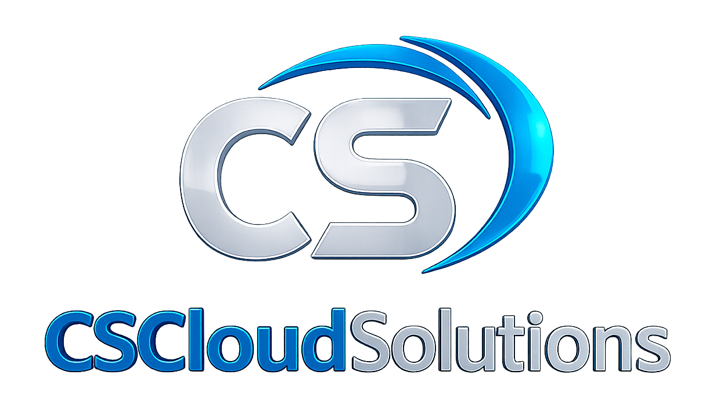

<div class="cover">

<h1 class="cover-title">User Manual</h1>
<p class="cover-sub">FinOps SaaS · CSCloudSolutions</p>
<p class="cover-meta">Version 2.1 · October 2026</p>
<p class="cover-copyright">© 2026 CSCloudSolutions. All rights reserved.</p>
</div>

# 📘 User Manual — FinOps SaaS (CSCloudSolutions)

**Version:** 2.1 (detailed)
**Language:** English
**Last updated:** October 2026
**Audience:** technical users (Cloud Admin, DevOps, FinOps Analyst) and non-technical users (finance, management, product owners)

---

## Recent updates (September – October 2026)

- **Perspectives and team scope.** You can now create Perspectives from the screen —by Tag, Name pattern, Subscription, Resource group or Resource type—, see how much of the spend falls inside each group, and narrow Cost Groups, Cost Centers, Spend & Forecast, Storage, the Whiteboard and the What-If simulator with a cross-cutting selector. An Admin can also **assign a scope to a user** from **Users & Access**: the API returns only their slice, it is not a screen filter (5.3 and 8.2). **Saved views** remember a scope combination so you can return to it in one click, and they can be **shared with the team** or marked as **default** (3.4).
- **Team leaderboard and gross margin.** A ranking that sorts by improvement —not by who spends least—, the cost of goods sold (COGS) / operating expense (OpEx) split —each group is classified from the same table— and gross margin once you load revenue (5.2).
- **Report subscriptions.** The **Subscriptions** tab of Reports & Export emails a report at the cadence you choose, with a link, a chart and a CSV (8.6).
- **Fiscal year and budget rollover.** The tenant's fiscal year is no longer fixed to January —you choose it in **Configuration → General**— and a budget can carry unspent money over to the next month, with a cap, from the budgets table itself (5.1.5).
- **FinOps Maturity.** You choose whether the score follows the team's self-assessment, Azure telemetry or an average, and each dimension shows both readings (4.4).
- **End of support.** What runs on a version Azure is retiring, when, and what it costs today: AKS, PostgreSQL and MySQL Flexible Server (7.9).
- **Commitments.** Expiry concentration warning, **ESR** (effective savings rate), a break-even simulator with optimal mix, tracking of the annual reservation-refund cap, and **automatic notices 90, 60 and 30 days before each reservation expires** (5.4.4).
- **Shift-Left FinOps.** The cost of a `terraform plan` inside the Pull Request, before the merge, with per-repository thresholds; it is under **Governance → Shift-Left (PRs)** (7.10).
- **Cosmos DB with real telemetry** and an RU/s optimizer: manual vs autoscale vs serverless, and hot partitions (5.5).
- **Networking: Traffic & egress, and Link capacity** (oversized ExpressRoute and VPN links) (5.8).
- **Azure Virtual Desktop** inside Compute: host pools, session hosts, FSLogix profiles and cost per user (5.6).
- **Storage** as its own hub: Storage Accounts, Managed Disk, Backups and Data Lake Gen2 (5.7).
- **Whiteboard with a time range:** current month, last 30 days or last 90 days, with history stored in the platform's database (4.1).
- **Add-ons Marketplace** for à-la-carte modules and capacity, so you can add a feature or a quota without changing plans (8.10).
- **FinOps Copilot with a continuous conversation** across pages and a **New conversation** button (9).
- **Mobile app (PWA)** with Summary, Alerts, Approvals, Support and Profile (11.12).
- **Anomalies with an owner and follow-up** (14) and **subscriptions beyond your plan's limit** (15).
- **Anomalies: what changed, and an AI explanation.** In **Anomaly Detection** (Enterprise), **View Root Cause** shows which meter in the service went up and whether it was usage, price or something new, with the steps to check. AI can put it into words. The detail comes from the Azure sync and also from cost exports (14.4).
- **CSV files that aren't in FOCUS format:** **every** row is now processed. AI only identifies the columns, and the platform reads the amounts. The upload's AI report comes in your language and in the file's currency, and if AI isn't available you see a summary by service (5.1.7).
- **Tags with non-compliant values.** In **Tag Governance**, Environment and Role have a list of allowed values. **Non-Compliant Values** finds the ones that don't match it, like `Production` or `PRD`, and suggests the right one: first by rule and, for what the rules don't resolve, with AI. You confirm it and it gets fixed in Azure. That's why the compliance % can drop without anything changing in Azure (7.1.1).

**August 2026 updates**

- **New Azure Integration Services (iPaaS) module:** a hub with tabs for Logic Apps, APIM, Service Bus, Event Grid, Event Hubs and ADF.
- **Enterprise connectors in Logic Apps:** a dedicated section to tell Standard from Enterprise connectors and their operational/cost impact.
- **Enterprise AI (Azure AI):** the global AI configuration supports an **endpoint URL** + deployment for Azure AI instead of relying only on the resource name.
- **FinOps/CMP table standard (SaaS):** every table in the standard includes base filters (**Resource, Region, Type, Resource group**), sorting (A-Z/Z-A/cost), **15/30/45/60** pagination, responsive design, full width and resizable columns.
- **Monitoring and Security aligned:** they use the same visual/operational pattern as Databases and Compute, focused on quick reading for FinOps decisions.
- **AI Cost Analytics fixed:** the Microsoft Foundry/Azure OpenAI panel prioritizes real consumption, keeps the MTD trend from day 1 of the month and fixes cache/source inconsistencies.
- **Security pre-warm cron:** `GET /api/cron/prewarm-security-finops` pre-warms Defender + Security families to speed up loading.
- **Hardened Database intelligence:** Redis, MySQL, PostgreSQL, Cosmos DB, MongoDB and SQL/Managed Instance show status and metrics with per-metric fallback to avoid `N/A/unknown` caused by partial Azure telemetry.
- **Navigation and FinOps modules visual refresh:** key cards in Intelligence, Consumption, Governance, Cleanup, Overview and Copilot M365 moved to Tabler iconography and headers without a blue background.

## How to use this manual

Each section explains **what** the feature is, **who** can use it (role and subscription tier), and the **step-by-step usage flow** — concrete buttons, URL paths, form fields, and expected results. If you're a non-technical user, feel free to jump straight to the section you need: each one is self-contained.

---

## 📑 Table of Contents

1. [Getting Started](#1-getting-started)
2. [Roles and Permissions](#2-roles-and-permissions)
3. [Main Navigation](#3-main-navigation)
4. [Visibility Section](#4-visibility-section)
5. [Financial Intelligence Section](#5-financial-intelligence-section)
6. [Cloud Cleanup Section](#6-cloud-cleanup-section)
7. [Governance Section](#7-governance-section)
8. [Administration Section](#8-administration-section)
9. [FinOps Copilot (AI Assistant)](#9-finops-copilot-ai-assistant)
10. [Account Security (MFA)](#10-account-security-mfa)
11. [Advanced Features and Integrations](#11-advanced-features-and-integrations)
12. [Best Practices](#12-best-practices)
13. [Platform notices](#13-platform-notices)
14. [Spend anomalies: who handles them](#14-spend-anomalies-who-handles-them)
15. [Subscriptions beyond your plan's limit](#15-subscriptions-beyond-your-plans-limit)

---

## 1. Getting Started

### 1.1. Access and login

The platform is a B2B SaaS. Authentication is integrated with **Microsoft Entra ID** (Azure Active Directory):

1. Go to the platform URL.
2. Click **"Sign in with Microsoft"**.
3. Authenticate with your corporate account. The platform automatically recognizes your Azure tenant and identity.
4. **Demo Mode:** if you want to try the platform without connecting your real environment, choose one of the preconfigured demo profiles from the main screen — they come with realistic simulated data and metrics, so you can explore every module risk-free. Demo credentials are `demo` / `demo`.

### 1.2. The onboarding wizard (first time)

If you're an administrator and this is your organization's first time using the platform, upon login the **Setup Wizard** (`/onboarding`) automatically opens — a 5-step linear wizard with a progress bar:

| Step | What you do | Result |
|---|---|---|
| **1. Welcome & Company Info** | Confirm company name, primary cloud provider (Azure), display currency (USD/EUR/GBP), and timezone | Your initial preferences are saved |
| **2. Connect Azure Subscription** | Paste **Client ID**, **Client Secret**, and **Azure Tenant ID** from the Service Principal (generated with the PowerShell script provided by CSCloudSolutions) and click **"Validate"** | The system checks live whether the Service Principal has the minimum required roles; if any is missing, it shows exactly which one in red |
| **3. Run First Data Sync** | Click **"Run Sync"** | Fetches your first set of cost data from Azure (can take up to 60 seconds) |
| **4. Create Your First Budget** | Fill in name, monthly limit ($), and alert threshold (%) | Your first active budget is created |
| **5. Set Up Notifications** | Click **"Configure"** (opens `/admin/notifications` in a new tab) | Add at least one channel (email, Slack, or Teams) to receive alerts |

You can **skip** any step and return later — the wizard keeps appearing until you complete or skip all 5. Progress (%) is calculated as `(completed + skipped) / 5 × 100`. If you prefer the advanced setup form instead of the wizard, `/admin/onboarding` remains available in parallel.

### 1.3. Verifying your Azure connection

When you connect your Azure subscription (step 2 of the onboarding wizard, or from `/admin/onboarding`), the Service Principal needs certain Azure roles assigned so the platform can read your cost data. This section helps you verify and troubleshoot that connection.

**Azure roles required, by contracted tier:**

| Tier | Built-in roles | Custom role (*CSCloudSolutions Remediation Role*) |
|---|---|---|
| Professional (platform floor) | Reader, Cost Management Reader, Monitoring Reader, Billing Reader, Security Reader and, at tenant level, Reservations Reader | — (read-only) |
| Business | Professional + Tag Contributor | Start, stop, restart and deallocate VMs; write tags; manage Azure budgets; and **delete** the orphaned resources that Cloud Cleanup detects (VMs, disks, snapshots, App Service plans, NICs, public IPs, NSGs and the other network types of Networking Zombies) |
| Enterprise | Business + Monitoring Contributor | Business + create resource groups |

In addition, the script grants the identity **Microsoft Graph read permissions** on all plans (`Directory.Read.All`, `Reports.Read.All`, `User.Read.All` and `Organization.Read.All`) and, depending on the plan: `Application.ReadWrite.OwnedBy` (Business+, to rotate secrets: it only reaches the App Registrations the identity *owns*), `AuditLog.Read.All` (Enterprise, sign-in activity for *Users & Licenses*) and `ExternalConnection.ReadWrite.OwnedBy` (Enterprise, Copilot M365 connector).

**Reservations Reader** is assigned on `/providers/Microsoft.Capacity`, at tenant level and not per subscription: without it, reservations do not show up in Optimization & Savings and their expiry notices do not arrive. Assigning it requires being *Reservations Administrator*, or Owner / User Access Administrator on that scope; if the script marks it as `[FAIL]`, someone with that permission has to assign it.

> ⚠️ **Reader, Cost Management Reader, Monitoring Reader and Billing Reader are the absolute minimum** for the Real Consumption page to show data. If `Cost Management Reader` or `Billing Reader` is missing, Azure silently returns 0 rows. `Security Reader` adds read access to the security posture (Defender/WAF).

> ℹ️ **AI Cost Analytics (Microsoft Foundry / Azure OpenAI)** uses the same base roles (`Reader`, `Cost Management Reader`, `Monitoring Reader`, `Billing Reader`): **no extra role is required**.

> ⚠️ **EA/MCA subscriptions** (Enterprise Agreement / Microsoft Customer Agreement) additionally require the customer's Billing Admin to assign `Enrollment Reader` or `Billing Account Reader` to the Service Principal at the billing account scope — the script can't do this automatically, it must be coordinated with the customer.

**Verifying permissions were correctly assigned**, after the customer runs the script:

- **Quick option (recommended):** `GET /api/admin/check-sp-roles?tenantId=<tenant-id>` — returns how many subscriptions have all required roles ✅, which are partial ⚠️, and which have none ❌, with the exact detail of what's missing in each.
- **Manual option:** in Azure Portal → Subscription → **Access control (IAM)** → **Role assignments** → filter by the App Registration `CSCloudSolutions-FinOps-Agent` and confirm the tier's roles appear.

**Troubleshooting — "Real Consumption shows no data":**

| Error message | Cause | Fix |
|---|---|---|
| `NO_COST_PERMISSION` | Missing `Cost Management Reader` | Assign the role to the SP on that subscription |
| `NO_SUBSCRIPTION_ACCESS` | Missing `Reader` | Assign `Reader` or re-run the script |
| `SUBSCRIPTION_INACTIVE` | The subscription has no spend in the current month or the last 30 days | Verify it's the correct subscription |
| `NO_SUBSCRIPTIONS` | The SP sees no subscriptions | Assign `Reader` on at least one |
| `NO_CONSUMPTION` | Everything OK but no spend in the current cycle | Wait for the billing cycle to close or check another subscription |

### 1.4. Operational note

Commercial and partner-association management (PAL/CPOR) is handled internally by CSCloudSolutions and does not require tenant end-user actions.

---

## 2. Roles and Permissions

The platform separates **two independent concepts** that combine but don't replace each other:

### 2.1. Role (what you can DO)

| Role | Capability |
|---|---|
| **Owner** | Tenant owner. Full access, including plan changes and billing. |
| **Admin** | Complete financial visibility, configuration changes, corrective actions (shutting down VMs, deleting resources). |
| **Colaborador (Collaborator)** | Sees financial intelligence and visibility; can suggest changes but doesn't manage billing or users. |
| **Reader** | Read-only in dashboards and reports. Cannot apply changes or view sensitive configuration. |

### 2.2. Domain permissions (which pages you SEE)

Beyond the role, each user can be assigned one or more **domain permissions**, which determine which sidebar sections they see — independent of their role:

| Permission | Who benefits | What it enables to view |
|---|---|---|
| **FinOps** | FinOps Analyst | Cost and recommendation pages |
| **CloudAdmin** | Cloud Administrator | Infrastructure execution/write pages |
| **Security** | Security Auditor | Compliance auditing, credentials, governance |
| **ProductOwner** | Project/product lead | Visibility by Cost Center or application |

**How they combine:** a user with the **Reader** role and the **FinOps** permission can *view* FinOps pages, but can't modify or delete anything in them — the role still governs actions. Permission filtering is opt-in: if a user has no permission assigned, they see everything their role and tier allow (default behavior, no domain restriction). **Admin/Owner** roles always see everything their tier allows, regardless of assigned permissions. The **Dashboard** (`/`) and **Support** (`/support`) are always visible to everyone.

**How to assign permissions:** go to `/admin/users` → select the user → toggle the permission switches in the table, or assign them when manually creating a new user. (Note: users bulk-imported from Entra ID have no permissions assigned by default — assign them afterward from the main table.)

> ⚠️ Domain permissions **do not** enable write actions on the backend — that remains exclusively controlled by the role. A user with the `CloudAdmin` permission but `Reader` role can *view* those pages, but any write action will return a 403 error if their role doesn't authorize it.

---

## 3. Main Navigation

The left sidebar groups everything into 5 pillars (collapsible sections — the active page's section auto-expands):

- **Visibility** — Whiteboard, FinOps Academy, Azure Advisor, FinOps Maturity, Historical Progress, TOP Expenses, Resources, Green FinOps, Captured Savings and Financial Leaks.
- **Financial Intelligence** — Consumption & Budget, Team leaderboard, Perspectives, Optimization & Savings, Databases, Compute, Storage, Networking, Users & Licenses, Azure AI, Azure Integration Services, Monitoring, Security and Advanced Analytics.
- **Cloud Cleanup** — Zombie Resources, Networking Zombies, TTL Expirations and Orphaned Backups.
- **Governance** — Tag Compliance, Self-Service Alerts, Power Schedules, Auto-Block Policies, Governance Reporting, High Availability, End of support, Shift-Left (PRs), Expiring Credentials and Approvals.
- **Administration** — Support, Users & Access, Configuration, Reports & Export, Integrations & API, Billing & Audit and Marketplace.

**What you see depends on three things:** your **plan** (each screen states the plan it is available from), your **role** (what you can do) and your **domain permissions** (which pages are shown to you). Whatever your plan does not include appears with a lock and an upgrade notice, or can be added on its own from the **Marketplace** (8.10).

A **search bar** at the top of the sidebar lets you find pages by name without browsing the categories, and it only lists what you can open.

### 3.1. "History" button — time evolution of any metric

On Dashboard, Commitment Discounts, Rightsizing, Anomalies, Budgets, High Availability, and Tag Governance you'll find a **History** button in the top right corner. When opened:

1. Choose a date range (up to **1 year back**).
2. See the daily evolution of that page's metrics as a **line chart** and **table**.

The platform automatically saves a daily snapshot of every page (retention ~13 months) — you don't need to enable anything, it's already running in the background.

### 3.2. Your profile

Click your **avatar** (circle with your initial, top right) to open:

- **Full name** — editable via the pencil icon.
- **Email and role** within the tenant (read-only).
- **Display currency** — currency selector.
- **Appearance** — Light / Dark / Automatic (follows the OS theme).
- **Sign out.**

### 3.3. Hubs with tabs

Many menu entries are **hubs**: one screen with tabs that groups the views of a single topic. You enter through the hub and move between its tabs without going back to the menu; the active tab stays in the URL, so you can share the exact link. Hubs include **Consumption & Budget**, **Optimization & Savings**, **Databases**, **Compute**, **Storage**, **Networking**, **Monitoring**, **Security**, **Azure AI**, **Azure Integration Services**, **Advanced Analytics** and, in Administration, **Users & Access**, **Configuration**, **Reports & Export**, **Integrations & API** and **Billing & Audit**.

The URLs that predate the hubs (for example `/intelligence/billing` or `/admin/users`) still work: they open the same screen or redirect you to its tab, so old bookmarks do not break.

### 3.4. The scope bar: subscription, Perspective and Views

The header has three selectors that narrow what the dashboards show:

- **Scope (tenant and subscription).** You pick the whole tenant or one Azure subscription. If your organization has more than one tenant, you also switch tenants from here.
- **Perspective and group.** It appears only if your plan is Enterprise and the tenant has Perspectives defined (5.3). You pick a Perspective and a group —for example *Teams → Engineering*— and the dashboards that support it show only that slice of the spend. The choice travels in the URL: it can be shared by link and survives a refresh.
- **Views** (bookmark icon). With a Perspective selected, *Save the current view…* remembers the combination —Perspective and group— under the name you give it, and you apply it again in one click from the same selector. When saving it you can mark it to **open by default** —it is applied automatically when the URL does not specify a scope— and, if you are an Admin or Owner, **share it with the whole team**. The star next to each view marks or unmarks it as the default. Shared views are visible to the whole tenant and only Admins and Owners change or delete them. If there is a default of yours and one from the team, yours wins. The selector is shown only when there are saved views or an active Perspective to save.

> If your account has a **scope assigned** by an Admin (8.2), the Perspective selector is fixed on your group, with a lock, and the Views selector is not shown: your slice is not chosen, saved or changed by you.

### 3.5. Shortcuts and mobile app

- **Command palette:** `⌘K` (Mac) or `Ctrl+K` (Windows/Linux) opens a search for screens, quick actions and also resources in your environment (type at least two characters).
- **Manual:** the help icon (**?**) in the header opens this manual as a PDF, in your active language.
- **Phone:** on narrow screens the platform offers a dedicated mobile experience (11.12).

---

## 4. Visibility Section

### 4.1. Dashboard (White Board)

Your executive entry panel. It brings together Current Cost, forecast, Zombie Resources, Potential Savings and Environmental Impact, along with budgets, dominant services, governance, Advisor and Quick Wins.

**How to use it:**
1. Choose the **period** in the header selector: **Current Month (MTD)**, **Last 30 days** or **Last 90 days**. The current month is queried live from Azure Cost Management (with the platform's database as a fallback if Azure does not respond); the 30- and 90-day ranges are read from the history the platform stores every night, so they answer instantly and do not spend Azure query quota. The main cost card changes its label according to the range.
2. Check the sync bar and use **Refresh** to bypass the cache and query the current cycle.
3. Compare spend against the cost-center budgets and adjust the 12-month forecast rate.
4. Pin/unpin widgets from the pin icon to take them to **My Dashboard**.
5. In **Top Quick Wins**, choose **Optimize** to open the remediation modal with CLI, PowerShell and Terraform scripts.

The Whiteboard respects the **scope** of the top bar (3.4): with a Perspective and a group selected, the numbers are those of that slice of the spend.

### 4.2. Spend & Forecast (tab of the Consumption & Budget hub, Enterprise tier)

This screen lives as a tab of the **Consumption & Budget** hub and is described in 5.1.6. The Dashboard shows a summary card of the same data with the **"See full detail"** link.

### 4.3. Azure Advisor

Direct sync with Microsoft's native recommendations, classified into Cost, Security, Reliability, Performance, and Operational Excellence. Recommendations display in the language you have active on the platform (not Azure's original language).

**How to use it:** filter by category, review each recommendation's potential savings impact, execute remediation commands, or manage lifecycle states:
- **Snooze for 30 or 90 days:** If the optimization requires prior team validation or a future maintenance window. The recommendation disappears from active views and does not count towards pending open balances in the **Optimization Index (COIN)** or potential savings. When the time expires, the platform automatically reopens it if it remains unresolved.
- **Dismiss (Permanent):** If the recommendation does not apply to your architecture. It transitions to the *Dismissed* state indefinitely and is excluded from active views.

> ℹ️ **Scope clarification regarding Azure Portal vs. FinOps Platform:**
> - **Azure → Platform Sync:** If you suppress a recommendation directly in the Microsoft Azure Portal, our platform automatically detects it and hides it from the UI.
> - **Platform → Azure Governance:** When suppressing or dismissing from the FinOps platform, the action is recorded and governed in the tenant database under the principle of least privilege (without requiring write permissions on Azure). Therefore, the recommendation **may still appear in the native Azure Portal**, while in the FinOps platform it remains formally suppressed, audited, and excluded from cost savings totals.

### 4.3.1. Azure AI Document Intelligence

Under `Financial Intelligence → Azure AI → Document Intelligence`, review MTD cost, processed pages, Prebuilt/Custom usage and training hours. Select MTD/30D/90D, filter the table by model, Resource Group or subscription, and open **Optimize** to evaluate Commitment Tier, F0 or Custom→Prebuilt migration. A real tenant without accounts shows an empty state and never demo data.

### 4.4. FinOps Maturity

Places your organization at **Crawl / Walk / Run** —the FinOps Foundation model— across six dimensions: Visibility & Insight, Rate Optimization, Usage Optimization, Governance & Allocation, Automation and FinOps Culture. The radar shows each one's score (Crawl below 40, Walk 40 to 75, Run above 75), with the roadmap of next milestones.

Each dimension has **two readings**: the **telemetry** the platform measures in your Azure and the **self-assessment** the team completes with **Retake Assessment** (one question per dimension). When both exist, the row shows them together (*Team 70 · Azure 45*), and if they are more than 20 points apart the action plan flags it: either the team is calling itself mature without evidence, or there are capabilities in place that nobody documented.

**How the score is calculated.** Above the radar you choose which reading wins. Admins and Owners choose it; everyone else sees which one is active.

| Option | What it does | For whom |
|---|---|---|
| **The team's self-assessment wins** (default) | Each dimension's score is what the team declared | A team in adoption, measuring its own reading |
| **Azure telemetry wins** | The score is what was measured; the declaration stays as a contrast | An audited customer, where a declaration is not enough |
| **50/50 average** | Half of each reading | A middle ground |

Changing it recalculates the radar immediately and deletes no answers.

### 4.5. FinOps Academy

Interactive learning center on FinOps and Azure cost optimization — structured courses, videos, glossary, and downloadable resources.

> ⚠️ **Mandatory gate:** new users must complete the Academy before accessing the rest of the platform (with a disclaimer explaining why). Progress is tracked **per user**, not per organization — every new person on the tenant has to complete it, and once completed it can't be re-run.

### 4.6-4.10. Historical Progress, TOP Expenses, Resources, Green FinOps, Captured Savings, Financial Leaks (Professional/Business+)

- **Historical Progress:** monthly trend charts, savings milestones reached, month-over-month and year-over-year comparisons. You can add manual annotations about events that explain a change (e.g. "migration to reservations").
- **TOP Expenses:** ranking of your biggest spend sources by service, subscription or resource group, with drilldown to the individual resource level.
- **Resources** (Business+): full inventory — filtering and advanced search, bulk tagging, export. A child resource with no charge of its own (for example a VM extension) does not add its cost twice: it is shown in gray as *in <parent resource> · $amount*, and the amount counts once, on the parent.
- **Green FinOps** (Professional+): carbon-footprint estimate by service, comparison of the most efficient regions, sustainability recommendations.
- **Captured Savings** (Professional+): tracking of real savings already achieved through RIs, Savings Plans and Hybrid Benefit, with ROI calculation. The history also includes what your team saved **directly in Azure**, without going through the platform (a disk deleted from the portal, a VM shut down by CLI): it is detected because the resource's spend drops and, when the Azure Activity Log still keeps the event (90 days), it shows who did it and when.
- **Financial Leaks** (Professional+): identifies wasted money (abandoned resources, over-sizing, unnecessary redundancy) with a remediation calendar.

---

## 5. Financial Intelligence Section

This is where the cost and optimization analysis of Azure lives. Almost every menu entry is a **hub with tabs** (3.3). The minimum plan appears next to each name; if yours does not include it, the screen says so and offers the upgrade or the standalone module from the Marketplace (8.10).

| Hub | Plan | What it is for |
|---|---|---|
| **Consumption & Budget** | Professional+ | Real spend, budgets, cost groups and forecast |
| **Team leaderboard** | Enterprise | Which team improved, cost of goods sold and gross margin |
| **Perspectives** | Enterprise | Split the spend by your own dimensions |
| **Optimization & Savings** | Enterprise | Rightsizing, rates, commitments, Hybrid Benefit, zero cost |
| **Databases** | Business+ | Cosmos DB, SQL, PostgreSQL, MySQL, MongoDB, Redis and Fabric |
| **Compute** | Business+ | VMs, VMSS, App Service, Functions, AVD, containers, Kubernetes and OpenShift |
| **Storage** | Enterprise | Storage Accounts, disks, backups and Data Lake |
| **Networking** | Business+ | Network analysis, connectivity, balancing, egress and link capacity |
| **Users & Licenses** | Enterprise | M365 licenses and user activity |
| **Azure AI** | Enterprise | Cost and consumption of Azure's AI services |
| **Azure Integration Services** | Enterprise | Logic Apps, APIM, Service Bus, Event Grid, Event Hubs and ADF |
| **Monitoring** | Enterprise | Application Insights, Log Analytics, Monitor, Sentinel and alerts |
| **Security** | Enterprise | Defender, Sentinel, Key Vault, Entra ID, WAF and DDoS |
| **Advanced Analytics** | Enterprise | Unit Economics, allocation, scorecard, anomalies, health, What-If and MACC |

### 5.1. Consumption & Budget (`/intelligence/consumo-y-presupuesto`)

Eight tabs: **Real Consumption**, **By Category**, **Budgets**, **Cost Groups**, **Cost Group Budgets**, **Spend & Forecast**, **CSV Ingestion** and **External spend**.

#### 5.1.1. Real Consumption (Professional+)

The detailed billing dashboard, live from Azure.

**How to use it:**
1. Filter by period, subscription and resource group.
2. Zoom into a specific service to see its breakdown by resource.
3. Download the invoice or export the data to Excel from the corresponding button.
4. Create threshold alerts from the same page (it takes you to the Self-Service Alerts form with the context preloaded).

> If a resource spends on two Azure services (a storage account on *Storage* and on *Bandwidth*, a VM on *Virtual Machines* and on *Managed Disks*), it appears **in full under its main service** instead of split. The breakdown never adds up to more than its card's total, but a resource may be attributed to a service that is not the only place where it spends.

#### 5.1.2. By Category (Business+)

Cost distribution by FinOps category (Compute, Storage, Networking, AI, etc.), to answer "which service family is eating my bill?" without going through service by service.

#### 5.1.3. Budgets (Professional+)

1. **Create a budget:** name, period (monthly/quarterly/annual), limit in $.
2. **Alert threshold:** you define at what % of the budget you want to be notified (e.g. 75%).
3. The system tracks automatically — you see real consumption vs. budget in real time, with a history of previous periods.

#### 5.1.4. Cost Groups (Business+)

Custom cost grouping based on your own business logic (by project, line of business, application or environment).

1. You create a group with naming rules (which resources go in, by name pattern or tag).
2. You assign resources manually if adjustments are needed.
3. Clicking a group opens a modal with tabs: **Costs**, **Actions**, **Resources**, **Governance** — each with the detail for that group.
4. You compare groups with each other from the list view. Among the available periods is your tenant's **Fiscal Year** (5.1.5).

This screen and its detail respect the **Perspective scope** of the top bar (3.4).

#### 5.1.5. Cost Group Budgets (Enterprise)

You define cost centers, assign resources (manually or in bulk) and the system allocates spend automatically to generate **internal chargeback** by department, against each center's monthly budget.

**Budget rollover.** A budget can carry unspent money over to the next month, with a cap. The month is measured against the base budget plus what was carried over, and the card shows it with a badge and its breakdown: *"Base budget X plus Y carried over from previous months of the fiscal year"*. Rules worth knowing:

- A month in the red carries over **zero**, never a negative balance: a one-off overspend does not put the following months in debt without anyone deciding it.
- The cap is applied **at every step**, month by month.
- With rollover off —the default— the dashboard is identical to the usual one.
- It is turned on per cost center from the table: the pencil in the budget column opens the **base** amount together with **Carry over unspent budget** and its **Cap (USD)** (empty = no cap). Admins and Owners change it. Through the API it is `PUT /api/intelligence/cost-centers` with `rolloverEnabled` and `rolloverCapUsd`, and a save that does not send them keeps what was there.

**Fiscal year.** The annual accumulations —the Whiteboard's, the *Fiscal Year* period of Cost Groups and the forecast— count from the month in which your **tenant's fiscal year** starts, which defaults to January. If yours starts in another month (for example April), you choose it in **Configuration → General → Fiscal year** (Admin or Owner), and dashboards pick it up immediately. Through the API it is `PUT /api/admin/tenant-settings` with `fiscalYearStartMonth`, 1 to 12. The annual forecast divides by the days of the fiscal year and not by the days since January, so it does not come out low when the fiscal year is not the calendar year.

**Under a Perspective scope** (3.4) the budget is **not narrowed**: it is defined for the whole center, and comparing it against a slice would show a margin that does not exist. The screen says so instead of leaving the cell empty.

#### 5.1.6. Spend & Forecast (Enterprise)

It combines two tools in one page:

- **Cost histogram:** daily distribution of spend, with a range selector from the last month up to **13 months back** (everything Azure Cost Management allows querying), cached in Redis for an instant response.
- **Spend Projection:** calculate how much you will spend in the future.
  1. The system takes the average monthly spend of the last 12 months as the base.
  2. You enter an **expected annual growth %** (you can use negative values to simulate an optimization/savings scenario).
  3. You choose the horizon: 3, 6, 12 or 24 months.
  4. The result shows: base average, equivalent monthly rate, and the projected total, with a real vs. projected line chart.

There is a summary card of the same data on the Dashboard with the **"See full detail"** link. Both cards respect the Perspective scope; the comparison against the budget does not (5.1.5).

#### 5.1.7. CSV Ingestion (Business+)

Manual or scheduled import of cost files in the **FOCUS** standard and of Azure exports: you upload the third-party billing CSV and analyze it alongside your Azure data.

If the file is already in FOCUS format, it loads directly. If not, AI looks at the headers and a sample of 20 rows, with sensitive data hidden, and works out which column is the cost, the service, the date, and so on. The platform then applies that mapping to **every** row:

- **The platform reads the amounts and dates, never the AI.** A date that can't be read without guessing is left empty.
- **The mapping is remembered.** If you upload a file with the same columns again, AI isn't used and no quota is spent.
- **Monthly quota for the organization:** 150 new formats on Business. It's unlimited on Enterprise or with your own AI key (BYOK).
- **If AI isn't available** (turned off, out of quota, or too many requests in a row), the file isn't loaded and the screen tells you why. Uploading it in FOCUS format avoids AI.

**The AI report.** After reading the file, AI writes a report in the screen's language and in the currency the file states; if the file doesn't state one, the report doesn't assume it. It has its own monthly quota: 150 reports on Business, unlimited on Enterprise or with BYOK. If AI is turned off, out of quota, or getting too many requests in a row, you see the **File summary** instead of the report: the cost per service and category calculated by the platform, along with the reason.

#### 5.1.8. External spend (Business+)

Invoices and contracts from vendors that don't go through Azure billing: licenses, SaaS, consulting. Document Intelligence reads them, you review what it extracted, and what you approve is reported separately, labeled **Outside Azure cost**. It never mixes with Azure cost or with anomaly detection (14): it's another source, with another level of precision.

Everyone can see the screen. Uploading, reviewing and adding commitments takes an **Admin** or **Owner**, because what gets approved goes into the reports.

**Uploading.** In **Upload an invoice or contract** you pick the **Document type** (**Invoice** or **Contract**), click **Choose file** and then **Upload and analyze**.

- PDF, JPEG, PNG or TIFF up to **10 MB**. The first **20 pages** are read.
- **Monthly quota for the organization:** 150 documents on Business and 500 on Enterprise. It applies even if you have your own AI key (BYOK), because the analysis runs on the platform's account.
- The same file doesn't go in twice: if it's already in the list, the screen tells you. A **Rejected** or **Failed** one can be uploaded again, for example with the right type, and it replaces the previous one.

**Statuses.** **Uploaded** → **Analyzing** → **To review** → **Approved** or **Rejected**. **Failed** if it couldn't be analyzed. A one- or two-page invoice is usually ready in seconds. If it takes longer, the analysis continues in the background and the list refreshes on its own.

**Reviewing.** **Review** opens what AI extracted, with **Download original** at hand:

- **Invoice details:** vendor, number, date, due date, period, currency, subtotal, tax and total.
- **Lines:** description, quantity, unit price, amount, **Category** and **Cost center**. You correct them in place, and there's **Add line** and **Remove line**.
- Anything read with **low confidence** (under 80%) is flagged: check it against the original.
- If the model doesn't recognize any fields, you see the **Document text** so you can copy what you need.

**Validation findings.** The platform calculates them, not AI: that the lines add up to the subtotal and that subtotal plus tax gives the total (with a 0.5% rounding margin), that the dates are consistent, and that there's no other invoice from the same vendor with the same number. They're warnings, because whoever reviews knows the document better than the rule. The ones marked **Blocks approval** are four: the total is missing, the date is missing, the currency isn't an ISO 4217 code (USD, EUR…), or that same invoice is already approved in another document. Without a total, a date and a currency there's no way to report it, and approving it twice would count it double.

**Approving or rejecting.** **Save changes** saves and validates again. **Approve** saves anything pending and, from then on, the invoice counts as external spend. **Reject** leaves it out. An approved invoice can also be rejected, after a confirmation, and it stops counting. An approved contract can't: its commitment would keep sending notices. To undo it, delete the commitment.

**Exchange rate.** On approval, the platform fixes the USD equivalent with the rate for the invoice date (or the closest one it has) and shows it: *USD equivalent: … (1 USD = …, rate as of …)*. It stays fixed, so a closed report doesn't change on its own. If the platform has no rates loaded, it uses an undated reference rate and says so. The convertible currencies are USD, EUR, GBP, ARS, BRL, MXN, CLP, COP, PEN, CAD, AUD, JPY, CHF, CNY and INR. An invoice in another currency is still approved, but it isn't included in the USD total, and the summary counts it separately.

**Contracts and commitments.** The contract model reads parties, dates, renewal and duration (**Contract terms**), but not amounts. When reviewing a contract you fill in **Add as a commitment** with the committed amount; saving it approves the contract. A commitment without a document is added with **New commitment**: vendor, type (Enterprise Agreement, MACC, Savings plan, Reservation, SaaS subscription or Other), amount, currency, start, end, renewal (optional), notice days and whether it renews automatically. Commitments can't be edited: if something changed, delete it and add it again.

**Renewal notices (90, 60 and 30 days).** The **Notice deadline** is the renewal date (or the end date, if there's no renewal) minus the notice days: the last day to cancel or renegotiate. The platform sends a notice when a commitment enters the **90-day** window before that deadline, again at **60** and again at **30**: once per step. It reaches the whole tenant's **bell** and the **Notification channels** (8.5), with the vendor, the date and whether it renews automatically. At 30 days or less it's **critical**, with or without auto-renewal: the date to cancel doesn't move. **Delete commitment** stops its notices.

**Summary.** **Approved external spend (USD)** adds up only approved invoices, **By vendor** and **By month** (the month of the billed period or, if the invoice doesn't have one, of its date; the last 12). Next to it you see how many documents are **To review**, the commitments and the next notice deadline.

**The original.** It's deleted **365 days** after upload; the extracted and reviewed data is kept. A document still **To review** keeps its file.

**If analysis isn't available** (turned off on the platform or for your organization, out of quota, or too many documents in a row), you can't upload and the screen tells you why. You can still review what you already uploaded and add commitments by hand. If the installation doesn't have Document Intelligence, the screen says document analysis isn't configured.

**In the demo** you see sample invoices and a contract in different statuses, and three commitments. No files are uploaded and no changes are saved.

> This isn't the same as *Azure AI → Document Intelligence* (4.3.1). There you see what your own Document Intelligence accounts in Azure cost you. Here the platform uses its own to read your documents, at no cost to your subscription.

### 5.2. Team leaderboard (`/intelligence/leaderboard`, Enterprise)

**Who improved, not who spends least.** The dashboard compares the **groups of a Perspective** (3.3 and 5.3) and sorts them by improvement, which is the behavior you want to reward: a ranking by absolute spend would punish the team that runs production and reward the small one.

| Column | What it shows |
|---|---|
| **Team** | The Perspective group |
| **Spend** | What was spent in the period |
| **Change** | Against the previous period |
| **Budget used** | How much of the budget it consumed |
| **Captured savings** | Remediations approved **and executed** in Azure for that group |
| **Classification** | COGS, OpEx or Unclassified. Admins and Owners change it right there; for everyone else it is read-only |

**How it is sorted.** By the percentage drop against the previous period and, at equal change, by captured savings. Two cases stay **outside the order** but in view, with their reason: a group with *no previous period to compare against* (it neither improved nor worsened) and one *too small to rank without it being noise* (below 1% of spend: one that goes from 1 to 0.50 dollars does not beat the one that cut thousands). Each row has **See breakdown** to reach that group's detail: a ranking that cannot be explained creates arguments, not optimization.

Three things that clarify the numbers:

- **The budget is matched by name.** A Perspective group and a cost center are different things; if the group's name matches a cost center's, its budget is shown, and if not, the cell stays empty instead of showing another team's.
- **Captured savings come from what was executed**, not merely approved. Since remediations do not store tags, in a Perspective defined by tags those savings fall into *unassigned*.
- **Unassigned spend** (no rule reaches it) is part of the total but of no team, and is reported separately.

**Cost of goods sold and operating expense.** A card splits the spend into **COGS**, **OpEx** and **Unclassified**, and the sum matches the total. Each group is classified in the table's **Classification** column (COGS, OpEx or Unclassified): Admins and Owners choose it, and the split and the margin are recalculated instantly. For other roles the column is read-only. Through the API it is `PUT /api/intelligence/leaderboard` (`perspectiveId`, `groupName`, `classification`).

**Gross margin.** When you load **revenue**, the card calculates *revenue − COGS*. It is sent with `POST /api/unit-metrics/ingest`, with a public API Key that has the `write:metrics` permission and `metricType` = `REVENUE` (11.11). Honesty rules of the calculation:

- **No revenue means no margin**, not 0%: the card explains how to send it.
- **If there is unclassified spend, the margin is a range**: next to the best case the worst case is shown (everything unclassified counted as COGS), because an underestimated COGS makes the margin look better than it is.
- A **negative margin** is shown as is: spending more than comes in is exactly what this screen exists to show.

Without Perspectives defined the dashboard says so and takes you to **Define one**. Users with an assigned scope do not see it: a ranking compares groups with each other and their slice is precisely not seeing the others.

### 5.3. Perspectives (`/intelligence/perspectives`, Enterprise)

A **Perspective** splits the spend along a dimension of your business —teams, products, environments, cost centers— without touching Azure tags. Each one is an **ordered** set of rules that assign a resource to a group.

Three properties that make it auditable:

1. **A resource falls into a single group per Perspective**, and the **first matching rule** decides: order matters and is editable.
2. **The same resource can be in groups of different Perspectives.** The same disk can be "Production" in *Environments* and "Engineering" in *Cost Centers*.
3. **The sum of the groups plus *Unassigned* equals exactly the period's total.** The *Unassigned* group is always shown, with its amount and percentage: a Perspective that covers 60% of the spend and does not say so would read as if it were the total.

**Creating a Perspective.**
1. In **New Perspective** type the name (for example *Teams*, *Products* or *Environments*) and press **Create**. It is born **without rules**, on purpose: with an empty rule the split would show a nameless group and 100% unassigned, which reads as if something had failed.
2. Add rules with **Add rule**. Each rule has a **Group** (the name of the team, product or environment) and a criterion:

   | Rule type | What it compares |
   |---|---|
   | **Tag** | Key and value of a resource tag (the value accepts `*`) |
   | **Name pattern** | The resource name |
   | **Subscription** | The Azure subscription |
   | **Resource group** | The resource group |
   | **Resource type** | The Azure resource type |

3. Order them with **Move up** and **Move down**: the first one that matches wins.
4. **Preview split** calculates, without saving anything, how much of the period's spend falls into each group and how much stays *Unassigned*, with the coverage percentage. Changing the order of the rules changes the split in the preview.
5. **Save** applies the rules.

**Delete** a Perspective asks for confirmation with its name in view: its rules are deleted too, and whoever has it assigned as scope stops having it.

**"Unassigned" and "No data to evaluate" are not the same thing.** *Unassigned* is the spend no rule reached: it is what you still have to tag or a rule still to write. *No data to evaluate* appears when the rules need a piece of data the platform does not yet ingest for those rows —for example, tag rules on a tenant whose cost sync does not bring tags at resource level—: it is not a problem with your tagging. Setting up the **Azure FOCUS export** completes those tags.

**Where it applies.** With a Perspective and a group selected in the top bar (3.4), these narrow their content: Cost Groups and their detail, Cost Group Budgets and their resource inventory, Spend & Forecast, the Whiteboard, Storage, the What-If simulator and the FOCUS export (`/api/exports/focus?perspective=&pgroup=`, useful to hand finance only one team's slice). When a screen **cannot narrow** precisely, it does not show you a dubious slice: it says so (*"Could not narrow by Perspective… the numbers below are those of the full dashboard"*).

**Scope assigned to a person.** An Admin can leave a user *scoped* to a group (8.2). For that person the cut is not a preference: the API applies it, so changing a parameter in the browser does not show more, and the screens that do not know how to narrow answer with access denied instead of showing the whole dashboard.

In the demo, Perspectives are examples and no changes are saved.

### 5.4. Optimization & Savings (`/intelligence/optimizacion-y-ahorro`, Enterprise)

Seven tabs: **Rightsizing**, **Rate Optimization**, **Hybrid Benefits**, **Reserved Instances (RIs)**, **Saving Plan**, **Zero Cost** and **Optimization Index**.

#### 5.4.1. Rightsizing

Analyzes 30 days of real usage and recommends the optimal SKU; shows the estimated savings before you approve the change. Dedicated verticals at `/intelligence/rightsizing/{vmss,appservice,sqldb,storage}`.

#### 5.4.2. Rate Optimization

Rate opportunities —savings plans, Spot and volume discounts—, comparing your current rates against market benchmarks to prepare a negotiation with Microsoft.

#### 5.4.3. Hybrid Benefits (AHB)

Shows which VMs could use licenses with Software Assurance (Windows Server and SQL Server) and how much you would save by enabling it; tracking of what already uses it.

#### 5.4.4. Reserved Instances (RIs) — Commitment Discounts

Besides global coverage and utilization, the **Active Reservations** table replicates Azure's *Reservations* blade: Name, Status, Expiration, Scope, Type, Product, Region, Renewal, Quantity, and utilization for the last day and the last 7 days.

- Click the **Renewal** button → modal to **enable/disable auto-renewal** for that reservation. The change is applied directly in Azure — it requires the tenant's Admin/Owner role **and** `Reservations Contributor/Owner` permissions in Azure.
- Click any **utilization percentage** → modal with last day / 7 days / 30 days detail and the daily trend.
- **Orphaned reservations** —still billing without real consumption— are flagged with an alert so you can check whether the resource exists or cancel the reservation.

Above the dashboard, three readings of the portfolio:

- **Effective savings rate (ESR).** How much you really save against paying everything at list price: `(list price − effective cost) / list price`, over the last 30 days. The effective cost **includes the commitment that went unused**, so buying too much does not improve the number. It is calculated only on spend that has a list price, and the screen says on what percentage: whatever could not be valued stays out instead of being counted as zero discount. If the tenant does not yet have the cost **FOCUS export** configured, there is no list price and the ESR is not drawn.
- **Expires together.** What part of the committed value expires in the same month or in a rolling three-month window: if the whole portfolio expires at once, the spend goes back to list price all at once. It is weighted by **value**, not by count (ten small reservations do not weigh like one large one), and it says how many reservations were left without cost or without a date so as not to understate the risk.
- **Annual refund limit (US$ 50,000).** Microsoft caps reservation cancellations and refunds at **US$ 50,000 per year** per Billing Account, in a rolling 12-month window. A bar shows how much of the quota you have used and how much is left, and warns once you pass 80%.

**Break-even and optimal mix simulator.** Choose the workload type (**General Mix**, **Flexible Compute** or **Databases**) and your monthly pay-as-you-go (PAYG) spend: the simulator calculates in which month a **1-year** (~38% reference discount) or **3-year** (~62%) reservation beats paying on demand, how much you save per month after that point, and suggests a **3-layer mix**: Savings Plans for flexibility, reservations for stable workloads such as databases, and a pay-as-you-go cushion (*elastic PAYG*) to absorb peaks.

**Expiry notices (90, 60 and 30 days).** Every day the platform checks the expiry date of each active reservation and sends a notice when one enters the **90-day** window, again at **60** and again at **30**: once per step, even though the check runs daily, and if it misses a day the notice goes out the next one. It reaches the whole tenant's **bell** and the **Notification channels** you have configured (Slack, Teams, email or webhook, 8.5), with the name, the date and whether the reservation **renews automatically**. It is **critical** when a reservation without auto-renewal is 30 days or less away; one with auto-renewal is informational, because it does not stop covering. If the reservation is renewed or extended, the ladder starts again with the new date. It uses the same reading as this table: if you do not see your reservations here —the *Reservations Reader* role is missing (1.3)— no notices arrive either. It does not apply to tenants connected through Azure Lighthouse, because reservations are tenant-level and Lighthouse delegates per subscription.

#### 5.4.5. Saving Plan

**Savings Plan vs Reservation** comparator: simulate both purchase options with your real numbers and compare the savings over 1 and 3 years before committing. Savings Plans for Compute are flexible hourly spend commitments.

#### 5.4.6. Zero Cost

Inventory of zombie, orphaned and powered-off resources that generate residual costs, and which resources are free in your subscription (free tier, credits) so you can make the most of them.

#### 5.4.7. Optimization Index (COIN)

Consolidated indicator of efficiency and use of the spend: a composite 0-100 score, with the adoption rate of recommendations, the state funnel (pending, accepted, implemented, snoozed, dismissed), the breakdown by the 5 Well-Architected Framework pillars and the historical series against the excellence benchmark.

### 5.5. Databases (`/intelligence/bases-de-datos`, Business+)

Visibility, metrics and cost recommendations for Azure databases. Seven tabs:

| Tab | What it covers |
|---|---|
| **CosmosDB** | RU consumption, partitioning and costs |
| **Azure SQL / Managed Instance** | DTUs, vCores, Elastic Pools and Managed Instances |
| **PostgreSQL** | Costs, IOPS and scaling on Flexible Server |
| **MongoDB** | Mongo clusters and API compatibility in Cosmos DB for MongoDB |
| **Azure Cache for Redis** | Memory, hit rate and sizing; includes detailed monitoring of the 12 critical Azure Cache for Redis metrics |
| **MySQL** | Compute, storage and high availability on Flexible Server |
| **Microsoft Fabric** | F-SKU capacities, OneLake storage and analytical consumption |

As in the rest of the cockpits, if Azure does not return a metric the platform shows **"no data"** and not a zero: a zero would read as "idle" and lead you to shrink something that may be working.

**Cosmos DB: real telemetry and RU/s optimizer.** Each account is measured with the real Azure Monitor metrics (normalized RU, provisioned throughput, requests and those throttled with a 429 error, storage, latency) and the dashboard issues three decisions, always with the saving derived from what was measured and from published rates:

1. **Lower the manual RU/s** when it is oversized: it is sized by the **95th percentile of usage with a 25% margin** —not by the average, which leaves the database short at every peak— and never below the 400 RU/s minimum.
2. **Move to Autoscale** when average usage is low relative to the ceiling: the threshold (~66%) comes from the ratio between the two published rates, it is not a chosen number.
3. **Switch to Serverless** when the account consumes little and intermittently: it is decided with the RUs actually consumed extrapolated to the month, and the 5,000 RU/s ceiling is measured against the **real peak**, not against what is provisioned.

It also detects **hot partitions** (one physical partition concentrating the consumption while the others have room to spare). That recommendation carries a saving of **zero** on purpose: spreading the key better prevents 429 errors, it does not lower the bill by itself, and putting a number there would be making it up.

### 5.6. Compute (`/intelligence/computo`, Business+)

Efficiency and costs of the compute platforms. Nine tabs:

| Tab | What it covers |
|---|---|
| **Compute Efficiency** (Enterprise) | Unit cost per core, regional benchmark and commitment optimization. In the **By SKU and Architecture** table, *vCPU/VM* and *RAM/VM* are the spec sheet of **one** instance of the SKU, *Instances* tells you how many you have, and the *$/Core* and *$/GiB* ratios divide the total cost by that SKU's fleet |
| **Kubernetes** (Enterprise) | AKS clusters: active nodes, real utilization vs. over-provisioning, infrastructure and control-plane cost, cost per pod, auto-scaling recommendations and **chargeback by namespace** (you assign namespaces to teams and it calculates how much each one spends, for internal billing) |
| **Container Structure** | Azure Container Apps, Registries and Environments: financial inventory, forecast and rightsizing; monthly cost per app, CPU/memory and replicas, and *scale-to-zero* opportunities (apps with a minimum replica ≥ 1 that could be switched off with no traffic) |
| **Web Apps & App Services** | Cockpit for App Service Plans and Web Apps with app density, consolidation and detection of underused instances |
| **Function Apps** | Invocations, GB-s, log auditing, dedicated and flexible plans, and sampling/downgrade playbooks |
| **Azure Virtual Machines** | Compute cost separated from persistent storage (leaks in deallocated VMs), AHUB, rightsizing to B-series, 8x5 schedules, discarding abandoned VMs and Spot and Savings Plans opportunities |
| **Azure Virtual Desktop** | See below |
| **Virtual Machine Scale Sets** | Elasticity, autoscale policies and Spot instances |
| **Azure Red Hat OpenShift** | Cost governance, node capacity and TCO of ARO clusters |

**Azure Virtual Desktop.** Inventory of **Host Pools** and their **Session Hosts** (the underlying VM and its real cost), with KPIs for host pools, session hosts, active sessions, monthly compute cost and the cost of **FSLogix profile storage** (detected by resource name: Azure offers no direct link). Per user it shows connection hours, peak concurrent users and **cost per user** for the last days; it also lists *application groups*, *workspaces* and user assignments. A host pool whose application groups are not published to any workspace is flagged **UNREACHABLE**: nobody can connect to it even though it keeps costing. Remediation recommendations come with the **View remediation** button.

### 5.7. Storage (`/intelligence/almacenamiento`, Enterprise)

Visibility and cost optimization of storage services. Four tabs: **Storage Accounts**, **Managed Disk**, **Backups** and **Data Lake Gen2**.

Each is a *cockpit* with the same layout: KPIs for MTD cost, end-of-month forecast, potential savings, change against the previous month, resources evaluated, efficiency, low utilization and operational health; filters by resource, tier and resource group; sorting and prioritized recommendations.

Besides the tabs, **storage efficiency** (`/intelligence/storage-efficiency`) simulates the saving of moving blobs between Hot/Cool/Archive tiers before you apply it. With a Perspective scope active (3.4), the dashboard is narrowed with the cost that can be attributed per resource; if there is nothing to narrow with, it says so instead of showing "your group has no storage".

### 5.8. Networking (`/intelligence/redes`, Business+)

Network analysis, connectivity, balancing and internet access. Eight tabs:

| Tab | What it covers |
|---|---|
| **Network Analysis** | Breakdown by resource of all the tenant's network services: bandwidth, gateways, load balancers and public IPs; transfer peaks and idle IPs to remove |
| **Basic Networks** | Topology, private connectivity and cost observability in Virtual Networks, Private Endpoints, DNS, NSGs and route tables (UDR) |
| **Hybrid Connectivity** | ExpressRoute, Virtual WAN, VPN Gateways and connections: tunnel optimization, ExpressRoute arbitrage, idle gateways and dropped tunnels |
| **Balancing & Publishing** | Application Gateways / WAF, Azure Front Door, Load Balancers and Traffic Manager: orphaned balancers, autoscale and Front Door arbitrage |
| **Internet Access** | Public IPs, NAT Gateways, Azure Firewall and DDoS Protection: orphaned IPs, DDoS plans and firewall rightsizing |
| **Traffic & egress** | See below |
| **Link capacity** | See below |
| **DDoS Protection** | DDoS IP Protection and Network Protection plans |

**Traffic & egress.** Where the money for moving data goes, which does not show up in the cost of the network resources. It classifies the billed transfer cost into **internet outbound**, **between availability zones**, **processed by NAT Gateway**, **between regions of the continent**, **between continents** and **inbound**, with cost and volume per region and meter, over a window of the last N days. The cost is what Azure billed, not an estimate. It gives suggestions for the two avoidable traffics: traffic **between zones** is paid in both directions and often comes from replicas or balancing spread out unnecessarily; the **NAT Gateway** charges per GB processed and, if the destination is an Azure service, a Private Endpoint or a Service Endpoint avoids it entirely. A limitation the screen states: the **volume is a floor** (rows with no charge, such as the free outbound tier, are not ingested), while the cost is the total.

**Link capacity.** It compares the **contracted** bandwidth of each ExpressRoute circuit and VPN gateway against the **P95 of real usage over the last 30 days**. Those that use less than **15%** of what is contracted are flagged as **oversized**: they can be moved down a SKU. The rule that governs is safety: **without metrics, no downsizing is recommended**. A link with no samples is not idle, most likely the read permission is missing or it is new, and lowering the SKU of a saturated one would cut the link; those links are counted separately and flagged above the table. The P95 is calculated over hourly samples (Azure Monitor offers no percentiles), and the screen shows the review date of the SKU catalog.

### 5.9. Users & Licenses (`/intelligence/licenses`, Enterprise)

Three tabs: **Dashboard** (M365 and Entra ID KPIs), **User Activity** (filterable table) and **License Optimization** (resources without Hybrid Benefit via Resource Graph and per-SKU metrics via Microsoft Graph).

> ℹ️ **With Azure Lighthouse these tabs show no data.** Lighthouse delegates the management of your subscriptions, not your directory, so the platform cannot read users, licenses or Microsoft 365 activity: instead of data you will see the notice *Not available with Azure Lighthouse*. The same applies to the **Entra ID** tab in Security (5.13), to searching and syncing users from Entra ID (8.2) and to Copilot M365 (8.7). To use them, the tenant has to connect with the onboarding script (1.3).

### 5.10. Azure AI (`/intelligence/azure-ai`, Enterprise)

Azure's artificial-intelligence platform: vector search, document processing, transcription, vision, moderation, MLOps and distributed analytics. Nine tabs: **Overview**, **Azure Foundry**, **AI Search**, **Document Intelligence**, **Speech & Language**, **Vision & Video**, **Content Safety**, **Machine Learning** and **Databricks**.

The **Azure Foundry** tab is the *AI Cost Analytics*: cost per model and token consumption in Microsoft Foundry / Azure OpenAI, with call-optimization recommendations. For Document Intelligence see 4.3.1.

### 5.11. Azure Integration Services (`/intelligence/integration-services`, Enterprise)

Operation and cost of enterprise integrations. Six tabs: **Azure Logic Apps** (with the distinction between Standard and Enterprise connectors and its cost impact), **Azure API Management (APIM)**, **Azure Service Bus**, **Azure Event Grid**, **Azure Event Hubs** and **Azure Data Factory (ADF)**.

### 5.12. Monitoring (`/intelligence/monitoreo`, Enterprise)

Observability and operation of the monitoring services. Eight tabs: **Application Insights**, **Log Analytics Workspace**, **Azure Monitor**, **Microsoft Sentinel**, **Alerts**, **Action Groups**, **Workbooks** and **Network Watcher**.

In **Log Analytics Workspace** you control monthly cost, retention and estimated ingestion per workspace; it detects unnecessary massive ingestion (workspaces without a daily cap), excessive retention and *Commitment Tier* opportunities, with estimated potential savings. It also shows as a card on the White Board.

### 5.13. Security (`/intelligence/seguridad`, Enterprise)

Visibility and cost control of the security services. Six tabs: **Defender for Cloud** (per-resource protection plans: Servers, Containers, SQL, Storage), **Microsoft Sentinel** (log ingestion and capacity commitments), **Key Vault**, **Entra ID** (P1/P2 licensing and workload identities), **WAF** and **DDoS Protection**. A pre-warm cron speeds up loading. With Azure Lighthouse, the Entra ID tab shows the same notice (see 5.9).

### 5.14. Advanced Analytics (`/intelligence/analitica-avanzada`, Enterprise)

Advanced models for allocation, anomalies, health and financial simulation. Seven tabs:

| Tab | What it does |
|---|---|
| **Unit Economics** | You define your own unit metric (cost per transaction, per user, per MB processed) and the system calculates the unit cost over your Azure data: total spend of the period divided by total volume, not the average of the daily averages. The business volume is loaded by hand in the screen's configuration or automated from your pipeline with the ingestion endpoint (11.11) |
| **Allocation** | Rules to distribute shared costs across areas, cost centers and teams (by real usage, proportional or fixed) |
| **Scorecard (Fama)** | 0-100 score of your financial health with individual indicators (savings, reservation coverage, efficiency) and a maturity assessment in *Inform, Optimize and Operate* (FAMA framework); you can set goals |
| **Anomaly Detection** | Identifies abnormal spend spikes or drops (Z-Score) and lets you create alerts by adjusting sensitivity. Each anomaly has an owner and follow-up (14) |
| **Tenant Health** | Comprehensive index of architectural and governance health: detected problems, billing consistency, reservation coverage and policy compliance |
| **What-If Simulator** | See 5.14.1 |
| **MACC Tracking** | Tracking of the minimum annual commitment (EA/MCA) — consumed vs. committed, burn-rate and compliance projection |

#### 5.14.1. What-If Simulator

Simulate the impact of scaling compute/storage, varying network traffic or enabling Azure Hybrid Benefit on your current cost, **before applying the real change**.

**Full flow:**
1. You move the sliders: compute scale, storage scale, % increase in network traffic, enable/disable AHB.
2. You press **"Run Simulation"** — you see the breakdown: base cost, projected cost, delta and % change.
3. **Save the scenario:** **"Save current"** button → you give it a name and optional notes. The scenario is frozen with those numbers (it is not recalculated later, even if your real base cost changes over time — so you can compare scenarios saved at different moments with each other consistently).
4. You repeat the process 2-3 times with different sliders to have several saved scenarios.
5. **Compare:** you tick 2 to 4 scenarios with the checkboxes → **"Compare"** button → a side-by-side modal opens with each scenario as a card, marking which one is the baseline.
6. **Export:** you choose the format (CSV, PDF or Markdown) next to the download buttons — you can export a single scenario, all saved ones, or the full comparison with each one's delta against the baseline.
7. **Delete:** trash icon on each row (only the scenario's creator or an Admin/Owner can delete it).

> The assumed calculation mix is Azure-first: 60% of the cost is compute, 25% storage, 15% network; AHB applies a flat 18% discount on the total if enabled.

**With a Perspective scope active**, the base spend of the last 30 days is that of the slice: "what happens if my team grows 20%?" is answered over the team's spend and not the tenant's. The list of saved scenarios remains the tenant's.

---

## 6. Cloud Cleanup Section

### 6.1. Zombie Resources (`/cleanup/zombies`, Professional+; remediation Business+)

Detects orphaned and underused resources across 25 types of Azure infrastructure (unattached disks, orphaned public IPs, NICs without a VM, empty App Service Plans, Elastic Pools without databases, idle VMSS, old snapshots and deallocated VMs with active storage).

**Capabilities and flow:**
1. **Omni-Scan of 25 Resource Types:** Exhaustive analysis in Azure Resource Graph.
2. **Hard vs Soft Waste classification:** Visual distinction between direct monetary waste (Hard Waste) and governance/tagging misalignment (Soft Waste).
3. **Subscription resolution:** Always shows the friendly subscription name (e.g. `CSCS-LandingZone`).
4. **Customizable table:** Columns with interactive width handles (`col-resize`) and a `Customize Columns` dropdown (`IconColumns`) persisted per browser.
5. **Safe remediation:** Creation of preventive snapshots and execution of CLI/PowerShell playbooks.

### 6.2. Networking Zombies (`/cleanup/zombies/networking`, Professional+; remediation Business+)

Specialized audit of network infrastructure:
- **Idle VPN / ExpressRoute Gateways:** Detection of gateways with no active connections or configured IPsec tunnels.
- **Orphaned Public IPs:** Identification of IPs assigned without association to NICs or load balancers (excluding the system's Network Watchers).
- **Disconnected Private Endpoints:** Diagnosis of private endpoints in `Disconnected` state or pointing to deleted resources.
- **NAT Gateways and Firewalls:** Detection of NAT Gateways without subnets and Firewalls/Application Gateways without routing rules or backend pools.

### 6.3. TTL Expirations — Time-To-Live (`/cleanup/ttl`, Business+)

Automated lifecycle control of ephemeral resources (test environments, development labs and sandboxes):
1. **Centralized TTL Policies:** Definition of maximum lifetime per resource type and environment.
2. **`ExpireOn` tagging:** Optimistic application of expiration tags with date validation.
3. **Expiry traffic lights:** Real-time indicators (`CRITICAL` expired, `WARNING` expiring in less than 72h, `ACTIVE` current).
4. **Interactive extensions:** Quick lifetime extension (+7d, +14d, +30d) for resources that need more test time.
5. **Immutable audit:** Unalterable history of the deprovisioning actions executed in `TtlDeletions`.

### 6.4. Orphaned Backups (`/cleanup/backup-orphans`, Professional+; remediation Business+)

Management of storage, accrued costs and legal compliance of backups in **Recovery Services Vaults**:
1. **Detection of unlinked Protected Items:** Identification of protected instances whose original resource has already been deleted from Azure but which keep accruing storage fees and base costs.
2. **Compound cost calculation:** Exact monthly cost breakdown adding the base fee per item type (`AzureIaasVM`, `AzureWorkload`, `AzureStorage`, `AzureDisk`) and the vault storage consumption at \$0.0224/GB/month.
3. **Safe purge with Soft Delete:** Strict confirmation modal with name verification and a warning about the preventive 14-day Soft Delete window before permanent deletion.
4. **Legal compliance exemptions:** Side drawer to register audit tickets (SOX, tax, regulatory) with retentions from 1 to 10 years or indefinite, excluding the item from active waste.
5. **Transfer to Archive Tier:** Move to the cold storage tier to obtain up to an 85% reduction in long-term retention cost.

---

## 7. Governance Section

### 7.1. Tag Governance — Azure Tag Governance Engine (`/governance/tags`, Professional+)

Comprehensive audit, suggestion, and metadata propagation panel in Azure.

**Key capabilities:**
- **Dual Compliance Audit:** Dedicated views to audit both **Individual Resources** and **Resource Groups (RGs)**.
- **Tagging policies:** if your organization hasn't defined its own, the 4 core FinOps tags are evaluated. Environment and Role also have a list of allowed values (7.1.1):
  - `Environment`: `prod`, `stg`, `dev`, `qa` or `sandbox`.
  - `Role` (what the resource does): `database`, `api`, `frontend`, `backup`, `orchestrator`, `network`, `storage` or `worker`.
  - `CostCenter` (accounting cost centre): free value.
  - `Department` (owning business unit): free value.
- **Suggestions from naming conventions (1-click):** The **Suggest from naming conventions** button fills in the missing tags of the edit form from the resource's name, resource group and type. For example, `dev` in the name suggests `Environment = dev`. It only suggests allowed values and, if the name, type and group give no clues, it suggests nothing. It's a fixed rule, not AI: review the suggestion, which isn't applied until you save.
- **Bulk RG Tag Inheritance (Safe Merge):** Propagate tags from the parent Resource Group to child resources without overwriting or deleting pre-existing tags.
- **Tag editing:** **Edit Tags** writes a resource's tags to Azure, without removing the others, and the screen shows them right away, without waiting for Azure to report them. Environment and Role are picked from the list of allowed values; if the policy has no list, you type them freely. If the resource has a value that isn't on the list, it shows up as **{value} (not allowed)**, so you can see it and change it.
- **CMP Table Standard & Customization:** Resizable column headers (`col-resize`, 100px - 600px), column visibility popover in `z-[100]`, and automatic tenant persistence in `localStorage`.

#### 7.1.1. Non-Compliant Values

A tag can be present and still be useless: `Production`, `PRD` and `prod` are the same environment, but a report grouped by Environment counts them as three. This section finds those values, suggests the right one and, once you confirm, fixes it in Azure.

**Allowed values.** Each policy can have a list of allowed values. If it does, the value has to be written exactly as on the list: `Prod` or `production` don't comply for Environment. Without a list, the policy is **Free value** and only requires the tag to be present. The **Active Global Tagging Policies** cards and **Manage Policies** show each policy's list, or **Free value**, and **OPTIONAL** if the policy isn't mandatory. You can see them on screen but not edit them: for now, an Admin or Owner changes them through the API (`/api/governance/policies`). If your organization defines a single policy of its own, it replaces the 4 defaults, so it's best to define all of them.

**The compliance % may drop.** As of this version, a value outside the list counts as non-compliant, just like a missing tag. If your resources use `production` or `Prod`, **Global Tag Compliance** drops even though nothing changed in Azure. It's not a bug: those are the values this section helps you fix. In the audit, the **Missing or Disallowed** column shows disallowed values in amber, with the suggested value on hover, and the CSV adds a **Disallowed Values** column.

**The table.** It groups by tag and value: **Tag**, **Current value**, how many **Resources** use it (hover to see their names), **Fix to**, **Suggestion** and **Actions**.

**Suggestions and confidence.** Fixed rules are tried first, without AI. The **Suggestion** column says which one found the value and with what confidence:

- **Format** (100%): the same value written differently, like `Prod` or `PROD` for `prod`, or `Front-End` for `frontend`. The comparison ignores case, accents, spaces and hyphens.
- **Alias** (95%): a known synonym. `production`, `produccion` or `prd` map to `prod`; `staging` or `preprod`, to `stg`; `web`, to `frontend`; `k8s`, to `orchestrator`. Your organization's aliases count first, then the platform's.
- **Similar:** a typo in a value of 5 letters or more, like `prodution`. It allows one letter of difference up to 7 letters and two from 8 on, and the confidence drops with each one. If two values are equally close, it suggests neither.
- **AI:** for what the rules didn't solve, **Suggest with AI** asks the AI about that tag's unresolved values. For each one it picks a value from the list or answers that it doesn't know (**The AI did not know**). It never makes up a value. The suggestion shows up as **AI** with its confidence, and is applied like the others.

**Apply.** **Fix to** starts at the suggestion, and you can pick another value from the list. **Apply** opens **Confirm changes in Azure**, with the change and the affected resources. **Confirm and apply** writes the tag to those resources in Azure, without touching their other tags. The row goes away once Azure accepts the change; if some resources fail, the screen says how many.

**Save as an alias.** The confirmation offers *Save “x” → “y” as an alias for your organization, so it gets fixed automatically next time*. If you check it, that value is suggested by rule, without AI, on any resource in your organization. The alias belongs to your organization only. It isn't offered when the difference is just formatting, because that's already solved automatically.

**Dismiss.** Hides the value until the next scan. If there was a suggestion, it counts as rejected. It's not a permanent exception: if the value is still in Azure, it comes back on the next scan.

**Missing Free-Value Tags.** Mandatory tags without a list (by default, CostCenter and Department) have no value to fix: they're missing. This part shows up when there are resources without the tag.

- **Inherit from group (N)** sets on each resource the value its resource group has. It goes first because it doesn't guess anything.
- **Propose with AI (N)** is for resources that can't inherit. The AI proposes one value per resource, looking at its name, type and group, and only among the values your organization already uses for that tag. You review each row (**Proposed value**, **Confidence**), change the value if needed and check **Approve**.
- **Apply approved (N)** writes to Azure only what you approved. A proposal is never applied on its own.

**Who can do what.** Everyone sees the section and can ask the AI for suggestions, which only propose. Applying, inheriting, applying approved values and dismissing are done by an **Admin** or **Owner**, because they change tags in Azure or count in the indicators. Applying, inheriting and applying approved values also require the **Business** plan, like the rest of tag remediation: on Professional you see the suggestions but can't apply them. If a button is disabled, hovering over it tells you why.

**Indicators.** At the top right of the section, two lines summarize the last 90 days: how many resources were fixed and what share was **by rule**, **with AI** and **manually** (without a suggestion, or with a value other than the suggested one), and **Suggestion acceptance**: how many suggestions were applied as is, out of those applied or dismissed. The **History** button (3.1) shows the daily trend of compliance, of non-compliant resources and of resources with disallowed values. The day's snapshot is taken when all subscriptions are scanned, not when you filter one.

**AI quota.** 50 requests per month for your organization on Professional and 150 on Business; Enterprise has no quota. Each **Suggest with AI** or **Propose with AI** that reaches the AI counts as one. If the platform already has the answer for that same batch, it doesn't count. With your own AI key (BYOK) there's no quota.

**If the AI isn't available** (turned off on the platform or for your organization, out of quota, too many requests in a row, or because your organization doesn't share tags or resource names with the AI), the button shows the reason. The rules and manual fixing keep working the same.

**What the AI sees.** One tag per request, and up to 50 values or resources. To fix values: the unresolved values, the list of allowed values and, if your organization shares resource names, some names and types of the resources using them. To propose missing values: each resource's name, type and group, its tags from the other policies and the values you already use. Never the rest of your tags, which may contain names or emails. What gets shared is set in **AI Configuration → What Data Is Shared**.

**In the demo** you see sample non-compliant values and missing tags, with rule and AI suggestions. The AI isn't actually called, and applying only changes the sample data.

### 7.2. Governance Reporting (`/governance/reporting`, Enterprise+)

Unified executive dashboard. At its centre sits the **Financial Security Score**, a 0-100 index weighing four
pillars: Azure Policy compliance (40%), mandatory tag hygiene (30%), RBAC assignment hygiene (20%) and zombie
resource control (10%).

**When a pillar cannot be measured** —because the Service Principal lacks permissions, or because no policies
are assigned— it counts as neither 0 nor 100: it is flagged "not measurable" and its weight is redistributed
across the rest. "View pillar breakdown" shows each pillar's nominal and effective weight.

**What else you get:**
- Azure Policy compliance with an expandable detail of non-compliant resources.
- Resource inventory by type and by region, with everything outside the top grouped under "Other" so the bars
  add up to the headline total.
- RBAC assignments by principal type, including an **orphaned SID audit**: assignments whose user or
  application no longer exists in the directory. They grant nobody access today, but if Azure reuses that
  identifier the permission comes back to life on a different principal.
- Export to **executive PDF** and to **CSV** with the full dataset.

### 7.3. Virtual Machine Control — Power Schedules (`/governance/power`, Business+)

Automated VM start/stop routines outside business hours, plus live manual control.

**Two scheduling modes:**
- **One-time:** runs the action (start / stop / restart) once, at an exact date and time.
- **Recurring:** you pick the time and the weekdays. A "from–to" window is built from two rules: one to start
  and one to stop, over the same days.

**Smart Shutdown.** Before every scheduled shutdown the system checks the VM's actual CPU over the last 30
minutes. If it sits above the threshold (5% by default, adjustable), it **postpones the shutdown** and records
it as skipped rather than taking down a machine that is working. Tune the threshold with "Calibrate
Threshold": too high shuts down machines mid-job, too low lets OS background noise cancel every shutdown and
the savings never materialise.

**Off-hours savings.** The first KPI shows the monthly spend you already recover through active schedules, and
how much more is available on running VMs with no schedule. The calculation uses each VM's real window —from
its shutdown to its next start— rather than a constant: a weekend with no scheduled start extends Friday's
shutdown all the way to Monday.

**Live control.** The lower table lists every VM with its state, size, current CPU and spend. Select several
and apply Stop / Start / Restart in bulk. The state badge changes immediately while Azure processes the
operation, and corrects itself if something fails or if Smart Shutdown skipped the shutdown.

**Operational details:**
- The time zone is stored as an IANA name, so a schedule keeps firing at the correct local time across
  daylight-saving changes.
- The system checks pending schedules every few minutes, plus an immediate check on save.
- If Azure Monitor returns no metrics for a VM, the CPU column shows **"n/a"** instead of 0%: a zero would
  read as "idle" and could lead you to shut down a machine with no telemetry.

### 7.4. High Availability Recommendations (`/governance/ha`, Business+)

Detects virtual machines, databases and cloud resources without zonal or geographic redundancy, or without
backup.

**Every gap tells you the SLA you have today and the one you would reach**, translated into minutes of monthly
downtime — because "99.9%" means nothing until you turn it into 43.2 minutes a month, and 99.99% into 4.3.
The "View Architecture" drawer shows the topology, the SLA comparison and the estimated additional cost before
you decide.

**What is detected:** VMs with no zone or Availability Set, resources with no backup, databases without a
failover group or geo-redundancy, single-instance App Service Plans, and Basic SKU public IPs.

**About Basic IPs:** they show an SLA of 0, not 99.9. Microsoft publishes no SLA for that SKU — it is not that
it is low, it is that there is none.

**About backups:** a backup does not improve availability, it improves RPO (how much data you lose if
something breaks). That is why current and projected SLA match on those rows: we do not promise an improvement
that does not happen.

**What can be remediated from here:** only the public IP SKU upgrade and attaching a backup policy, both
idempotent Azure operations. Spreading across zones or enabling geo-redundancy requires recreating the
resource or choosing a secondary region — for those, "Remediate" hands you the change blueprint with the exact
command so your infrastructure team can plan it.

**Exemptions.** If a non-production workload does not warrant redundancy, exempt it with a justification. It
stops counting towards the KPIs but stays visible under the history button, and the justification is recorded
against your user — somebody will have to defend it at the next audit.

### 7.5. Expiring Credentials — Entra ID (`/governance/credentials`, Business+)

Inventory of App Registration and Service Principal secrets and certificates, across two tabs.

**Credentials tab.** Each row shows the status —**Healthy** (more than 30 days), **Expiring Soon** (30 days or
fewer) or **Expired**—, the expiry date, the exact days remaining and the App ID with a copy button. Days are
recalculated on every query: a credential moves from healthy to expiring without anyone touching it.

**Secret rotation.** The "Rotate" button generates a new secret through Microsoft Graph with the validity you
choose (6, 12 or 24 months).

> **Important:** rotation **does not revoke the previous secret**, and that is deliberate. Revoking in the same
> step would take down everything still using it — precisely the incident this module prevents. The correct
> order is: rotate, migrate the consumers to the new secret, and only then delete the old one from the Entra ID
> portal.
>
> The secret value **is shown only once**. Microsoft Graph never returns it again and the platform stores it
> nowhere. Copy it there and then, and keep it in Azure Key Vault.

Certificates are not rotated here: they are renewed by uploading the public key, a different procedure.

**Configured Alerts tab.** Advance-warning rules. Each rule accepts **several thresholds** (60, 30 and 7 days,
for example), and each one fires an independent notice — a single reminder at 7 days rarely leaves enough time
to coordinate a rotation across every consuming team. Pick the channels (Email, Teams, Slack, Webhook) and the
recipients, and enable or disable each rule with a switch.

### 7.6. Auto-Block Policies (`/governance/policies`, Enterprise+)

Cost prevention at provisioning time through Azure Policy: constraints that stop unwanted spend from coming
into existence.

**What you see:** your environment's overall compliance, the breakdown by resource category, the status of each
governance initiative, and the table of active policies with their effect (`Deny`, `Modify`, `Audit`,
`DeployIfNotExists`), their scope and how many resources each one is breaching.

Everything comes from live Azure Policy. **If your environment has no policies assigned you will see 0
evaluations** and a message explaining why — not an estimated percentage.

**Deploying a policy.** The wizard lets you pick the scope (management group or subscription) and one of the
predefined templates: restrict VM sizes, block public IPs in sandbox, inherit tags, require CostCenter,
restrict regions, or audit storage without HTTPS. Each template explains the cost it prevents.

> A `Deny` policy **blocks new deployments but does not revert what already exists**. Resources created before
> the assignment will show as non-compliant until you fix them by hand or with a `Modify` policy. Azure takes
> up to 30 minutes to complete the first evaluation.

**Remediate.** The remediation button creates an Azure Policy task that fixes existing resources. It only
appears on `Modify` and `DeployIfNotExists` policies: those are the only effects Azure can apply
retroactively. It is not offered on `Deny` or `Audit`, where the task would finish with zero resources fixed.

**View non-compliant resources** opens a side panel with each breach and its reason.

### 7.7. Remediation Approvals (`/governance/approvals`, Business+)

Control flow over the infrastructure changes proposed by the optimisation engines. It runs on the
**four-eyes principle**: whoever requests a change cannot approve it.

**Pending requests.** Each card shows the resource, the proposed action, who requested it, the monthly savings
it releases and any relevant warnings — whether the VM will reboot, whether the action is irreversible.

**Approving executes the change in Azure immediately.** It is not a status change in a list: the platform calls
Azure Resource Manager and the real outcome lands in the history. If Azure rejects the operation, the request
shows as **Failed** with the literal error, not as approved.

**Safety controls:**
- **Pre-deletion snapshot.** When deleting a disk you can request a backup snapshot. If the snapshot fails the
  deletion **does not run**: you asked for a safety net, and without it the action does not proceed.
- **"Approve everything safe"** only covers non-destructive actions that do not restart a service. Deleting a
  disk or resizing a production VM requires a conscious decision, not a bulk click.
- **Rejecting requires a reason**, which is sent to the requester. Without one, the same request comes back
  next week.

**Decision history.** Full audit trail: who resolved it, when, what Azure replied and —if one was created— the
backup snapshot identifier. The "Released Savings" KPI counts **only what Azure confirmed**: an approval that
failed released nothing and is not counted.

### 7.8. Self-Service Alerts (`/governance/alerts`, Professional+)

Financial alert rules you build yourself, without asking support, delivered to Microsoft Teams, Slack, webhooks, email and ServiceNow. They are created with a **3-step** wizard (*Trigger and destination configuration*).

**Four alert types:**

| Type | It fires when… |
|---|---|
| **Budget (% of consumption)** | spend exceeds a percentage of the budget |
| **Fixed threshold ($ USD)** | spend exceeds an amount in dollars |
| **Statistical anomaly (+% deviation)** | spend deviates from the usual by more than the chosen percentage |
| **Month-end forecast (> % EOM)** | the end-of-month projection exceeds the chosen percentage |

**Scope.** Each rule can watch the **whole tenant**, a **subscription**, a **resource group** or a **cost center** (by tag). The **condition preview** shows in one sentence when the alert will be emitted (*"when spend on X exceeds Y under the criterion of Z"*) before you save it.

**Rules table.** You search by name, subscription or channel; filter by type, channel and status (active or paused); sort by most triggered, last activation, name or threshold. Each rule is **paused with a toggle**, **edited** without being duplicated, and has **"Test dispatch"**, which sends a test notification to the channel so you can verify delivery before relying on it. The *Last activation* and *Triggers* columns tell you whether the rule is alive.

Delivery channels are configured in **Configuration → Notifications** (8.5).

### 7.9. End of support (`/governance/lifecycle`, Business+)

**What runs on a version Azure is retiring, when, and what it costs today.** Staying on a retired version has two endings and both are paid for: an unbudgeted emergency migration, or paid extended support. Seeing it months ahead lets you plan it.

It crosses your tenant's inventory against Azure's retirement calendar. Today it covers **AKS** (Kubernetes version), **PostgreSQL Flexible Server** and **MySQL Flexible Server**.

**At the top**, a summary: *"N resources at risk — $X per month running on something Azure retires within the year, or has already retired"*.

**The table** shows per resource the product, the version, the **status**, the **end of support** date (*N days left* or *expired N days ago*), the paid extended-support date when it exists, and the **monthly cost**. The status is a traffic light by window:

| Status | Meaning |
|---|---|
| **Retired** | Azure has already retired that version |
| **Less than 90 days** | Critical: retirement is imminent |
| **Less than a year** | Upcoming: there is time to plan |
| **Supported** | Supported beyond a year |
| **No data** | Nothing can be asserted |

**The rule that gives the screen its name: absence of data is never "supported".** A resource whose version could not be read, a version later than the last one the catalog knows, or a resource type the catalog does not cover, are marked **No data**. The same goes for cost: a resource without attributable cost shows as *no data* and is reported separately —it is not added as zero—, because adding it would lower the total and make the risk look smaller.

**Where the dates come from.** From Microsoft's documentation, kept in our own catalog —not from an Azure API—. That is why the screen shows the **date of the catalog's last review**: if it got stale, it says so. When Azure publishes the end of a version as a month (for example "Mar 2026") it means the **last day** of that month, and that is how it is loaded.

**What it does not cover yet:** Azure SQL logical servers (their version is the server's, which never retires; SQL's end of support lives in each database's compatibility level), App Service runtimes, VM series and cloud licenses.

This screen is not shown to users with an assigned scope: it is the inventory of the whole platform, not one team's slice.

### 7.10. Shift-Left FinOps (`/governance/shift-left`, Business+)

**Cost is decided when someone writes the `.tf`, not when the invoice arrives.** Shift-Left brings the economic impact of an infrastructure change into the **Pull Request** review, which is where it is still cheap to correct. It works on Terraform. In the menu it is under **Governance → Shift-Left (PRs)**.

**How it works.** In the PR pipeline the plan is generated (`terraform plan`), a GitHub action sends it to the platform, and the platform estimates the **monthly cost delta** with **Azure list prices**. The result comes back as a comment on the Pull Request (edited on every push, not accumulated) and can **fail the check** if the increase exceeds a threshold. The action and its workflow example are described in 11.10, and it needs an API Key with the `write:shift-left` permission.

**How to read the number.** The delta is a **floor, not a total**: what the platform knows how to map to a meter of the Azure Retail Prices API is priced —today **Linux and Windows virtual machines, managed disks and public IPs**—; the rest is counted apart as *unpriced* and appears in the comment, and if that number is not zero the real cost is higher. They are **list prices**: they do not include your reservations, Savings Plans, EA/CSP discounts or markup. It is useful to compare the before and after of a PR; it does not replace the real cost the platform shows.

**What you see on the screen.**
- Four KPIs: **Plans analyzed**, **Increase detected**, **Savings detected** and **Blocked by threshold**.
- The **history**: one row per `terraform plan` analyzed, with repository, author, cost *before* and *after*, **monthly delta**, threshold status (*Within threshold*, *Threshold exceeded* or *No threshold*) and date. If some resources could not be priced, the screen warns that **the delta is a floor, not the total**.

**Budget Gates.** You define, per repository, how many USD per month a Pull Request may add. If it exceeds that, the GitHub check fails. How the thresholds combine:

- The workflow's `threshold-usd`, if present, **wins** over the platform's: a team can be stricter in its own pipeline, not looser.
- With no threshold the gate stays *not evaluated*: it reports and does not block.
- If the platform does not respond, it **does not block either**: it is a cost control, and halting a team's work because of an outage on our side is worse than letting an expensive change through.
- Only an **Admin or Owner** can change the thresholds.

**Current limits.** Terraform only (not Bicep) and GitHub only (not Azure DevOps). The threshold is in absolute USD —not a percentage—, and unblocking a blocked PR is resolved with the repository's own mechanisms (another commit, or branch protection rules): the platform has no approval flow of its own.


---

## 8. Administration Section

### 8.1. Support (`/support`, all plans from Professional)

Any tenant user can open tickets to CSCloudSolutions and follow the conversation within the platform.

**How to create a ticket:**
1. Fill in subject, category (Technical / Billing / Inquiry / Feature Request), priority, and initial message.
2. You can attach screenshots or files (`jpg`, `jpeg`, `png`, `txt`, `json`; max 5 MB per file, 10 per ticket) — kept for 60 days and then auto-deleted.
3. Support team replies appear marked with 🛟 in the thread. You can reply while it's open, and close/reopen it yourself.
4. **Quick access:** the lifebuoy icon next to your username in the header opens Support from any page. When your ticket gets a reply, you'll see a notification in the bell 🔔.

**Quotas by plan:**

| Plan | Tickets/month | First-response SLA |
|---|---|---|
| Professional | 20 | 24 h |
| Business | Unlimited | 8 h |
| Enterprise | Unlimited | 4 h |

**What you see on screen:**

- **Four indicators at the top:** open tickets (including those waiting on your reply), in progress,
  resolved, and your plan's first-response SLA.
- **Troubleshooting:** a collapsible section with FAQs and a search box. Many questions are answered
  here without opening a ticket.
- **Your ticket table** with number, subject, category, priority, status, last update and **SLA
  remaining** as a live countdown. Drag the right edge of any header to resize the column, pick which
  columns to show with *Customize columns*, and page 15 at a time (or 30/45/60). Those preferences are
  saved in your browser.
- **Conversation in a side panel:** *View conversation* opens the thread on the right without losing the
  table. You can attach several files at once by dragging them; images show an expandable preview in the
  thread and logs download.

**About SLA remaining:** the counter measures the time until the team's **first response**. Once we
reply it stops, even if the ticket stays open. If the ticket is waiting on your reply it does not run
either — the ball is on your side.

**Affected module (optional):** when creating the ticket you can state which module it concerns
(Defender, Zombie resources, Cost allocation, Alerts, Power schedules, Tag governance). It is not
required, but it speeds up routing to the right team.

**AI in support:** if your organization has AI enabled, the team may use it to classify the ticket and
to prepare a draft reply based on this manual. A person always reviews it before sending it. If you
turn off AI for your organization, or don't share resource names or tags with the AI
(*Configuration → AI*), your tickets don't go through the AI.

### 8.2. Users & Access (`/admin/access`)

The hub has five tabs: **Users & Permissions** (what this section describes), **Security (2FA)** (section 10), **SAML SSO** (11.1), **Client Onboarding** (1.2 and 1.3) and **Lighthouse Onboarding** (Enterprise, to delegate a client's access without asking for credentials).

See section 2 for details on role vs. permissions. From the **Users & Permissions** tab you add users, edit their role, adjust their module scope, or remove their access. Only tenant Admins and Owners can open this screen.

**Four indicators at the top:** registered users (and how many your plan allows), admins and owners,
readers, and your team's **2FA compliance**.

**Adding a user — no more copying GUIDs.** Type the person's name or email: the platform searches your
Entra ID directory and shows the matches. Pick one and the *Entra ID (OID)* field fills in by itself,
marked with a green check. Then choose the base role and the page scope (*Full module access*,
*Visibility & FinOps only*, or *Cleanup & Governance only*).

Suggestions flag people who are **already added** to the tenant and accounts that are **disabled** in
Entra ID.

**Sync from Entra ID** opens a panel with two ways to onboard in bulk:

1. **By users:** the directory listing, with multi-select and a role per person.
2. **By security group:** pick a group (for example `FinOps-Engineers`) and a default role, and all its
   members are provisioned at once. The **Owner role cannot be assigned by group**: ownership transfer
   is done user by user, deliberately. If the group has more members than your plan allows, the excess
   is skipped and reported.

**The user table** shows the name with initials, email, the abbreviated OID with a copy button, the role
(editable in one click from the cell), page scope, 2FA status and last sign-in. Like every other table:
resizable columns, a visible-columns selector, 15/30/45/60 paging, and preferences saved in your browser.

**2FA status — three values, not two:**

| Badge | What it means |
|---|---|
| **2FA active** | The person has a second factor registered in Entra ID. |
| **Pending** | Entra ID confirmed they have **no** second factor registered. |
| **No data** | Entra ID has not answered for that user yet. It does **not** mean 2FA is missing. |

The compliance indicator is computed only over users whose status is known, and it tells you how many
have no data. If the platform lacks the Graph permission to read the authentication-methods report, the
column shows "No data" for everyone — not 0% compliance. The *Refresh 2FA* button queries Entra ID again
whenever you need it.

**Granular permissions** (the *Permissions* button on each row) opens a side panel with one switch per
module: Visibility, Financial intelligence, Cloud cleanup, Governance, Security, and Administration &
support. Turning a module off removes it from that user's menu **and** blocks access if they try to
reach it by typing the URL. Below that you can restrict which Azure subscriptions they can see: with
none selected, they see every subscription in the tenant.

#### Team scope: restricting a person to their slice of the spend (Enterprise)

**Domain permissions** (section 2) decide which *pages* a person sees; **team scope** decides which *slice of the data* they see. It lets a team's owner enter the platform and see only the spend of their group of a Perspective (5.3), without seeing the rest of the organization's.

**It is not a screen filter: the server applies it.** With a scope assigned, the API returns only their slice —changing a URL parameter does not show more— and the dashboards' totals and percentages are calculated over that slice. Screens that do not yet know how to narrow **deny access** instead of showing the whole tenant: when in doubt, the system fails closed.

**How it is assigned.** An Admin or Owner does it, only on an Enterprise tenant, from **Users & Access → Users & Permissions**: the **Team (data)** column shows each person's scope (*Whole tenant* if they have none) and the **Scope** button opens the choice of **Perspective** and **Group** (*all groups* is the whole Perspective, without the unassigned spend). Before saving, the dialog says which screens they will keep. **Change** replaces the scope and the **✕** removes it. It is not offered for an Admin or Owner.

Through the API: `POST /api/admin/user-scopes` (`tenantId`, `email`, `perspectiveId` and optional `group`), `GET /api/admin/user-scopes?tenantId=…` and `DELETE /api/admin/user-scopes?tenantId=…&email=…`. The POST response includes **how many screens are left** (`screensWhenScoped`): assigning blindly would be assigning without knowing what is being taken away.

**Rules.**

- **One scope per user.** Assigning another replaces the previous one.
- **Reader and Colaborador only.** An **Admin or Owner cannot have a scope**: they could issue themselves an API key —which belongs to the tenant, not to them— and bypass the restriction.
- If the Perspective is deleted, the scope of whoever had it assigned is deleted with it.

**What the scoped person sees.** Only the screens that today know how to narrow to a group, all cut down to their slice: the **Whiteboard**; in **Consumption & Budget**, the Cost Groups, Cost Group Budgets and Spend & Forecast tabs; in **Advanced Analytics**, the Scorecard (Fama); and in **Storage**, the *Storage Accounts* tab. Everything else answers with access denied. The side menu shows them only those places: each hub takes them straight to its first allowed tab and, inside, the tabs that cannot narrow are not shown. The Perspective selector stays fixed with a lock and Views are not shown. It is a small product on purpose: it grows as more dashboards learn to narrow.

### 8.3. Configuration (`/admin/config`)

A hub with five tabs:

| Tab | What you do there |
|---|---|
| **General** | Appearance (light, dark or system theme), **Fiscal year** (the month the fiscal year starts, 5.1.5), branding (the tenant logo) and integrations: alert webhook, ITSM and the Power BI feed |
| **AI** | Enable or disable AI features, choose the model, adjust the sensitivity of detections and what data is shared (Professional+) |
| **Notifications** | Delivery channels: Slack, Teams, email and webhook (8.5) |
| **Account Status** | Your Azure subscriptions, the state of the ingestion and credential expiry; from here you unlink and relink subscriptions to choose which ones are monitored (15) |
| **Partner Markup (CSP)** | Configurable margins per service for CSP partners, applied automatically in billing (Enterprise) |

### 8.4. Billing — Plan Change (`/admin/billing`, Professional+, Owner role)

**Plan Limits:**
| Plan | Allowed Azure Subscriptions | Users per Tenant | Support / SLA |
|---|---|---|---|
| **Professional** | Up to 2 subscriptions | Up to 3 users | 20 tickets/mo (24 h) |
| **Business** | Up to 3 subscriptions | Up to 5 users | Unlimited tickets (8 h response) |
| **Enterprise** | Unlimited | Unlimited | Dedicated support, unlimited tickets (4 h max SLA) |

**Change procedure:**
1. Choose the new plan (Professional / Business / Enterprise).
2. Choose frequency (monthly/annual) and proration mode.
3. The system shows a **preview summary** with the real amount calculated by the payment gateway before confirming: *"You'll be charged $X now"* (upgrade) or *"You'll receive a $X credit"* (downgrade), the new recurring total, and the next billing date.
4. The change **only applies** when you click **Confirm change** — until then you can cancel at no cost.

#### 8.4.1. Azure Subscription Quota Enforcement & Upgrade Modal
The platform automatically verifies connected Azure subscriptions:
- **Professional:** Up to 2 Azure subscriptions.
- **Business:** Up to 3 Azure subscriptions.
- **Enterprise:** Unlimited subscriptions with multi-account support.

If you attempt to link a subscription exceeding your quota, the **Dynamic Upgrade Modal** opens automatically to seamlessly upgrade your plan via Paddle.


#### 8.4.2. Expanding capacity without changing plans (add-ons)

If you need more Azure subscriptions or more tenants but don't want to jump to a higher plan, go to **Administration → Billing** and look for the **Expand capacity** card.

At the top you'll see your current usage: *"You are using 3 of 3 Azure subscriptions"*.

**How to purchase:**
1. Enter the **total** quantity you want (not how many to add). If you already have 2 and want 5, enter `5`.
2. Press **Purchase**. If you enter a lower number, the button reads **Reduce**.
3. The change is automatically prorated on your next invoice.

**Capacity is not enabled instantly:** it activates a few seconds later, once the payment gateway confirms. If you don't see it right away, wait and refresh.

**List price per unit** (the card shows the current price, the one the payment gateway charges):

| Add-on | Professional | Business |
|---|---|---|
| Additional Azure subscription | $40/mo | $40/mo |
| Additional tenant | $90/mo | $240/mo |

**Enterprise does not use this card:** your capacity is adjusted contractually. Contact your account executive.

If the card shows *"Online purchase is not available"*, your account has no active paid subscription (for example, you're on a trial or your plan is managed commercially). Reach out and we'll sort it out.


### 8.5. Notification Configuration (`/admin/notifications`, Professional+)

Three supported channels: **Slack**, **Microsoft Teams**, **Email (SMTP)**. Besides the alerts you configure, these channels also receive automatic platform notices, such as **reservation expiry** at 90, 60 and 30 days (5.4.4).

#### 8.5.1. Global Notification Center (Navbar Bell)
- **Interactive Bell:** `IconBell` icon with corporate blue badge (`#0078D4`) indicating unread notifications.
- **Dynamic Filters:** Filter by *All*, *Unread*, *Info*, *Warning*, and *Critical*.
- **Quick Actions:** *"Mark all as read"* and direct deep-links to associated anomalies, reports, or support tickets.

**Configure Slack:**
1. Go to `https://api.slack.com/apps` → create or select an app → **Incoming Webhooks**.
2. **"Add New Webhook to Workspace"** → choose the destination channel.
3. Copy the webhook URL (starts with `https://hooks.slack.com/services/...`).
4. In the platform: **Notifications** → **Add Channel** → **Slack** → paste the URL → save.

**Configure Microsoft Teams:**
1. In the Teams channel → **⋯** → **Connectors** → search for "Incoming Webhook".
2. Configure the webhook and give it a name.
3. Copy the generated URL.
4. In the platform: **Notifications** → **Add Channel** → **Microsoft Teams** → paste the URL → save.

**Configure Email:**
- Uses SMTP. If your organization doesn't specify its own server, the platform's default SMTP configuration is used.
- You can define multiple recipients and, optionally, override host/port/user/password per channel.

**Severity filter:** each channel can filter what it receives — `info`, `warning`, `error`, or combinations (e.g., `warning,error` to skip informational messages).

**Test the channel:** a test button on each configured channel — sends a test notification before you rely on it in production.

**Tier availability:** Professional allows 2+ channels; Enterprise allows unlimited channels + per-channel SMTP overrides.

**If notifications aren't arriving**, check in this order: channel enabled (`enabled = true`) → severity filter matches the alert level → you tested the channel from the UI → there's at least one channel configured for the tenant. The send log (with errors) is available for diagnosis.

### 8.6. Reports & Export (`/admin/reports`, Professional+)

A hub with seven tabs:

| Tab | Plan | What it does |
|---|---|---|
| **Executive Report** | Business+ | Automated generation of high-level reports, designed to present to management: a downloadable PDF executive summary, also sent by email |
| **Report History** | Business+ | The executive reports already generated, to reopen or download them |
| **Invoicing Report** | Business+ | Showback/chargeback invoices per client or cost center (11.4) |
| **Workbooks** | Enterprise | Custom reports: own layout, charts, data tables, exportable to PDF and shareable by link |
| **Power BI Templates** | Enterprise | Downloadable `.pbit` templates, pre-connected to your SaaS data |
| **FOCUS 1.1 Export** | Professional+ | Your data in the standard FOCUS format, schedulable for automatic daily generation (11.5) |
| **Subscriptions** | Professional+ | Reports by email at the cadence you choose (below) |

#### Report subscriptions

*In a FinOps tool, the report you have to go and look for does not get looked at.* A subscription makes the report **arrive on its own**, at the cadence each person chooses, with a **link to the report, a chart and a CSV attachment** of the raw data (the CSV is what lets finance cross it with its own model).

**Creating a subscription** (Admin or Owner, because it sends email to third parties): **New subscription** and fill in:

| Field | What it is |
|---|---|
| **Report** | Today there is one type: **Spend by team** (the deviation of a group's spend) |
| **Frequency** | *Every day*, *Weekly* (with the day of the week) or *Monthly* (with the day of the month) |
| **Recipients** | Emails separated by commas; at least one is required |
| **Perspective and Group** (optional) | To send only one team's spend: whoever subscribes to their group does not receive the others'. They are picked from the tenant's list of Perspectives (Enterprise); without a Perspective, the report covers the whole tenant |

**Worth knowing:**

- **The cadence is evaluated in your tenant's timezone**: "Mondays" are your organization's Mondays, not the server's.
- **A 31st does not skip short months**: it is sent on the last day of the month.
- **It is sent only once per period**, even though the system checks every hour.
- **A report with no data is not sent.** An email with an empty table would read as "your team spent nothing", and it almost always means the ingestion has not run yet.
- **One email per recipient**: nobody sees who else receives it, and a bounce does not affect the rest.
- **If whoever created the subscription stops being active** in the tenant, the subscription is **deactivated** and stops sending.
- **Send a test now** uses the same path as the scheduled send and **does not count** as the period's send.
- The chart goes **inside the email body** (not as an attached image) so it looks the same in Gmail and Outlook.

### 8.7. Integrations & API (`/admin/integrations`, Enterprise)

A hub with three tabs: **Copilot M365** (tenant configuration and assisted chat over your own FinOps data), **MCP API Keys** (keys for integrations with MCP-type AI assistants: generate, rotate and revoke) and **Public API** (documented REST with OpenAPI/Swagger, with usage limits and monitoring; see 11.3).

### 8.8. Billing & Audit (`/admin/account`, Professional+)

Two tabs: **Billing** (plan, quotas, payment method and plan change; see 8.4) and **Audit Trail** (the log of who changed what and when; see 11.2).

### 8.9. Other Administration modules

| Module | Where it is | Plan | Use |
|---|---|---|---|
| **Azure Lighthouse Onboarding** | Users & Access → Lighthouse Onboarding | Enterprise | ARM template for cross-tenant delegation, at `/admin/onboarding/lighthouse` |
| **AI Configuration** | Configuration → AI | Professional | Enable or disable AI features, choose the model, adjust sensitivity and what data is shared |
| **Invoicing Report** | Reports & Export | Business | JSON/CSV/PBIT stub export with detail by billing profile, invoice section and customer |
| **Workbooks** | Reports & Export | Enterprise | Custom reports exportable to PDF and shareable by link |
| **Audit** | Billing & Audit → Audit Trail | Professional | Complete log of who changed what and when, filterable by user, action and date, exportable for compliance |
| **MCP API Keys** | Integrations & API | Enterprise | API keys for MCP-type integrations — generate, rotate and revoke |
| **Public API** | Integrations & API | Enterprise | Documented REST API (OpenAPI/Swagger), with rate limits and usage monitoring |
| **Power BI Templates** | Reports & Export | Enterprise | Downloadable `.pbit` templates, pre-connected to your SaaS data |
| **FOCUS 1.1 Export** | Reports & Export | Professional | Export of your data in the standard FOCUS format, schedulable for automatic daily generation |
| **SAML SSO** | Users & Access | Enterprise | You configure your Identity Provider, map attributes (roles, emails), test and enable it for the whole organization |
| **Partner Markup (CSP)** | Configuration | Enterprise | Configurable margins per service for CSP partners, applied automatically in billing |
| **M365 Copilot** | Integrations & API | Enterprise | Tenant configuration + assisted chat over your own FinOps data |

### 8.10. Add-ons Marketplace: à-la-carte modules and capacity (`/marketplace`)

If you need a feature or a quota your plan does not include, **you do not have to change plans**: the Marketplace sells standalone add-ons. They are bought as a **prorated monthly subscription** or as a **temporary pass** of 1, 3, 6, 9 or 12 months, and paid through the same gateway (Paddle) as your plan.

**What is sold:**

| Type | What it includes |
|---|---|
| **Features** | *Commitment Simulator for RIs & Savings Plans*, *Advanced Zombies & Networking Audit*, *Executive PDF Reports* and the **navigation modules**: Resource Inventory, Databases, Compute, Networking, TTL, Power Schedules, High Availability, Expiring Credentials, Approvals, Optimization & Savings, Storage, Users & Licenses, Azure AI, Azure Integration Services, Monitoring, Security, Advanced Analytics, Policies & Auto-Block and Governance Reporting |
| **Quotas and capacity** | Additional Azure subscription, extra user seats (+5) and additional tenant |

**How to use it:**

1. Filter by *Features* or *Quotas*. Each card explains what it unlocks and shows the current price.
2. **Temporary pass:** choose the duration and press **Activate Pass**. It is paid once and, when it expires, the module switches off by itself without touching your base plan. If you already have one active, **Extend Pass** appears.
3. **Monthly subscription:** **Add to monthly subscription** adds the add-on to your current subscription with proration.
4. At the top, **Your Active Capabilities and Passes** shows what you have and how many days each pass has left.

A purchased module opens **both the screen and its APIs**, and you get a notice before it expires. Activation happens when the gateway confirms the charge, a few seconds later.

The **additional tenant** —adds another Azure tenant to your contract, with your same account and accesses, inheriting your plan's limits— is purchased in **Billing → Expand capacity** (8.4.2): it modifies your existing subscription instead of opening a separate purchase, and the Marketplace shows it so you can find it.

**Enterprise** customers have everything included (they will see the *Enterprise Plan Active* badge). If your subscription is billed through the **Microsoft Azure Marketplace**, additional modules cannot be purchased from here: write to us and we will sort it out through your purchasing channel.

---

## 9. FinOps Copilot (AI Assistant)

Floating icon in the bottom corner of the screen, available on Professional+.

- **Automatic context awareness:** the Copilot reads the content of the page you're on — you don't need to tell it which module you're in. When you open it, without typing anything, it generates an **executive report** of what's being shown: module context, key findings, savings opportunities prioritized by impact, risks, and a 7-day action plan.
- **Targeted questions:** besides the automatic report, you can ask it directly. E.g., in Budgets: *"Summarize the current state of our budgets"*.
- **Strategic suggestions and information:** the Copilot provides exclusively analytical recommendations, cost optimization suggestions, and informative insights to support decision-making — it does not perform corrective actions or direct modifications on your infrastructure.

- **Continuous conversation:** the Copilot remembers the conversation even if you change pages, so you can ask it *"compare this rightsizing with the anomalies we just saw"* and it resolves the reference to what was discussed on the previous screen. It remembers the latest questions of the chat (up to 8 turns) and, if an old turn contradicts what the screen shows today, **the current figures prevail**.
- **Monthly query quota:** Professional **50**, Business **150** and Enterprise **unlimited**. If the tenant configures **its own AI key** (*Configuration → AI*), the Copilot has no query cap.
- **New conversation:** the button in the panel header clears the thread to start from scratch (it is disabled while the Copilot is answering).
- **Comfortable reading:** the answer arrives word by word and the panel follows it; if you scroll up to reread a report, it does not drag you back to the bottom until you ask a new question.

> The Copilot lives inside the platform: it does not appear on public pages (legal, status, partner panel, demo, login and sign-up) or before signing in.

---

## 10. Account Security (MFA)

TOTP-based two-factor authentication (Google Authenticator, Microsoft Authenticator, Authy, etc.), optional per user, required only for **sensitive operations** (deleting a tenant, canceling a subscription, changing billing configuration).

**How to enable it:**
1. Go to your profile → **Security Settings** → **"Enable 2FA"**.
2. The system shows you a QR code — scan it with your authenticator app.
3. Enter the 6-digit code shown by the app to confirm.
4. You receive **10 recovery codes** — download and store them somewhere safe. They're shown only once.

**When it's requested:** when you attempt an operation marked as sensitive, a modal appears asking for your 6-digit code (or a recovery code if you've lost access to the authenticator). Each recovery code is single-use; if you use up all 10, you must disable and re-enable 2FA to generate a new set.

**If you lose access to your authenticator:** use any of your 10 recovery codes to log in and reconfigure 2FA from scratch. If you've also lost the recovery codes, an Admin can force-disable your MFA (logged in the audit trail).

---

## 11. Advanced Features and Integrations

This section is for technical users (Cloud Admin, DevOps) who need to integrate the platform with other tools or configure advanced access.

### 11.1. SSO SAML (`/admin/sso`, Enterprise, via WorkOS)

Lets Enterprise customer users log in with their own Identity Provider (Okta, Auth0, AD FS) instead of — or alongside — Microsoft Entra ID.

**Configuration per customer:**
1. Go to **Admin → SSO SAML** (only visible on Enterprise tier).
2. Get the `workos_org_id` and `workos_connection_id` from the WorkOS dashboard (CSCloudSolutions creates the Organization/Connection there if they don't exist).
3. Fill in the form: **Domain** (e.g., `acme.com`), **WorkOS Organization ID**, **WorkOS Connection ID** → enable the **Enable SSO** toggle → save.
4. **"Generate Admin Portal"** button → opens a WorkOS link in a new tab; the customer's IT admin receives an email to configure their own IdP.
5. (Optional) **"Test SSO"** button → redirects you to the IdP to validate the login works before announcing it to end users.

**How the end user logs in:** on the login screen, they choose "Login with SSO" instead of "Sign in with Microsoft" → the system redirects them to their own IdP → after authenticating, they're automatically returned to the dashboard.

> ⚠️ Only **one IdP connection per tenant** is supported by current design. SSO coexists with Microsoft Entra ID login (MSAL) without replacing it — both methods work simultaneously, so you don't lose existing access when enabling SSO. The SSO session lasts 12 hours.

**Common errors:** "SSO not configured" (platform credentials missing), "SSO not enabled for this tenant" (the toggle is off), "Missing workos_connection_id" (the portal hasn't been generated yet, or the customer hasn't configured their IdP).

### 11.2. Audit Trail — advanced usage (`/admin/audit`, Professional+)

Beyond the filterable log (by email, action type, status, and date range, 10 rows per page), you have 4 export formats: **CSV (current page)**, **Full filtered CSV (streaming)**, **JSON**, **NDJSON**.

**Typical use cases:**
- **Compliance audit (SOC2):** export the full quarterly range with the filtered export button.
- **Investigate an incident:** filter by the suspicious user's email + `FAILURE` status.
- **Operational monitoring:** filter by action type `DELETE` + a recent date range to see what was deleted.

> ⚠️ The full export has a **100,000-row cap** — for larger datasets, narrow the date range and export in parts. Log retention is currently indefinite (no automatic purge yet).

### 11.3. Public REST API v1 (`/admin/api-keys`, Enterprise)

Read-only programmatic access to your data (costs, budgets, recommendations, anomalies) to connect BI tools or your own scripts.

**How to generate and use it:**
1. **Admin → Public API** → generate a new key, choosing only the **scopes** you need (`read:cost`, `read:resources`, `read:budgets`, `read:recommendations`, `read:anomalies`, plus the write ones, `write:metrics` and `write:shift-left`, which must be granted on purpose: 11.10 and 11.11) — request the minimum necessary, e.g., `read:cost` if it's only to feed a BI dashboard.
2. Authenticate each request with the header `X-API-Key: pak_live_xxx` (or `Authorization: Bearer pak_live_xxx`).
3. Example endpoints: `GET /cost/summary?from=...&to=...&groupBy=service`, `GET /cost/timeseries?granularity=daily|monthly`, `GET /resources?type=...&limit=100`, `GET /budgets`, `GET /recommendations`, `GET /anomalies?severity=low|medium|high`.
4. Interactive documentation (Swagger) available at `/api/v1/docs`.

> ⚠️ Default limit: **60 requests/minute** per key (`X-RateLimit-*` headers show your remaining quota; hitting the limit returns a 429 error). If you need more for a batch job, request it from Admin → Public API or via support (up to 1000 req/min). Monetary values always travel as **strings** (e.g., `"1234.56"`), not numbers — parse them as text to avoid losing precision.

### 11.4. Showback/Chargeback PDF Export (`/admin/report`, Business+)

Generate and email showback/chargeback invoices to each customer or internal cost center.

- **Download a single invoice:** from the billing report, select the customer/center and period → the PDF downloads directly.
- **Download all at once:** same flow without selecting a specific customer → a ZIP with all the period's invoices downloads.
- **Send via email:** fill in the recipient's email and name → it's automatically sent with the PDF attached via Microsoft 365 (requires CSCloudSolutions to have email sending configured for your tenant — if unavailable you'll see a clear error asking you to contact support).

Every send and download is logged in the audit trail.

### 11.5. FOCUS 1.1 Export — advanced usage

Beyond manual download from `/admin/focus-export` (see section 8.7), you can automate extraction with your own MCP API Key (generated at `/admin/mcp-keys`):

```
curl -H "Authorization: Bearer mcp_xxx" \
  ".../api/exports/focus?tenantId=...&format=ndjson"
```

Available formats: CSV, JSON, NDJSON. Cap of **500,000 rows** per export (default 100,000). Useful for automatically feeding external FinOps tools (Power BI, CloudHealth, etc.) without manual intervention.

### 11.6. Status Page

A public page (no login required) where you and your users can check at any time whether the platform is operational: `/es/status` (or `/en/status`, `/status`). Shows the status of API, database, Azure sync, AI provider, and billing, plus an incident history. Useful to share with your team if something seems broken — before opening a ticket, check whether an incident is already reported there.

### 11.7. Paddle Billing — technical detail

The plan change (see section 8.4) has 3 possible proration modes when upgrading/downgrading:

- **Immediate proration:** the difference is charged or credited right now.
- **Next-cycle proration:** the full price change is charged only at the next renewal.
- **No immediate charge:** the plan change applies without generating any charge until the next cycle.

From `/admin/billing` you also access the **payment management portal** (update card) and the **downloadable invoice history**.

### 11.8. 7-day free trial (self-service)

If you signed up yourself from the pricing page (not through an onboarding assisted by the CSCloudSolutions team), your account starts with a **7-day trial** on the plan you chose. You'll see a trial status banner at the top of the platform:

- 🔵 Blue: 5 or more days remaining.
- 🟡 Yellow: between 3 and 4 days remaining.
- 🔴 Red: 2 days or fewer — this one can't be dismissed.

You can upgrade to a paid plan at any time from **Billing** — the trial immediately converts to an active subscription. If the trial expires without an upgrade, the account switches to limited access until you activate a paid plan.

### 11.9. Infrastructure and data residency

- **Active physical region:** Azure West US 2.
- **Production Redis:** Azure Managed Redis with HA enabled.
- **Edge/CDN:** Cloudflare is used in front of the Azure origin.

### 11.10. Shift-Left FinOps: API and GitHub Action (Business+)

What it does and how to read the result: see 7.10. Here, the technical part.

**The permission.** The **`write:shift-left`** scope does not come with existing keys: it must be granted explicitly when generating the key in **Integrations & API → Public API** (11.3). This is on purpose: a cost-reading key should not be able to write estimates.

**The API.** `POST /api/v1/shift-left/estimate`, with the API Key in the `X-API-Key` header. It receives the Terraform plan as JSON (the output of `terraform show -json`, up to 6 MB) and returns the monthly cost delta, the projected cost, the number of unpriced resources and the state of the repository's Budget Gate (`OK`, `EXCEEDED` or `NOT_EVALUATED`).

**The GitHub Action** *FinOps PR Cost Estimator* wraps that call in a step of the Pull Request workflow:

```yaml
permissions:
  contents: read
  pull-requests: write   # without this it cannot comment

steps:
  - uses: actions/checkout@v4
  - uses: hashicorp/setup-terraform@v3
  - run: terraform init
  - run: terraform plan -out=tfplan.bin
  - uses: ./integrations/github-action      # the action, as you have it in your repository
    with:
      api-key: ${{ secrets.FINOPS_API_KEY }} # always via secrets, never literal
      plan-file: tfplan.bin
      threshold-usd: '200'                   # optional: local Budget Gate
```

Inputs: `api-key` (required), `plan-file` (defaults to `tfplan.bin`), `plan-json` (an already-converted plan, so Terraform is not needed on the runner), `threshold-usd`, `comment` and `api-url`. Outputs, to chain with other steps: `delta-usd`, `projected-usd`, `unpriced` and `gate-status`. It needs `jq`, `curl` and `bc`, which already ship with GitHub runners.

### 11.11. Business metrics ingestion through the API (revenue and volume)

To calculate the **unit cost** (Unit Economics, 5.14) and the **gross margin** (Leaderboard, 5.2), the platform needs to know how much you sold or processed. You send it from your pipeline or a cron with a public API Key that has the **`write:metrics`** scope:

```
curl -X POST https://<host>/api/unit-metrics/ingest \
  -H "x-api-key: pak_..." -H "Content-Type: application/json" \
  -d '[{"metricDate":"2026-08-21","metricType":"TRANSACTIONS","unitCount":14320}]'
```

Up to **400 rows per call**; the tenant comes from the key itself, never from the request body. `metricType` = `REVENUE` loads **revenue** (in money, not a unit count: it is not offered as a denominator of the unit cost) and enables the gross margin.

### 11.12. Mobile app (PWA)

The platform can be installed on a phone as a **progressive web app** (add to home screen) and, on narrow screens, offers a dedicated mobile experience at `/mobile` with five tabs:

| Tab | What you see |
|---|---|
| **Summary** | Month cost, forecast, potential savings and zombie resources |
| **Alerts** | The state of your alert rules (triggered, paused) and credentials that are expired or expiring in 30 days or less |
| **Approve** | Pending remediation approvals, with the **Approve** button to resolve them from the phone |
| **Support** | Open a ticket with the team |
| **Profile** | Your account, the language and access to the desktop version |

The summary has shortcuts to **Alerts** (budgets, anomalies and credentials), **Recommendations** (the savings suggested by Azure Advisor) and **Support**. If you prefer the desktop version, choose it with **Use desktop version**.

---

## 12. Best Practices

- **Weekly review:** check the **Dashboard** and **Zombie Resources** at least once a week to catch financial leaks before they pile up.
- **Automate early:** enable **Power Schedules** on your Development/Testing environments as a first step — it's common to see 60% savings in idle compute hours with no other change.
- **Enforce tag compliance:** without consistent tags, the chargeback/showback module can't fairly distribute the monthly bill across teams — it's the foundation everything else relies on.
- **Use the What-If Simulator before committing:** before purchasing a Reservation or Savings Plan, simulate the scenario and save it — it gives you a concrete number to justify the decision to finance.
- **Set up at least one notification channel from day one** (Slack/Teams if your team already lives there, or email if you prefer simplicity) — budget alerts are useless if nobody sees them in time.


## 13. Platform notices

From time to time you'll see messages from us inside the platform. There are two kinds:

**Top banner.** A colored strip at the top of the screen. The color indicates severity:

| Color | Meaning |
|---|---|
| Blue | Informational |
| Amber | Scheduled maintenance or warning |
| Red | Critical incident |

You can close it with the **✕**, but it **reappears in your next session** while the notice is still in effect. That's intentional: during real maintenance it shouldn't slip out of sight.

**Pop-up window.** For notices that need your attention. Pressing **Got it** dismisses it for good: that dismissal is recorded for your user, so it won't come back even on another device.

Notices **disappear on their own** when their validity window ends — you don't need to do anything.

If a notice includes a **More information** link, it takes you to the status page or the relevant detail.

Notices appear in your active language. If a particular notice wasn't translated into your language, you'll see it in Spanish, the base language — we'd rather show it to you than hide it.


## 14. Spend anomalies: who handles them

When the platform detects unusual spend, it no longer stops at the alert.

### 14.1 The owner

Each anomaly shows **who is responsible** and where that assignment came from. The platform derives it from your own governance model, in this order:

1. If the Resource Group is manually assigned to a Cost Group, that group's owner wins.
2. If it matches a Cost Group's name pattern rule.
3. If it carries the tag that defines that group.
4. If the resource has an `Owner` tag with an email address.

**If none of those resolve, you'll see "Unassigned"** — deliberately. We'd rather tell you an owner is missing than assign it to the wrong person: they'd learn to ignore the alerts. That "unassigned" count is, in practice, your list of what still needs tagging.

> It's recalculated on every scan. If you assign the Resource Group to a Cost Group **after** the anomaly fired, it finds its owner on its own.

### 14.2 Follow-up

Each anomaly has a status that **is saved**, along with who changed it and when:

| Status | When to use it |
|---|---|
| **New** | Nobody has looked at it yet |
| **Investigating** | Someone picked it up |
| **Resolved** | Acted on and spend corrected |
| **False positive** | The detection was wrong |

That last one isn't the same as "dismissed": it's feedback we use to tune detection.

Changes are visible to your whole team, so two people don't work the same item unknowingly.

The status is changed in **Advanced Analytics → Anomaly Detection** (Enterprise, 5.14), with each card's buttons: **Investigate** on a New one, **Mark Resolved** or **False positive** while it's open, and **Reopen** once it's closed. Owner, Admin and Colaborador use them; a Reader sees the status and the owner, without the buttons. If the change can't be saved, the card goes back to its previous status and the screen says so.

The panel's indicators come from those statuses:

- **Open Anomalies:** the New ones plus those Investigating.
- **Unresolved Impact:** how much the open ones spent above what was expected.
- **Resolved** and **Mean Time to Action:** only the Resolved ones. The time runs from detection to closing; false positives don't count, because closing them didn't correct any spend.

### 14.3 The alert

If the anomaly has an owner, the notification **goes to that person**. If it doesn't, it goes to the whole team — an unowned deviation still needs someone to see it.

### 14.4 What changed, and the AI explanation

In **Advanced Analytics → Anomaly Detection** (Enterprise, 5.14), each anomaly's **View Root Cause** button opens the side panel. Below the breakdown by service, the **What changed** block shows what moved inside the service that drove it. It compares the day against the average of the previous 30 days:

| Fact | What it means |
|---|---|
| **New meter** | Something that cost nothing in the last 30 days |
| **Higher usage** | The increase comes mostly from using more |
| **Higher unit cost** | The increase comes mostly from each unit costing more, for example because a reservation stopped covering it |
| **Higher cost** | The cost went up, but there are no quantities to tell usage from price |
| **No meter detail** | There's no detail for that service: the platform says so instead of guessing |

The detail is at service level: it adds up all regions and resource groups. It arrives with the API sync and with cost exports that include the meter column (`MeterName`, or `SkuMeter` / `x_SkuMeterName` in FOCUS). If your organization loads costs with an export that lacks that column, you'll see **No meter detail**.

Below it, **What to check** lists the next steps. They come from the facts, not from AI:

- Confirm that a new meter is expected usage.
- Check whether it can be shut down off-hours.
- Review reservation and savings plan coverage.
- Assign an owner, if the anomaly doesn't have one.

The facts and the steps don't use AI: you see them even with AI turned off.

**Explain with AI.** The **Explain with AI** button asks AI to tell the same story in words. AI can only use the facts above:

- It doesn't see amounts, and it can't name a cause that isn't on the list.
- If it writes a number that isn't in the facts, the explanation is discarded and the facts remain.
- That's why it carries the **AI-generated · verify the data** label.

**Helpful** or **Not helpful** lets us measure whether the explanation is useful.

On Enterprise there's no monthly quota for explanations. If it isn't available (AI turned off, or in the demo), the screen tells you why.

---

## 15. Subscriptions beyond your plan's limit

**Configuration → Account Status** (formerly "Cloud Accounts") lists **every** Azure subscription the
platform discovers. If you have more than your plan allows (Professional 2,
Business 3, Enterprise unlimited), the ones left outside appear **dimmed** with
an amber **"Over plan limit"** badge.

That badge means something specific: **the subscription is visible in this table
and feeds no dashboard**. Its spend isn't counted in the totals, its resources
don't appear in the inventory, and its anomalies aren't detected.

### 15.1 Choosing which ones are monitored

The platform can't know which ones matter to you, so it takes the first ones by
identifier order — a stable but arbitrary criterion. You have two ways to decide
for yourself:

- **Unlink the ones you don't care about.** The *Unlink* button on each row takes
  a subscription out of the count and **frees up the slot** for another one. It
  asks you to type the identifier to confirm, because the action affects every
  dashboard in the tenant.
- **Increase the quota.** The *Increase quota* button in the banner adds
  subscriptions without changing plans. What you buy is kept even if you switch
  tiers later.

### 15.2 Relinking

An unlinked subscription doesn't disappear: it moves to the end of the list,
dimmed, with an **"Unlinked"** badge and a **Relink** button.

Unlike unlinking, relinking **doesn't ask for confirmation**: it destroys
nothing — it only lifts the exclusion — and unlinking again is one click away.

> Relinking doesn't require redoing the onboarding or running any script again.
> The historical spend of an unlinked subscription **is preserved**: closed
> months are accounting data and are never deleted.

> If you are at your plan's limit, relinking brings the subscription back into
> this table but the dashboards still leave it out, the same as any other one
> above the limit. Make room first.

### 15.3 Adding a new subscription in Azure

**You don't need to redo the onboarding.** The script assigns the read roles at
the root management group of your directory, and Azure inherits them downward: a
subscription created later is born with permission already. It shows up on its
own with **Sync now**.

The only manual step is if you want to **act on it** — shutting down VMs, power
schedules, right-sizing: the remediation role is assigned per subscription and
is not inherited. Azure portal → the subscription → Access control (IAM) → Add
role assignment, on the same Service Principal.

> If the new subscription **doesn't** appear after syncing, the assignment at the
> root management group never happened when the onboarding was run. In that case
> the read roles have to be assigned on that subscription.

---

## Support and Contact

For any additional assistance, open a ticket from **Support** (`/support`) within the platform, or write to **soporte@cscloudsolutions.com.ar**.

---

**User Manual — FinOps SaaS**
**Version 2.1 | English | October 2026**
